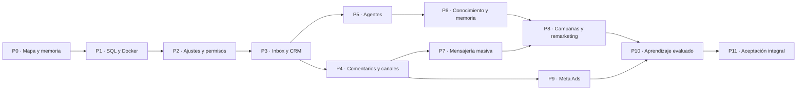

## Estado vigente P11-ES local; puesta institucional pendiente — 2026-10-28

**Roadmap general:93,62%. P11 original:72,50% (2/4criterios); sprint local de operación:100% dentro de su alcance.** Son261/279hitos y45/56criterios aceptados. El general incluye trabajo parcial mediante los56criterios de peso1; no es promedio de fases ni ratio de tests/hitos. Cada respuesta final debe incluir porcentaje general y avance de todas las fases. P12 es la fase adicional solicitada por el usuario para servidor/URLs/puesta online:ejecución0%,sin añadir peso ni duplicar los18hitos originales pendientes. No declarar el roadmap ni P11 institucional al100%.

Aplicación única acumulada:**http://127.0.0.1:4178/#/settings/operations**. Imagen`crm-cbn-workspace:p11es-r3`,digest`sha256:61d11e928e0c64d6fc52535892e418809afa94086a2721eca0e772eb9e17531d`,base`CBN_P11ES_TRIAL_20261028_e0a14ef5`,perfil privado`.local/p11-es/final-runtime`,volumen`crm-cbn-p11-media`. Receta:`docker compose -p crm-cbn-current-p11 -f compose.operations.yaml up -d --pull never`. Credenciales humanas conservadas en`.local/p11-es/ACCESS.txt`;no publicarlas. `.local/current-preview/access.json` ya apunta a P11. P10 original queda detenido como`crm-cbn-preview-p10-preserved`,con base/perfil/imagen/volumen intactos. SIIE Windows,C5/C9 y todas las copias anteriores se conservan.

P11 no añade tablas de dominio ni DDL de arranque:SQL2019,motor15/compat150,TLS/CA/nombre validados,185tablas/330FK/155bindings y30académicas protegidas incluidas en185. Principal y cookie propios. Runtime sin lectura/escritura académica,DDL,administración ni respaldo/restauración. En cada transacción nueva se comprueban identidad/modelo/contexto/diarios/ACL completos;P11 recorre una vez la cadena P5–P10 conservando P3/P4. Sin caché entre peticiones. Mismo perfil sobre imágenes R2/R3 reproduce273→121consultas (160→46dehistoria);los tiempos no son SLA. No editar releases/checkers/grafos anteriores ni`es_schema_catalog_v2.py`.

Ajustes→Operación es sólo lectura con`users.manage`:SQL fresco,ocho consumidores con comprobación por etapa/frescura180s,totales completos de colas y recibo HMAC ligado a base/institución/principal/perfil/release. Liveness no es readiness;Docker usa readiness SQL+workers. El recibo se emite después de recuperar SQL y archivos,no sustituye el ensayo ni rehash continuo del`.bak`. Más de24h se muestra vencido;es alerta local,no RPO institucional. No hay API de backup/restore/migración,borrados ni automatización nueva. La retención conserva todas las copias por instrucción humana.

Ajustes reutiliza recurso ligado a ruta+CSRF+secuencia+ciclo de vida;respuestas tardías no cambian otra sección. Los errores de recarga se muestran conservando borradores,incluso en Shell. Credencial cargando/error no se muestra ausente. Comentarios sigue la capacidad Inbox;Canales se puede administrar mientras su procesamiento está pausado. Navegación usa tokens claros/oscuros Glass,sin rediseño. Proxy propio P11:90s para APIs con varias transacciones acotadas;SQLquery20s/applock15s intactos.

Pasan440backend/354frontend,tipos/lint. Autoridad:150rol/acción,188método/ruta y510CSRF (102escrituras×5roles),55lecturas porrol y extras5. Workers22 en segmentos18+4 tras nuevo login real por confirmación vencida;guard8 incluye corrupción rollback-only de seis diarios sin cambiar185tablas. Son recibos distintos,no sumarlos como tests únicos. UI28rutas/112celdas en segmentos84R2+28R3,siete estados de error/carga/borrador,teclado y smoke final R3. Admisiones muestra integración pendiente:no aceptación académica ni auditoría formal de accesibilidad.

Recuperación de fixture y principal final:backupCOPY_ONLY/CHECKSUM/VERIFYONLY,comparación inicial185tablas,CHECKDB,secretosAccess/C10/Ads autenticados y cuatro archivos privados validados. Tras revocar sesiones/OAuth/autoridad copiada y pausar productores/modelos,171tablas estables conservan huellas. El panel valida el recibo de su propia recuperación. Reinicio real:15checks,misma sesión,182tablas estables y cuatro archivos descargados/verificados porhash. Seis lecturas de mensajes con concurrencia2:4.660–6.909ms;observación local,no carga institucional. Reversión8checks sobre una recuperación P10 NUEVA con imagen congelada;P10 original conserva185tablas. P11 vuelve a4178 con182tablas estables;Session/Audit/RateBucket se excluyen expresamente por ser volátiles.

Se conservan11contactos/11conversaciones/26mensajes,3agentes,5packs,256muestras y4artefactos sintéticos. Modelos restaurados pausados hasta revisión. Cero consentimientos comerciales concedidos,intentos masivos,inscripciones,cuentasAdsconectadas o efectos externos nuevos. Aprendizaje sigue siendo variante logística JSON,con datos numéricos revisados y finalidad explícita;no equivalencia con HistGradientBoosting ni eficacia institucional. Abandono sin evidencia vigente se muestra sin evaluación,no inventar resultados demo. HORARIOSSIIE es un fragmento:no afirmar mapeo completo DBSIIE.

Fallos conservados en`artifacts/p11-es/failures.json`:preparaciones rechazadas,backup concurrente rechazado,primer503deauditoría no reproducido,arnés UI corregido y reversión repetida con volátiles explícitos. Timeout real de mensajes motivó ajustes P11;no se ocultaron intentos ni se debilitaron guardas. Las copias fallidas se conservan:no escoger base por fecha/nombre parecido.

Continuidad:`tasks/p11-es-progress.json`,`tasks/p12-online-backlog.json`,`docs/adaptation/sql/SQL_P11_ES_REVIEW.md`,`P11_OPERATOR_RUNBOOK.md`,`P11_ES_CHECKPOINT.md`,`artifacts/p11-es/criteria-matrix.json`,`docs/adaptation/sql/p11_es_validation.json` y`graphify-out/p11-es/`. Checkoffline:`python -X utf8 -B backend/tools/check_p11_es_checkpoint.py --self-test --replay-parent`;grafo:`python -X utf8 -B backend/tools/p11_es_graphs.py check`. Replay exacto1.769preimágenes P10→P9→P8→P7→P6→P5→P4→preview→P3→P2→P1,sinSQLIO. Siete ZIPinmutables se enlazan sólo trasSHA,no código mutable. Revisiones semánticas son estáticas;tokensUNMEASURED yparserSQLopcional ausente.

No reejecutar preparadores/seeds/calificadores en bases pobladas. El preparador P11 usa P10 como base de fixtures;trabajo futuro debe partir del P11 vigente. El contenedor`crm-cbn-p11-reversal-preserved`,perfil`.local/p11-es/reversal-p10-runtime` yvolumen`crm-cbn-p11-rollback-media` son otra recuperación P10 para ensayo,no el P10 original. Revertir exige detener primero la ocupante de4178,preservar base/perfil/media/recibos y comprobar readiness al regresar. PendienteP12:Linux+DNS/HTTPS,SQL/mapeos completos,appsMeta/TikTok,custodios/retención/RPO-RTO yaceptación institucional. No pedir contraseñas porchat ni fabricar verificación externa.

| Fase | Avance técnico con parcial | Criterios aceptados |
|---|---:|---:|
| P0 | 100,00% | 5/5 |
| P1 | 100,00% | 5/5 |
| P2 | 100,00% | 5/5 |
| P3 | 100,00% | 5/5 |
| P4 | 82,29% | 2/5 |
| P5 | 100,00% | 4/4 |
| P6 | 100,00% | 5/5 |
| P7 | 82,29% | 2/5 |
| P8 | 95,00% | 3/4 |
| P9 | 93,75% | 3/4 |
| P10 | 95,00% | 4/5 |
| P11 | 72,50% | 2/4 |

El 0,00 % online corresponde al último cierre formal de P12. La migración PostgreSQL registra **5 de 8 hitos completos (62,50 %) y tres parciales**. La copia de Oracle tiene 155 tablas tipadas y 48 filas conciliadas, con lectura comprobada de las **155 de 155 tablas (100 %)**. En una copia aislada pasaron **8 de 8 etapas de workers** y **5 de 5 recorridos del ensayo ampliado** de contactos, ajustes, agentes, campañas y masivos con proveedor simulado. El arranque de Coolify y la restauración conciliada pasaron en Oracle. Se verificó conectividad privada y se guardó la URL de PostgreSQL en Coolify. La sincronización se ensayó con datos sintéticos y la captura final está pendiente. Restan las escrituras de los demás módulos, adjuntos salientes, rendimiento comparativo y activación. El roadmap general ponderado sigue en **93,62 %**. [Migración PostgreSQL en Oracle](deployment/postgresql-migration.md)

## P13 · Agentes de venta por programa — 2026-11-16

Ficha por escuela, importación revisable desde una URL y selector de modelos implementados en local. P13 conserva **0 de 4 hitos aceptados** hasta probar y revisar el piloto. El plan vincula a Admisiones con especialistas en Auxiliar de Enfermería y un programa de software y concilia evidencia de Coolify, WhatsApp y Gemini con los hitos pendientes de P4, P7 y P11/P12. [Plan P13 y guía de actualización](adaptation/P13_PROGRAM_SALES_AGENTS.md)

## Historia anterior a P11; prevalece el estado superior

## Estado vigente P10-ES parcial — 2026-10-28

**Roadmap general: 90,23%. P10: 95,00%; cuatro de cinco criterios aceptados localmente y 23 de 24 hitos realizados.** El hito P10.close.m4 exige cerrar P8/P9, que conservan dependencias externas pendientes. No declarar P10 al 100%. Cada cierre debe incluir el porcentaje general y el avance por fase, contando trabajo parcial. El general suma equivalentes realizados en 56 criterios de peso uno y divide por 56; no es un promedio simple de fases ni el ratio de 279 hitos.

La aplicación acumulada sigue en **http://127.0.0.1:4178/#/intelligence**. Imagen `crm-cbn-workspace:p10es-r2`, digest `sha256:d053356e8ea6b5aa23d09ae9422a9e6d1464955748dfc0ca9ce9bcee567e08c1`, base `CBN_P10ES_TRIAL_20261028_014cc86f`, perfil privado `.local/p10-es/final-v2-runtime`, volumen `crm-cbn-p10-media`. Receta: `docker compose -p crm-cbn-current-p10 -f compose.learning.yaml up -d --pull never`. Se mantienen las credenciales humanas; están guardadas privadamente en `.local/p10-es/ACCESS.txt`. P9 R9 queda detenido como `crm-cbn-preview-p9-preserved`, con imagen/base/perfil/volumen intactos. No redirigir SIIE, C5/C9 ni copias anteriores.

Inteligencia integra packs/versiones, autorización por finalidad, muestras revisadas y correcciones append-only, datasets temporales, modelos JSON, evaluación frente a baseline y por segmento, inferencia sombra, deriva, promoción humana y reversión. Son cuatro tareas: prospectos, abandono, seguimiento y anomalías. Las observaciones son numéricas y humanas: se verifica el origen CRM, sujeto y fecha, pero no se reconstruyen automáticamente features históricas desde mensajes. El consentimiento comercial no autoriza entrenamiento. Revocaciones, correcciones o cambios de identidad invalidan usos posteriores afectados sin borrar evidencia.

Se usa regresión logística binaria determinista, identificada como variante institucional; no se afirma equivalencia con el HistGradientBoosting de Scentra. No se carga pickle/joblib ni se añade una red neuronal. Reglas CRM, memoria/ADN, LLM y modelo entrenado permanecen distinguidos. La separación temporal y de sujetos y la normalización sólo de entrenamiento evitan fugas estructurales. Promoción exige evaluación, autoridad reciente y cuatro sujetos distintos en sombra de la revisión actual, con autorizaciones y bindings vigentes. La reversión a un artefacto aprobado sigue disponible al detener nuevos entrenamientos.

SQL Server 2019, motor 15/compatibilidad 150 y TLS validados: **185 tablas, 330 FK y 155 mapeos CRM**, más las 30 tablas académicas protegidas incluidas en el total. Nueve tablas nuevas de dominio y su diario; release congelada `831c4a3f667aa67a94d2b2ae9465be0bbc000388b8b8d40cbd21ec6b4747c67c`. Runtime sin DDL ni acceso académico, con perfil propio, CAS, idempotencia y validación íntegra de modelo/historial/permisos. Un drift real en otra copia es rechazado después de un check válido; no hay caché entre peticiones. No editar releases/checkers/grafos anteriores ni el lector congelado `es_schema_catalog_v2.py`.

Verificación: **419 pruebas backend y 351 frontend**, tipos y lint; P10 aporta 24 puras y nueve UI. Recibos separados: API16, extras15, gates8, almacenamiento12, recuperación8 y fronteras6. El navegador completa 25 checks funcionales y cinco de apariencia/móvil/teclado en segmentos declarados; reinicio real12 conserva la sesión y huellas de 182 tablas. La imagen coincide con 222 archivos de aplicación. No sumar esos recibos heterogéneos como pruebas únicas. Recuperación poblada conserva 171 tablas estables y cuatro blobs privados, autentica secretos existentes y pausa modelos/productores; su snapshot de fixture precede al seed del preview y no acredita efectos posteriores.

El preview conserva 11 contactos, 11 conversaciones, 26 mensajes y las funciones/datos P2–P9. Añade cuatro packs ficticios, 256 muestras y cuatro modelos con 48 muestras de entrenamiento/16 de validación por tarea. Las mejoras medidas son sintéticas, no eficacia institucional real. El navegador añade un quinto pack ficticio vacío, con entrenamiento detenido y autorización ficticia revocada. Cero consentimientos comerciales, intentos, inscripciones, gasto o envíos externos nuevos. Packs/autorizaciones y listados paginan; el catálogo inicial limita contextos CRM y campañas recientes a 200. No afirmar mapeo completo DBSIIE.

Se preservaron fallos de preparación: constraint duplicado corregido antes de congelar; prueba inválida del último propietario sustituida por un usuario de consulta separado; generador demo inicial con grupo incorrecto rechazado y conservado como prototipo `CBN_P10ES_TRIAL_20261028_cea278a8`. No reparar sus muestras inmutables con UPDATE ni apuntar el preview a él. El destino válido es `final-v2`. La revisión semántica es estática; los recibos SQL/API/UI están separados. Tokens no medidos; el parser SQL opcional no está instalado.

Roadmap fijo: **252/279 hitos realizados y 43/56 criterios aceptados**. P4/P7 permanecen en 82,29%, P8 en 95% y P9 en 93,75%; no hay dominio/apps reales de proveedor para cerrar sus dependencias.

| Fase | Avance técnico incluido parcial | Criterios aceptados |
|---|---:|---:|
| P0 | 100,00% | 5/5 |
| P1 | 100,00% | 5/5 |
| P2 | 100,00% | 5/5 |
| P3 | 100,00% | 5/5 |
| P4 | 82,29% | 2/5 |
| P5 | 100,00% | 4/4 |
| P6 | 100,00% | 5/5 |
| P7 | 82,29% | 2/5 |
| P8 | 95,00% | 3/4 |
| P9 | 93,75% | 3/4 |
| P10 | 95,00% | 4/5 |
| P11 | 25,00% | 0/4 |

Continuidad: `tasks/p10-es-progress.json`, `docs/adaptation/sql/SQL_P10_ES_REVIEW.md`, `artifacts/p10-es/acceptance-review.json`, `docs/adaptation/sql/p10_es_validation.json` y `graphify-out/p10-es/`. Check offline: `python -X utf8 -B backend/tools/check_p10_es_checkpoint.py --self-test --replay-parent`; grafo: `python -X utf8 -B backend/tools/p10_es_graphs.py check`. El replay conserva 1660 preimágenes exactas y la cadena P9→P8→P7→P6→P5→P4→preview→P3→P2→P1 sin SQL IO ni modificar checkers anteriores. No reejecutar preparadores, seeds o calificadores sobre copias pobladas.

Revertir: pausar predicción/entrenamiento y seleccionar un artefacto aprobado previo conservando muestras/evaluación. La recuperación crea base/perfil/media nuevos y exige revisión de selecciones pausadas. Para volver a P9, conservar P10/base/volumen, detener P10 e iniciar sólo P9 retenido en 4178. Próximo: aceptación externa cuando existan apps/dominio o P11 bajo una nueva solicitud. Una modificación futura del estimador requiere nueva versión de algoritmo y evaluación; no reinterpretar artefactos existentes.

## Historia anterior a P10; prevalece el estado superior

## Estado vigente P9-ES parcial — 2026-10-27

**Roadmap general:82,46% técnico ponderado, incluido trabajo parcial. P9:93,75%,3/4criterios aceptados;17/18hitos. Pendiente P9.close.m4 por cierre de P4. No declarar100%.** Preferencia humana permanente: cada respuesta final de trabajo debe incluir porcentaje general del roadmap y porcentajes por fase. General=suma de equivalentes realizados en56criterios de peso1 /56; no promedio simple de fases ni ratio de279hitos. Se conservan pesos/textos/denominadores fijos y aceptación separada.

Aplicación única acumulada: **http://127.0.0.1:4178/#/ads**, imagen `crm-cbn-workspace:p9es-r9`, base propia `CBN_P9ES_TRIAL_20261027_94ba4b55`, perfil privado `.local/p9-es/final-runtime`, volumen `crm-cbn-p9-media`, receta `docker compose -p crm-cbn-current-p9 -f compose.ads.yaml up -d --pull never`. Mismas credenciales humanas en `.local/p9-es/ACCESS.txt`, privadas. P8R7 queda detenido como `crm-cbn-preview-p8-preserved`; imagen/base/perfil/volumen/evidencia/grafo intactos. P7/P6/P5/P4/C5/C9 y SIIE no se redirigen.

Publicidad adapta la fuente Scentra real: cuentasMeta/TikTok, campañas y presupuestos/CTR/CPC/leads registrados con período, formularios/leads, comentarios de anuncios,6indicadores y vínculos CRM/Inbox/programa/etapa. La fuente no tiene MarketingAPI HTTP/publicación/gasto: no se inventa sincronización, gasto ni last_sync_at. OAuth continúa en Canales. AdsCreative/ContentStudio/Advisor/WooCommerce/planes/cobros quedan fuera de este dominio. Estados declarados separados de verificación externa; UI conserva estiloCBN y detalles por cuenta.

Recibos C10 firmados vigentes usan cursor propio Ads sin modificar Status/Attempts/Lease C10. Mapeo explícito de anunciante o formulario/campaña único por canal; ambiguos/incompletos/contexto pausado/no verificado/ruta cambiada quedan en cuarentena, con reintentoCAS revisado e historial. NormalizaciónMeta leadgen/directa yTikTok anidada acotada, aliases con ID externo explícito; firma/client_key y fechas desbordadas probadas. Sin segundo reply worker ni productor B011 automático. Formularios crean contexto CRM humano y nota; no fabrican DM, ventana24h, LastIncomingAt ni consentimiento.

Identidad aislada por institución/cuenta/canal; coordenadas útiles sólo dentro de la misma cuenta. Teléfonos inválidos no colapsan personas. Identity/Note/_crm persisten ContactId histórico, lecturas resuelven canonical; conversiones antes/después de merge yundo preservan vínculo. P4/P9 reutilizan autor/contacto/conversación en ambos órdenes, incluso lead previo al primer comentario. Eventos/secretos AES-GCM versionados append-only; acceso sensible exige permisoCanales yautenticación reciente; revocar retira puntero sin borrar versiones.

SQL2019 motor15/compat150/TLS validado:175tablas/304FK/145mapeosCRM+30académicas protegidas. Siete tablasAds+diario propios. Releasev1P9ES-000/001 congelada; extensión aditivav2P9ES-002 añade ignored yCHECKconversión fuerte sin reescribir historial. Runner conapplock/secuencia/drift/fallos/reconciliación; perfilv2 autentica modelo/diario/base/principal/permisos ysecretos. Sin DDL de arranque, acceso académico ni ALTER del diario desde runtime. Mapeos educativos siguen catálogoCRM declarado, no afirmar DBSIIE completo.

395pruebas backend/342frontend, tipos/lint pasan; P9puras34/UI10. API16/Meta14/extras12/TikTok4/storage12/recuperación8 son recibos separados, no suma de pruebas únicas. SQL fallos/concurrencia/drift en4copias propias; conversión/merge/undo/permisos/CSRF/módulo probados. El navegador detectó GETtardío tras navegar: hookAds por vista+CSRF/secuencia/cleanup, guard de editor descartado y generación paraProcesar/Reintentar;3regresiones diferidas. Prueba históricaSettings espera la misma lectura única asíncrona. Contención nativa3checks: bloqueo exclusivo6s; sóloP9 espera15s porapplock, manteniendo SERIALIZABLE/TLS/validaciones/SQLtimeout5s; perfiles anteriores5s. Logging sóloetapa/clase/tag. Recibos visuales yreinicio real se conservan aparte.

Recuperación poblada mantiene162tablas estables, autentica todas versiones Access/C10/Ads, revoca sesiones/OAuth/aprobaciones ypausa cuentas; cuatro blobsprivadosP8 copiados/verificados en nueva raíz. Ese snapshot precede últimas API16/extras12, no afirmar recuperar efectos posteriores al backup. RespaldoSQL no incluye archivos. Reinicio real conserva172tablas estables, sesión, ejemplosAds yblobP8. FuenteP8 y30académicas de su respaldo fresco conservan huellas; WindowsSIIE no se reconsulta ni modifica.

Preview conserva8contextos originales/26mensajes, notas/tareas/comentarios,3agentes yconocimiento/memoria/ADN/ajustes/canales/borradores anteriores. Añade2cuentasAds pausadas/2campañas enborrador/2leads/1comentario etiquetados Ejemplo ficticio y3contextosCRM humanos. Cero consentimientos/inscripciones/intentos/aprobaciones/gasto/envíos externos nuevos. No hay dominio/apps reales: P4/P7siguen82,29%; P8sigue95% y P9cierre dependeP4.

Roadmap fijo: **231/279hitos realizados,48pendientes;39/56criterios aceptados**. Las pruebas locales no sustituyen la aceptación externa ni alteran definiciones para alcanzar100%.

| Fase | Avance técnico incluido parcial | Criterios aceptados |
|---|---:|---:|
| P0 | 100,00% | 5/5 |
| P1 | 100,00% | 5/5 |
| P2 | 100,00% | 5/5 |
| P3 | 100,00% | 5/5 |
| P4 | 82,29% | 2/5 |
| P5 | 100,00% | 4/4 |
| P6 | 100,00% | 5/5 |
| P7 | 82,29% | 2/5 |
| P8 | 95,00% | 3/4 |
| P9 | 93,75% | 3/4 |
| P10 | 8,00% | 0/5 |
| P11 | 25,00% | 0/4 |

Continuidad: `tasks/p9-es-progress.json`, `docs/adaptation/sql/SQL_P9_ES_REVIEW.md`, `artifacts/p9-es/acceptance-review.json`, `docs/adaptation/sql/p9_es_validation.json`, `graphify-out/p9-es/`. Verificadoroffline: `python -X utf8 -B backend/tools/check_p9_es_checkpoint.py --self-test --replay-parent`; grafo: `python -X utf8 -B backend/tools/p9_es_graphs.py check`. Replay P8→P7→P6→P5→P4→preview→P3→P2→P1 desde1562preimágenes exactas, checkers/graphs/releases anteriores intactos. Uso tokens no medido. No reejecutar preparadores/seeds/calificadores sobre copias pobladas.

Reversión: pausar disponibilidad local de la cuenta, conservar IDs externos/captaciones/procesos/eventos, no tocar anuncios reales para revertirUI. Recuperación siempre nueva base/perfil/media y revisión antes de activar. Para volver aP8, conservar primeroP9/base/volumen, detenerP9 y arrancar sóloP8retenido en4178; nunca fusionar efectos inciertos. Próximo: aceptación externaP4 cuando existan apps/dominio; P10requiere nueva autorización.

## Historia anterior a P9; prevalece el estado superior

## Estado vigente P8-ES parcial — 2026-10-27

**P8:95,00% técnico;3/4criterios aceptados (P8.1/P8.2/P8.3). Pendiente P8.close.m5 por cierre real de P7/P4. No declarar100%.** Preview único acumulado: **http://127.0.0.1:4178/#/campaigns**, imagen `crm-cbn-workspace:p8es-r7`, base propia `CBN_P8ES_TRIAL_20261027_1908de72`, perfil privado `.local/p8-es/final-runtime`, receta `docker compose -p crm-cbn-current-p8 -f compose.campaigns.yaml up -d --pull never`, volumen `crm-cbn-p8-media`. Mismas credenciales humanas, guardadas privadamente en `.local/p8-es/ACCESS.txt`. P7 queda detenido como `crm-cbn-preview-p7-preserved` con imagen/base/perfil/volumen intactos. P6/P5/P4/C5/C9 y SIIE no se redirigen.

Campañas, flujos, activadores, segmentos y plantillas CRM funcionan sobre SQL Server2019 con CAS, CSRF, roles, versiones inmutables, copia/restauración revisada y preflight vinculado a sesión/documento. Flujos persistidos de espera/condición/envío, horarios IANA/DST y activadores futuros por mensaje/etapa/programa/inactividad. Identidad canónica, respuesta, consentimiento/no-contactar, rol y control humano se revisan antes de efectos. Pausa/reanudación conserva plazos y partes aceptadas; efectos inciertos nunca se reenvían automáticamente. Una sola cola C10 y dispatcher P7; no arrancar el worker legado de campañas ni B011 automático.

Plantillas CRM admiten bloques texto/enlace/imagen/audio/video/documento, uploads inspeccionados, grabación por gesto, preview/descarga autenticados y demoras persistidas por parte. Caption social es texto independiente; WhatsApp conserva caption de video y nombre editable del documento. Instagram Login usa URL firmada por perfil/institución/cola/media de600s con comprobación de estado, contexto e integridad. Requiere PublicBaseUrl HTTPS institucional. Biblioteca privada y cuota total compartida;5MB/archivo, audio300s, video120s/1920×1080, TikTokimagen3MB+IMAGE_SEND; otros medios TikTok rechazados. La simulación resume pasos, no el cronograma exacto de cada parte. A/B determinista y métricas observadas; respuesta atribuida sólo por contexto explícito, sin conversiones/ganadores inventados.

SQL motor15/compat150/TLS verificado:167tablas totales/284FK/137mapeos CRM+30tablas académicas. Release P8 congelada, seis tablas+diario propios; metadatos media usan Event JSON, sin nueva DDL.361pruebas backend/332frontend, tipos ylint pasan;API16/runtime13/extras6/storage12/recovery9/boundaries3/wait-resync3/media9/caption4/Instagramdelivery6. Espera real2min+reinicio4; navegador20+adjunto3+smoke/reinicio9. Son recibos de alcances distintos, no una suma de pruebas únicas. Runtime13 continúa9 comprobaciones registradas y extras6 continúa5 tras ajustes del calificador. Media9 usó codecR5; correcciones posteriores tienen pruebas actuales361/332 y caption4/delivery6.

Restauración poblada v2 preserva155tablas estables, incertidumbre y11blobs privados en raíz nueva (snapshot anterior a caption/delivery adicionales). El backupSQL solo no contiene archivos. Reinicio real conserva164tablas estables, la sesión y el adjunto demo. Fuente P7 y30tablas académicas de su copia conservan huellas; no se reconsulta Windows SIIE ni se afirma mapa completo DBSIIE. El catálogo usa JOINs de sys.sql_modules/constraints/triggers; no restaurar OBJECT_DEFINITION escalar del código histórico para validación SQL viva.

Preview conserva8contactos/8conversaciones/26mensajes, notas/tareas/comentarios,3agentes y conocimiento/memoria/ADN previos. Añade5registros P8 de ejemplo en borrador y adjuntos ficticios privados; sin inscripciones, consentimiento comercial, intentos o efectos de proveedor. Cuenta pendiente/cadencia deshabilitada. No existen todavía dominio/apps/catálogo/recibos Meta reales; P4 yP7 permanecen82,29% y su aceptación externa no se fabrica.

Roadmap fijo: **215/279hitos realizados,64pendientes;36/56criterios aceptados**. P8 tiene21/22hitos realizados. Su95% sale de3criterios completos+4/5del cierre; se conserva el peso de P8.close.m5. No modificar denominadores ni sustituir aceptación real por fixtures.

| Fase | Avance técnico, incluido parcial | Criterios aceptados |
|---|---:|---:|
| P0 | 100,00% | 5/5 |
| P1 | 100,00% | 5/5 |
| P2 | 100,00% | 5/5 |
| P3 | 100,00% | 5/5 |
| P4 | 82,29% | 2/5 |
| P5 | 100,00% | 4/4 |
| P6 | 100,00% | 5/5 |
| P7 | 82,29% | 2/5 |
| P8 | 95,00% | 3/4 |
| P9 | 6,25% | 0/4 |
| P10 | 8,00% | 0/5 |
| P11 | 25,00% | 0/4 |

Continuidad: `tasks/p8-es-progress.json`, `docs/adaptation/sql/SQL_P8_ES_REVIEW.md`, `artifacts/p8-es/acceptance-review.json`, `docs/adaptation/sql/p8_es_validation.json`, `graphify-out/p8-es/`. Verificador offline: `python -X utf8 -B backend/tools/check_p8_es_checkpoint.py --self-test --replay-parent`; grafo: `python -X utf8 -B backend/tools/p8_es_graphs.py check`. Replay P7→P6→P5→P4→preview→P3→P2→P1 desde1464preimágenes exactas; anteriores grafos/releases/checkers intactos. Uso de tokens no medido. No reejecutar preparadores/seeds/calificadores en copias pobladas.

Revertir: pausar flujo, conservar intentos/aceptación/incertidumbre y restaurar versión como borrador con nueva revisión. Recuperación crea base/perfil/raíz media nuevos y retira sesiones/aprobaciones copiadas. Para volver a P7, conservar primero P8/base/volumen y detener P8 antes de arrancar P7 retenido en4178. Próximo trabajo: aceptación externa P4/P7 cuando existan apps/dominio, o siguiente fase bajo nueva autorización.

## Historia anterior a P8; prevalece el estado superior

## Estado vigente P7-ES parcial — 2026-10-27

**P7:82,29% técnico ponderado;2/5criterios aceptados (P7.2/P7.3). No está cerrada al100%.** Aplicación integrada: **http://127.0.0.1:4178/#/broadcasts**. Imagen `crm-cbn-workspace:p7es-r3`, base propia `CBN_P7ES_TRIAL_20261027_c305e024`, perfil privado `.local/p7-es/final-runtime`, receta `docker compose -p crm-cbn-current-p7 -f compose.broadcast.yaml up -d --pull never`, volumen `crm-cbn-p7-media`. Mismas credenciales humanas conservadas privadamente en `.local/p7-es/ACCESS.txt`. P6 está detenido como `crm-cbn-preview-p6-preserved`, con su base/perfil/imagen/volumen intactos; P5/P4/C5/C9 y SIIE no se redirigen.

Mensajería masiva está integrada con cuentas WhatsApp C10, catálogo/versiones de plantillas, creación a revisión sin aprobación local, cabeceras/pie/botones, variables explícitas, audiencia/consentimiento/no-contactar/deduplicación canónica, zona horaria+UTC, preparación sin IO, pausa/reanudación revisada y cadencia en la frontera real del POST. Una sola cola C10 conserva intentos, aceptación y efectos inciertos. Reintento selectivo sólo para fallo definitivo sin ID proveedor; un merge tras aceptación no permite duplicar a la persona. Catálogo/credencial/contexto/autoridad se vuelven a validar justo antes de enviar. Recibos adelantados se concilian; respuesta atribuida sólo por context.id+cuenta+remitente. Informe/CSV filtrados y paginados en SQL, con cuerpo/fechas observadas y protección de fórmulas. El worker/API legado de campañas y productor automático B011 siguen cerrados.

SQL2019 motor15/compat150/TLS:160tablas (130CRM y30académicas protegidas),266FK/130mapeos,6tablas P7+diario nuevos,3entradas de release congeladas, sin DDL de arranque.322pruebas backend/323frontend, tipos ylint pasan;15checksAPI,22ejecución,6extras,12storage,7recuperación,5catálogo;18navegador+7smoke/reinicio. Son alcances separados, sin sumar como pruebas únicas. Runtime22 continúa14checks ya registrados y extras6 continúa5 tras corregir expectativas del calificador; no son dos ejecuciones completas nuevas. Cero proveedores reales. Catálogo/recibos Meta reales y P4 siguen pendientes; no fabricar aprobación ni reinterpretar hitos para llegar100%.

La calificación de reinicio detectó OBJECT_DEFINITION escalar atascado en validación. Se sustituyó por JOINs equivalentes de módulos/constraints/triggers, probados contra15objetos incluyendo NULL cifrado en FAULT propio. Conserva exactamente el digest del perfil, TLS y todas las validaciones. Se reinició sólo el SQL Docker de copias para retirar el rollback no interrumpible; SIIE Windows no participa. Reinicio real posterior conserva157tablas estables y sesión. Restauración poblada conserva150tablas estables y dos trabajos inciertos; trabajadores nuevos no reencolan ni hacen POST. Fuente P6 coincide con su respaldo fresco y30académicas vacías siguen iguales. No se afirma mapeo completo de DBSIIE ni recuperación de archivos poblados (ready0).

Se conservan8contactos/8conversaciones/26mensajes/8notas/8tareas/3comentarios,3agentes y6registros de conocimiento. P7 añade cuenta ficticia pendiente, campaña y2plantillas de ejemplo en borrador; sin consentimiento, destinatarios, intentos o aprobaciones de proveedor falsos. Cuenta/cadencia/envío permanecen deshabilitados. Guardar agente válido sigue disponible, editar pausado conserva pausa, diagnóstico opcional; fuentes/etapas/acciones sensibles conservan sus controles propios. Memoria/ADN privados y colectivos mantienen el contrato P6.

Roadmap fijo: **201/279hitos realizados,78pendientes;33/56criterios aceptados**. P7.1.m5/m7 requieren catálogo Meta aprobado real; P7.4.m4/m5 requieren recibos externos; P7.close.m5 depende del recorrido completo/P4. No hay dominio/apps reales. El progreso técnico incluye trabajo parcial, sin otorgar crédito canónico a un criterio incompleto.

| Fase | Avance técnico, incluido parcial | Criterios aceptados |
|---|---:|---:|
| P0 | 100,00% | 5/5 |
| P1 | 100,00% | 5/5 |
| P2 | 100,00% | 5/5 |
| P3 | 100,00% | 5/5 |
| P4 | 82,29% | 2/5 |
| P5 | 100,00% | 4/4 |
| P6 | 100,00% | 5/5 |
| P7 | 82,29% | 2/5 |
| P8 | 30,83% | 0/4 |
| P9 | 6,25% | 0/4 |
| P10 | 8,00% | 0/5 |
| P11 | 25,00% | 0/4 |

Continuidad: `tasks/p7-es-progress.json`, `docs/adaptation/sql/SQL_P7_ES_REVIEW.md`, `artifacts/p7-es/acceptance-review.json`, `docs/adaptation/sql/p7_es_validation.json`, `graphify-out/p7-es/`. Verificador offline: `python -X utf8 -B backend/tools/check_p7_es_checkpoint.py --self-test --replay-parent`; grafo: `python -X utf8 -B backend/tools/p7_es_graphs.py check`. No volver a ejecutar preparadores/seeds/calificadores sobre copias pobladas. Replay P6→P5→P4→preview→P3→P2→P1 desde1382preimágenes exactas; verificadores/grafos anteriores intactos, uso de tokens no medido.

Revertir campaña: pausar y conservar intentos/recibos/incertidumbre antes de revisión. Revertir fase: conservar primero P7/base/volumen, detener P7 y arrancar P6 retenido; nunca ambos en4178 ni fusionar efectos inciertos. Próximo trabajo: validación real P4/P7 cuando existan apps/dominio, o P8 bajo nueva autorización.

## Historia anterior a P7; prevalece el estado superior

## Estado vigente P6-ES local — 2026-10-27

**P6:100,00% local,5/5 criterios.** Aplicación integrada: **http://127.0.0.1:4178/#/knowledge**. Imagen `crm-cbn-workspace:p6es-r2`; base propia `CBN_P6ES_TRIAL_20261027_a6fc321d`; perfil privado `.local/p6-es/final-runtime`; mismas credenciales humanas en `.local/p6-es/ACCESS.txt`. Receta vigente: `docker compose -p crm-cbn-current-p6 -f compose.knowledge.yaml up -d --pull never`.

Conocimiento PDF/TXT, citas léxicas con página/versión, fuentes revisadas por ámbito/vigencia/visibilidad, memoria colectiva, ADN institucional y memoria privada del Inbox están integrados. Corrección crea borrador; publicación requiere revisión explícita; archivo retira el contenido; recuperar una versión publicada añade versión e historial. Sólo se reconstruyen índices derivados. Datos «Sólo equipo editor» nunca entran al prompt; hechos privados exigen mensaje entrante/cita literal y quedan ligados a conversación/contexto/revisión. Generic simulator no lee esos hechos. Cambios de memoria/ADN/fuentes o de switches de módulos invalidan contexto y replay confirmado sin segunda inferencia. Confianza editorial0 se conserva al cargar y editar.

Pasan288pruebas backend,316frontend, tipos/lint;45checksAPI,14ejecución,13negativas extra,12storage,5recuperación,5replay/switch/carga;15checks de navegador y5smoke/reinicio. Alcances separados. Tres preguntas educativas sintéticas recuperan fuente esperada en posición1; no mide precisión institucional. Cero proveedores reales. PDF/TXT sin URL remota/OCR/CSV/vectores nuevos. Referencias validadas por ID no equivalen a entailment. Productor automático B011 sigue cerrado.

SQL2019 motor15/compat150 con TLS validado:153tablas,249FK,123mapeos. Release P6 `cf32dcab88a1e0467c5ae58fa2863e16df13ce906d246a3df43ceb8eb311f5ff`,3entradas congeladas. Diario, registro tipado y versiones append-only; sin DDL de arranque. Recuperación conserva148tablas estables; reinicio150. Preservación final compara105tablas heredadas y30académicas vacías contra respaldo fresco de P5. No se consultó de nuevo SIIE Windows ni se modifica su estructura/datos. El catálogo sigue declarado CRM, sin afirmar mapeo completo de DBSIIE. Volumen P6 propio con0blobsready; no afirmar recuperación de archivos poblados.

P5 queda detenido en `crm-cbn-preview-p5-preserved`, con imagen/base/perfil/volumen intactos. P4,C5,C9 y demás checkpoints preservados. Para revertir fase: detener P6, conservar primero su base/historial/volumen y arrancar el contenedor P5 retenido; nunca simultáneamente en4178 ni fusionando efectos inciertos. Se conservan8contactos/8conversaciones/26mensajes/8notas/8tareas/3comentarios y3agentes educativos. P6 añade fuentes, criterio colectivo y ADN ficticios; navegador añade guías de ejemplo. La pausa del agente de programa se conserva, sin activar al descendiente para la demostración. Guardar perfil válido sigue disponible, editar pausado conserva pausa, diagnóstico opcional; fuentes/etapas/acciones sensibles mantienen controles propios.

Roadmap fijo: **189/279hitos realizados,90pendientes;31/56criterios aceptados**. Pesos/textos conservados. **P4 sigue82,29%** por aceptación externa pendiente; próxima fase **P7 Mensajería masiva**.

| Fase | Avance técnico, incluido parcial | Criterios aceptados |
|---|---:|---:|
| P0 | 100,00% | 5/5 |
| P1 | 100,00% | 5/5 |
| P2 | 100,00% | 5/5 |
| P3 | 100,00% | 5/5 |
| P4 | 82,29% | 2/5 |
| P5 | 100,00% | 4/4 |
| P6 | 100,00% | 5/5 |
| P7 | 38,57% | 0/5 |
| P8 | 30,83% | 0/4 |
| P9 | 6,25% | 0/4 |
| P10 | 8,00% | 0/5 |
| P11 | 25,00% | 0/4 |

Continuidad: `tasks/p6-es-progress.json`, `docs/adaptation/sql/SQL_P6_ES_REVIEW.md`, `artifacts/p6-es/acceptance-review.json`, `docs/adaptation/sql/p6_es_validation.json`, `graphify-out/p6-es/`. Verificación **offline**: `python -X utf8 -B backend/tools/check_p6_es_checkpoint.py --self-test --replay-parent`; grafo: `python -X utf8 -B backend/tools/p6_es_graphs.py check`. No volver a ejecutar preparadores, seeds ni calificadores SQL sobre copias pobladas. Replay P5→P4→preview→P3→P2→P1 desde1304preimágenes exactas; ningún verificador padre modificado. Tres referencias históricas conservan bytes/SHA en `docs/adaptation/history/p6-predecessors/`. Grafos anteriores congelados; uso de tokens no medido.

## Historia anterior a P6; prevalece el estado superior

## Estado vigente P5-ES local — 2026-10-27

P5 cerrada al **100,00% local,4/4 criterios canónicos**. Un solo CRM CBN integrado: **http://127.0.0.1:4178/#/agents**. Imagen `crm-cbn-workspace:p5es-r5`, base propia `CBN_P5ES_TRIAL_20261027_13990dac`, perfil privado `.local/p5-es/final-runtime`, acceso `.local/p5-es/ACCESS.txt` con las mismas credenciales humanas. Receta vigente: `docker compose -p crm-cbn-current-p5 -f compose.agents.yaml up -d --pull never`. P4 conserva imagen/base/perfil/volumen y contenedor detenido `crm-cbn-preview-p4-preserved`; P3 y los demás checkpoints siguen conservados. No iniciar sus recetas simultáneamente en4178.

Constructor, jerarquía orientador→programa→etapa, personalidad/instrucciones/variables/reglas/objetivos/herramientas/canales, modelos/fallback/cuotas por perfil, diagnóstico opcional, archivo/restauración/versiones y asignación desde el Inbox real están integrados. Guardar válido deja disponible; editar pausado conserva pausa. Etapas, fuentes y acciones sensibles mantienen sus controles separados. Simulación fija agente/versión; actor/nonce/hash/lease evita doble inferencia. Handoff, pausa y epoch invalidan resultados y envíos antiguos. No se activa IA automática por guardar ni se monta el productor B011; una sola outbox C10. Restaurar configuración crea versión nueva en pausa y conserva memoria, historial y asignaciones.

Se conservaron8contactos/8conversaciones/26mensajes/8notas/8tareas y3comentarios, y se añadieron3perfiles educativos y1etapa de ejemplo persistidos. El modelo de ejemplo bloquea IO; la prueba de navegador dejó el agente de programa pausado para revisión. El catálogo nuevo es declarado CRM, con ejemplos marcados sintéticos; no representa oferta académica SIIE validada. Vincular solicitud/período sigue cerrado hasta revisar el mapeo real. Publicación/administración/reindexación de conocimiento pertenece a P6; P5 sí aplica ámbito, responsable, vigencia y revisión al recuperar fuentes.

Pasan242pruebas backend,311frontend, tipos y lint(exit0,1warning histórico de cleanupEpoch),19checks de navegador y smoke tras reinicio;8constructor/API,22ejecución,18ciclo/fuentes/handoff,28C10/dispatch,8archivo/tarea/techos,3replay de contexto,10storage y5recuperación. Los conteos son alcances separados. Cero llamadas a proveedores reales: las inferencias y transportes de calificación son controlados. No hay dominio/apps reales; **P4 permanece82,29%**, sin aceptar recepción/OAuth/envío externo por esta fase.

Release P5 `9046a8c33a3bbbb9d874ba0fc5451e3db5815c9afcc9b6552aabb6b0d2a2793a`:3entradas congeladas,150tablas,242FK,120mapeos. Se conservan14entradas P2 y releases P3/P4. Se comprobaron106tablas de negocio heredadas y30académicas vacías entre fuente/respaldo/P5; no hubo nueva consulta a SIIE Windows. Recuperación conserva145tablas estables, autentica vault y retira sesiones copiadas; reinicio conserva147tablas estables y sesión. La fuente y destino finales tienen0blobsready: volumen propio y copia vacía verificados, sin afirmar ensayo P5 de archivos poblados. Fuente P4 intacta frente a respaldo fresco.

El ledger conserva pesos y textos: **170/279 hitos done,109pending;26/56criterios aceptados**. Los porcentajes incluyen trabajo parcial, no horas ni producción externa.

| Fase | Avance técnico con trabajo parcial | Criterios aceptados |
|---|---:|---:|
| P0 | 100,00% | 5/5 |
| P1 | 100,00% | 5/5 |
| P2 | 100,00% | 5/5 |
| P3 | 100,00% | 5/5 |
| P4 | 82,29% | 2/5 |
| P5 | 100,00% | 4/4 |
| P6 | 33,90% | 0/5 |
| P7 | 38,57% | 0/5 |
| P8 | 30,83% | 0/4 |
| P9 | 6,25% | 0/4 |
| P10 | 8,00% | 0/5 |
| P11 | 25,00% | 0/4 |

Evidencia: `docs/adaptation/sql/SQL_P5_ES_REVIEW.md`, `artifacts/p5-es/acceptance-review.json`, `docs/adaptation/sql/p5_es_validation.json`, `tasks/p5-es-progress.json` y `graphify-out/p5-es/`. Retomar con `python -X utf8 -B backend/tools/check_p5_es_checkpoint.py --self-test --replay-parent` y `python -X utf8 -B backend/tools/p5_es_graphs.py check`, offline; nunca con preparadores/seeds/calificadores SQL automáticos. Replay transitorio P4→preview→P3→P2→P1 desde1225preimágenes exactas, sin modificar verificadores. Cinco referencias históricas a dos fuentes cambiadas conservan sus bytes/SHA en `docs/adaptation/history/p5-predecessors/`; la evidencia P5 actual está separada. El replay usa un directorio privado persistente del helper para evitar llenar su tmpfs.

Para revertir un perfil: restaurar versión en pausa y revisar permisos descendientes antes de reanudar. Para volver a P4: pausar entrada/salida, conservar base/solicitudes/colas/volumen P5, detener P5 e iniciar el contenedor P4 conservado. No reparentar datos posteriores ni reenviar efectos inciertos. Siguiente: P6; las validaciones externas P4 necesitan dominio/apps/cuentas reales y conservan sus pendientes.

## Historia preservada anterior a P5

## Estado vigente P4-ES local — 2026-10-27

Un solo CRM CBN integrado: **http://127.0.0.1:4178/#/comments**. Imagen `crm-cbn-workspace:p4es-r3`, base propia `CBN_P4ES_TRIAL_20261026_a8ef717a`, perfil privado `.local/p4-es/final-runtime`, acceso `.local/p4-es/ACCESS.txt` con las mismas credenciales humanas. Receta vigente: `docker compose -p crm-cbn-current-p4 -f compose.channels.yaml up -d --pull never`. La copia P3 demo conserva base/perfil/imagen y contenedor detenido `crm-cbn-preview-p3-demo-preserved`; no levantar simultáneamente las recetas históricas en4178.

Canales por cuenta, callbacks/verify token generados por la aplicación, vault C10, OAuth provisional/selección/verificación, comentarios/filtros/estados/conversión/IA humana y una outbox C10 están integrados con SQL2019. Se conservan los8contactos/8conversaciones/26mensajes/8notas/8tareas demo y se agregan3comentarios ficticios con1cuenta pausada sin egress. Los ejemplos bloquean efectos externos. No hay dominio ni apps de proveedor: **P4 no está al100%**. TikTok Login Kit sólo identidad; Business OAuth/renovación y aceptación real por canal siguen pendientes. Cookie Secure/origen humano/proxy HTTPS se deben calificar bajo el dominio real antes de usar OAuth externo.

P4=**82,29%** técnico,2/5 criterios locales aceptados; P4.3.m6/m7, P4.4.m4/m5 y P4.close.m5 pendientes. Totales158hitos done/121pending sobre279,22criterios/56. Se conservaron textos y pesos fijos; los porcentajes no son horas ni aceptación institucional. P0–P3 permanecen100%. El avance parcial de las demás fases no se borró.

| Fase | Avance técnico con trabajo parcial | Criterios aceptados |
|---|---:|---:|
| P0 | 100,00% | 5/5 |
| P1 | 100,00% | 5/5 |
| P2 | 100,00% | 5/5 |
| P3 | 100,00% | 5/5 |
| P4 | 82,29% | 2/5 |
| P5 | 45,00% | 0/4 |
| P6 | 33,90% | 0/5 |
| P7 | 38,57% | 0/5 |
| P8 | 30,83% | 0/4 |
| P9 | 6,25% | 0/4 |
| P10 | 8,00% | 0/5 |
| P11 | 25,00% | 0/4 |

Evidencia: `docs/adaptation/sql/SQL_P4_ES_REVIEW.md`, `artifacts/p4-es/acceptance-review.json`, `tasks/p4-es-progress.json`, `docs/adaptation/sql/p4_es_validation.json` y `graphify-out/p4-es/`. Pruebas170backend,299/306frontend (7fallos previos de agentes reproducidos en preimágenes),4nuevasUI,15checks navegador,13eventos/medios/pausa,23comentarios/IA/medios,9recuperación,26API,3límites Unicode,7storage y2drift; los conteos son alcances separados, no capacidades únicas. Las notas largas respetan2000unidadesUTF16 y conservan íntegro el comentario original. Reinicio conserva142tablas de negocio y la sesión sigue válida al reemplazar la imagen.

Preservación:107tablas de negocio de la fuente comparadas con backup fresco;30tablas académicas vacías coinciden en respaldo/fuente/P4. No se afirma nuevo fingerprint de filas de HORARIOSSIIE Windows ni de todas las copias: no se escribieron ni redirigieron. Release P4 `fd247602e95f7756deb77c7a71dfd53bf4b18f56eb555c499c1cc69a8d438e5b`,147tablas/236FK/117mapeos. Las14entradas P2 y3P3, los grafos y verificadores anteriores se conservan. Replay offline PREVIEW→P3→P2→P1 desde1128preimágenes públicas sin debilitar checks; Linux evita rutas Windows anidadas largas.

Retomar sólo con `python -X utf8 -B backend/tools/check_p4_es_checkpoint.py --self-test --replay-parent` y `python -X utf8 -B backend/tools/p4_es_graphs.py check`. El replay usa únicamente archivos en el helper Docker, sin SQL. No ejecutar preparadores/calificadores/seed por consultar memoria ni en el arranque. No editar releases, ampliar tickets antiguos, vaciar colas ni reenviar POST inciertos. Para revertir: pausar entrada/salida, conservar base/cola/eventos/volumen P4, detener P4 e iniciar el contenedor P3 conservado; nunca reparentar datos/secretos P4 sobre P3. Los siguientes pasos externos requieren dominio/apps/permisos reales; la infraestructura local por sí sola no los acepta.

## Historia preservada anterior a P4

# Roadmap de adaptación de Scentra a CRM CBN

## Preview actual único con datos demo — 2026-10-26

Se desarrolla un solo CRM CBN. La dirección de trabajo es **http://127.0.0.1:4178/#/inbox** y ahora muestra datos ficticios persistidos en SQL Server 2019: 8 contactos, 8 conversaciones, 26 mensajes, 8 notas y 8 tareas. Usa exactamente la imagen P3 R6 ya aceptada; integra usuarios/permisos/ajustes de P2, Inbox/CRM/mini CRM/riesgo de P3 y la configuración de Canales disponible. Las fases parciales todavía incluyen contratos/código/pruebas que no equivalen a una función operativa completa.

La copia demo es `CBN_P3ES_TRIAL_20261026_f6b6fa1f`, con perfil y principal propios. La copia limpia P3 `CBN_P3ES_TRIAL_20261026_606a9bec`, su perfil y su contenedor quedan conservados; sólo su contenedor se detuvo para liberar el puerto. No ejecutar simultáneamente compose.workspace.yaml y compose.preview.yaml en 4178. La receta vigente es `docker compose -p crm-cbn-current -f compose.preview.yaml up -d --pull never`. Acceso privado en `.local/current-preview/ACCESS.txt`; correo y contraseña se conservan. La sesión anterior requiere nuevo login en la copia demo.

Los otros puertos son checkpoints históricos conservados, no productos que se desarrollen por separado. En las próximas fases se promoverá la aplicación integrada al mismo 4178, preservando los datos demo mediante copia/migración revisada; no reiniciar los seeds ni dar al usuario otro puerto por cada fase. SIIE y las copias anteriores permanecen fuera del seed; no hay envíos reales. El ejemplo de riesgo es sintético y vence con la frescura normal de 24 horas; una evaluación obsoleta vuelve a «Sin evaluación».

La demostración facilita revisar lo ya integrado y no añade crédito artificial al roadmap: 147/279 hitos y 20/56 criterios; porcentajes sin cambios.

| Fase | Progreso técnico | Criterios aceptados |
|---|---:|---:|
| P0 | 100,00% | 5/5 |
| P1 | 100,00% | 5/5 |
| P2 | 100,00% | 5/5 |
| P3 | 100,00% | 5/5 |
| P4 | 38,29% | 0/5 |
| P5 | 45,00% | 0/4 |
| P6 | 33,90% | 0/5 |
| P7 | 38,57% | 0/5 |
| P8 | 30,83% | 0/4 |
| P9 | 6,25% | 0/4 |
| P10 | 8,00% | 0/5 |
| P11 | 25,00% | 0/4 |

Detalle vigente: `docs/adaptation/PREVIEW_STATUS.md`, `tasks/current-preview.json` y `graphify-out/current-preview/`. Retomar con `python -B backend/tools/check_current_preview.py --self-test --replay-parent`, offline. Verifica las transiciones de memoria y reproduce P3/P2/P1 congelados; no cambiar sus hashes para aceptar documentos actuales.

## Histórico anterior al preview demo

## Estado vigente P3-ES — 2026-10-26

P3 está cerrada al 100,00% en el alcance canónico local de Inbox, mini CRM, CRM y superficie de riesgo sobre SQL Server 2019. La ficha editable es única, las consultas filtran en SQL antes de paginar y conservan borradores, asignación humana, lectura observada, CAS y reintentos. Notas, tareas, actividad y unificación reversible mantienen el origen institucional. Riesgo por reglas, interés manual y SLA son independientes; evidencia inválida muestra «Sin evaluación». P10 conserva la inferencia entrenada y P5 la asignación/ejecución de agentes IA. Las tareas locales tienen título, fecha, prioridad, responsable y tres estados; no se afirma paridad literal de cada campo Scentra.

Preview general limpio: `http://127. 0. 0. 1:4178/`, base `CBN_P3ES_TRIAL_20261026_606a9bec`, perfil propio revisión 2 y una cuenta propietaria sin fixtures. Acceso humano sólo en `.local/p3-es/ACCESS.txt` con ACL del usuario y SYSTEM. 4177 sigue P2 y4173/4176 sus copias anteriores. Se verificaron intactas6 bases Windows y77 copias SQL2019 anteriores; sin DDL/DML académico, redirección de perfiles ni proveedores.

Release P3 `7d4c3f55654d8d683246c2cd2547d29da5274825170f304b2c6b069e914d379b`:6 tablas nuevas,144 totales,229 FK y114 mapeos; 3 entradas congeladas. No editarlo ni repetir preparadores sobre destinos poblados. Pasaron127 pruebas backend,81 frontend,25 checks SQL/API base,16 únicos de riesgo/17 instancias y24 checks finales de consultas/anclas/umbral74–75. Navegador:12 checks de ficha, reintento tras respuesta perdida, tres paneles, móvil y teclado; 8 checks de perfil limpio y sesión conservada tras reemplazar la aplicación. Tres fallos de migración, concurrencia, restore nativo poblado con2 cuentas/secretos, cuatro denegaciones SQL y persistencia de15 tablas pasaron. Las suites base y las ampliaciones finales conservan sus fuentes y alcances en la revisión.

Hay147 hitos completados/132pendientes sobre279 y20 criterios aceptados/56. Los porcentajes incluyen trabajo parcial con pesos fijos; no son horas, funciones utilizables ni aceptación de producción institucional.

| Fase | Avance técnico con trabajo parcial | Criterios aceptados |
|---|---:|---:|
| P0 | 100,00% | 5/5 |
| P1 | 100,00% | 5/5 |
| P2 | 100,00% | 5/5 |
| P3 | 100,00% | 5/5 |
| P4 | 38,29% | 0/5 |
| P5 | 45,00% | 0/4 |
| P6 | 33,90% | 0/5 |
| P7 | 38,57% | 0/5 |
| P8 | 30,83% | 0/4 |
| P9 | 6,25% | 0/4 |
| P10 | 8,00% | 0/5 |
| P11 | 25,00% | 0/4 |

Evidencia actual: `docs/adaptation/sql/SQL_P3_ES_REVIEW.md`, `docs/adaptation/sql/p3_es_validation.json`, `artifacts/p3-es/acceptance-review.json`, `tasks/p3-es-progress.json` y `graphify-out/p3-es/`. Verificador offline: `python -B backend/tools/check_p3_es_checkpoint.py --self-test`; reproduce los checkers P2/P1 congelados en carpetas nuevas con993 preimágenes y dependencias públicas verificadas por sus hashes originales. No ajustar los hashes de P1/P2 al código P3.

Siguiente: P4, comentarios, canales y webhooks, con la paridad de campos/acciones de Scentra y SQL Server. Conservar SIIE, C5/C9/C13, releases/imágenes/perfiles P1/P2/P3 y sus grafos. El arranque no ejecuta DDL; la devolución al consumidor anterior conserva su propia base y puerto y nunca borra/reparenta datos P3. No ejecutar calificadores para consultar memoria; empezar por checks offline. Proveedores/recepción pública/transporte, campañas, Ads, agentes/memoria operativos y puesta en servicio mantienen sus fases.

## Histórico anterior a P3-ES

## Estado vigente P2-ES — 2026-10-26

P2 está cerrada al 100,00% en administración institucional local sobre SQL Server 2019. Se integraron esquema español, perfil propio, usuarios/permisos/sesiones/MFA, ajustes tipados y UI Glass independiente. El preview limpio está en `http://127.0.0.1:4177/`, sobre `CBN_P2ES_TRIAL_20261026_13f95607`; tiene una cuenta propietaria y cero fixtures. Acceso sólo en `.local/p2-es/ACCESS.txt`, protegido por ACL del usuario y SYSTEM. Sin DDL/DML académico, cambios a SIIE ni redirección de copias anteriores.

Hay 138 tablas, 108 mapeos y 221 relaciones físicas. Release P2 comprometido SHA `1a7ba0dc7435e1e5dd61b431cca7f2164d698d4b4b6df9dd53cd66e8b40b10b4`: 14 entradas congeladas, dos unidades y repetición NOOP. No editar sus entradas/diario ni repetir preparadores sobre destinos poblados. Reinicio, restauración poblada de nueve cuentas, MFA/anti-replay y consumidor anterior compatible pasaron. Se conservaron 6 bases Windows y 56 copias SQL Server 2019 previas. 91 pruebas backend, 72 frontend y verificaciones SQL/navegador aprobadas. Las fuentes P1 originales se reproducen desde preimágenes; su checker no se relaja para el código P2.

Los porcentajes cuentan trabajo parcial con pesos fijos: 129 hitos done/150 pending sobre 279, y 15 criterios aceptados/56. P4.3.m5 suma configuración de Canales; P4 pasa a 38,29% sin aceptar proveedores. OAuth, números/tokens externos, webhooks públicos, campañas/envíos, Ads, agentes/memoria operativos, churn y puesta en servicio institucional mantienen sus fases pendientes. No confundir P2 local con producción institucional.

| Fase | Avance técnico con trabajo parcial | Criterios aceptados |
|---|---:|---:|
| P0 | 100,00% | 5/5 |
| P1 | 100,00% | 5/5 |
| P2 | 100,00% | 5/5 |
| P3 | 34,67% | 0/5 |
| P4 | 38,29% | 0/5 |
| P5 | 45,00% | 0/4 |
| P6 | 33,90% | 0/5 |
| P7 | 38,57% | 0/5 |
| P8 | 30,83% | 0/4 |
| P9 | 6,25% | 0/4 |
| P10 | 8,00% | 0/5 |
| P11 | 25,00% | 0/4 |

Ver `docs/adaptation/sql/SQL_P2_ES_REVIEW.md`, `docs/adaptation/sql/p2_es_validation.json`, `artifacts/p2-es/acceptance-review.json`, `docs/adaptation/phase-work-progress.json`, `graphify-out/p2-es/` y `tasks/p2-es-progress.json`. Check actual sin SQL: `python -B backend/tools/check_p2_es_checkpoint.py --self-test`; reproduce P1 en copia aislada. No ejecutar el checker P1 congelado contra archivos actuales y después cambiar sus hashes para hacerlo pasar.

Siguiente fase: P3, Inbox/mini CRM/CRM, filtros antes de paginar y churn/riesgos unificados, sobre una copia propia. Comenzar por comprobaciones offline; los scripts de calificación no son comandos de arranque ni preparadores idempotentes del producto.

## Histórico anterior a este cierre

## Seguimiento vigente P1-ES — 2026-10-26

**P1 = 100% técnico**, aceptado en SQL Server 2019 real con un release nuevo de 98 tablas más diario, restauración previa, negativos, drift, conflictos, reintento, recuperación, reversión y reinicio. Fuentes académicas y previews anteriores intactos. P2 continúa en implementación; el esquema español no redirige automáticamente repositorios o perfiles actuales.

El porcentaje principal mide trabajo técnico documentado, incluyendo lo parcial. Se desglosan los 56 criterios canónicos en 279 hitos binarios con pesos fijos: cada criterio conserva peso 1 y sus hitos suman 1. Un hito suma sólo con evidencia revisada; código, prueba pura, SQL, UI y aceptación conservan alcances diferentes. Se usan fracciones exactas y dos decimales para presentar. No mide horas, porcentaje exacto de funciones utilizables ni preparación para producción. La aceptación completa queda en una columna separada; sus dependencias siguen siendo obligatorias.

**Avance vigente:** P0 100,00%; P1 100,00%; P2 48,67%; P3 34,67%; P4 35,43%; P5 45,00%; P6 33,90%; P7 38,57%; P8 30,83%; P9 6,25%; P10 8,00%; P11 25,00%.

[Tabla y pendientes por fase](ADAPTATION_STATUS.md) · [Detalle de los 56 criterios](adaptation/WORK_PROGRESS.md) · [279 hitos con evidencia](adaptation/phase-work-progress.json) · [Informe P1](adaptation/sql/SQL_P1_ES_REVIEW.md).

Siguiente: P2, integrar migración de acceso y perfil propios, sesiones/roles/permisos/ajustes con SQL real, después interfaz completa y pruebas de navegador. Decidir explícitamente el enlace del nuevo namespace español; no basta sustituir nombres en los perfiles anteriores. Mantener la jerarquía educativa, el estilo CBN y los campos/acciones de Scentra. La interfaz final debe omitir rótulos de ensayo y códigos internos; todavía no hay una UI P2 nueva publicada.

Actualizar estos registros y mostrar porcentajes de todas las fases al finalizar cada entrega. La petición más reciente del propietario autoriza contar trabajo parcial; los porcentajes antiguos que siguen describen únicamente cierres en cada corte histórico. Los textos/IDs y pesos de las 44 unidades y 12 cierres canónicos se conservan exactos.

## Historia de cortes anteriores

## Estado vigente SQL-C13 — 2026-10-25

SQL-C13 integra el preview general independiente en `http://127.0.0.1:4176/`, sobre `CBN_C13_TRIAL_20261025_1f10a824` restaurada de C12, con perfil cifrado y principal propios. Muestra 14 secciones: CRM/Inbox/mini CRM/Ajustes CRM locales, Canales en lectura segura y pendientes explícitos. C5 (4173), C9 (4175), SIIE, C11 y C12 se conservan, igual que las 50 tablas/44.180 filas académicas y el diario de 17 entradas. Sin DDL, DML académico ni proveedores. Pasan 265 pruebas backend (23 nuevas), 52 frontend (11 nuevas), 25 checks HTTP, 15 SQL y 16 Docker/worker local durable. La imagen autónoma oficial, volúmenes, healthcheck y recuperación por SIGKILL cierran el sprint P1.4. Los workers de fallo quedan detenidos y sus contenedores conservados. TLS permanece verificado.

Siguiente sprint **P2.1**: contrato de ajustes, identidad y permisos institucionales en otra copia de ensayo. El propietario autorizó cerrar el sprint más cercano y continuar con P2 si HORARIOSSIIE resulta insuficiente. P1.close sigue pendiente de un ensayo real en SQL Server 2019; el motor local es SQL2022 Express/160. Los 22 enlaces académicos C13 son candidatos sin aceptación ni aliases activos; confirmar tablas, columnas, tipos, claves y significado antes de habilitarlos. Conservar campos/acciones Scentra; UI completa de Canales, OAuth, secretos operativos y proveedores mantienen sus pendientes. No redirigir C5/C9, repetir preparadores ni conectar SQL automáticamente al retomar; comenzar por checks offline.

C13/P1.4 = 100% del sprint; P0 = 5/5 (100%); P1 = 4/5 (80%); P2–P11 = 0% de cierres, con avances parciales conservados. Los porcentajes cuentan criterios aceptados, no funciones ni horas.

[estado por fase](ADAPTATION_STATUS.md), [informe C13](adaptation/sql/SQL_C13_REVIEW.md), [evidencia C13](adaptation/sql/sql_c13_validation.json), [seis entregables C13](../tasks/sql-c13-progress.json). Checks: `python -B backend/tools/adaptation_graphs.py --check` y `python -B backend/tools/check_general_progress.py --self-test`.

## Estado vigente SQL-C12 — 2026-10-25

SQL-C12 integrada sólo en `CBN_C12_TRIAL_20261025_7a309d11`:23 bindings B011, dos secretos recifrados y en estado staged, etapas B006 vinculadas y API/perfil propios con68 GRANT y siete DENY. Recibo heredado en cuarentena; cola sin ruta registrada para revisión, sin SendJob ficticio. Se conservan SIIE/C5/C9/C11 y las65 tablas anteriores de C12 (50 académicas/44.180 filas, 203 foundation, 23 B011, diario 17). Pasan42 pruebas C12 y200 regresiones,47 comprobaciones SQL/API, 15 escenarios de fallos/drift/recuperación y dos rollbacks de importación. No se montó un listener/preview nuevo;4173 = C5 y 4175 = C9. TLS verificado. SQL2022 Express/160 local no acredita SQL2019 institucional.

Siguiente unidad propuesta **SQL-C13**: composición general separada para reunir capacidades aceptadas y mostrar los pendientes con perfil/ACL/ticket nuevos; mantener campos/acciones Scentra. P2, confirmación de contraseña, OAuth, reemplazo operativo de secretos, recepción pública, cuotas, proveedores y workers siguen pendientes. No redirigir C5/C9 ni ejecutar sus preparadores sobre datos poblados. Retomar sólo con checks offline de grafos y medición, no con harness SQL automático.

Porcentajes por criterios canónicos completos: P0 = 5/5 (100%); P1 = 3/5 (60%); P2–P11 = 0% de cierres, con avances parciales conservados. No son porcentajes de funciones ni de horas.

[estado y porcentajes por fase](ADAPTATION_STATUS.md), [informe C12](adaptation/sql/SQL_C12_REVIEW.md), [evidencia](adaptation/sql/sql_c12_validation.json), [seis entregables C12](../tasks/sql-c12-progress.json). Checks: `python -B backend/tools/adaptation_graphs.py --check` y `python -B backend/tools/check_phase_progress.py --self-test`.

## Estado vigente SQL-C11 — 2026-10-25

SQL-C11 implementada y ensayada sólo en restauraciones independientes. Release CBN-channels-parity-v1 SHA f5200dad…; copia principal `CBN_C11_TRIAL_20261025_d30e2cb2`: 24 tablas nuevas / 343 columnas / 78 FK / 79 CHECK, 89 tablas en total. Diario de 7 a 17 entradas preservando las siete previas. SIIE, C5 y C9 conservan catálogo completo y firmas binarias; 50 tablas/44.180 filas académicas, 203 filas foundation y 23 B011 (226 CRM en conjunto). 39 pruebas offline, 32 negativos y cuatro positivos SQL, 21 escenarios de fallos/drift y recuperación desde respaldo aprobados. TLS conserva validación; sin cambios de UI, workers o proveedores. El motor ensayado es SQL2022 Express/160, no aceptación institucional SQL2019.

Siguiente unidad propuesta **SQL-C12**: correspondencias B011 y repositorios/API nuevos con perfil propio. No inventar App IDs ni copiar ciphertext sin clave verificada y recifrado. Los 23 registros B011 siguen intactos, sin promoción a las tablas nuevas. P2/usuarios, UI completa, cuotas/OAuth/HMAC transaccionales, proveedores y SQL2019 institucional mantienen sus aceptaciones. Después, integrar un preview general separado: 4173 sigue C5 (Resumen/CRM/Inbox/Ajustes); 4175 sigue C9 (sólo Canales). No redirigir tickets, reaplicar unidades o modificar releases anteriores para hacer que una composición acepte el esquema nuevo.

[qué está listo, qué falta y acceso a previews](ADAPTATION_STATUS.md), [informe C11](adaptation/sql/SQL_C11_REVIEW.md), [evidencia](adaptation/sql/sql_c11_validation.json), [progreso por fase](../tasks/sql-c11-progress.json). Retomar con `python -B backend/tools/adaptation_graphs.py --check`, offline. No ejecutar el harness SQL para comprobar memoria. C10 y sus controles permanecen congelados.

## Checkpoint vigente SQL-C10 — 2026-10-25

SQL-C10 definida y verificada sólo offline. Canales debe pedir los mismos campos y acciones de Scentra, incluidos número, token, PIN, OAuth, secretos, TikTok y Webhooks, conservando el estilo CBN y SQL Server2019. Matriz vinculante de115 contextos de campos/salidas y83 instancias de acciones, no capacidades únicas. Modelo declarativo de24 tablas nuevas,78FK y cinco unidades CBN-CHP001–005; sin DDL emitido/compilado ni migraciones. PIN/contraseña efímeros, secretos AES-GCM por propietario/versión, OAuth de un uso, varias cuentas con ID explícito y recepción firmada antes del ACK. Los contadores B013/dead-letter sin contrato muestran no disponible, nunca cero ficticio. No hubo conexión SQL, cambios de runtime/UI, Docker, proveedores o workers; SIIE/C5/C9 no se tocaron. La preservación conectada anterior es evidencia C9, no una nueva consulta C10. 627 preimágenes verificadas,52 diseños inválidos y53 transiciones históricas rechazados; Ruff aprobado. P0 completa; P1/P4 en curso; demás fases conservan sus pendientes. La aceptación institucional SQL2019 sigue pendiente.

Siguiente unidad propuesta **SQL-C11**: implementar y ensayar el release nuevo en otra restauración independiente, con catálogo/ACL/perfil/ticket propios, diario conservado, correspondencias B011 y pruebas de fallos/reversión. No ampliar tickets C5/C8/C9 ni ejecutar 015 histórico directamente. UI completa, autenticación P2, credenciales/proveedores y operación real mantienen sus puertas separadas; no se activan por tener un contrato. El backend Scentra observado sólo permite una integración por tenant/proveedor/canal: multicuenta WhatsApp es la ampliación humana explícita C10. Se corrige la inferencia C9 en esta unidad sin reescribir su evidencia.

[informe C10](adaptation/sql/SQL_C10_REVIEW.md), [contrato](adaptation/sql/SQL_C10_CONTRACT.md), [campos/acciones](adaptation/sql/SQL_C10_FIELD_MATRIX.md), [evidencia](adaptation/sql/sql_c10_validation.json), [progreso por fases](../tasks/sql-c10-progress.json). Retomar con `python -B docs/adaptation/sql/check_c10_contract.py --self-test` y `python -B backend/tools/adaptation_graphs.py --check`, ambos offline. No ejecutar harness SQL para comprobar memoria. Historia C6/C7/C8/C9 congelada.

## Checkpoint vigente SQL-C9 — 2026-10-25

SQL-C9 aceptada sólo para UI/API local de Canales en restauración independiente `CBN_C9_TRIAL_20261025_23ac78d3`, con preview propio en 127.0.0.1:4175. Perfil SQL cifrado, login/ticket propios, 15 GRANT y siete DENY dbo; Credential sólo Channel/Kind, sin acceso al contenido cifrado ni clave de proveedores. Manifiesto v2 estricto antes de montar shell Glass, sin hooks CRM/Inbox; configuración con revisión y borrador retenido/readback, etapas y actividad/comentarios de sólo lectura. 244 pruebas backend (55 C9), 42 frontend (30 C9), 35 checks SQL/API y navegador escritorio/móvil aprobados. SIIE, C5, C7 y C8 intactos por comparación de catálogo/datos; C9 conserva 50 tablas/44.180 filas académicas, 203 registros CRM heredados y siete entradas del diario. Sin migraciones, proveedores o workers. El preview compartido4173 sigue C5.

Siguiente unidad propuesta **SQL-C10**: definir los contratos SQL y ensayos para completar la paridad de Canales con Scentra: cardinalidad de integraciones, OAuth, secretos/pistas, activos, verificación de números, controles TikTok y Webhooks; ubicar B015/MessageRoute en esa secuencia. No reducir la referencia a los diez campos actuales ni activar proveedores, envíos, workers o recepción pública por inferencia. P1/P4 y SQL2019 institucional siguen pendientes de aceptación integral.

[informe C9](adaptation/sql/SQL_C9_REVIEW.md), [evidencia](adaptation/sql/sql_c9_validation.json), [ADR-021](decisions/ADR-021-channels-capability-ui.md), [progreso por fases](../tasks/sql-c9-progress.json). Checks offline: `python -B backend/tools/adaptation_graphs.py --check` y `python -B backend/tools/historical_checkpoint.py --self-test`. C6/C7/C8 permanecen congelados; no ejecutar harness SQL para comprobar memoria.

Precisión de paridad del propietario: los seis grupos de Canales siguen Scentra; SQL Server cambia la persistencia. C9 acepta sólo configuración/lectura local; la igualdad funcional completa sigue parcial. La [matriz de paridad](adaptation/sql/SQL_C9_SCENTRA_PARITY.md) registra cada brecha, incluidas varias integraciones WhatsApp, OAuth, secretos, números/PIN y controles TikTok. No usar acciones deshabilitadas como prueba de implementación.

## Corte vigente SQL-C8 — 2026-10-25

SQL-C8 aceptada para repositorios y API local en otra restauración, `CBN_C8_TRIAL_20261025_ca9bec36`. Perfil cifrado, login, ticket y clave AES propios; 33 GRANT mínimos y siete DENY dbo, sin CONTROL ni INSERT en cola. Guard nuevo de identidad/catálogo/ACL/diario que permite datos CRM mutables. 189 pruebas offline (44 nuevas y 145 regresiones) y 38 comprobaciones SQL/API aprobadas. Se conservan SIIE, C5, C7, las 50 tablas/44.180 filas académicas, 199 registros CRM previos y siete filas del diario; C8 tiene cuatro registros CRM sintéticos nuevos. No hubo migraciones, workers o proveedores. API probada con TestClient y SQL real en Docker; el preview compartido de 4173 sigue en C5.

Siguiente unidad **SQL-C9**: definir y adaptar UI por capacidades a Canales en una composición de ensayo separada, revisar los permisos de CRM/Inbox y usar perfil/ticket nuevos si se amplía el alcance. No redirigir C4/C5 ni flexibilizar tickets C8 para evitar drift. B015/MessageRoute, transporte, recepción pública, proveedores, workers, paridad general, suite completa e institucional SQL2019 siguen pendientes. El motor local es SQL2022Express/160.

[informe C8](adaptation/sql/SQL_C8_REVIEW.md), [evidencia](adaptation/sql/sql_c8_validation.json), [ADR-020](decisions/ADR-020-channels-repository-rehearsal.md), [progreso por fases](../tasks/sql-c8-progress.json). Comprobación offline: `python -B backend/tools/adaptation_graphs.py --check` y `python -B backend/tools/historical_checkpoint.py --self-test`. C6/C7 permanecen históricos y congelados; no ejecutar harness SQL para comprobar memoria.

## Corte vigente SQL-C7 — 2026-10-25

SQL-C7 aceptada sólo para el esquema B011 en restauraciones independientes. Release `CBN-channels-local-v2` SHA `49f72eb8…`; ocho tablas vacías, 57 columnas y diez FK; diario de 5 a 7 entradas conservando las cinco filas originales. 119 pruebas offline y 51 comprobaciones conectadas aprobadas en once copias v2. HORARIOSSIIE, el C5 compartido, 50 tablas/44.180 filas académicas y 199 filas CRM intactos. V1 retirada por ordenación previa a normalizar IDENTITY; sus bytes y copias se conservan. Formato v3 corregido y ensayado en copias nuevas; no resetear identidades ni editar releases. C4→C5→C7 explícita; C6 reproduce sus 402 preimágenes y 20 rechazos sin reescribir historia.

Siguiente unidad **SQL-C8**: definir e integrar consumidores B011 con perfil, principal, ACL, guard y composición de ensayo propios. El lector C7 exige CONTROL administrativo y firma datos previos inmutables: no es un guard de runtime mutable ni justifica CONTROL para la aplicación. No redirigir ticket C4 ni ampliar su lista de tablas. El preview de 4173 sigue en C5; crear tablas no activa workers, proveedores, webhooks públicos o envíos. B015/B018, paridad general, suite completa e institucional SQL2019 siguen pendientes; el motor local ensayado es SQL Server 2022 Express, compatibilidad 160.

[informe C7](adaptation/sql/SQL_C7_REVIEW.md), [evidencia](adaptation/sql/sql_c7_validation.json), [ADR-019](decisions/ADR-019-channels-restored-extension.md), [progreso por fases](../tasks/sql-c7-progress.json). Comprobación offline: `python -B backend/tools/adaptation_graphs.py --check`; `python -B backend/tools/historical_checkpoint.py --self-test`. El checker C6 crudo corresponde a su corpus histórico; la cadena verifica sus preimágenes. No ejecutar harness SQL automáticamente al retomar.

## Corte vigente SQL-C6 — 2026-10-25

SQL-C6 definida y revisada offline: siguiente paquete propuesto `CBN-channels-local-v1`, CBN-B011 = 011+012 en forma final, ocho tablas vacías / 57 columnas / 10 FK / tres índices explícitos. Partición futura por objetos exactos: 50 tablas académicas, siete foundation y ocho de extensión; 54 tablas CRM declaradas siguen diferidas. Objetos desconocidos, visibilidad incompleta y colisiones bloquean; no excluir crm_* ni aceptar sólo conteos. Nuevo lector/guard/migrador en C7; no modificar helpers, snapshots, release o evidencia C3/C4/C5. Diario conserva cinco filas y semántica antigua; nueva cadena versionada, STARTED durable, COMMITTED con DDL y reconciliación ante cualquier COMMIT incierto. SuccessKey único por UnitId impide reutilizar B011 confirmado con otros bytes.

Siguiente unidad SQL-C7: implementar ese contrato y B011, probar offline y ensayar en restauraciones independientes del CRM C5 poblado; nunca instalar sobre la fuente académica o la copia compartida C5. No resetear datos para repetir C3. C8 integrará consumidores con perfil/ACL/guard propios; el ticket C4 no se redirige. Sin workers, credenciales de proveedores, cuentas, webhook o envío externo por crear tablas. B015 y después B018 preparan Inbox/churn; B007/B008 siguen condicionados por SIIE/crm_inbox.Operation. SQL2019 institucional y suite general pendientes.

Verificación C6: 402 inputs preservados, partición/dependencias/FK/011+012 comprobadas, 20 diseños inválidos rechazados y Ruff aprobado. No conexión SQL, DDL/DML, Docker, pruebas de runtime ni cambios al preview en esta unidad. El checkpoint operativo sigue siendo SQL-C5; su evidencia anterior no se reescribe.

[Informe C6](adaptation/sql/SQL_C6_REVIEW.md), [plan estructurado](adaptation/sql/crm-extension-plan.json), [validación](adaptation/sql/sql_c6_validation.json), [comprobador documental](adaptation/sql/check_c6_plan.py). Para retomar: `python -B docs/adaptation/sql/check_c6_plan.py --self-test` y `python -B backend/tools/adaptation_graphs.py --check`, ambos offline.

## Corte anterior SQL-C5 — 2026-10-25

SQL-C5 cumplida en interfaz y runtime de ensayo: el preview de 4173 usa `local_foundation` sobre `CBN_C3_TRIAL_20261024_ac8505b8`. El manifiesto se valida antes de montar React. CRM, Inbox y mini CRM comparten una ficha editable, borradores y definiciones; Ajustes CRM funciona con el mismo documento B006. Se conserva el perfil C4 cifrado, de sólo lectura, con el mismo login, TLS y ACL. Pasan 280 pruebas backend (una omitida), 43 frontend y 25 comprobaciones en navegador de escritorio/móvil; typecheck, lint y build aprobados (aviso de bundle >500 kB). Las 50 tablas/44.180 filas académicas y las cinco filas del diario siguen intactas en fuente y restauración; no hubo DDL, migraciones ni cambios de permisos SQL. Conteos CRM sintéticos finales: 27 contactos, 27 conversaciones, 53 mensajes, 87 operaciones; una configuración y cuatro operaciones de configuración. C3 y la evidencia/baseline C4 permanecen congelados, con cadena explícita C4→C5. La aceptación institucional en SQL2019 y la suite general siguen pendientes; los 41 fallos previos documentados en C4 no se recertificaron.

Siguiente unidad propuesta SQL-C6: definir el siguiente release CRM y la partición explícita de tablas académicas/CRM, revisar dependencias y secuencia del próximo paquete. El guard foundation admite sólo siete tablas; no añadir esquemas ni editar hashes C3 para esquivar drift. No iniciar otra migración por inferencia. Mantener bloqueos académicos y obtener aceptación2019 en su etapa. [Informe](adaptation/sql/SQL_C5_REVIEW.md), [ADR-017](decisions/ADR-017-foundation-ui-capabilities.md). P1 y la paridad general siguen en curso; esto acredita sólo la superficie habilitada del ensayo.

## Corte histórico SQL-C4 — 2026-10-24

SQL-C4 aceptada sólo para repositorios en CBN_C3_TRIAL_20261024_ac8505b8: contactos, conversaciones, texto local, configuración e Inbox básico sobre B000+B001+B006. Perfil local_foundation/foundation_rehearsal, login SQL exclusivo con TLS y ACL mínima; no fallback demo, workers o proveedores. Fuente HORARIOSSIIE y 50 tablas/44.180 filas académicas de la restauración conservadas; diario intacto. 269 pruebas focalizadas (51 nuevas; una omitida) y 84 comprobaciones reales. Inventario/release C3 congelados; inventario activo y transiciones C4 separados. Ampliaciones: 41 fallos previos reproducidos con código anterior; suite completa no verde. UI compartida sigue demo; SQL2022 local no acredita SQL2019 institucional.

Siguiente unidad propuesta SQL-C5: adaptar la UI Glass a capacidades foundation y aceptar CRM/Inbox/mini CRM en navegador, sin activar dependencias académicas ausentes. Antes de trabajar leer SQL_C4_REVIEW/ADR-016, comprobar grafos offline y conservar credencial/ticket privados. No reejecutar prepare/verify sobre CRM poblado, no reaplicar C3 sobre ACL C4 ni crear tablas SIIE para superar bloqueos. [Informe](adaptation/sql/SQL_C4_REVIEW.md), [ADR-016](decisions/ADR-016-foundation-repositories.md). P1 general sigue en curso; los registros siguientes son checkpoints históricos.

## Corte histórico SQL-C3 — 2026-10-24

[Primer paquete CRM y diario implementados/ensayados](adaptation/sql/SQL_C3_REVIEW.md), [ADR-015](decisions/ADR-015-foundation-restored-rehearsal.md). B000+B001+B006 aceptados sólo en nuevas restauraciones, releasev2 b8de5466…:7tablas/69columnas/12índices/16CHECK/5FK.34offline+31SQLchecks+24escenarios; backup/restauración/CHECKDB y firmas académicas comprobados. Fuente HORARIOSSIIE sigue50/437/41sinCRM. V1retirada sin editar historia; límites documentados.

Siguiente unidad: integrar repositorios al contrato nuevo en ensayo y aceptar capacidades independientes del fragmento, conservando bloqueos para académico ausente. No se aplicó a fuente ni se activó negocio. P1 general, institucionalSQL2019 y demás grupos pendientes. [Grafo de paquete ensayado](../graphify-out/sql-foundation/graph.html).

## Corte histórico SQL-C2 — 2026-10-24

Comparación y [plan de creación CRM sobre HORARIOSSIIE](adaptation/sql/HORARIOSSIIE_CRM_PLAN.md) terminados, sin aplicar SQL. Faltan68tablasCRM:36candidatas estructurales condicionadas y32bloqueadas por GEEmpleado/003. NoFK académicas;14de22fuentes académicas ausentes. Se renovó metadata50/437/41 y comprobó ausencia de namespaceCRM/triggersDDL visibles. Grafo comparativo separado202/342/10.

Siguiente propuesta: implementar y preparar ensayo B000+B001+B006 (seis tablas + diario), preservando académicas, TLS y guard institucional2019. No ejecutar históricos contra el fragmento ni activar repositorios por crear estructura. Falta paquete/runner, forma final, backup/restauración y aceptación funcional; P1 sigue en curso. [Detalle68tablas/22fuentes](adaptation/sql/HORARIOSSIIE_COMPARISON.md). SQL-C1 y cortes inferiores son historia vigente por fecha/unidad.

## Corte histórico SQL-C1 — 2026-10-24

Selector local implementado/verificado en Ajustes → Base de datos: credenciales, descubrir/probar/guardar cifrado y metadatos. [Informe y límites](adaptation/sql/SQL_C1_REVIEW.md), [ADR-014](decisions/ADR-014-database-selection.md). HORARIOSSIIE confirmada como fragmento;50tablas/437columnas/41FK; motor localSQL2022Express/compat160. No DBSIIE visible. TLS resuelto, Docker activo; perfil revisión2 persiste tras recreación. No migraciones ni activación CRM: selección sólo de inspección, preview local_demo/outboundfalse.

P1 general continúa en curso; institucionalSQL2019 no aceptado. Siguiente: copia completa/mapa SIIE, contraste final y ensayo de migraciones CRM en copia restaurable antes de activar. No crear tablas académicas para rellenar el fragmento. SQL-R1/TLS pendiente en secciones anteriores son registros históricos. Verificación89backend/3frontend/build/UI; grafos y memoria actualizados.

Fecha: 24 de octubre de 2026, America/Bogota. Destino: `CRM_CBN`; referencia funcional: `../saas-version`. Este es el roadmap vigente para la copia educativa. El [roadmap R0–R9](roadmap.md) conserva la historia y las capacidades existentes, pero no representa la equivalencia completa solicitada ahora.

La institución recibirá una aplicación independiente con las funciones acordadas de Scentra, el estilo visual actual de CRM CBN, su integración SIIE y su jerarquía de agentes educativos. El motor será **SQL Server 2019** y la aplicación se desplegará en **Linux con Docker**. Se reutilizará la base existente y se diseñarán las tablas CRM faltantes mediante migraciones explícitas. La ubicación y edición del servidor SQL todavía deben verificarse; Linux/Docker para la aplicación no implica que SQL también deba moverse a Linux.

**P0/P1.1 estáticas, P1.2 implementada/probada offline y P1.3 definida/revisada/validada offline.** [Plan de migraciones P1.3](adaptation/sql/P1_3_MIGRATION_PLAN.md) sin DDL/runner institucional ni conexión. P1 completa conserva implementación y aceptación conectada pendientes. Siguiente definición seleccionable: P1.4, imagen/entorno; no ejecutar SQL por continuación automática. No se usan porcentajes de avance: cada capacidad se acepta con evidencia de la capa correspondiente.

## Decisiones confirmadas

| Tema | Decisión |
|---|---|
| Producto | Copia educativa independiente, no módulo adicional del SaaS. |
| Referencia | Scentra determina el comportamiento de las funciones incluidas; no basta un nombre de pantalla equivalente. |
| Apariencia | Conservar Glass, temas, tipografía, componentes y preferencias visuales de CRM CBN. Adaptar distribución y funciones cuando haga falta. |
| Educación | Conservar Admisiones, catálogo SIIE, identidad institucional y orientador → agente por programa → subagente por etapa. |
| Datos | SQL Server 2019 existente; preservar las tablas académicas y las CRM ya construidas. Nuevas tablas por capacidad, sin duplicar autoridades. |
| Incluido | Inbox y comentarios, mini CRM, CRM, mensajería masiva, campañas, remarketing, Meta Ads, agentes, conocimiento, memoria colectiva, ADN, aprendizaje y ajustes. |
| Ajustes | Módulos, proveedores/modelos, canales, webhooks, usuarios, permisos y diagnóstico institucional. |
| Excluido | Planes, suscripciones, checkout, facturación, cobro del software y WooCommerce/comercio electrónico. No copiar otros verticales o add-ons de Scentra por dependencia accidental. |
| Controles | Autorización, control humano, presupuesto IA, cadencia, consentimiento y reglas del proveedor continúan. Eliminar billing no elimina estos controles. |
| Trabajo actual | Primero roadmap, grafos y memoria; después unidades pequeñas por etapas. Sin conexiones productivas, envíos, gasto publicitario o activaciones implícitas. |

Decisión duradera: [ADR-011](decisions/ADR-011-scentra-educational-fork.md). Fuente estructurada: [scope.json](adaptation/scope.json).

## Punto de partida comprobado

Se compararon código activo y referencias documentales, sin iniciar la aplicación ni consultar SQL. La [matriz de paridad](adaptation/PARITY_MATRIX.md) conserva los hallazgos trazables a archivos y líneas, con aceptación individual. Incluye la precisión del propietario sobre exceso de texto, ficha duplicada y ausencia de churn integrado en CRM/mini CRM.

- CRM CBN ya compone FastAPI, React/TypeScript, pyodbc y módulos educativos. `backend/app/crm` contiene referencia importada de Scentra; su existencia no significa que ese router PostgreSQL esté montado.
- Inbox, ficha compartida, tareas, asignación, multimedia, identidad, actividad y unificación reversible tienen implementación que se debe preservar y contrastar.
- Comentarios tiene tabla, recepción y rutas backend. La pantalla Inbox aún presenta la función como no conectada; no corresponde crear una segunda persistencia por ese aviso.
- Campañas tiene API, tablas y worker. El transporte marketing está bloqueado en varias fronteras; no se resuelve quitando un único error 423.
- Agentes educativos y conocimiento ya existen. La memoria colectiva actual aporta políticas/fuentes; falta equivalencia con la gestión y gobernanza de Scentra.
- Usuarios/Perfil/Seguridad muestran identidad pendiente. Contratos que devuelven 501 no cuentan como autenticación implementada.
- Hay guards que exigen `SQLEXPRESS`, `DBSIIE`, una máquina y certificado locales. El despliegue institucional requiere un contrato de destino explícito y probado; no retirar esos guards sin reemplazo.
- Scentra contiene recuperación por vectores dispersos y entrenamiento scikit-learn/LightGBM/XGBoost. No se presume pgvector obligatorio ni una red neuronal demostrada. Contexto, prompts y puntuaciones por reglas son capacidades distintas del entrenamiento.

Los commits base y las huellas del árbol de trabajo están en [source-manifest.json](../graphify-out/source-manifest.json). Ambos repositorios ya tenían cambios sin commit; los SHA por sí solos no identifican la fuente analizada.

## Orden y dependencias

| Etapa | Resultado verificable | Depende de | Estado |
|---|---|---|---|
| P0 | Inventario, decisiones, grafos, matriz y memoria para retomar | — | Completada: documentación/grafos |
| P1 | Contrato SQL 2019, migraciones y entorno Docker verificables | P0 | P1.1/P1.2 offline; P1.3 definida; SQL-C3 fundamento ensayado en restauraciones; resto e institucional2019 pendientes |
| P2 | Configuración institucional, usuarios y permisos sin billing | P1 | Pendiente |
| P3 | Paridad Inbox, mini CRM y CRM | P1, P2 | Pendiente |
| P4 | Comentarios y canales/webhooks conectados | P2, P3 | Pendiente |
| P5 | Agentes educativos con ejecución y control equivalentes | P2, P3 | Pendiente |
| P6 | Conocimiento, memoria colectiva y ADN institucional | P3, P5 | Pendiente |
| P7 | Mensajería masiva y plantillas Meta | P2, P3, P4 | Pendiente |
| P8 | Campañas CRM, activadores y remarketing | P5, P6, P7 | Pendiente |
| P9 | Meta Ads y captación hacia CRM | P2, P3, P4 | Pendiente |
| P10 | Feedback, entrenamiento, evaluación y versiones de modelos | P5, P6, P8, P9 | Pendiente |
| P11 | Aceptación integral, recuperación y operación institucional | P1–P10 | Pendiente |

El orden de presentación es secuencial; el grafo permite ver dependencias reales. Que P9 no dependa de P8 no constituye autorización para desarrollarlas a la vez. Cada sesión selecciona una unidad y registra su resultado.

Diagrama resumido; [scope.json](adaptation/scope.json) contiene todas las dependencias.

## Unidades y aceptación por etapa

### P0 Inventario y continuidad

- **P0.1:** fijar origen/destino, decisiones, exclusiones y estado previo sin sobrescribir el trabajo existente.
- **P0.2:** generar el grafo AST de código activo, actualizar la referencia Scentra y construir el grafo comparativo con evidencia y etapas.
- **P0.3:** documentar matriz, riesgos, ruta de lectura, tareas y comandos de reconstrucción/verificación.
- **P0.4:** comprobar JSON, referencias, fases sin ciclos, hashes, enlaces, integridad de grafos y apertura de sus HTML; registrar límites.

**Cierre:** otro agente puede ubicar el siguiente paso desde `AGENTS.md`, memoria y tarea sin consultar la conversación. Ninguna capacidad P1–P11 se presenta como implementada. **Reversión:** retirar únicamente los artefactos de planificación nuevos de este corte, preservando informes históricos y cambios anteriores.

### P1 Base SQL Server 2019 y Docker

- **P1.1, completada estáticamente:** inventario de **19 migraciones destino** (001–009 y 011–020; 010 no existe), objetos/contratos/guards/runners y mapeo de las 68 tablas declaradas. La cifra 20 del plan P0 confundía el máximo ordinal con el número de archivos. [Resultado y límites](adaptation/sql/P1_1_REVIEW.md), sin DDL ni conexión.
- **P1.2, implementada/probada offline:** perfil SQL independiente de modo, DNS/TCP e identidad institucional explícitos, TLS fijo, validación SQL 2019/compatibilidad/principales antes de negocio; marker/forma local y permisos mínimos preservados. Workspace institucional bloqueado antes del transporte. [Contrato y evidencia](adaptation/sql/P1_2_CONTRACT.md). La aceptación conectada de TLS, versión/edición/compatibilidad y nombres reales requiere copia autorizada; sigue pendiente y no cambia compatibilidad automáticamente.
- **P1.3, definida/revisada/validada offline:** secuencia de 19 fuentes/18 grupos institucionales propuestos, historial atómico/adopción/reconciliación, drift por modelo final y recuperación acotada preservando SIIE. [Plan/manifiesto/evidencia](adaptation/sql/P1_3_MIGRATION_PLAN.md). No hay SQL institucional/runner ni ensayo conectado implementados. Los históricos permanecen intactos; su implementación posterior requiere unidad explícita y no es una aplicación automática.
- **P1.4:** separar receta de desarrollo de imagen institucional; comprobar volúmenes IA/media, configuración, secretos, salud, reinicio y recuperación de workers.

**Cierre:** contratos y migraciones aceptados en una copia restaurable SQL Server 2019; guards negativos, reintento y conflictos comprobados; sin DDL automático al arranque. **Reversión:** versión anterior de aplicación más reversión de la migración específica; restauración ensayada antes de la primera aplicación. No borrar registros existentes para volver a una versión.

JSON utilizará almacenamiento y funciones compatibles con 2019; no asumir tipo JSON nativo, búsquedas vectoriales de versiones posteriores o sintaxis PostgreSQL. `OPENJSON` necesita compatibilidad de base suficiente. Véanse [JSON en SQL Server](https://learn.microsoft.com/en-us/sql/relational-databases/json/json-data-sql-server?view=sql-server-ver15), [OPENJSON](https://learn.microsoft.com/en-us/sql/t-sql/functions/openjson-transact-sql?view=sql-server-ver15) y [bloqueos para colas](https://learn.microsoft.com/en-us/sql/t-sql/queries/hints-transact-sql-table?view=sql-server-ver15). Se debe verificar la configuración real antes de decidir las consultas concurrentes.

### P2 Ajustes, usuarios y permisos institucionales

- **P2.1:** mapear ajustes Scentra → ajustes CBN; mantener proveedores/modelos y canales existentes. Incorporar perfil institucional, módulos y webhooks con validación, permisos y persistencia.
- **P2.2:** implementar cuentas, sesiones revocables y roles/acciones; distinguir empleado SIIE, usuario de acceso y agente IA. No usar el registro de empleados como una sesión autenticada.
- **P2.3:** sustituir dependencias comerciales por disponibilidad institucional explícita. Inventariar imports/consultas de billing antes de portar cada módulo; mantener cuotas técnicas, presupuestos y controles de proveedor.
- **P2.4:** documentar autorización de cada endpoint y auditoría; configurar quién puede administrar agentes, fuentes, campañas, publicidad y usuarios.

**Cierre:** un usuario sin permiso no puede leer o cambiar el recurso protegido por acceso directo; sesión cerrada/revocada deja de funcionar; ajustes sobreviven a reinicio; no aparecen plan/cobro/checkout. **Reversión:** restaurar configuración y versión previa sin perder cuentas/auditoría; no abrir rutas para solucionar incompatibilidades.

### P3 Inbox, mini CRM y CRM

- **P3.1:** contrastar filtros, paginación, no leídos, asignación, control humano, lectura, borradores y conflictos por conversación.
- **P3.2:** completar ficha compartida, etapas, etiquetas, campos, notas, actividad y tareas. Una sola zona por dato: edición en el lugar correspondiente, sin bloque completo no editable arriba y formulario repetido abajo. Conservar identidad educativa y unificación reversible; no crear otra ficha de la misma persona.
- **P3.3:** llevar listados Clientes y tareas a consultas SQL paginadas cuando corresponda; no cargar el workspace completo para filtrar en memoria.
- **P3.4:** comparar el mini CRM con Scentra, separando valores manuales, reglas y predicciones evaluadas. Diseñar y conectar el resumen de riesgo de abandono existente cuando sea válido: estado, razones, fecha y siguiente acción; datos insuficientes muestran «Sin evaluación». La inferencia entrenada se cierra en P10; no se difiere toda la superficie de churn hasta entonces.

**Cierre:** misma acción produce datos coherentes en Clientes/Inbox y SQL; ficha sin duplicación lectura/formulario; ayuda extensa y detalle técnico colapsados; resumen operativo y churn identifican origen y frescura; filtros antes de paginar, borradores conservados y handoff seguro. Glass funciona con teclado y móvil. Contrato detallado: [organización de información](adaptation/INFORMATION_DESIGN.md). **Reversión:** contrato aditivo y cambio de consumidor reversible; no reparentar/borrar contactos para restaurar la UI.

### P4 Comentarios, canales y webhooks

- **P4.1:** conectar la vista Comentarios con las rutas y tabla existentes; completar filtros, estados y conversión a CRM según la referencia.
- **P4.2:** mapear respuesta pública/privada, reacción y asistencia IA por canal y capacidad real; reutilizar outbox, firmas y recibos existentes.
- **P4.3:** unificar ajustes/diagnóstico de cuentas, webhooks, identidad externa, adjuntos y estados de entrega. Relacionar callback y configuración sin exponer secretos.
- **P4.4:** probar deduplicación, firma inválida, comentario eliminado, cuenta desactivada, mensajes repetidos y recuperación; pruebas externas sólo en entorno de aceptación autorizado.

**Cierre:** UI y datos reales están conectados; reintentos no duplican acciones; un POST aceptado no se presenta como mensaje entregado; funciones no soportadas se explican. **Reversión:** pausar entradas/salidas afectadas y conservar eventos para recuperación; no vaciar colas.

### P5 Agentes educativos

- **P5.1:** comparar constructor, instrucciones/variables, personalidad, objetivos, reglas, herramientas, canales, modelos, fallback y presupuestos.
- **P5.2:** conservar jerarquía, versiones, pausa, archivo y asignación desde Inbox; contrastar validaciones de preparación con Scentra. La decisión vigente de CBN permite usar un perfil válido al guardarlo y deja el diagnóstico opcional: no reinstalar una aprobación obligatoria adicional por copiar la referencia.
- **P5.3:** comprobar simulación del perfil elegido, un único propietario de respuesta, límites de contexto y transferencia humana concurrente.

**Cierre:** agente inactivo/sin permisos o fuente de otro programa no ejecutan; el simulador usa el perfil seleccionado; no hay respuestas dobles. Guardar configuración válida conserva la disponibilidad definida en CBN y no habilita por sí solo respuestas automáticas del Inbox o proveedores. Las acciones sensibles y publicación de fuentes mantienen sus propios controles. **Reversión:** desactivar la versión nueva y restaurar la anterior manteniendo memorias, historial y asignaciones revisables.

### P6 Conocimiento, memoria colectiva y ADN institucional

- **P6.1:** contrastar fuentes, carga, extracción, publicación, búsqueda y citas; preservar la recuperación léxica útil y evaluar mejoras contra casos reales antes de elegir otra técnica.
- **P6.2:** implementar gestión de memoria colectiva institucional: contenido, ámbito, vigencia, visibilidad, revisión, archivo y auditoría, integrada al contexto de agentes.
- **P6.3:** definir ADN institucional compartido y versiones de comportamiento sin confundirlo con catálogo/precios SIIE ni instrucciones particulares de un agente.
- **P6.4:** separar memoria de aspirante, conversación, programa, institución y memoria compartida; capturar origen y correcciones sin divulgar contenido privado entre aspirantes.

**Cierre:** respuesta verificable con fuente vigente; documentos no publicados/ajenos no entran al contexto; corrección y archivo cambian la versión efectiva; la autoridad académica sigue en SIIE. **Reversión:** volver a la versión de memoria/ADN aprobada y reconstruir únicamente índices derivados.

### P7 Mensajería masiva

- **P7.1:** completar catálogo/estado de plantillas Meta, variables, audiencias, importación cuando la referencia la soporte y previsualización con conteos reales.
- **P7.2:** implementar destinatarios y programación con consentimiento, exclusiones, cadencia y pausa; reemplazar conjuntamente las fronteras de transporte bloqueado por validación transaccional.
- **P7.3:** reutilizar la única outbox; probar leases, reintentos, cancelación, resultado incierto, reconciliación y revalidación inmediatamente antes de enviar.
- **P7.4:** completar reporte, exportación y reintento selectivo, distinguiendo pendiente/aceptado/enviado/entregado/leído/fallido.

**Cierre:** ensayo no productivo demuestra selección correcta, idempotencia y pausa efectiva; revocar consentimiento impide enviar aunque el destinatario se haya preparado antes. **Reversión:** pausar campaña/transporte, conservar outbox y recibos y reconciliar resultados inciertos antes de reintentar.

### P8 Campañas CRM y remarketing

- **P8.1:** completar campañas, plantillas CRM y segmentos guardados con la semántica de Scentra; no confundir una plantilla CRM con una plantilla Meta aprobada.
- **P8.2:** portar activadores y flujos de varios pasos: condiciones, esperas persistidas, horarios, salida por respuesta, pausa y reglas por etapa/programa.
- **P8.3:** incorporar simulación/preflight, versiones, A/B y medición donde exista equivalente; conectar al mismo dispatcher validado en P7.

**Cierre:** avances de flujo sobreviven a reinicio; un cambio de etapa, respuesta, handoff o baja cancela lo que corresponda; no hay envíos duplicados por reejecución de worker. **Reversión:** pausar versión/flujo, conservar ejecuciones y reactivar una versión anterior sólo tras revisar trabajos pendientes.

### P9 Meta Ads y captación

- **P9.1:** inventariar la función Ads realmente disponible en Scentra: cuentas, campañas, formularios/leads, detalle y vínculo con conversaciones. No incluir automáticamente Ads Creative, Content Studio u otros add-ons.
- **P9.2:** adaptar persistencia, configuración/credenciales, permisos y pantalla al estilo CBN; enlazar leads al CRM y programas sin mezclar identidades de cuentas.
- **P9.3:** reproducir los indicadores y acciones soportados, con sincronización/reintento y trazabilidad. Las acciones que gastan presupuesto requieren aceptación concreta del operador.

**Cierre:** lead repetido no duplica persona/conversación; cuenta/período/origen se preservan; reportes identifican fecha y fuente; ninguna lectura modifica campañas o gasto. **Reversión:** pausar sincronización/acciones, conservar IDs externos y registros; no borrar ni alterar anuncios reales para revertir una pantalla.

### P10 Inteligencia y entrenamiento evaluado

- **P10.1:** mapear eventos, correcciones, resultados y features desde conversaciones/campañas/admisiones; datos y consentimiento mínimos por finalidad.
- **P10.2:** adaptar packs, datasets versionados, evaluaciones y candidatos de mejora. Definir métricas y conjunto de validación por programa/etapa, evitando fuga temporal o de etiquetas.
- **P10.3:** portar el pipeline entrenable aplicable de Scentra y su registro de artefactos; comenzar con evaluación fuera de línea y modo sombra antes de promoción.
- **P10.4:** integrar inferencia versionada, comparación, deriva, promoción y reversión; distinguir reglas, memoria, LLM y modelos entrenados. Si se necesita una red neuronal adicional, requiere especificación y evidencia propia.

**Cierre:** dataset y modelo son reproducibles; mejora medida frente a baseline y errores por segmento; versión promovida/revertida; sin entrenamiento cruzado con otros clientes. Recoger eventos por sí solo no acredita aprendizaje. **Reversión:** seleccionar artefacto aprobado anterior y conservar evidencia de evaluación; detener nuevos entrenamientos sin borrar muestras revisadas.

### P11 Aceptación y operación

- **P11.1:** cerrar la matriz requisito por requisito y capa por capa; probar roles, restauración, concurrencia de workers, cuotas, errores y continuidad.
- **P11.2:** recorrido completo claro/oscuro, escritorio/móvil, teclado, estados vacíos/carga/error y densidad; preservar el estilo autorizado sin un rediseño general.
- **P11.3:** preparar despliegue institucional, migración ensayada, monitorización, respaldo, retención y recuperación; aceptación externa y puesta en servicio con alcance explícito.

**Cierre:** institución acepta los recorridos acordados con datos y entorno identificados; riesgos residuales y runbooks quedan entregados. **Reversión:** versión e imagen anteriores, pausa de productores, restauración ensayada y reconciliación de colas/recibos.

## Regla de trabajo por unidad

1. Leer `AGENTS.md`, memoria y tarea; comprobar el árbol existente y las decisiones vigentes.
2. Seleccionar **una unidad** del roadmap; describir entradas, archivos, contrato y aceptación antes de editar.
3. Consultar Graphify con presupuesto acotado y verificar llamadas/rutas en fuente. Si los hashes cambiaron, actualizar el mapa y revisar la evidencia afectada.
4. Implementar la diferencia mínima en el destino, reutilizando capacidades existentes. No copiar una carpeta PostgreSQL y asumir que funciona con otra URL.
5. Verificar sólo las capas necesarias para esa unidad y registrar comandos/resultados saneados. Las restricciones vigentes del entorno se respetan; si impiden una prueba, esa aceptación permanece pendiente.
6. Actualizar matriz, memoria, riesgos, tarea, decisiones y grafos cuando cambie el código o la relación documentada. Revalidar después del último cambio.
7. Cerrar con hecho/pendiente, reversión y siguiente paso exacto. No iniciar otra etapa por proximidad al límite de contexto ni dar por completada una unidad sin sus comprobaciones.

Protocolo para retomar: [RESUME.md](adaptation/RESUME.md). Estado operativo de la planificación: [TASK_STATE.md](../tasks/TASK_STATE.md). Los grafos reducen lectura repetida; no garantizan memoria ilimitada ni eliminan el límite de tokens.

## Progreso general tras SQL-C7

| Fase | Estado verificable |
|---|---|
| P0 | Completada: inventario, grafos y protocolo de continuidad. |
| P1 | En curso: C1–C7 locales cerradas; C8 e institucional SQL2019 pendientes. |
| P2 | Paridad pendiente; Ajustes CRM foundation comprobados en C5. |
| P3 | Paridad pendiente; Inbox básico/ficha única comprobados en C5; churn pendiente. |
| P4 | Esquema Canales aceptado en C7; consumidores y operación pendientes. |
| P5 | Pendiente de paridad y aceptación de agentes educativos. |
| P6 | Pendiente de paridad y aceptación de memoria/ADN. |
| P7 | Pendiente de paridad y aceptación de mensajería masiva. |
| P8 | Pendiente de paridad y aceptación de campañas/remarketing. |
| P9 | Pendiente de paridad y aceptación de Meta Ads. |
| P10 | Pendiente de paridad y aceptación de inteligencia/entrenamiento. |
| P11 | Pendiente de aceptación integral y operación institucional. |

## Progreso general tras SQL-C8

| Fase | Estado verificable |
|---|---|
| P0 | Completada: inventario, grafos y continuidad. |
| P1 | En curso: repositorios C8 ensayados; institucional SQL2019 y aceptación integral pendientes. |
| P2 | Paridad pendiente; Ajustes CRM foundation comprobados en C5. |
| P3 | Paridad pendiente; ficha única/Inbox básico C5; churn y funciones avanzadas pendientes. |
| P4 | Esquema C7 y repositorios/API local C8 aceptados; UI C9 e integraciones pendientes. |
| P5 | Pendiente de paridad y aceptación de agentes educativos. |
| P6 | Pendiente de paridad y aceptación de memoria colectiva/ADN. |
| P7 | Pendiente de mensajería masiva y aceptación de transporte. |
| P8 | Pendiente de paridad y aceptación de campañas/remarketing. |
| P9 | Pendiente de paridad y aceptación de Meta Ads. |
| P10 | Pendiente de paridad y aceptación de inteligencia/entrenamiento. |
| P11 | Pendiente de aceptación integral y operación institucional. |

## Progreso general tras SQL-C9

| Fase | Progreso verificable |
|---|---|
| P0 | Completa: inventario, grafos y continuidad. |
| P1 | En curso: base y repositorios locales C3–C9; aceptación institucional SQL2019 e integral pendientes. |
| P2 | Paridad pendiente; Ajustes CRM foundation aceptados en C5. |
| P3 | Paridad pendiente; ficha única/Inbox básico C5; churn y funciones avanzadas pendientes. |
| P4 | En curso: UI local C9; paridad Scentra completa, cardinalidad/OAuth/secretos y transporte pendientes. |
| P5 | Pendiente: agentes educativos y paridad funcional. |
| P6 | Pendiente: memoria colectiva y ADN. |
| P7 | Pendiente: mensajería masiva y transporte real. |
| P8 | Pendiente: campañas y remarketing. |
| P9 | Pendiente: Meta Ads. |
| P10 | Pendiente: inteligencia y entrenamiento. |
| P11 | Pendiente: aceptación integral y operación institucional. |

## Progreso general tras SQL-C10

| Fase | Progreso verificable |
|---|---|
| P0 | Completa: inventario, grafos y continuidad. |
| P1 | En curso: base/repositorios C3–C9; contrato C10 definido offline; release nuevo y aceptación institucional SQL2019 pendientes. |
| P2 | Paridad pendiente; Ajustes CRM foundation aceptados en C5. |
| P3 | Paridad pendiente; ficha única/Inbox básico C5; churn y funciones avanzadas pendientes. |
| P4 | En curso: esquema C7, repositorios C8 y UI local C9; contrato de paridad C10 definido. UI completa, OAuth, transporte y proveedores pendientes. |
| P5 | Pendiente: agentes educativos y paridad funcional. |
| P6 | Pendiente: memoria colectiva y ADN. |
| P7 | Pendiente: mensajería masiva y transporte real. |
| P8 | Pendiente: campañas y remarketing. |
| P9 | Pendiente: Meta Ads. |
| P10 | Pendiente: inteligencia y entrenamiento. |
| P11 | Pendiente: aceptación integral y operación institucional. |
