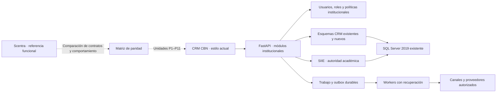
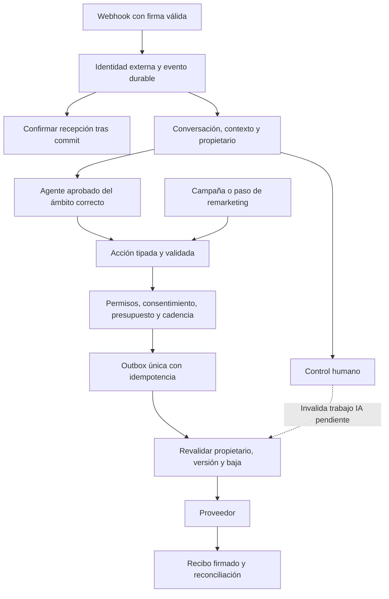
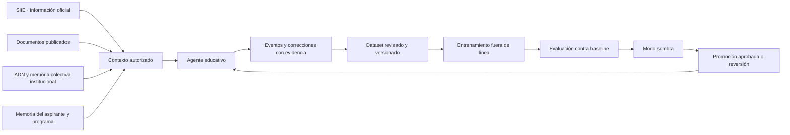

# Mapas de la adaptación educativa

Los flujos siguientes representan el destino planificado. La composición actual se consulta en `backend/app/main.py`, `frontend/src/App.tsx` y el grafo AST. Cada función parcial tiene evidencia en la matriz; los diagramas no certifican implementación o producción.

## Referencia y autoridad de datos

Los esquemas aislados no son bases autoritativas duplicadas de estudiantes/precios/matrículas. La única cola de salida existente se conserva; cada portabilidad debe evitar escritores y colas paralelos que compitan por la misma acción.

## Mensajes, control humano y campañas

No se puede convertir un resultado incierto en fallo seguro y reenviarlo sin reconciliar. La ventana/plantilla aplicable y permisos del proveedor se comprueban en el entorno de aceptación correspondiente.

## Memoria y aprendizaje

La memoria contextual funciona antes de completar el entrenamiento. Cambiar instrucciones o guardar un score no entrena automáticamente un modelo. Una fuente de otro aspirante/programa no puede entrar por ser semánticamente parecida.

## Grafos para continuidad

| Mapa | Pregunta que resuelve | Archivo |
|---|---|---|
| Código CBN | Qué importa/llama el código seleccionado hoy | `../../graphify-out/graph.json` |
| Adaptación | Qué brecha se compara con qué archivo y en qué etapa | `../../graphify-out/adaptation/graph.json` |
| Scentra | Dependencias del comportamiento de referencia | `../../../saas-version/graphify-out/graph.json` |

Las relaciones `planned_for` y `planned_dependency` describen el plan, no funciones ejecutables. Los enlaces `semantically_similar_to` son inferencias para explorar y no prueba de paridad. Los imports/llamadas inferidos por AST también requieren inspección de fuente cuando haya resolución dinámica.
