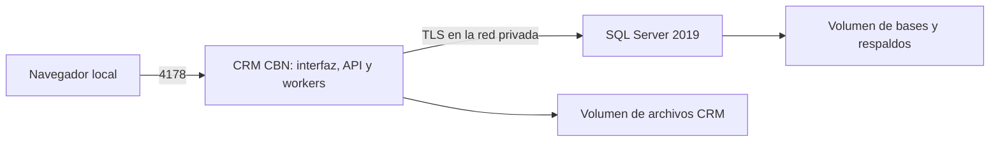

# Instalación local única de CRM CBN

Registro operativo del 7 de noviembre de 2026. La dirección de uso es [CRM CBN](http://127.0.0.1:4178/). Docker conserva dos contenedores permanentes, la aplicación acumulada P11 y su SQL Server 2019 local.



## Arranque y comprobación

Desde la raíz `C:\verane-whatsapp-ai\CRM_CBN` en PowerShell, con Docker Desktop iniciado:

```powershell
docker start crm-cbn-p2-sql2019
docker compose -p crm-cbn-current-p11 -f compose.operations.yaml up -d --pull never --no-recreate
Invoke-RestMethod http://127.0.0.1:4178/health/ready
```

Ambos contenedores tienen `restart: unless-stopped`. SQL Server conserva su nombre, su puerto de administración local `14449`, sus volúmenes y su configuración TLS. La única interfaz web de CRM CBN se publica en `127.0.0.1:4178`.

## Retirada y custodia

Se retiraron 42 contenedores de pruebas, versiones anteriores y herramientas permanentes que quedaron del roadmap. Tres copias antiguas estaban arrancadas o reiniciándose. La aplicación actual conservó su contenedor e imagen P11 R3. SQL Server estaba detenido con política `no`. Se inició la misma instancia y se guardó la política de reinicio.

Se conservaron las bases, volúmenes, imágenes etiquetadas, perfiles, respaldos y evidencias. Se comprobaron los 19 volúmenes identificados de CRM CBN y Scentra. El directorio privado `.local/docker-consolidation-20261107` conserva la configuración de los 42 contenedores cifrada con DPAPI para la cuenta de Windows, un export de la capa de archivos de C5 y dos exports de C13 cuyas imágenes dejaron de estar disponibles por ID. Sus cuatro huellas SHA-256 se volvieron a comprobar antes de retirar los contenedores. Los exports de sistema de archivos se complementan con los volúmenes y la configuración original.

## Herramientas bajo demanda

Para tareas de recuperación local que necesitan `crm-cbn-p2-tools`, con SQL Server disponible, iniciar el auxiliar con esta receta y usar los comandos de preparación de código del [runbook P11](sql/P11_OPERATOR_RUNBOOK.md) según la tarea. Al terminar, `docker stop crm-cbn-p2-tools` lo retira automáticamente. La prueba de la receta verificó UID, CA, ODBC 18, montajes y resolución del nombre SQL sin ejecutar consultas administrativas.

```powershell
$root = (Get-Location).Path
$helper = @(
  '--rm','--name','crm-cbn-p2-tools','--network','crm-cbn-p2-sql19'
  '--user','10001:10001','--read-only','--cap-drop','ALL'
  '--security-opt','no-new-privileges','--no-healthcheck'
  '--tmpfs','/tmp:rw,nosuid,nodev,size=512m,uid=10001,gid=10001,mode=0700'
  '--mount',"type=bind,src=$root\.local\p2,dst=/run/p2-private,readonly"
  '--mount',"type=bind,src=$root\.local\sql-c13\private,dst=/run/c13-state,readonly"
  '--mount',"type=bind,src=$root\.local\sql-c13\runtime,dst=/run/c13-profile,readonly"
  '--mount','type=volume,src=crm-cbn-p2-private-work,dst=/var/lib/cbn-p2'
  '--mount','type=volume,src=crm-cbn-integration-20261014_ai-state,dst=/var/lib/crm-ai,readonly'
  '-e','SSL_CERT_FILE=/run/p2-private/ca-bundle.pem'
  '-e','PYTHONPATH=/tmp/p2-code/backend','-e','PYTHONDONTWRITEBYTECODE=1'
  '--entrypoint','python'
  'sha256:ccf28b3bbc5df62c3e106ac65774e585aa6156e6d2f2d25001c9c1f0b0910f14'
)
docker run -d @helper -B -c 'import time; time.sleep(604800)'
```

Para materializar el contenedor histórico de P10 sólo durante una reversión aprobada, usar su receta congelada con un nombre propio y reinicio desactivado. Se verificó el modelo de Compose sin arrancar P10. La configuración conserva `p10-es/final-v2-runtime` y su volumen original. Si se necesita el ejercicio sobre la copia de recuperación P10, usar su perfil y volumen separados según el inventario privado.

```powershell
$p10 = @'
services:
  preview:
    container_name: crm-cbn-preview-p10-preserved
    restart: 'no'
'@
$p10 | docker compose -p crm-cbn-current-p10 -f compose.learning.yaml -f - up --no-start --pull never preview
```

P10 también usa 4178. Detener primero `crm-cbn-current-preview` antes de iniciar P10. Al regresar, detener P10, arrancar P11 y comprobar `/health/ready`. La revisión original de P11 conserva su evidencia histórica.

## Verificación y roadmap

Docker registró la retirada de 42 contenedores y conservó la aplicación y SQL sin recrearlos. Se verificó que 4178 era el único puerto web en escucha entre 4173 y 4178. El CRM quedó `healthy` y la prueba de acceso confirmó inicio y cierre de sesión, 185 tablas verificadas, ocho consumidores y 11 conversaciones en Inbox. La política de reinicio se verificó en la configuración de ambos contenedores.

El [roadmap general](../SCENTRA_ADAPTATION_ROADMAP.md) conserva **93,62%** de avance técnico ponderado. P0, P1, P2, P3, P5 y P6 están al 100%, P4 y P7 al 82,29%, P8 y P10 al 95%, P9 al 93,75% y P11 al 72,50% con el sprint local al 100%. P12 online está al 0% y su trabajo se contabiliza en los criterios originales. Esta intervención sólo ajustó la operación local. Los grafos de implementación y los porcentajes siguen respaldados por su evidencia original.

El verificador histórico de P11 encontró una diferencia en la referencia de Scentra, frontend/src/App.jsx, de 1.887 huellas comprobadas. El grafo P11 (98 fuentes) y el cálculo de porcentajes pasaron por separado. La diferencia queda fuera de la intervención de Docker.
