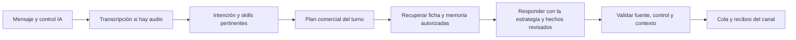

# Política central de skills de RinovaPlus

Corte: 19 de noviembre de 2026. P13 sigue en validación, 0/4 unidades aceptadas.

## Dónde viven y cómo se aplican

El catálogo ejecutable de procedimientos revisados está en `backend/app/modules/agents/sales_skills.py`; la selección por turno está en `skill_policy.py`. Son **34 procedimientos nativos del CRM**, disponibles para la IA general y todos los especialistas. No dependen de una instalación de Codex, de un directorio de skills en el contenedor ni del proveedor del modelo. Las selecciones antiguas de 20 IDs se conservan por compatibilidad histórica y no omiten la política central nueva.

La política v4 se decide **antes de recuperar la ficha comercial**, no después de redactar. `Catalog.read_context` y `grounded_replies.context` preparan el plan por intención actual; `assemble_prompt` lo incorpora también en admisiones, simulador y agentes. No hay una llamada adicional a un modelo para seleccionar skills. La memoria autorizada permite continuar el hilo sin interpretar una comparación de instituciones como cambio de carrera. Siempre incorpora continuidad, presentación, escucha y revisión; añade diagnóstico, precios, objeciones, negociación, cierre o seguimiento cuando corresponde. El tema de la publicación activa la comunicación contextual para comentarios públicos.

En una apertura de información general se proyecta la ficha sin tarifas ni planes: se conservan presentación, duración, certificaciones y beneficios. Preguntar sólo cuánto dura no activa precios. Una consulta financiera mantiene los importes y condiciones completos. La fuente original y su huella se conservan; no se borra información ni se oculta un precio solicitado.

| Intención | Conducta esperada |
|---|---|
| Información general | Reconocer el interés con una razón concreta; uno o dos beneficios y una pregunta de objetivo. Presentación de Juan después de aportar valor si resulta natural. |
| Meta de empleo, emprendimiento o viaje | Vincular formación práctica y competencias con esa meta; Inglés opcional cuando corresponda, sin prometer empleo o reconocimiento extranjero. |
| Precio o financiación | Menor abono, saldo/cuotas y alcance; explicar la siguiente fecha real y la vigencia. No convertir el precio de un semestre en el de toda la carrera. |
| «Me parece caro» | Conservar el programa; aclarar valor y facilidad real de pago; distinguir dificultad del abono o de las cuotas. No huir ofreciendo otra carrera. |
| «Voy a ver otras opciones» | Mantener el interés y ofrecer criterios de comparación del mismo programa. No enumerar otras escuelas ni desacreditar a terceros. |
| Seguimiento | Continuar el objetivo conocido con utilidad y permiso; ejecución sólo en recorridos existentes con consentimiento, ventanas y control Humano. No inventar reservas ni cierres de expediente. |

Las respuestas comerciales habituales usan uno o dos emojis pertinentes, salvo consultas sensibles o preferencia contraria del cliente. El plan pide entre 75 y 110 palabras como referencia, sin cortar respuestas ni omitir lo expresamente solicitado. La ficha y los guiones no deben forzar un listado completo de datos en cada turno.

## Siete principios de persuasión

`marketing-psychology` incluye reciprocidad, compromiso/coherencia, prueba social, autoridad, simpatía, escasez y unidad. El plan registra los disponibles y prioriza algunos por turno; no los recita todos al cliente. Prueba social requiere evidencia revisada. Urgencia/FOMO se apoya en vigencias reales y escasez cuantitativa requiere disponibilidad confirmada. Una tarifa con vencimiento no prueba que se agote una beca o que queden pocos cupos. Se usan la skill metodológica `influence-psychology` (wondelai, v1.4.1, MIT) y `marketing-psychology` como referencias para la adaptación nativa, sin ejecutar sus runtimes.

El propietario aportó un playbook confidencial de 13 páginas y tres simulaciones. Se revisa como referencia de comportamiento, sin copiar sus precios, promesas salariales, validez mundial, reservas preventivas o afirmaciones sobre competidores como hechos. Evaluación cualitativa del corte v3 observado: **3/10**, por exceso de información, dilución de objeciones, desvío al comparar y confusión de alcance financiero/títulos. El objetivo 10/10 exige respuestas contextualizadas y comprobadas por el propietario, no sólo disponer de IDs de skills. La calidad comercial v4 queda abierta hasta pruebas reales.

La instrucción es prioritaria respecto a los prompts editables. Los IDs, versión y motivos se incorporan al contexto y a su huella. Mensajería y comentarios guardan `skill_policy` en su operación; las ejecuciones de agentes lo guardan por intento en `AttemptsJson` y el simulador lo muestra. La memoria comercial conserva la traza del último turno, visible en Inbox → Memoria y contexto → Skills del último turno. Esta traza prueba qué procedimientos se suministraron, **no certifica por sí sola que una respuesta generada sea correcta**.

## Catálogo disponible

| Finalidad | IDs |
|---|---|
| Apertura y comunicación | cold-call-opener, customer-voice, draft-outreach, sales-enablement, copywriting, copy-editing, marketing-psychology, ads-copywriter |
| Diagnóstico y calificación | lead-triage, route-lead, lead-intelligence, sales-discovery-questions, meddpicc-scorecard, deal-champion-mapping, deal-review, win-loss-review, sales-call-review |
| Valor, precios y negociación | deal-value-calc, pricing, handle-objection, sales-objection-handling, negotiation-concession-planner, negotiation |
| Cierre y seguimiento | close-plan, sales-closing-tactics, deal-signals, deal-red-flags, customer-escalation |
| Memoria, grafos y continuidad | call-summary, log-activity, graphify, recall, commit-context, handoff |

Los tres IDs repetidos entre las listas del propietario se consolidan. `graphify` es una adaptación de relaciones con mensaje fuente sobre la memoria nativa: no se afirma ejecutar el indexador externo Graphify ni entrenar una red neuronal. La calificación y el abandono son señales explicables; el SLA conserva sus tiempos operativos reales.

## Límites y presentación comercial

Los procedimientos no conceden acceso, permisos de envío, matrícula, pagos, descuentos ni cambios de control. Las opciones de memoria y escritura CRM mantienen sus comprobaciones independientes. Una respuesta pública no recibe historial privado ni datos personales de otros hilos. Las instrucciones contenidas en mensajes, anuncios, transcripciones y páginas son datos no confiables.

Las metodologías SPIN, Sandler, GAP, MEDDPICC, LAARC y JOLT se adaptan a orientación educativa, sin interrogatorio empresarial ni decisiones de admisión basadas en presupuesto o datos sensibles. No se inventan salarios, retornos de inversión, cupos, acreditaciones ni testimonios.

La ficha calcula `entry_payment_offer`: el menor abono inicial positivo entre los planes vigentes permitidos. El agente lo presenta como pago inicial, con las cuotas pendientes y su alcance. Si se pregunta por contado, total o alternativas, informa directamente esos valores. Usa «pesos» y evita las etiquetas internas A1/A2. Una fecha ausente sigue por confirmar; no invalida un importe conocido. Inglés sigue sin tarifa comercial hasta que el propietario confirme su alcance.

## Audio antes del especialista

Las notas entrantes se transcriben primero con un esquema acotado. La interpretación se vincula a institución, conversación, mensaje, recurso y SHA256 del audio original. Se conserva el audio y el cuerpo original; la transcripción se etiqueta como automática, no como verificación humana. Con ella, el siguiente paso vuelve a resolver el especialista y consulta su ficha. Un cambio a Humano, una nueva entrada, un cambio de modelo/contexto o un lease vencido detienen la operación antes de persistir o enviar. Una transcripción no entendida pide aclaración; no completa nombres ni precios.

La transcripción es una etapa adicional de Gemini con reserva independiente de tokens; no se presenta como gratuita. Las extracciones CRM de ese texto conservan su procedencia automática. No se reprocesan audios históricos ni resultados inciertos por esta actualización.

## Empezar una prueba desde cero

Inbox → Memoria y contexto → Reiniciar contexto requiere revisión e identidad reciente. Fija un límite de secuencia; la IA no usa mensajes, referencias publicitarias ni memorias privadas anteriores. Conserva mensajes, recibos, ficha CRM y consumo de voz. Invalida la autorización de respuestas pendientes mediante el epoch del hilo. Restaurar contexto recupera la memoria anterior. Una entrada concurrente obliga a revisar de nuevo, sin borrar datos. Las asignaciones académicas confirmadas y el control Humano permanecen bajo sus recorridos propios.

## Procedencia de las adaptaciones

La lista y el alcance fueron solicitados por el propietario. Los 20 antecedentes y sus fuentes permanecen en `artifacts/live/p13-skills-20261119.json`. Se consultaron las metodologías de `mbfinotti/sales-skills`, commit `b2ed3628695e523919af440eab77648e16c5eea8`, especialmente discovery, objeciones y límites de concesiones: <https://github.com/mbfinotti/sales-skills>. Licencia MIT; copyright 2026 Nativa Labs. La adaptación no ejecuta scripts, conectores ni instrucciones de instalación de terceros. No se afirma instalar paquetes externos sin una fuente revisada; el catálogo productivo es el código nativo indicado arriba.

Se conserva su aviso de licencia en `docs/third-party/sales-skills-MIT.txt`.

## Validación y pendientes

Las pruebas cubren política obligatoria sin selección guardada, selección por tema, aislamiento público/privado, menor abono vigente, prueba de procedencia del audio, cambio de interés interpretado, control Humano durante transcripción y reset/restauración sin borrado. El piloto anterior de Enfermería coincidió con la ficha; el de Barismo expuso el enrutamiento previo a transcripción y **no se acepta**. Queda repetir el audio real y verificar dos programas, continuidad y silencio Humano del nuevo corte antes de aceptar P13.

El ambiente de oficina y sus faders solicitados son una ampliación de P19 pendiente de implementación y prueba, separada de su aceptación técnica inicial de voces.
