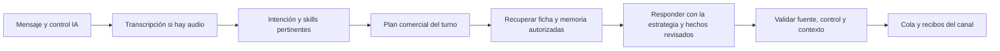

# Política central de skills de RinovaPlus

Corte: 20 de noviembre de 2026. P13 sigue en validación, 0/4 unidades aceptadas hasta repetir el piloto comercial publicado.

## Dónde viven y cómo se aplican

La biblioteca física está en `backend/app/modules/agents/skills/<id>/SKILL.md`: **34 guías nativas revisadas**, empaquetadas con el backend y disponibles para la IA general y los especialistas. `manifest.json` conserva fuente, versión y SHA256; `skill_library.py` valida el contenido, y `skill_policy.py` selecciona e incorpora las guías completas pertinentes al system prompt. `sales_skills.py` mantiene el índice. No depende de Codex ni ejecuta instaladores, motores Graphify o scripts de terceros. Son adaptaciones educativas revisadas, no una afirmación de instalar íntegros todos los paquetes originales. Los 20 IDs antiguos se conservan por compatibilidad.

La política v5 se decide **antes de recuperar la ficha comercial**, no después de redactar. `Catalog.read_context` y `grounded_replies.context` preparan el plan por intención actual; `assemble_prompt` lo incorpora también en admisiones, simulador y agentes. No hay una llamada adicional a un modelo para seleccionar skills. La memoria autorizada permite continuar el hilo sin interpretar una comparación de instituciones como cambio de carrera. Siempre incorpora continuidad, presentación, escucha y revisión; añade diagnóstico, precios, objeciones, negociación, cierre o seguimiento cuando corresponde. El tema de la publicación activa la comunicación contextual para comentarios públicos.

En una apertura de información general se proyecta la ficha sin tarifas ni planes: se conservan presentación, duración, certificaciones y beneficios. Preguntar sólo cuánto dura no activa precios. Una consulta financiera mantiene los importes y condiciones completos. La fuente original y su huella se conservan; no se borra información ni se oculta un precio solicitado.

| Intención | Conducta esperada |
|---|---|
| Información general | Reconocer el interés con una razón concreta; uno o dos beneficios y una pregunta de objetivo. Presentación de Juan después de aportar valor si resulta natural. |
| Meta de empleo, emprendimiento o viaje | Vincular formación práctica y competencias con esa meta; Inglés opcional cuando corresponda, sin prometer empleo o reconocimiento extranjero. |
| Precio o financiación | Menor abono, saldo/cuotas y alcance; explicar la siguiente fecha real y la vigencia. No convertir el precio de un semestre en el de toda la carrera. |
| «Me parece caro» | Conservar el programa; aclarar valor y facilidad real de pago; distinguir dificultad del abono o de las cuotas. No huir ofreciendo otra carrera. |
| «Voy a ver otras opciones» | Mantener el interés y ofrecer criterios de comparación del mismo programa. No enumerar otras escuelas ni desacreditar a terceros. |
| Seguimiento | Continuar el objetivo conocido con utilidad y permiso; ejecución sólo en recorridos existentes con consentimiento, ventanas y control Humano. No inventar reservas ni cierres de expediente. |

Las respuestas comerciales habituales usan uno o dos emojis pertinentes, salvo consultas sensibles o preferencia contraria del cliente. El plan pide entre 75 y 110 palabras como referencia, sin cortar respuestas ni omitir lo expresamente solicitado. La ficha y los guiones no deben forzar un listado completo de datos en cada turno.

## Siete principios de persuasión

`marketing-psychology` incluye reciprocidad, compromiso/coherencia, prueba social, autoridad, simpatía, escasez y unidad. El plan registra los disponibles y prioriza algunos por turno; no los recita todos al cliente. Prueba social requiere evidencia revisada. Urgencia/FOMO se apoya en vigencias reales y escasez cuantitativa requiere disponibilidad confirmada. Una tarifa con vencimiento no prueba que se agote una beca o que queden pocos cupos. Se usan la skill metodológica `influence-psychology` (wondelai, v1.4.1, MIT) y `marketing-psychology` como referencias para la adaptación nativa, sin ejecutar sus runtimes.

El propietario aportó un playbook confidencial de 13 páginas y tres simulaciones. Se revisa como referencia de comportamiento, sin copiar sus precios, promesas salariales, validez mundial, reservas preventivas o afirmaciones sobre competidores como hechos. Evaluación cualitativa del corte v3 observado: **3/10**, por exceso de información, dilución de objeciones, desvío al comparar y confusión de alcance financiero/títulos. El objetivo 10/10 exige respuestas contextualizadas y comprobadas por el propietario, no sólo disponer de IDs de skills. La calidad comercial v4 queda abierta hasta pruebas reales.

La instrucción es prioritaria respecto a los prompts editables. Los IDs, versión y motivos se incorporan al contexto y a su huella. Mensajería y comentarios guardan `skill_policy` en su operación; las ejecuciones de agentes lo guardan por intento en `AttemptsJson` y el simulador lo muestra. La memoria comercial conserva la traza del último turno, visible en Inbox → Memoria y contexto → Skills del último turno. Esta traza prueba qué procedimientos se suministraron, **no certifica por sí sola que una respuesta generada sea correcta**.

## Catálogo disponible

| Finalidad | IDs |
|---|---|
| Apertura y comunicación | cold-call-opener, customer-voice, draft-outreach, sales-enablement, copywriting, copy-editing, marketing-psychology, ads-copywriter |
| Diagnóstico y calificación | lead-triage, route-lead, lead-intelligence, sales-discovery-questions, meddpicc-scorecard, deal-champion-mapping, deal-review, win-loss-review, sales-call-review |
| Valor, precios y negociación | deal-value-calc, pricing, handle-objection, sales-objection-handling, negotiation-concession-planner, negotiation |
| Cierre y seguimiento | close-plan, sales-closing-tactics, deal-signals, deal-red-flags, customer-escalation |
| Memoria, grafos y continuidad | call-summary, log-activity, graphify, recall, commit-context, handoff |

Los tres IDs repetidos entre las listas del propietario se consolidan. `graphify` es una adaptación de relaciones con mensaje fuente sobre la memoria nativa: no se afirma ejecutar el indexador externo Graphify ni entrenar una red neuronal. La calificación y el abandono son señales explicables; el SLA conserva sus tiempos operativos reales.

## Límites y presentación comercial

Los procedimientos no conceden acceso, permisos de envío, matrícula, pagos, descuentos ni cambios de control. Las opciones de memoria y escritura CRM mantienen sus comprobaciones independientes. Una respuesta pública no recibe historial privado ni datos personales de otros hilos. Las instrucciones contenidas en mensajes, anuncios, transcripciones y páginas son datos no confiables.

Las metodologías SPIN, Sandler, GAP, MEDDPICC, LAARC y JOLT se adaptan a orientación educativa, sin interrogatorio empresarial ni decisiones de admisión basadas en presupuesto o datos sensibles. No se inventan salarios, retornos de inversión, cupos, acreditaciones ni testimonios.

La ficha calcula `entry_payment_offer`: el menor abono inicial positivo entre los planes vigentes permitidos. El agente lo presenta como pago inicial, con las cuotas pendientes y su alcance. Si se pregunta por contado, total o alternativas, informa directamente esos valores. Usa «pesos» y evita las etiquetas internas A1/A2. Una fecha ausente sigue por confirmar; no invalida un importe conocido. Inglés sigue sin tarifa comercial hasta que el propietario confirme su alcance.

## Audio antes del especialista

Las notas entrantes se transcriben primero con un esquema acotado. La interpretación se vincula a institución, conversación, mensaje, recurso y SHA256 del audio original. Se conserva el audio y el cuerpo original; la transcripción se etiqueta como automática, no como verificación humana. Con ella, el siguiente paso vuelve a resolver el especialista y consulta su ficha. Un cambio a Humano, una nueva entrada, un cambio de modelo/contexto o un lease vencido detienen la operación antes de persistir o enviar. Una transcripción no entendida pide aclaración; no completa nombres ni precios.

La transcripción es una etapa adicional de Gemini con reserva independiente de tokens; no se presenta como gratuita. Las extracciones CRM de ese texto conservan su procedencia automática. No se reprocesan audios históricos ni resultados inciertos por esta actualización.

## Empezar una prueba desde cero

Inbox → Memoria y contexto → Reiniciar contexto requiere revisión e identidad reciente. Fija un límite de secuencia; la IA no usa mensajes, referencias publicitarias ni memorias privadas anteriores. Conserva mensajes, recibos, ficha CRM y consumo de voz. Invalida la autorización de respuestas pendientes mediante el epoch del hilo. Restaurar contexto recupera la memoria anterior. Una entrada concurrente obliga a revisar de nuevo, sin borrar datos. Las asignaciones académicas confirmadas y el control Humano permanecen bajo sus recorridos propios.

## Procedencia de las adaptaciones

La lista y el alcance fueron solicitados por el propietario. Los 20 antecedentes y sus fuentes permanecen en `artifacts/live/p13-skills-20261119.json`. Se consultaron las metodologías de `mbfinotti/sales-skills`, commit `b2ed3628695e523919af440eab77648e16c5eea8`, especialmente discovery, objeciones y límites de concesiones: <https://github.com/mbfinotti/sales-skills>. Licencia MIT; copyright 2026 Nativa Labs. La adaptación no ejecuta scripts, conectores ni instrucciones de instalación de terceros. No se afirma instalar paquetes externos sin una fuente revisada; el catálogo productivo es el código nativo indicado arriba.

Se conserva su aviso de licencia en `docs/third-party/sales-skills-MIT.txt`.

## Validación y pendientes

Las pruebas cubren política obligatoria sin selección guardada, selección por tema, aislamiento público/privado, menor abono vigente, prueba de procedencia del audio, cambio de interés interpretado, control Humano durante transcripción y reset/restauración sin borrado. El piloto anterior de Enfermería coincidió con la ficha; el de Barismo expuso el enrutamiento previo a transcripción y **no se acepta**. Queda repetir el audio real y verificar dos programas, continuidad y silencio Humano del nuevo corte antes de aceptar P13.

P19: controles, mezcla y generador publicados y confirmados por el propietario; las pistas sintéticas fueron rechazadas por sonar poco realistas y su sustitución sigue pendiente, separada de P13.

## Revisión v5 — 20-11-2026

La consulta real de los SKILL.md incluye íntegros los procedimientos principales
de la intención y las guías de memoria/grafo/continuidad/revisión/persuasión.
Las guías adicionales entran mientras quepan en9000caracteres de contenido;
las principales nunca se recortan y pueden superar ese objetivo. La traza
consulted_resources conserva ID/ruta/versión/SHA; deferred_resource_ids indica
las adicionales que no se suministraron. La interfaz dice consultadas: eso no
garantiza por sí solo que el modelo las haya aplicado correctamente.

Se corrige el enrutamiento por artículos/pronombres y aliases cortos: «voy a ver
otras opciones» no puede seleccionar Primera Infancia sólo por la palabra «a».
Las preguntas explícitas, cambio real de programa, ambigüedad de jornada y control
manual mantienen sus recorridos. Se elimina la presentación repetitiva obligatoria
de asistente virtual del ensamblador común; el nombre de atención no es una falsa
identidad humana y se conserva la transparencia si preguntan por IA.

## Nombre y campos visibles de la ficha CRM

El contexto privado puede usar el nombre visible guardado para dirigirse a la
persona con naturalidad, sin repetir saludo/nombre en cada turno. Se omiten números
y nombres genéricos como Contacto de Messenger. Comentarios públicos no reciben
esa ficha ni memoria privada.

Con memoria customer_profile y auto_sales_crm habilitados, la IA puede proponer
nombre, ciudad, jornada e intereses expresamente declarados: value debe aparecer
literalmente en quote y quote en el mensaje entrante. Nombre exige presentación
explícita o respuesta a nuestra pregunta de nombre; no se toma de terceros.
La transcripción de audio conserva su origen automático. El backend escribe sólo
esos cuatro campos de trato, con procedencia y comparación del valor previo.

Las modificaciones manuales se protegen por campo. Los contactos con guardados
manuales anteriores al despliegue conservan los valores no vacíos como revisados.
Si hay conflicto, la corrección queda en memoria y se informa que el campo manual
se conservó. No se promete sobrescribirlo. El nuevo guardado manual sólo protege
los campos cambiados, y la unificación de contactos usa la ficha canónica.

Los objetivos, presupuesto declarado, dudas, fechas de interés y próximos pasos
se conservan como hechos citados en memoria, sin inventar datos ausentes. La
calificación es comercial y explicable; el SLA usa su política y tiempos reales.
No se escriben automáticamente documento, salud, género, pagos, matrícula,
identidad académica, propietario humano, descuentos ni decisiones de admisión.

Pruebas locales:263backend seleccionadas y47frontend; tipos/ESLint/Ruff/build
pasan (bundle histórico grande conservado). Nueve consultas nuevas traducidas y
parseadas como PostgreSQL sin conexión ni escrituras. La actualización del nombre
conserva el contexto anterior durante el mismo turno para no invalidar su propio
despacho; el siguiente turno usa el nombre nuevo.

Pendiente de aceptación: despliegue v5, simulaciones reales de apertura, objetivo,
objeción, comparación, financiación, becas/títulos, límites y continuidad; piloto
real del44 con dos programas, campo de ficha y silencio Humano. Inglés conserva
su tarifa pendiente de confirmación, sin inventarla. OpenRouter comparte política
en el simulador; su prueba real queda condicionada a una clave guardada por el
propietario y no se acredita por probar Gemini.

## Corrección del catálogo de Agentes — 20-11-2026

El prompt general de producción tiene11044caracteres: válido en el esquema
institucional de20000, pero rechazado por el esquema compartido de8000 que usaba
AgentAI.read. La excepción de validación se presentaba como503 de almacenamiento.
Se lee con el mismo esquema AI que valida el guardado institucional; los valores
realmente inválidos devuelven409 de configuración con instrucciones de revisión.
Cinco regresiones cubren prompt largo, ceros válidos, cadencia, IDs y rechazo
real;59pruebas seleccionadas pasan. Verificación publicada aún pendiente.

## Recuperación y duplicados de contexto — 20-11-2026

UI de Agentes comprobada después de la corrección del esquema:27activos y
26programas. La primera vista previa de Barismo rechazó el tamaño antes de
consumir IA. Se conserva el límite40000: prompt general exacto una sola vez
en grounding, ADN ya incorporado en system referenciado en memoria sin repetir
su cuerpo y fichas secundarias dominadas por una coincidencia más específica
excluidas de recuperación. La apertura no necesita temario/requisitos extensos;
se recuperan al preguntar. Finanzas expresas mantienen planes y condiciones
completos.93regresiones seleccionadas pasan; simulación publicada pendiente.

## Contexto financiero y traza compacta

La apertura real de Barismo pasó con Gemini; el modelo no presentó precios ante
una consulta general. La prueba financiera detectó aún exceso de contexto antes
de llamar al proveedor. Se mantienen importes/cuotas/fechas/condiciones y se
reservan presentación extensa, temario, requisitos o campo laboral cuando no
fueron preguntados; las peticiones combinadas vuelven a incluirlos. Las fichas
adicionales se difieren completas cuando no caben, sin cortar la seleccionada.
La traza que ve el modelo usa IDs y una huella única; la auditoría nativa restaura
las rutas, fuentes, SHA y versiones verificándolas contra la biblioteca. No se
reducen las guías de razonamiento ni se amplía el límite40000. Reproducción
privada local:38178financiación,39281objeción,39331comparación.286backend pasan.
P13continúa0/4hasta las comprobaciones publicadas y aceptación comercial.

## Revisión de cierre — 20-11-2026

Nueva orientación real de Enfermería con Gemini completada, sin envío ni ficha
modificada; la respuesta comercial de Barismo llegó en WhatsApp con siete guías
completas y objetivo trazado. La prueba de cambio falló: la primera de dos notas
consecutivas quedó sin interpretación. Se procesa la más antigua pendiente del
grupo sin respuesta, con fuente/hash, corte de memoria y guardas de la última
entrada. Cada transcripción se guarda y se resuelve de nuevo el especialista.
Un audio anterior intentado sin resultado confirmado requiere revisión; nunca
se reenvía automáticamente una solicitud incierta. Máximo seis notas por grupo.

Estilo v4: un párrafo representa un mensaje; las frases del mismo párrafo pueden
permanecer juntas. Se conservan seis partes como máximo, palabras completas,
pausas y el final íntegro. Los emojis acompañan frases pertinentes, sin firma
repetida al cierre ni identidad humana falsa. Objetivos como «para abrir mi
negocio» activan las guías de valor antes de recuperar hechos comerciales.

Se corrige además la huella de repetición de configuraciones antiguas: los
campos nuevos omitidos no invalidan la operación original; se acepta la huella
intermedia publicada sólo para recuperar una operación existente. Los valores
expresos y el actor permanecen protegidos.255backend/24frontend, tipos/lint/build
y una consulta PostgreSQL parseada. Pendientes publicación y retoma real; no
se acepta P13 por este volumen de pruebas.

El propietario autorizó crear el pipeline CRM: Nuevo, Calificación, Programa
definido, Propuesta y financiación, Dudas y objeciones, Inscripción, Matriculado,
Seguimiento y Cerrado sin matrícula. Creadas por la UI, con probabilidad vacía y
sin mover contactos. No son todavía agentes automáticos de etapa ni se han
cambiado sus modelos; esa asignación y los criterios de traspaso requieren su
configuración y pruebas. Matriculado exige verificación humana o académica.
P21 queda diferida expresamente hasta la recarga de crédito.
