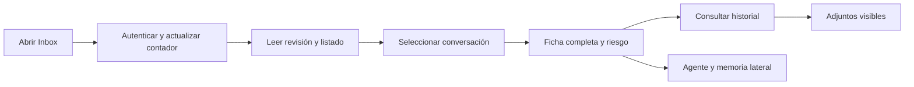

# P24 — Diagnóstico de listas de conversaciones, mensajes y contactos

Fecha local: 25 de noviembre de 2026. Código revisado: 4df7272. Alcance: análisis y propuestas; no se aplicaron cambios de código, SQL, índices, servicios, caché, cuotas o configuración productiva. P24 conserva implementación0% y aceptación0/6.

## Resultado principal

Hay una demora real dentro de la consulta que construye las listas, además de esperas encadenadas en el cliente. Cambiar de modelo de IA no acelera estos endpoints: las listas consultan CRM/PostgreSQL y no necesitan una inferencia para mostrar los contactos o el historial.

La primera intervención recomendada es revisar la sentencia de listado identificada por el registro, agrupar lecturas repetidas por fila y permitir que el historial se muestre sin esperar todos los datos laterales de la ficha. Después conviene reducir la invalidación global y aislar el contador de solicitudes de las escrituras comerciales. Cada cambio debe medirse y desplegarse por separado.

## Evidencia y límites

| Señal | Resultado | Qué permite concluir |
|---|---|---|
| Registros nativos de Coolify, backend vigente, seis entradas de26Nov02:19:05–02:20:23UTC, es decir25Nov21:19–21:20 Bogotá | source=listing:912, statement_id=ae7d8c1dcddb. Sentencia4487–5067ms, mediana4775ms. Transacción4907–5573ms, mediana5272ms | La consulta de filas del listado es un cuello de botella observado. La muestra proviene de una ventana con navegación administrativa; no es p95 ni ensayo de carga representativo |
| Registro de trabajo recurrente en la misma ventana | reconcile_receipts:385, statement_id=0c3ce6f3ff1a, alrededor de1,1s por transacción de escritura | Hay trabajo compartido que mantiene el bloqueo de escritores; todavía no hay plan de ejecución ni prueba de su costo bajo carga distinta |
| Código del cliente institucional WorkspaceP3 | Primera página revisada3s después de completar cada lectura; detalle15s; mensajes10s, todos condicionados a foco/visibilidad para las rondas posteriores | Produce solicitudes recurrentes por operador. No son tres relojes que necesariamente se ejecuten a la vez ni implica que todas las pestañas ocultas consulten |
| Montaje del historial | El componente de mensajes se monta después de resolver detail; useRead añade180ms al primer arranque de cada efecto | Existe una dependencia en serie: ficha→historial. No se midió todavía el ahorro de cambiarla |
| Acceso | Identity.authenticate abre transacción de escritura para rate() antes de atender cada API protegida; esa transacción obtiene el bloqueo institucional | Un GET puede esperar primero como escritor durante autenticación aunque su lectura de negocio sea READ ONLY. No se propone quitar permisos ni contador |
| Conexiones | Cada transaction abre y cierra una conexión psycopg2, comprueba contexto y autorización | Costos repetidos posibles; tiempo de conexión y saturación de conexiones aún sin medir |
| Build previo de la misma publicación | JS1202,89kB,348,25kB gzip; CSS164,12kB/31gzip; chunk de emojis dinámico | Puede afectar entrada fría y CPU, pero no explica por sí solo una sentencia SQL de5s. No se suma el selector de emojis como descarga inicial obligatoria |

held_ms se cuenta después de adquirir conexión/bloqueo e incluye el cuerpo de la transacción; no equivale a tiempo HTTP completo ni incluye toda la autenticación previa del endpoint. stage=commit indica dónde terminó la observación; no prueba que el COMMIT sea lento. No se recogieron trazas DevTools, HAR, RUM ni EXPLAIN; tampoco CPU/RAM/IO/conexiones de PostgreSQL. No se atribuye la demora a falta de RAM, red o índices ausentes sin medirlos.

## Recorrido actual

El listado ya pagina25 filas y el historial51 para devolver50 más indicador de continuación. No se está descargando todo el histórico de mensajes de una vez. Existen además coalescencia de GET simultáneos, revisión condicional, pausa por pérdida de foco, carga diferida de varios paneles y adjuntos por IntersectionObserver; las propuestas deben aprovecharlas en lugar de duplicarlas.

## Hallazgos de código

1. **Listado con varios trabajos por fila.** workspace.listing ejecuta total, consulta de filas con SLA, cuenta receptora, última vista previa y adjunto, y luego riesgo. La selección del último mensaje y la identidad/cuenta se repite en varias subconsultas. Es una estructura costosa posible; falta el plan para saber qué operador consume los4775ms medianos observados.
2. **Riesgo con patrón por fila.** populate_inbox_risk llama primero a risk para cada una de las25 filas. risk consulta identidad principal, miembros vinculados, ficha/perfil, conversaciones, hora y evaluaciones. Las evaluaciones comerciales y parte de la evidencia de canal ya se agrupan después; el tramo inicial sigue por fila. Agruparlo es una propuesta, no omitir o suavizar la rúbrica.
3. **Revisión compartida por el espacio de trabajo.** afterRevision evita reconstruir el listado cuando no cambia la revisión global, pero actividad ajena puede invalidarla. Además, cada60s de lecturas completas se fuerza otra lectura completa. liveRevision del chat usa la fila seleccionada serializada, no toda la revisión global: ya evita parte de los refrescos ajenos y debe conservarse. Fechas dinámicas del riesgo pueden cambiar esa fila aunque el contenido de mensajes no cambie.
4. **Ficha y mensajes en serie.** Person retorna «Cargando ficha» antes de montar Conversation. Así, un panel lateral lento retrasa el primer historial. Aunque se oculte la ficha con hidden, sus componentes pueden seguir montados: no todos los consumidores toman showContact como condición. Notas, tareas, historial de actividad y memoria comercial sí tienen condiciones de apertura; no se propone volver a implementar lo que ya existe.
5. **Historial enriquecido en varias transacciones.** channel_workspace.messages obtiene primero los50 mensajes y luego recibos, citas, adjuntos y presentación social. La consulta de MediaAsset filtra por conversación completa, no sólo por los50 IDs visibles, y después hace el cruce en Python. En un hilo largo, el trabajo de adjuntos puede crecer aunque la página de mensajes esté acotada. No se midió ese endpoint como causa dominante en esta ventana.
6. **Lecturas abandonadas siguen en vuelo.** useRead marca active=false al cambiar la vista y no aplica la respuesta antigua, lo que protege el contexto. No cancela esa petición HTTP; AbortSignal.timeout sólo limita45s. No se debe abortar un GET compartido por otro consumidor sin una política de referencias.
7. **Autenticación y contador comparten la cola de escritores.** El bloqueo institucional es anterior a toda transacción write=True, incluido authenticate. reconcile_receipts puede sostenerlo mientras otra consulta necesita actualizar el rate bucket. Las lecturas puras no toman ese bloqueo; afirmar que todos los SELECT lo toman sería incorrecto.
8. **Abrir más procesos no es una corrección inicial segura.** Cada proceso inicia trabajadores en lifespan. Aumentar workers de Uvicorn sin separar esos trabajadores podría multiplicar consumidores e inferencias. Antes deben verificarse concesiones, idempotencia y capacidad de PostgreSQL; no se ha cambiado esa configuración.

## Propuestas ordenadas

| Orden | Propuesta | Beneficio esperado, por verificar | Riesgo y condición de seguridad |
|---|---|---|---|
| 1 | Capturar plan de la sentencia ae7d8c1dcddb en copia representativa; seleccionar primero los25 IDs con el mismo orden/filtros y agrupar último mensaje, cuenta, adjunto y riesgo | Reducir el principal costo SQL y consultas por fila | Medio. Mismos IDs, total, orden, filtros, pertenencia a institución, comentario pendiente, no contactar y riesgo. Los filtros SLA/riesgo deben resolverse antes de paginar cuando determinan pertenencia |
| 2 | Separar lectura mínima del hilo de datos accesorios y cargar historial y ficha en paralelo | Mostrar los mensajes aunque tarde un panel lateral | Bajo–medio. La autorización del endpoint de mensajes y la comprobación de control/época antes de enviar se conservan; no usar una ficha vieja para habilitar envío |
| 3 | Limitar adjuntos/recibos enriquecidos a los IDs de la página y consultar por lotes | Costo estable al abrir hilos con mucho histórico | Bajo–medio. Pruebas de citas, reacciones, transcripciones, multimedia e historial importado; ninguna pérdida de recibos |
| 4 | Revisiones por recurso o cambios incrementales y refresco adaptativo; mantener la última lista de la misma búsqueda mientras se revalida | Menos listados completos y menos parpadeo al navegar | Medio. Cache sólo en memoria, aislada por sesión/permisos/institución/filtros; invalidar al salir o cambiar acceso. Un dato antiguo nunca autoriza mutaciones |
| 5 | Mantener autorización y mover el contador a actualización atómica con bloqueo por bucket/usuario; optimizar reconciliación sin trabajo | Evitar que leer espere por una escritura comercial ajena | Medio–alto. Conservar límite600 vigente, ventana, revocación, auditoría y límite distribuido entre procesos. No usar un contador local que multiplique el cupo al escalar |
| 6 | Pool de conexiones acotado, después de medir apertura y uso; devolver conexiones sin contexto residual | Reutilizar conexiones y limitar concurrencia | Medio. Reponer rollback, READ ONLY/aislamiento/search_path/timeouts y autoridad en cada préstamo; impedir fuga de sesión o transacción |
| 7 | Dividir módulos del frontend por ruta y diferir paneles secundarios aún anticipados | Mejor arranque frío; menos CPU inicial | Bajo–medio. Conservar borradores, navegación, permisos, error boundaries y retorno móvil; validar versión de recursos |
| 8 | Sólo si el plan lo exige, proponer índices compuestos concretos sobre tablas reales y estadísticas actuales | Evitar escaneos/ordenaciones caros | Medio. No crear índices redundantes a ciegas. Medir impacto en escrituras, espacio y bloqueos; DDL se trata por separado |

La recomendación inmediata combina1+2+3, con verificación independiente. La optimización del contador del punto5 importa para varios operadores, pero merece una revisión específica por su relación con seguridad. SSE/WebSocket y virtualización no son el primer cambio: la lista ya tiene25 filas; primero debe bajar el costo de producirlas. No se elimina el polling sin un sustituto confiable con recuperación.

## Cómo demostrar la mejora sin estropear los flujos

- Línea base de tres recorridos equivalentes: abrir Inbox, abrir chat, volver a lista, buscar contacto y cambiar de filtro. Separar caché fría/caliente, versión y estado autenticado. Medir por endpoint el total HTTP, espera de conexión/bloqueo, SQL, serialización y render.
- Comparar IDs/orden/total y proyecciones entre la lectura actual y propuesta sobre el mismo snapshot, incluidos Humano, bajas, chats de comentarios, contactos vinculados/SIIE y conversaciones con borradores. Sin datos reales en artefactos públicos.
- Probar varias sesiones con una concurrencia representativa acordada; considerar5/10/20 operadores como escalones de ensayo en entorno de prueba, no como capacidad ya demostrada. No hacer un estrés productivo ahora.
- Mantener pruebas de cambio rápido de contacto, respuestas tardías, permisos revocados,429/503, recibos inciertos, no duplicación y borradores. Un GET puede recuperarse según política; jamás repetir POST por una mejora de carga.
- Publicar un cambio reversible por vez, revisar p50/p95 y errores antes/después con la misma carga y conservar ruta anterior para reversión. Los objetivos de tiempo se fijan con la línea base; no se promete una reducción porcentual sin medición.

## Audio: hallazgo separado de rendimiento

La consulta nativa del chat de prueba confirmó voz activa en todos los WhatsApp, modo «Cuando el cliente mande una nota de voz», perfil Juampa y5 reservas usadas de un máximo5. El comprobador sin generación devolvió «Se alcanzó el máximo del hilo; continúa por texto». No se generó audio, no se cambió cuota y no se consultó saldo externo en este diagnóstico. Esto acredita el límite para ese hilo, no una caída global de ElevenLabs.

El máximo es por hilo y no se reinicia al pasar a Humano o reiniciar el servidor. Las reservas inciertas se conservan para evitar repetir una generación pagada. Ajustes→Voces y audios permite modificar el máximo;0 actualmente significa sólo texto, no ilimitado. También hay máximos60s/2000caracteres y20000caracteres diarios: pueden decidir texto en otros casos, pero no se atribuyen a los demás contactos sin revisar su causa.

Hay además una hipótesis de código pendiente de reproducir: tras transcribir una nota y llegar una imagen/texto como último mensaje, pending_input deja de devolver el audio ya transcrito, mientras incoming_voice para la salida depende de input_audio del último origen. Un turno mixto puede perder la señal de que incluía voz. La corrección propuesta es conservar una marca de nota de voz en el grupo entrante vigente, ligada a sus IDs/ámbito, sin volver a transcribir ni sintetizar dos veces. El límite5/5 del ensayo impide usar ese caso como prueba aislada de esta hipótesis. No se implementó ni se declaró corregida.

Ampliación por aclaración del titular: su consulta de voz se refería a otro chat de prueba, no al hilo anterior. En ese segundo hilo, la consulta nativa confirmó0 reservas de5. El comprobador con respuesta breve permite audio; al copiar la respuesta real sobre PRE-ICFES y Marketing devolvió duración estimada83s frente al máximo60s y salida completa por texto, sin generar. Por tanto, el cupo5/5 no explica ese segundo caso: la condición de duración sí se reproduce con su respuesta. La nota entrante figura a21:22 y las cuatro partes de texto a21:24, todas Leídas; no hay resolución de segundos suficiente en el historial para certificar latencia total o afirmar respuesta inmediata. Diagnóstico de generación: OpenRouter/Flash3.8/completed, sin error. No se observó el campo histórico voiceReason en la UI, no se invocó ElevenLabs ni se cambió configuración. Propuesta específica: versión hablada completa pero más concisa dentro del máximo, con enlaces/detalles en texto, o revisar explícitamente el máximo de duración; no elevar a ciegas el cupo por hilo.

## Referencias

Código: frontend/src/institution/Workspace.tsx:306,676,1268,1431; readCoordinator.ts:36; api.tsx:610; InstitutionApp.tsx:1; backend/app/institutional/workspace.py:338,511,618,908; channel_workspace.py:437,512; auth.py:527; postgres_rehearsal.py:199; broadcast_dispatch.py:382; voice_policy.py:100; whatsapp_gemini.py:407,787. La ruta productiva usa channel_workspace; postgres_workspace es la variante de ensayo, no la lectura productiva optimizada.

Fuentes técnicas primarias consultadas: [EXPLAIN de PostgreSQL](https://www.postgresql.org/docs/current/using-explain.html), para inspeccionar el plan real antes de cambiar consultas; [índices compuestos](https://www.postgresql.org/docs/current/indexes-multicolumn.html), cuya utilidad depende de predicados y orden; [React lazy](https://react.dev/reference/react/lazy), para diferir código de módulos hasta que se rendericen. Son fundamentos de las propuestas, no mediciones de RinovaPlus. Verificar funciones disponibles en la versión de PostgreSQL desplegada antes de aplicarlas.
