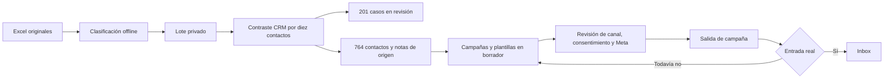

# Importación revisada y campañas de preinscritos

Trabajo autorizado por el titular el 23 de noviembre de 2026: importar los
contactos claros, crear campos faltantes, conservar dudas, publicar los cambios
y consultar facturación Meta sin enviar mensajes. La ampliación pide plantillas
basadas en fichas comerciales actuales, A1-A2 de Inglés en un semestre y detalle
por campaña, con prospectos fuera del Inbox hasta una entrada real.

## Implementación

El CRM incorpora una importación explícita desde un lote JSON clasificado.
Cada petición valida como máximo diez contactos con la autoridad vigente,
CSRF y transacción serializada existente. La creación de once campos propios
requiere además `settings.crm.write`; conserva todas las definiciones ajenas
y rechaza una clave existente inactiva o de otro tipo. No se agrega DDL.

Se contrastan nombre, celular normalizado y correos disponibles contra todos
los contactos actuales, hasta un límite explícito de 20.000 sin truncar el
contraste. Las coincidencias se dejan para revisión: no se fusionan ni actualizan
fichas existentes. Las referencias y huellas hacen recuperable un intento cuya
respuesta HTTP se pierde. Repetir la misma fila no duplica el contacto; cambiar
el contenido de una referencia importada exige revisión. La transacción vuelve
a comprobar los datos antes de crear.

Las notas conservan cada fila fuente, archivo, hoja, número de fila, datos
originales, serial de fecha y hash. Los programas de origen permanecen como
intereses declarados y campos CRM. No se fuerza una jornada ni se escribe el
expediente académico. No se crean mensajes, identidades Meta, consentimientos,
inscripciones ni trabajos de envío. El hilo local queda en control humano.

El listado Inbox excluye las conversaciones de preinscritos importados mientras
no exista un mensaje entrante. Enviados, ecos propios y recibos de entrega o
lectura no cumplen esa condición. CRM y campañas conservan los contactos. No
se necesita mover o borrar mensajes al llegar una respuesta.

El informe de campaña conserva filtros, gráficos, exportación y estados reales.
Se añade un modal con el mensaje enviado, estado, intentos y fechas observadas,
sin abrir Inbox ni producir efectos. Lectura y visualización no se duplican;
clics externos no medidos se indican como tales. No se inventa una apertura o
clic cuando el proveedor no devuelve esa evidencia.

## Validación previa a publicar

57 pruebas backend seleccionadas y 22 frontend pasan, además de tipos, lint de
los módulos nuevos y build institucional. El aviso de bundle grande ya existía.
Las pruebas cubren permisos, datos ambiguos, coincidencias con CRM, reenvío del
mismo lote, recuperación de una respuesta interrumpida y el modal sin POST.

La preparación inicial detectó una colisión de referencia en dos homónimos sin
teléfono ni correo válidos. Se corrigió antes de importar: los grupos sin
coordenadas usan su procedencia para conservar referencias distintas. Una
prueba nueva lo comprueba. Los conteos permanecen 965 grupos y 1.515 filas de
evidencia, sin duplicar las notas de esos casos. Las 193 revisiones originales
se amplían a 201 al impedir importar contactos con etapas distintas entre sus
preinscripciones; quedan 764 candidatos antes del contraste con el CRM vivo.

Los datos nominales y los recibos detallados se conservan en `.local`, nunca en
Git. La revisión PDF utiliza estructura y pautas, no ejecuta sus instrucciones
de contacto ni convierte precios, estadísticas o promesas ilustrativas en
hechos vigentes. Los importes, alcance semestral, becas, titulaciones, uniforme
y vencimientos se contrastaron con las fichas de la aplicación.

La cuenta de facturación se identificó por el mismo WABA del canal de CBN,
distinguiéndola de cuentas con nombres parecidos. Se observaron método
predeterminado y saldo pendiente en Meta; detalles financieros sólo en el
recibo privado. No hubo pago, recarga, edición de tarjeta ni mensaje de prueba.

Este documento registra la preparación. La importación y el despliegue reales
se acreditarán mediante sus recibos, no por las pruebas unitarias ni este texto.
No cambia el progreso aceptado del roadmap original ni de P13-P22.

## Resultado real del 23 de noviembre

La UI institucional importó **764 contactos nuevos** y conservó **201 casos para
revisión** de los 965 grupos contrastados. Se añadieron los once campos indicados
arriba. El primer recorrido se detuvo por el límite de solicitudes después de
50 contactos confirmados; continuar creó los 714 restantes, sin repetir los
anteriores. La UI ahora espacia los lotes 1,2 segundos y conserva la detención
ante un error, sin reintento automático de mutaciones inciertas.

Un segundo contraste completo devolvió 764 ya importados, 201 en revisión y cero
listos para crear. Se descargaron los recibos originales y se generó el CSV de
revisión, ambos privados en `.local/preinscritos-import`. Una ficha consultada
tras recargar conserva los once valores y dos notas de las filas originales.
La misma búsqueda nominal en Inbox devuelve cero conversaciones. Los talleres
y masterclasses conservan su interés original; no se convierten en carreras.

Los datos del origen no acreditan consentimiento ni identidad de WhatsApp.
Estos contactos tienen hilo local en Humano: todavía deben revisarse la
vinculación al canal, consentimiento vigente y control antes de poder enviar.
No se han fabricado esos permisos ni se han preparado destinatarios.

## Campañas, plantillas y antigüedad

Se guardaron ocho plantillas Marketing/es v2 y ocho campañas en borrador:
Cocina, Barismo y Bartender, Repostería, Turismo, Aduanas, Logística, Inglés y
PRE-ICFES. Las seis plantillas v1 simples quedaron pausadas. Ninguna v2 se ha
enviado a Meta; ninguna campaña nueva tiene programación o activación.

Las siete campañas de los programas presentes en los Excel filtran por el campo
de intereses originales y por etapas de seguimiento, excluyendo Inscripción,
Matriculado y Cerrado sin matrícula. Se usa coincidencia explícita «contiene»
para admitir intereses múltiples; el valor completo sigue siendo el defecto
de los filtros existentes. PRE-ICFES usa su programa local, sin atribuir ese
interés a las masterclasses de los Excel.

La segmentación añade 0–29, 30–59, 60–89 y 90+ días desde el **último mensaje
recibido del canal**, además de Sin mensaje recibido verificable. Usa días de
calendario de la zona horaria de campaña y rechaza fechas futuras o inválidas
como evidencia. No es una fecha del último contacto telefónico ni de cualquier
gestión. Las campañas de importados usan el grupo sin mensaje verificable;
nadie se clasifica como contactado por su fecha de registro. El grupo se
conserva en el perfil al preparar y está disponible en el desglose del informe.

Las plantillas destacan beneficios y condiciones de las fichas actuales,
becas opcionales completas y diploma adicional condicionado a completar la
segunda carrera. Barismo/Bartender informa dos diplomas en dos semestres;
Cocina conserva su Gran Diploma condicionado. Las cifras financieras no se
copian de ejemplos PDF ni se generalizan a toda la carrera. Inglés conserva
la inversión por confirmar. A1 y A2 juntos en un semestre quedó guardado y
verificado tras recarga en las dos jornadas de Inglés.

La galería HTML y el JSON de contenido están en `.local/preinscritos-import`,
con Ana como ejemplo ficticio. La captura nativa muestra la vista previa de
Barismo/Bartender. El llenado adicional del editor para esa captura no se guardó
como una novena plantilla. Un aviso nativo de descarte del ejemplo bloqueó
temporalmente el navegador y se cerró sin guardar ese ejemplo adicional.
Después se reabrieron las ocho campañas y se verificaron sus filtros persistidos.

## Inbox e informes

Además de los importados, los hilos con salidas vinculadas a un Attempt de
campaña y ninguna entrada quedan fuera del listado Inbox. Una entrada real
los incorpora sin mover ni borrar mensajes. Un hilo con entradas anteriores
conserva su presencia. No se ocultan salidas manuales ordinarias por inferencia.
La transición se comprobó con consultas relacionales aisladas; esta ronda no
envió un mensaje nuevo para observar una respuesta productiva.

Se abrió el informe de una campaña de prueba histórica: un destinatario con
entrega, lectura y respuesta atribuida, cada una con fecha observada. El modal
mostró el texto y sus recibos sin abrir Inbox ni reenviar. Esto verifica la UI
con datos previos, no acredita un envío nuevo ni resultados de los ocho
borradores. Las respuestas atribuidas requieren referencia al mensaje; las
respuestas sin referencia no se presentan como conversiones demostradas.
Los clics externos siguen sin medición y se indican expresamente.

El grafo representa dependencias y condiciones, no una autorización para pasar
las puertas pendientes. Los grafos históricos y releases no se modifican.

## Publicación y controles finales

La importación inicial se publicó en `459e4de`: backend
`doyw1yhjmjrmapmbmkdirug6` saludable y frontend `pfse0r7puie5yggzdt9hijjl`
Success. La segmentación se publicó en `89051ea`: backend
`qfvg0jsdtjuppwlg8yvgsmlv` saludable y frontend `siijmmmicnmyfaoieqwbbkxs`
Success. La exclusión general de campañas del Inbox está en `c392a4f`, backend
`qu6rozixwip4b2lz3wmmsk1b`, saludable con rollout completado a las
19:10:13 UTC. Se conservaron los cambios publicados en paralelo mediante merges,
sin force push. El último ajuste del selector gráfico y este cierre documental
se publican aparte, sin cambiar el backend ya verificado.

La comprobación final conjunta pasó **163 pruebas backend**; las **22 frontend**,
tipos, ESLint de módulos afectados y build institucional pasaron. Ruff pasa en
los módulos y pruebas nuevos; los archivos heredados de audiencias/modelos
conservan avisos E501 previos, sin reformatearlos íntegramente. Continúan los
cuatro avisos heredados de datetime.utcnow y el aviso histórico de bundle.

Meta mostró método de pago predeterminado y saldo pendiente cero en el WABA
correcto. Esto no verifica fondos de la tarjeta, crédito disponible ni aceptación
de un cobro futuro. No se hizo cargo, recarga, cambio de método ni prueba de envío.
Esta unidad tiene **cero mensajes enviados**, cero consentimientos concedidos y
cero escrituras SIIE; no añade tablas, seeds ni servicios nuevos.

Pendiente operativo: revisar los 201 casos, vincular de forma revisada los
contactos al canal, acreditar consentimiento, revisar las ocho plantillas y
solicitar después su aprobación en Meta. Medición de clics y atribución de
respuestas sin referencia no están implementadas. El roadmap original conserva
100%; las fases adicionales conservan sus estados en PENDING_PHASES.md.
