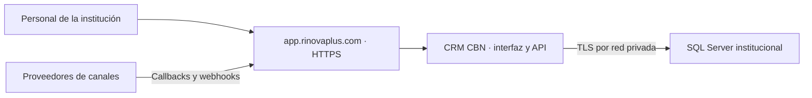

# P12 · Dominio y entrega DNS

9 de noviembre de 2026. El propietario indicó `rinovaplus.com` como dominio para la puesta online. Propuesta de origen único: `https://app.rinovaplus.com`. La consulta DNS del 9 de noviembre identificó `ns17.domaincontrol.com` y `ns18.domaincontrol.com` y devolvió NXDOMAIN para `app` y `api`. El propietario confirmó que todavía no dispone de servidor. Queda pendiente el destino Linux/Docker antes de crear el registro.

## Destino pendiente

Confirmar un servidor Linux con Docker, almacenamiento persistente y entrada pública HTTPS. El destino de DNS será la IPv4 pública del proxy o el nombre que entregue el hosting. Si SQL Server queda en la institución, comprobar la ruta privada y TLS desde el servidor del CRM antes de desplegar.

Al disponer del servidor, registrar su IP pública o nombre de destino, si ya tiene proxy HTTPS y dónde quedará SQL Server. Los accesos se gestionan por un canal privado. Crear el registro `app` cuando se conozca el destino.

## Registro que creará el propietario

| Campo | Valor |
|---|---|
| Nombre | `app` |
| Tipo | `A` si el hosting entrega IPv4 pública, o `CNAME` si entrega un nombre de destino |
| Valor | IPv4 pública o nombre exacto del hosting que servirá el CRM |
| TTL | Predeterminado del panel |

Los dos tipos son alternativas para el mismo nombre. Mantener el dominio raíz y los registros existentes. El diseño requiere un solo subdominio público. El mismo origen sirve la interfaz en `/`, la API en `/api/` y los callbacks en `/hooks/`. El backend y SQL Server se alcanzan desde la red privada del despliegue. [Ayuda para agregar un subdominio](https://www.godaddy.com/es/help/agregar-un-subdominio-4080)

## Publicación en Coolify

El propietario confirmó Coolify como plataforma de P12. El código actual toma `PublicBaseUrl` de la configuración de Canales en SQL Server. Los webhooks, OAuth y los enlaces de adjuntos de campañas construyen sus URLs desde esa base. El Compose de P11 usa loopback y carece de una referencia a una variable de origen público.

Contrato propuesto para la implementación P12:

- Declarar `CRM_PUBLIC_BASE_URL` como variable obligatoria de ejecución en el Compose de P12 con `${CRM_PUBLIC_BASE_URL:?}`. El valor para este entorno será `https://app.rinovaplus.com`. Validar un origen HTTPS exacto y usarlo como base de las URLs generadas en P12. Mantener un solo origen efectivo en el perfil público y resolver cualquier diferencia con la configuración persistida antes de habilitar OAuth.
- Configurar Domains de Coolify sobre el servicio CRM con su puerto interno. Si se conserva 4178, la entrada en el panel es `https://app.rinovaplus.com:4178`. El valor de `CRM_PUBLIC_BASE_URL` lleva el origen público sin el puerto interno. Usar el proxy de Coolify y conservar SQL Server en red privada.
- El backend debe leer y validar la variable. La declaración en el panel por sí sola no configura Canales ni habilita el perfil público. El ensayo debe verificar generación de URLs, rechazo de orígenes incorrectos, cookies seguras y retorno OAuth con la sesión original.

[Configuración de Docker Compose en Coolify](https://coolify.io/docs/applications/builds/docker-compose)

## Contrato a comprobar en P12

- La receta P11 en 4178 exige loopback para la interfaz y la API. P12 necesita su propio perfil de entrada, con host y origen exactos, cookies de sesión Secure y HttpOnly, permisos y CSRF en el backend, y validación TLS hasta SQL Server.
- El callback OAuth usa una cookie de sesión ligada al estado, al usuario y a la cuenta. Se mantendrá `Path=/`, SameSite=Lax para el retorno de primer nivel, cookie sin Domain y el origen público efectivo del perfil P12. Validar cookies y retorno OAuth en navegador. El origen único permite mantener las llamadas relativas y prescindir de CORS entre subdominios.
- En el proxy público, servir únicamente las rutas necesarias. Cerrar bootstrap público y mantener los puertos internos y comprobaciones administrativas en la red privada. Confiar cabeceras de reenvío sólo desde el proxy. Excluir consultas, cookies y credenciales de los registros.
- Canales genera sus URLs exactas. Verificar el desafío del proveedor, firmas sobre el cuerpo original, rechazo de callbacks inválidos, OAuth real con cuenta de prueba y reintentos con recibos. Registrar URLs en los proveedores cuando HTTPS esté disponible y exista alcance de prueba acordado.
- Confirmar la IP o nombre de destino y el proxy existente. Preparar el entorno separado, el perfil TLS y los mapeos SQL antes de publicar. Completar el respaldo restaurado, reversión y aprobación institucional según el [plan P12](SQL_P12_ONLINE_PLAN.md).

## Progreso

Dominio base informado y registro preparado para entrega. P12 online **0,00% de ejecución**, con 18 hitos canónicos aún pendientes. Roadmap general **93,62%**. P0, P1, P2, P3, P5 y P6 al 100%, P4 y P7 al 82,29%, P8 y P10 al 95%, P9 al 93,75% y P11 al 72,50% con el sprint local al 100%. Ver [roadmap](../../SCENTRA_ADAPTATION_ROADMAP.md). Este registro complementa la evidencia P11 y el backlog congelado.
