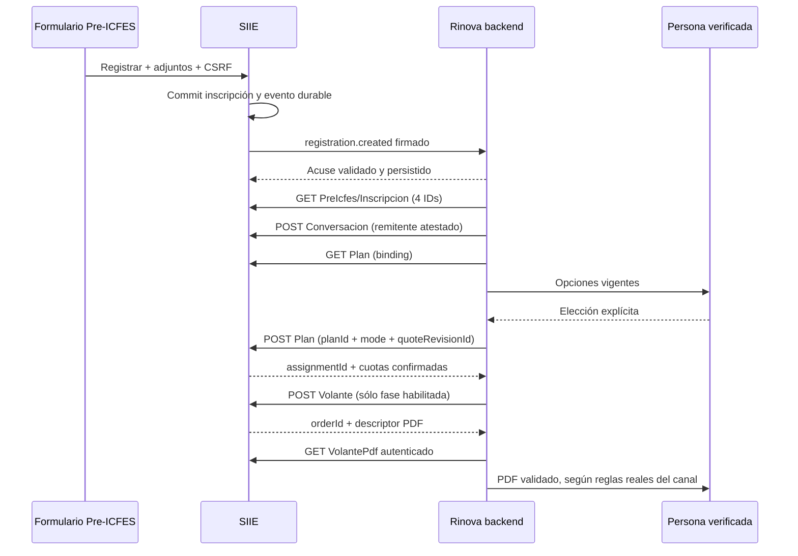

# Integración RinovaPlus ↔ SIIE: contratos y pruebas

**Una sola configuración central: `SIIE_BASE_URL`.** Todos los módulos, trabajos en cola y clientes HTTP de Rinova deben construir sus rutas desde ella. Este documento describe los endpoints actuales de SIIE y entrega solicitudes Postman; no modifica Rinova ni activa pagos o webhook.

| Entorno | Único valor de URL base |
|---|---|
| Test | `https://siieplus.online/SIIEWebPlustest/` |
| Producción | `https://siieplus.online/SIIEWEBPLUS/` |

La barra final es obligatoria. Las rutas anexadas nunca empiezan con `/`: hacerlo descartaría la carpeta virtual. Para cambiar el cliente completo a producción se cambia **solamente `SIIE_BASE_URL`** en la configuración central, manteniendo el token autorizado existente en su almacén privado. Esto presupone que producción tiene el código, esquema, configuración y catálogo correctos. Cambiar la URL no instala SQL, no crea ofertas y no cambia la dirección de salida SIIE → Rinova.

## Contenido

1. [Preparar el cliente y Postman](#preparacion)
2. [Flujo de inscripción, plan y volante](#flujo)
3. [Autenticación, filtros y errores](#errores)
4. [Inventario y contratos de las 39 operaciones](#inventario-completo)
5. [Campos completos del registro CRM](#apéndice-a--contrato-completo-de-secciones-crm)
6. [Webhook: contrato vigente del emisor](#webhook)
7. [Situación verificada y plan de pruebas](#estado)

<a id="preparacion"></a>
## Preparar el cliente y Postman

Archivos acompañantes: `SIIE-Rinova.postman_collection.json`, entornos `SIIE-Test.postman_environment.json` y `SIIE-Produccion.postman_environment.json`, `siie-client.example.mjs`, `.env.example`, `operaciones.json` y manifiesto. No contienen claves reales ni IDs de personas. El cliente JS de referencia cubre APIs autenticadas backend y PDF financiero; no automatiza el formulario público ni el login/sesión administrativa. Esos contratos permanecen en la carpeta separada de Postman.

1. Importar colección y entorno Test en Postman Desktop. Configurar en **Postman Vault** `SIIE_API_TOKEN`, con la misma clave que Rinova ya usa; autorizar acceso del script al Vault. No crear una nueva credencial institucional. `apiKey` del entorno se exporta vacío/deshabilitado únicamente para hacer visible que no se distribuye una clave; el script no lo usa. No guardar el token en variables compartidas ni exportaciones.
2. Ejecutar primero `Periodos` y los catálogos pertinentes. Los IDs de entorno están vacíos deliberadamente. No copiar IDs de otra instalación. Las escrituras tienen `ALLOW_WRITES=false`; se omiten mediante `pm.execution.skipRequest()` en el script **pre-request**. Se requiere Postman compatible con esa API y Vault; no se afirma compatibilidad de este control con Newman o clientes antiguos.
3. Elegir los registros de ensayo autorizados. Completar las variables requeridas; crear cada UUID de operación **una sola vez por intención** y conservarlo para conciliar/reintentar. No generar un UUID nuevo en cada envío. Elegir explícitamente plan/modalidad/revisión de la misma opción; la colección no elige `options[0]`.
4. Habilitar `ALLOW_WRITES=true` únicamente para enviar una operación de ensayo revisada. No ejecutar toda la colección con escrituras habilitadas. El indicador se vuelve a `false` al cambiar la base. Gateway sigue cerrado, incluso si se permiten otras escrituras.

La colección contiene pruebas de **éxito contractual**, no tolerancias para ocultar fallos. Por eso un endpoint bloqueado por configuración dará una prueba roja, aunque ese rechazo sea conocido y seguro. Los dos endpoints de pasarela prueban específicamente el circuito cerrado503. Un GET200 de Plan con `requiresConfiguration=true` también falla la prueba de cotización utilizable.

Rinova configura la base y el token sólo en Runtime de su backend. El frontend llama al backend propio; no crear VITE_/NEXT_PUBLIC_ ni copias de SIIE_BASE_URL por módulo. ALLOW_WRITES es únicamente un control del laboratorio Postman, no un segundo interruptor de producción del cliente Rinova.

El guard de cambio de base limpia solamente variables transitorias de IDs, cursores, UUID, cotizaciones y vínculos; nunca borra secretos o historial de auditoría. El primer intento después del cambio se omite para volver a consultar catálogos. El almacén de cookies de Postman es independiente: cerrar la sesión administrativa/pública anterior y obtener cookies nuevas para el destino. No compartir cookies entre carpetas virtuales del mismo host.

En Rinova, la misma regla debe aplicarse a **todos** los servicios, no sólo al formulario: clave de caché y trabajos pendientes incluyen una huella de `SIIE_BASE_URL`. Una intención pendiente de test no se reenvía a producción. Se conserva para revisión/auditoría en su entorno original. El ejemplo JS rechaza el cambio de entorno de una intención en lugar de reenviarla silenciosamente.

Referencia del guard: [Postman pm.execution.skipRequest](https://learning.postman.com/docs/tests-and-scripts/write-scripts/postman-sandbox-reference/pm-execution/). No usar un simple `throw` como sustituto de omitir una petición.

<a id="flujo"></a>
## Flujo completo y responsabilidades



SIIE es autoridad de identidad relacionada, programa/oferta/período, planes, cuotas, importe y recaudo. Rinova valida la firma del remitente WhatsApp por su canal, corrobora identidad con SIIE, obtiene elección expresa y custodia UUID/contexto/recibos. La IA no inventa importes, fechas, descuentos, niveles ni estados de pago. Enviar el PDF por WhatsApp requiere la implementación y reglas del canal en Rinova; el webhook no envía ese mensaje.

El catálogo comercial general sigue `Programs → ProgramOffers → Offer`. `program_id` es programa académico; `idOferta` es `ACProgramaOfrecido.Id_PrgOfrecido`; `offer_id` comercial es una cadena compuesta oferta-nivel. No son intercambiables. Antes de asignar a una inscripción, consultar **GET PreIcfes/Plan** y usar `options[i].quoteRevisionId`, no `data.quoteRevisionId` (este último es null). Si cambian precios/fechas/revisión, volver a mostrar y confirmar; no aceptar automáticamente una alternativa.

Consultar Periodos actualiza únicamente los selectores `crmIdPeriodo`/`commercialPeriodId` de listas y catálogos. Nunca reemplazar el período original de una inscripción por el período actualmente ofrecido. Las variables de contexto Pre-ICFES quedan separadas.

Los cuatro IDs de Pre-ICFES son `idInscripcion`, `idEstudiante`, `idOferta`, `idPeriodo`. Proceden del evento/registro corroborado. No se rellenan con el primer estudiante de una lista. `idAspirante` y `idPreinscripcion` no equivalen a ninguno de ellos. El flujo emisor actual no aporta `idPreinscripcion`. Las altas genéricas CRM no crean automáticamente el vínculo de grupo/outbox Pre-ICFES: no son una entrada intercambiable a este flujo financiero. GET PreIcfes/Inscripcion corrobora; nunca crea.

<a id="errores"></a>
## Autenticación, transporte y errores comunes

- Todas las integraciones de lectura/registro CRM, Commercial, Preinscripciones y Moodle usan el token backend existente `SIIE_API_TOKEN`: encabezado `X-API-Key` o Bearer. Nunca clave en query ni en JavaScript del navegador público. Mantener TLS y no seguir redirecciones transportando credenciales/cuerpos. Los endpoints Preinscripciones/Moodle de esta guía usan su URL canónica sin `.aspx` para evitar301.
- `PagoNotificacion` es una excepción deliberada: no acepta callbacks y devuelve503 antes de validar la API key. No hay contrato de firma de proveedor implementado ni pago autorizado por este endpoint.
- Formulario público: sesión/cookie + `X-CSRF-Token`, no API key. Descarga de adjunto administrativo: sesión/permiso institucional, no API key. PDF financiero CRM: API key + binding + identidad + orden.
- Ventanas por clave/IP/ruta: lecturas CRM/registro/Pre-ICFES/Moodle/Preinscripciones120 por minuto; escrituras30; Commercial60. Leer `X-RateLimit-Limit`, `X-RateLimit-Remaining` y `Retry-After` reales. No tratarlo como presupuesto global ni ejecutar cientos de solicitudes concurrentes.
- Política recomendada del consumidor: timeout explícito30s, una petición financiera en curso por intención, reintentos de lectura con espera creciente/jitter ante429/503 respetando Retry-After. Es una política del cliente, no garantía de que el servidor termine antes. Tras timeout de escritura idempotente consultar antes de repetir; las escrituras legacy sin UUID requieren conciliación, no reintento ciego.
- JSON de integración CRM: normalmente `{status:"ok",data:...}`; Pre-ICFES añade `schemaVersion:1`. Commercial devuelve contrato raíz `schema_version/source_revision`; catálogos legacy usan `data`; Moodle usa `status:"ok",data`. No imponer un único deserializador ciego. PDF/adjuntos son binarios.

| HTTP | Interpretación y acción |
|---|---|
| 200/201 | Comprobar también éxito de negocio y forma; RecibirPreinscripcion puede devolver200/status error. Plan200 puede indicar configuración incompleta. |
| 400 | Parámetros, tipos, campos desconocidos, revisión o JSON inválidos; corregir, no reintentar igual. |
| 401 | Token ausente/inválido; revisar credencial privada y entorno. No registrar la clave. |
| 403 | CSRF/sesión/binding/permiso según ruta. Un403 webhook tiene otro contrato HMAC. |
| 404 | Recurso no encontrado en ese contexto. Tras operación incierta no crear otro UUID sólo por un error de consulta. |
| 405 | Método no implementado; no hay DELETE de negocio. OPTIONS puede responder204. |
| 409 | Conflicto de identidad, revisión, idempotencia, asignación/orden o versión PDF. Resolver y corroborar, sin sobreescribir. |
| 413/415 | Tamaño/formato/cuerpo no admitido. Multipart no lleva boundary escrito manualmente. |
| 422 | Fuente/configuración insuficiente o datos no representables. Commercial partial_offer no autoriza cotizar. |
| 429 | Respetar Retry-After; no cambiar clave/IP para evadir límites. |
| 500/503 | Fallo/indisponibilidad: conservar contexto/UUID y conciliar. Un503 de pasarela desactivada es circuito cerrado, no prueba de pago. |

Guardar logs técnicos mínimos: entorno, ruta, método, estado HTTP, código seguro y UUID de operación. No claves, firmas, cuerpos de registro, cédulas, teléfonos, cookies ni PDF. El error500 legacy puede contener detalle interno: no reenviarlo al usuario ni almacenarlo completo.

UUID de seguimiento: `operationId` + `idSeguimientoCrm`. UUID de Conversacion/Plan/Volante: `requestId` distinto por operación. Son nombres contractuales diferentes. `ConsultaOperacion` usa `requestId` y `operation`. Una repetición conserva cuerpo y UUID; si el binding se renueva, consultar la intención anterior con el vínculo vigente antes de decidir otra escritura. Las asignaciones/órdenes son síncronas: no se documenta202 ni sondeo de un estado inventado `processing`.

## Inventario completo

34 rutas de integración/36 operaciones y 2 rutas públicas/3 operaciones: **36 rutas y 39 operaciones de negocio**. OPTIONS no se cuenta como operación de negocio; DELETE no existe.

| Nº | Método | Ruta relativa a SIIE_BASE_URL | Éxito contractual / circuito cerrado |
|---|---|---|---|
| [1](#op-1) | GET | `Api/CRM/v1/Periodos.aspx` | 200 |
| [2](#op-2) | GET | `Api/CRM/v1/EstadosSeguimiento.aspx` | 200 |
| [3](#op-3) | GET | `Api/CRM/v1/FiltrosAdmisiones.aspx` | 200 |
| [4](#op-4) | GET | `Api/CRM/v1/Aspirantes.aspx` | 200 |
| [5](#op-5) | GET | `Api/CRM/v1/Aspirante.aspx` | 200 |
| [6](#op-6) | GET | `Api/CRM/v1/HistorialSeguimiento.aspx` | 200 |
| [7](#op-7) | POST | `Api/CRM/v1/Seguimientos.aspx` | 201 |
| [8](#op-8) | PUT | `Api/CRM/v1/Seguimientos.aspx` | 200 |
| [9](#op-9) | GET | `Api/CRM/v1/Commercial/Programs.aspx` | 200 |
| [10](#op-10) | GET | `Api/CRM/v1/Commercial/ProgramOffers.aspx` | 200 |
| [11](#op-11) | GET | `Api/CRM/v1/Commercial/Offer.aspx` | 200 |
| [12](#op-12) | GET | `Api/CRM/v1/Estudiantes.aspx` | 200 |
| [13](#op-13) | GET | `Api/CRM/v1/Estudiante.aspx` | 200 |
| [14](#op-14) | GET | `Api/CRM/v1/FiltrosEstudiantes.aspx` | 200 |
| [15](#op-15) | GET | `Api/Preinscripciones/v1/Escuelas` | 200 |
| [16](#op-16) | GET | `Api/Preinscripciones/v1/TiposDocumento` | 200 |
| [17](#op-17) | GET | `Api/Preinscripciones/v1/ProgramasAcademicos` | 200 |
| [18](#op-18) | POST | `Api/Preinscripciones/v1/RecibirPreinscripcion` | 200 |
| [19](#op-19) | GET | `Api/Moodle/v1/Programas` | 200 |
| [20](#op-20) | GET | `Api/Moodle/v1/Asignaturas` | 200 |
| [21](#op-21) | GET | `Api/Moodle/v1/EstudiantesMatriculados` | 200 |
| [22](#op-22) | POST | `Api/CRM/v1/AspiranteRegistro.aspx` | 201 |
| [23](#op-23) | GET | `Api/CRM/v1/DocumentosRequeridos.aspx` | 200 |
| [24](#op-24) | POST | `Api/CRM/v1/Inscripcion.aspx` | 201 |
| [25](#op-25) | POST | `Api/CRM/v1/Documentos.aspx` | 201 |
| [26](#op-26) | GET | `Api/CRM/v1/CatalogosInscripcion.aspx` | 200 |
| [27](#op-27) | GET | `Api/CRM/v1/PreIcfes/Inscripcion.aspx` | 200 |
| [28](#op-28) | POST | `Api/CRM/v1/PreIcfes/Conversacion.aspx` | 200 |
| [29](#op-29) | GET | `Api/CRM/v1/PreIcfes/Plan.aspx` | 200 |
| [30](#op-30) | POST | `Api/CRM/v1/PreIcfes/Plan.aspx` | 200 |
| [31](#op-31) | POST | `Api/CRM/v1/PreIcfes/Volante.aspx` | 200 |
| [32](#op-32) | GET | `Api/CRM/v1/PreIcfes/ConsultaOperacion.aspx` | 200 |
| [33](#op-33) | GET | `Api/CRM/v1/PreIcfes/VolantePdf.aspx` | 200 |
| [34](#op-34) | GET | `Api/CRM/v1/PreIcfes/PagoEstado.aspx` | 200 |
| [35](#op-35) | POST | `Api/CRM/v1/PreIcfes/PagoIniciar.aspx` | 503 |
| [36](#op-36) | POST | `Api/CRM/v1/PreIcfes/PagoNotificacion.aspx` | 503 |
| [37](#op-37) | GET | `PreIcfes/Api/Inscripcion.ashx` | 200 |
| [38](#op-38) | POST | `PreIcfes/Api/Inscripcion.ashx` | 200 |
| [39](#op-39) | GET | `PreIcfes/Api/Documento.ashx` | 200 |

<a id="op-1"></a>
### 1. Consultar períodos

`GET {{SIIE_BASE_URL}}Api/CRM/v1/Periodos.aspx`

incluirHistoricos es 0 o 1. Ofrecido y activo son conceptos diferentes; no sustituir uno por otro.

| Query | Tipo / obligatoriedad | Uso |
|---|---|---|
| `incluirHistoricos` | Opcional; texto | Opcional. Habilitar para incluir todos los períodos históricos. |

Respuesta 200, **plantilla de contrato, no datos reales** (marcadores entre < > indican tipo):

```json
{
  "status": "ok",
  "data": {
    "items": [
      {
        "id": "<entero nativo>",
        "nombre": "<etiqueta>",
        "activo": false
      }
    ],
    "idPeriodoActivo": "<entero>",
    "idPeriodoOfrecido": "<entero>",
    "fuentePeriodoOfrecido": "<fuente>",
    "requiereSeleccion": false
  }
}
```

Errores y reintentos: ver [tabla común](#errores). No convertir 400/401/403/404/409/415/422/429/500/503 en éxito ni guardar el cuerpo de error con datos personales.

<a id="op-2"></a>
### 2. Consultar estados de seguimiento

`GET {{SIIE_BASE_URL}}Api/CRM/v1/EstadosSeguimiento.aspx`

Usar los IDs de este catálogo al escribir seguimiento.

Respuesta 200, **plantilla de contrato, no datos reales** (marcadores entre < > indican tipo):

```json
{
  "status": "ok",
  "data": {
    "items": [
      {
        "id": "<entero>",
        "nombre": "<estado>"
      }
    ]
  }
}
```

Errores y reintentos: ver [tabla común](#errores). No convertir 400/401/403/404/409/415/422/429/500/503 en éxito ni guardar el cuerpo de error con datos personales.

<a id="op-3"></a>
### 3. Consultar filtros del período

`GET {{SIIE_BASE_URL}}Api/CRM/v1/FiltrosAdmisiones.aspx`

Filtros derivados de aspirantes existentes en el período; una lista vacía no autoriza inventar IDs.

| Query | Tipo / obligatoriedad | Uso |
|---|---|---|
| `idPeriodo` | Opcional; entero positivo (offset admite 0) | Opcional. Omitido usa el período ofrecido del servidor; habilitar con ID explícito para consultar otro período, incluido histórico. Mantener el período efectivo al paginar. |

Respuesta 200, **plantilla de contrato, no datos reales** (marcadores entre < > indican tipo):

```json
{
  "status": "ok",
  "data": {
    "idPeriodo": "<entero>",
    "items": [
      {
        "idPrograma": "<entero>",
        "programa": "<nombre>",
        "idJornada": "<entero>",
        "jornada": "<nombre>"
      }
    ]
  }
}
```

Errores y reintentos: ver [tabla común](#errores). No convertir 400/401/403/404/409/415/422/429/500/503 en éxito ni guardar el cuerpo de error con datos personales.

<a id="op-4"></a>
### 4. Listar aspirantes

`GET {{SIIE_BASE_URL}}Api/CRM/v1/Aspirantes.aspx`

Páginas de 25, offset 0–1000000, q máximo 100; idPrograma/idJornada positivos opcionales. Mantener todos los filtros al paginar. No interpreta confirmadoOrigen como matrícula.

| Query | Tipo / obligatoriedad | Uso |
|---|---|---|
| `idPeriodo` | Opcional; entero positivo (offset admite 0) | Opcional. Omitido usa el período ofrecido del servidor; habilitar con ID explícito para consultar otro período, incluido histórico. Mantener el período efectivo al paginar. |
| `q` | Opcional; texto | Opcional. Búsqueda contenida por nombre/apellidos o documento, hasta 100 caracteres. |
| `idPrograma` | Opcional; entero positivo (offset admite 0) | Opcional. Entero positivo del catálogo de filtros. |
| `idJornada` | Opcional; entero positivo (offset admite 0) | Opcional. Entero positivo de jornada del programa. |
| `offset` | Opcional; entero positivo (offset admite 0) | Opcional. 0 a 1000000; predeterminado 0. Avanzar 25 cuando hasMore sea true. |

Respuesta 200, **plantilla de contrato, no datos reales** (marcadores entre < > indican tipo):

```json
{
  "status": "ok",
  "data": {
    "items": [],
    "offset": 0,
    "limit": 25,
    "hasMore": false
  }
}
```

Errores y reintentos: ver [tabla común](#errores). No convertir 400/401/403/404/409/415/422/429/500/503 en éxito ni guardar el cuerpo de error con datos personales.

<a id="op-5"></a>
### 5. Consultar ficha de aspirante

`GET {{SIIE_BASE_URL}}Api/CRM/v1/Aspirante.aspx?idAspirante={{crmIdAspirante}}`

idAspirante obligatorio; 404 si no pertenece al contexto. No expone el documento en esta ficha; la corroboración Pre-ICFES utiliza su endpoint propio.

| Query | Tipo / obligatoriedad | Uso |
|---|---|---|
| `idAspirante` | Obligatorio en esta variante; entero positivo (offset admite 0) | Obligatorio. ID obtenido del listado. |
| `idPeriodo` | Opcional; entero positivo (offset admite 0) | Opcional. Omitido usa el período ofrecido del servidor; habilitar con ID explícito para consultar otro período, incluido histórico. Mantener el período efectivo al paginar. |

Respuesta 200, **plantilla de contrato, no datos reales** (marcadores entre < > indican tipo):

```json
{
  "status": "ok",
  "data": {
    "aspirante": {
      "idAspirante": "<entero>",
      "nombre": "<texto>",
      "telefono": "<texto|null>",
      "celular": "<texto|null>",
      "correo": "<texto|null>",
      "idOferta": "<entero>",
      "idPrograma": "<entero>",
      "idPeriodo": "<entero>"
    },
    "jornadasOferta": []
  }
}
```

Errores y reintentos: ver [tabla común](#errores). No convertir 400/401/403/404/409/415/422/429/500/503 en éxito ni guardar el cuerpo de error con datos personales.

<a id="op-6"></a>
### 6. Consultar historial de seguimiento

`GET {{SIIE_BASE_URL}}Api/CRM/v1/HistorialSeguimiento.aspx?idAspirante={{crmIdAspirante}}`

idAspirante obligatorio. Historia ordenada y paginada; las filas nativas ajenas a la integración no se pueden corregir con PUT.

| Query | Tipo / obligatoriedad | Uso |
|---|---|---|
| `idAspirante` | Obligatorio en esta variante; entero positivo (offset admite 0) | Obligatorio. ID del aspirante. |
| `idPeriodo` | Opcional; entero positivo (offset admite 0) | Opcional. Omitido usa el período ofrecido del servidor; habilitar con ID explícito para consultar otro período, incluido histórico. Mantener el período efectivo al paginar. |
| `offset` | Opcional; entero positivo (offset admite 0) | Opcional. 0 a 1000000; predeterminado 0; páginas de 25. |

Respuesta 200, **plantilla de contrato, no datos reales** (marcadores entre < > indican tipo):

```json
{
  "status": "ok",
  "data": {
    "items": [],
    "offset": 0,
    "limit": 25,
    "hasMore": false
  }
}
```

Errores y reintentos: ver [tabla común](#errores). No convertir 400/401/403/404/409/415/422/429/500/503 en éxito ni guardar el cuerpo de error con datos personales.

<a id="op-7"></a>
### 7. CREAR seguimiento en SIIE

`POST {{SIIE_BASE_URL}}Api/CRM/v1/Seguimientos.aspx`

POST: expectedRevision=0, status201. PUT: idSeguimiento en query y expectedRevision vigente, status200. operationId e idSeguimientoCrm UUID obligatorios; observacion1–2000, autorCrmId1–128, autorCrmNombre1–200, ocurridoUtc ISO UTC Z/+00:00, proximoContacto yyyy-MM-dd o null. Misma operación/cuerpo reproduce resultado; UUID reutilizado con otros datos o revisión obsoleta:409. No genera matrícula/pago.

Solicitud (`{{variable}}` se sustituye por su valor antes de enviar):

```json
{
  "operationId": "{{createOperationId}}",
  "idSeguimientoCrm": "{{idSeguimientoCrm}}",
  "idAspirante": {{crmIdAspirante}},
  "idPeriodo": {{crmIdPeriodo}},
  "idEstadoSeguimiento": {{idEstadoSeguimiento}},
  "expectedRevision": 0,
  "observacion": "REEMPLAZAR por la observación revisada antes de enviar.",
  "proximoContacto": null,
  "ocurridoUtc": "{{ocurridoUtc}}",
  "autorCrmId": "{{autorCrmId}}",
  "autorCrmNombre": "{{autorCrmNombre}}"
}
```

Respuesta 201, **plantilla de contrato, no datos reales** (marcadores entre < > indican tipo):

```json
{
  "status": "ok",
  "data": {
    "idSeguimiento": "<entero>",
    "idSeguimientoCrm": "<UUID>",
    "idAspirante": "<entero>",
    "idPeriodo": "<entero>",
    "revision": 1,
    "operationId": "<UUID>",
    "recibidoUtc": "<ISO UTC>"
  }
}
```

Errores y reintentos: ver [tabla común](#errores). No convertir 400/401/403/404/409/415/422/429/500/503 en éxito ni guardar el cuerpo de error con datos personales.

<a id="op-8"></a>
### 8. CORREGIR seguimiento de la integración

`PUT {{SIIE_BASE_URL}}Api/CRM/v1/Seguimientos.aspx?idSeguimiento={{idSeguimiento}}`

POST: expectedRevision=0, status201. PUT: idSeguimiento en query y expectedRevision vigente, status200. operationId e idSeguimientoCrm UUID obligatorios; observacion1–2000, autorCrmId1–128, autorCrmNombre1–200, ocurridoUtc ISO UTC Z/+00:00, proximoContacto yyyy-MM-dd o null. Misma operación/cuerpo reproduce resultado; UUID reutilizado con otros datos o revisión obsoleta:409. No genera matrícula/pago.

| Query | Tipo / obligatoriedad | Uso |
|---|---|---|
| `idSeguimiento` | Obligatorio en esta variante; entero positivo (offset admite 0) | Obligatorio. ID nativo del comprobante POST o historial de integración. |

Solicitud (`{{variable}}` se sustituye por su valor antes de enviar):

```json
{
  "operationId": "{{updateOperationId}}",
  "idSeguimientoCrm": "{{idSeguimientoCrm}}",
  "idAspirante": {{crmIdAspirante}},
  "idPeriodo": {{crmIdPeriodo}},
  "idEstadoSeguimiento": {{idEstadoSeguimiento}},
  "expectedRevision": {{expectedRevision}},
  "observacion": "REEMPLAZAR por la corrección revisada antes de enviar.",
  "proximoContacto": null,
  "ocurridoUtc": "{{ocurridoUtc}}",
  "autorCrmId": "{{autorCrmId}}",
  "autorCrmNombre": "{{autorCrmNombre}}"
}
```

Respuesta 200, **plantilla de contrato, no datos reales** (marcadores entre < > indican tipo):

```json
{
  "status": "ok",
  "data": {
    "idSeguimiento": "<entero>",
    "idSeguimientoCrm": "<UUID>",
    "idAspirante": "<entero>",
    "idPeriodo": "<entero>",
    "revision": 1,
    "operationId": "<UUID>",
    "recibidoUtc": "<ISO UTC>"
  }
}
```

Errores y reintentos: ver [tabla común](#errores). No convertir 400/401/403/404/409/415/422/429/500/503 en éxito ni guardar el cuerpo de error con datos personales.

<a id="op-9"></a>
### 9. Listar programas del catálogo

`GET {{SIIE_BASE_URL}}Api/CRM/v1/Commercial/Programs.aspx`

Respuesta comercial en raíz, sin status/data. Cada programa expone program_id,code,name,school_id,school,modality_id,modality,shift_id,schedule,duration_levels. Página25; cursor opaco de next_cursor.

| Query | Tipo / obligatoriedad | Uso |
|---|---|---|
| `period_id` | Opcional; entero positivo (offset admite 0) | Opcional. Omitido usa el período ofrecido del servidor; habilitar con ID explícito para consultar otro período, incluido histórico. Mantener el período efectivo al paginar. |
| `cursor` | Opcional; texto | Opcional. Copiar next_cursor de esta misma consulta. Omitir en primera página. |

Respuesta 200, **plantilla de contrato, no datos reales** (marcadores entre < > indican tipo):

```json
{
  "schema_version": "siie-crm-commercial-v1",
  "source_revision": "<huella>",
  "period_id": "<texto ID>",
  "offered_period_id": "<texto ID>",
  "items": [],
  "next_cursor": null,
  "pagination": "keyset_live_catalog"
}
```

Errores y reintentos: ver [tabla común](#errores). No convertir 400/401/403/404/409/415/422/429/500/503 en éxito ni guardar el cuerpo de error con datos personales.

<a id="op-10"></a>
### 10. Listar ofertas y niveles del programa

`GET {{SIIE_BASE_URL}}Api/CRM/v1/Commercial/ProgramOffers.aspx?program_id={{programId}}`

program_id obligatorio (programa académico). Cada offer_id es compuesto oferta-nivel (por ejemplo <idOferta>-n<nivel>), y no se envía como idOferta entero. Conservar período/programa al reutilizar cursor.

| Query | Tipo / obligatoriedad | Uso |
|---|---|---|
| `program_id` | Obligatorio en esta variante; entero positivo (offset admite 0) | Obligatorio. Entero positivo obtenido de Programs. |
| `period_id` | Opcional; entero positivo (offset admite 0) | Opcional. Omitido usa el período ofrecido del servidor; habilitar con ID explícito para consultar otro período, incluido histórico. Mantener el período efectivo al paginar. |
| `cursor` | Opcional; texto | Opcional. Copiar next_cursor manteniendo programa y período. |

Respuesta 200, **plantilla de contrato, no datos reales** (marcadores entre < > indican tipo):

```json
{
  "schema_version": "siie-crm-commercial-v1",
  "source_revision": "<huella>",
  "items": [],
  "next_cursor": null
}
```

Errores y reintentos: ver [tabla común](#errores). No convertir 400/401/403/404/409/415/422/429/500/503 en éxito ni guardar el cuerpo de error con datos personales.

<a id="op-11"></a>
### 11. Consultar oferta académica y comercial parcial

`GET {{SIIE_BASE_URL}}Api/CRM/v1/Commercial/Offer.aspx?offer_id={{commercialOfferId}}`

Actualmente devuelve422 con partial_offer cuando la fuente no permite cotizar. Los flags conditions_missing y admission_requirements_missing son añadidos por código: no los resuelve Rinova ni editar importes. No usar el parcial para cobrar. Para asignación Pre-ICFES la autoridad es GET PreIcfes/Plan con binding.

| Query | Tipo / obligatoriedad | Uso |
|---|---|---|
| `offer_id` | Obligatorio en esta variante; texto | Obligatorio. ID completo obtenido de ProgramOffers, con sufijo -nNivel. |

Respuesta 200, **plantilla de contrato, no datos reales** (marcadores entre < > indican tipo):

```json
{
  "schema_version": "siie-crm-commercial-v1",
  "code": "source_data_incomplete",
  "partial_offer": {
    "offer_id": "<idOferta>-n<nivel>",
    "quotable": false
  },
  "data_quality": {
    "issues": []
  }
}
```

Errores y reintentos: ver [tabla común](#errores). No convertir 400/401/403/404/409/415/422/429/500/503 en éxito ni guardar el cuerpo de error con datos personales.

<a id="op-12"></a>
### 12. Estudiantes

`GET {{SIIE_BASE_URL}}Api/CRM/v1/Estudiantes.aspx`

Listado basado en GEMatricula, no sustituto de la corroboración de inscripciones todavía sin matrícula. idEstadoMatricula admite 0 o positivo; estados nativos 0 Inscrito,1 Plan Asignado,2 Matriculado,3 Retirado. q máximo100; página25.

| Query | Tipo / obligatoriedad | Uso |
|---|---|---|
| `idPeriodo` | Opcional; entero positivo (offset admite 0) | Opcional: ofrecido si se omite; habilitar para un período explícito/histórico. |
| `idPrograma` | Opcional; entero positivo (offset admite 0) | Obtener del flujo del mismo entorno; no copiar IDs de test a producción. |
| `idJornada` | Opcional; entero positivo (offset admite 0) | Obtener del flujo del mismo entorno; no copiar IDs de test a producción. |
| `idEstadoMatricula` | Opcional; entero positivo (offset admite 0) | Obtener del flujo del mismo entorno; no copiar IDs de test a producción. |
| `q` | Opcional; texto | Obtener del flujo del mismo entorno; no copiar IDs de test a producción. |
| `offset` | Opcional; entero positivo (offset admite 0) | Obtener del flujo del mismo entorno; no copiar IDs de test a producción. |

Respuesta 200, **plantilla de contrato, no datos reales** (marcadores entre < > indican tipo):

```json
{
  "status": "ok",
  "data": {
    "idPeriodo": "<entero>",
    "items": [],
    "offset": 0,
    "limit": 25,
    "hasMore": false,
    "procedencia": {
      "identidad": "GEEstudiante.Id_Estudiante",
      "matricula": "GEMatricula.Id_Matricula"
    }
  }
}
```

Errores y reintentos: ver [tabla común](#errores). No convertir 400/401/403/404/409/415/422/429/500/503 en éxito ni guardar el cuerpo de error con datos personales.

<a id="op-13"></a>
### 13. Estudiante

`GET {{SIIE_BASE_URL}}Api/CRM/v1/Estudiante.aspx?idEstudiante={{crmIdEstudiante}}`

idEstudiante obligatorio. matriculas contiene idMatricula/idPeriodo/idOferta/idPeriodoOferta/idPrograma/idEscuela/idModalidad/idJornada/nivel/fechaMatricula; idPeriodoIngreso/idSede pueden ser null.

| Query | Tipo / obligatoriedad | Uso |
|---|---|---|
| `idEstudiante` | Obligatorio en esta variante; entero positivo (offset admite 0) | Obtener del flujo del mismo entorno; no copiar IDs de test a producción. |
| `idPeriodo` | Opcional; entero positivo (offset admite 0) | Opcional: ofrecido si se omite; habilitar para un período explícito/histórico. |

Respuesta 200, **plantilla de contrato, no datos reales** (marcadores entre < > indican tipo):

```json
{
  "status": "ok",
  "data": {
    "idPeriodo": "<entero>",
    "estudiante": {
      "idEstudiante": "<entero>",
      "nombre": "<texto>",
      "telefono": "<texto|null>",
      "celular": "<texto|null>",
      "correo": "<texto|null>",
      "idEstadoMatricula": "<entero>",
      "estadoMatricula": "<texto|null>"
    },
    "matriculas": [],
    "procedencia": {}
  }
}
```

Errores y reintentos: ver [tabla común](#errores). No convertir 400/401/403/404/409/415/422/429/500/503 en éxito ni guardar el cuerpo de error con datos personales.

<a id="op-14"></a>
### 14. FiltrosEstudiantes

`GET {{SIIE_BASE_URL}}Api/CRM/v1/FiltrosEstudiantes.aspx`

Selecciones válidas del período para el listado.

| Query | Tipo / obligatoriedad | Uso |
|---|---|---|
| `idPeriodo` | Opcional; entero positivo (offset admite 0) | Opcional: ofrecido si se omite; habilitar para un período explícito/histórico. |

Respuesta 200, **plantilla de contrato, no datos reales** (marcadores entre < > indican tipo):

```json
{
  "status": "ok",
  "data": {
    "idPeriodo": "<entero>",
    "programas": [],
    "jornadas": [],
    "niveles": [],
    "estadosMatricula": []
  }
}
```

Errores y reintentos: ver [tabla común](#errores). No convertir 400/401/403/404/409/415/422/429/500/503 en éxito ni guardar el cuerpo de error con datos personales.

<a id="op-15"></a>
### 15. Escuelas

`GET {{SIIE_BASE_URL}}Api/Preinscripciones/v1/Escuelas`

Consultar la forma real data y conservar nombres nativos. URL canónica sin .aspx.

Respuesta 200, **plantilla de contrato, no datos reales** (marcadores entre < > indican tipo):

```json
{
  "status": "ok",
  "data": [
    {
      "Id_Escuela": "<entero>",
      "NombreEscuela": "<texto>"
    }
  ]
}
```

Errores y reintentos: ver [tabla común](#errores). No convertir 400/401/403/404/409/415/422/429/500/503 en éxito ni guardar el cuerpo de error con datos personales.

<a id="op-16"></a>
### 16. Tipos de documento

`GET {{SIIE_BASE_URL}}Api/Preinscripciones/v1/TiposDocumento`

Obtener TipoDocumento de este catálogo, no inferir el ID del catálogo CRM.

Respuesta 200, **plantilla de contrato, no datos reales** (marcadores entre < > indican tipo):

```json
{
  "status": "ok",
  "data": [
    {
      "Identificacion": "<texto>",
      "Abreviatura": "<texto>"
    }
  ]
}
```

Errores y reintentos: ver [tabla común](#errores). No convertir 400/401/403/404/409/415/422/429/500/503 en éxito ni guardar el cuerpo de error con datos personales.

<a id="op-17"></a>
### 17. Programas académicos

`GET {{SIIE_BASE_URL}}Api/Preinscripciones/v1/ProgramasAcademicos?idEscuela={{idEscuela}}`

idEscuela entero positivo obligatorio; id_programa y ProgramaInteres del POST deben corresponder al programa devuelto.

| Query | Tipo / obligatoriedad | Uso |
|---|---|---|
| `idEscuela` | Obligatorio en esta variante; entero positivo (offset admite 0) | Obtener del flujo del mismo entorno; no copiar IDs de test a producción. |

Respuesta 200, **plantilla de contrato, no datos reales** (marcadores entre < > indican tipo):

```json
{
  "status": "ok",
  "data": [
    {
      "Id_PrgOfrecido": "<texto ID oferta>",
      "NombrePrograma": "<texto>"
    }
  ]
}
```

Errores y reintentos: ver [tabla común](#errores). No convertir 400/401/403/404/409/415/422/429/500/503 en éxito ni guardar el cuerpo de error con datos personales.

<a id="op-18"></a>
### 18. Recibir preinscripción — ESCRITURA

`POST {{SIIE_BASE_URL}}Api/Preinscripciones/v1/RecibirPreinscripcion`

Éxito real200/status ok. También usa200/status error para JSON o datos inválidos: 200 solo NO confirma alta. Documento1–30, NombreCompleto3–150, ProgramaInteres1–250, id_programa texto1–20, NumeroContacto7–20 dígitos, Correo hasta254, TipoDocumento1–10. Sin operationId; no reintentar automáticamente una escritura incierta. No retorna idPreinscripcion nativo.

Solicitud (`{{variable}}` se sustituye por su valor antes de enviar):

```json
{
  "Documento": "{{documentoEnsayo}}",
  "NombreCompleto": "PERSONA DE ENSAYO",
  "ProgramaInteres": "{{nombrePrograma}}",
  "id_programa": "{{idProgramaPreinscripcion}}",
  "NumeroContacto": "{{celularEnsayo}}",
  "Correo": "ensayo@example.invalid",
  "TipoDocumento": "{{tipoDocumentoTexto}}"
}
```

Respuesta 200, **plantilla de contrato, no datos reales** (marcadores entre < > indican tipo):

```json
{
  "status": "ok",
  "message": "Aspirante recibido por WebForm.",
  "Documento": "<documento sintético>"
}
```

Errores y reintentos: ver [tabla común](#errores). No convertir 400/401/403/404/409/415/422/429/500/503 en éxito ni guardar el cuerpo de error con datos personales.

<a id="op-19"></a>
### 19. Programas Moodle

`GET {{SIIE_BASE_URL}}Api/Moodle/v1/Programas?idEscuela={{idEscuela}}`

Moodle: idEscuela requerido. El ID que alimenta idPrograma de los siguientes endpoints es Id_PrgOfrecido, no ACProgramas.Id_Programa.

| Query | Tipo / obligatoriedad | Uso |
|---|---|---|
| `idEscuela` | Obligatorio en esta variante; entero positivo (offset admite 0) | Obtener del flujo del mismo entorno; no copiar IDs de test a producción. |

Respuesta 200, **plantilla de contrato, no datos reales** (marcadores entre < > indican tipo):

```json
{
  "status": "ok",
  "data": [
    {
      "Id_PrgOfrecido": "<entero>",
      "NombrePrograma": "<texto>",
      "Jornada": "<texto>"
    }
  ]
}
```

Errores y reintentos: ver [tabla común](#errores). No convertir 400/401/403/404/409/415/422/429/500/503 en éxito ni guardar el cuerpo de error con datos personales.

<a id="op-20"></a>
### 20. Asignaturas Moodle

`GET {{SIIE_BASE_URL}}Api/Moodle/v1/Asignaturas?idPrograma={{idProgramaMoodle}}&nivel={{nivelMoodle}}`

idPrograma (oferta) y nivel positivos obligatorios.

| Query | Tipo / obligatoriedad | Uso |
|---|---|---|
| `idPrograma` | Obligatorio en esta variante; entero positivo (offset admite 0) | Obtener del flujo del mismo entorno; no copiar IDs de test a producción. |
| `nivel` | Obligatorio en esta variante; entero positivo (offset admite 0) | Obtener del flujo del mismo entorno; no copiar IDs de test a producción. |

Respuesta 200, **plantilla de contrato, no datos reales** (marcadores entre < > indican tipo):

```json
{
  "status": "ok",
  "data": [
    {
      "Id_AsignaturaPlan": "<entero>",
      "NombreAsignatura": "<texto>"
    }
  ]
}
```

Errores y reintentos: ver [tabla común](#errores). No convertir 400/401/403/404/409/415/422/429/500/503 en éxito ni guardar el cuerpo de error con datos personales.

<a id="op-21"></a>
### 21. Estudiantes matriculados Moodle

`GET {{SIIE_BASE_URL}}Api/Moodle/v1/EstudiantesMatriculados?idPrograma={{idProgramaMoodle}}&idAsignatura={{idAsignaturaMoodle}}&nivel={{nivelMoodle}}`

idPrograma (oferta), idAsignatura (Id_AsignaturaPlan), nivel obligatorios. Devuelve IdPrograma,Programa,AbreviaturaNombrePrograma,NivelesPrograma,Jornada,Documento,Nombres,Apellidos,CorreoElectronico,NivelEstudiante,IdAsignatura,Asignatura,DocumentoDocente,NombreDocente,ApellidosDocente,CorreoDocente. Defecto confirmado de filtros en BAU; no importar masivamente esta respuesta hasta aplicar y verificar corrección.

| Query | Tipo / obligatoriedad | Uso |
|---|---|---|
| `idPrograma` | Obligatorio en esta variante; entero positivo (offset admite 0) | Obtener del flujo del mismo entorno; no copiar IDs de test a producción. |
| `idAsignatura` | Obligatorio en esta variante; entero positivo (offset admite 0) | Obtener del flujo del mismo entorno; no copiar IDs de test a producción. |
| `nivel` | Obligatorio en esta variante; entero positivo (offset admite 0) | Obtener del flujo del mismo entorno; no copiar IDs de test a producción. |

Respuesta 200, **plantilla de contrato, no datos reales** (marcadores entre < > indican tipo):

```json
{
  "status": "ok",
  "data": []
}
```

Errores y reintentos: ver [tabla común](#errores). No convertir 400/401/403/404/409/415/422/429/500/503 en éxito ni guardar el cuerpo de error con datos personales.

<a id="op-22"></a>
### 22. Crear aspirante

`POST {{SIIE_BASE_URL}}Api/CRM/v1/AspiranteRegistro.aspx`

201. idOferta/idPeriodo/tipoId enteros positivos; documento alfanumérico1–16, nombres1–100, primerApellido1–30, celular/correo hasta50. Opcionales segundoApellido≤30 y telefono≤50. Oferta debe pertenecer al período ofrecido. Documento ya existente en oferta:409 applicant_exists. No operationId ni creación de matrícula.

Solicitud (`{{variable}}` se sustituye por su valor antes de enviar):

```json
{
  "idOferta": {{crmIdOferta}},
  "idPeriodo": {{crmIdPeriodo}},
  "documento": "{{documentoEnsayo}}",
  "tipoId": {{tipoId}},
  "nombres": "ANA MARIA",
  "primerApellido": "PEREZ",
  "segundoApellido": "LOPEZ",
  "telefono": "6050000000",
  "celular": "3000000000",
  "correo": "ensayo@example.invalid"
}
```

Respuesta 201, **plantilla de contrato, no datos reales** (marcadores entre < > indican tipo):

```json
{
  "status": "ok",
  "data": {
    "idAspirante": "<entero>",
    "idOferta": "<entero>",
    "idPeriodo": "<entero>",
    "documento": "<texto sintético>"
  }
}
```

Errores y reintentos: ver [tabla común](#errores). No convertir 400/401/403/404/409/415/422/429/500/503 en éxito ni guardar el cuerpo de error con datos personales.

<a id="op-23"></a>
### 23. Consultar requisitos de documentos

`GET {{SIIE_BASE_URL}}Api/CRM/v1/DocumentosRequeridos.aspx?idOferta={{crmIdOferta}}&idPeriodo={{crmIdPeriodo}}`

idOferta requerido; idPeriodo opcional ofrecido; idEstudiante opcional para entregas existentes. items: idDocumento,nombre,descripcion,obligatorioAlInscribir,soloMenores,aplica,soportado,prefijo,nombreArchivo,rutaRelativa,recibido,archivoExistente. El límite y formatos reales vienen en respuesta; no usar rutaRelativa como autorización de descarga.

| Query | Tipo / obligatoriedad | Uso |
|---|---|---|
| `idOferta` | Obligatorio en esta variante; entero positivo (offset admite 0) | Obtener del flujo del mismo entorno; no copiar IDs de test a producción. |
| `idPeriodo` | Obligatorio en esta variante; entero positivo (offset admite 0) | Obtener del flujo del mismo entorno; no copiar IDs de test a producción. |

Respuesta 200, **plantilla de contrato, no datos reales** (marcadores entre < > indican tipo):

```json
{
  "status": "ok",
  "data": {
    "oferta": {
      "idOferta": "<entero>",
      "idPeriodo": "<entero>"
    },
    "items": [],
    "idEstudiante": null,
    "extensiones": [
      ".pdf",
      ".jpg",
      ".jpeg",
      ".png"
    ],
    "maximoBytesArchivo": 10485760,
    "maximoBytesTotal": 52428800,
    "reglaAdjuntosIniciales": "<regla institucional>"
  }
}
```

Errores y reintentos: ver [tabla común](#errores). No convertir 400/401/403/404/409/415/422/429/500/503 en éxito ni guardar el cuerpo de error con datos personales.

<a id="op-24"></a>
### 24. Guardar inscripción completa

`POST {{SIIE_BASE_URL}}Api/CRM/v1/Inscripcion.aspx`

CRM completo:201, once secciones del apéndice, multipart datos+documentos[ID]; application/json sólo si requisitos iniciales permiten no adjuntar. Sin requestId idempotente: tras timeout conciliar antes de repetir. Esta ruta NO emite el webhook Pre-ICFES actual.

Solicitud `multipart/form-data`; el cliente genera el boundary.

| Parte | Tipo | Valor / origen |
|---|---|---|
| `datos` | text | JSON del bloque siguiente |
| `documentos[1]` | file | Archivo elegido del requisito real; habilitar en Postman |
| `documentos[5]` | file | Archivo elegido del requisito real; habilitar en Postman |

```json
{
  "idOferta": {{crmIdOferta}},
  "idPeriodo": {{crmIdPeriodo}},
  "aceptaTratamientoDatos": true,
  "estudiante": {
    "Id_DocEstudiante": "{{documentoEnsayo}}",
    "TipoId": {{tipoId}},
    "Expedida": {{idMunicipio}},
    "Nombres": "ANA MARIA",
    "PrimerApellido": "PEREZ",
    "SegundoApellido": "LOPEZ",
    "Id_Genero": {{idGenero}},
    "EstadoCivil": "SOLTERO(A)",
    "Direccion": "CALLE 1 NUMERO 2",
    "Id_Poblacion": {{idMunicipio}},
    "Telefono": "6050000000",
    "Celular": "3000000000",
    "Mail": "ensayo@example.invalid",
    "FechaNacimento": "2005-01-15",
    "CiudadNacimiento": "{{idMunicipio}}",
    "GrupoSanguineo": "O",
    "FactorRh": "+",
    "Estrato": 2,
    "Articulacion": ""
  },
  "acudiente": {
    "NombreAcudiente": "MARIA",
    "ApellidosAcudiente": "LOPEZ",
    "Telefono": "6050000001",
    "Celular": "3000000001",
    "Mail": "acudiente@example.invalid",
    "Ocupacion": "EMPLEADA",
    "DocumentoA": "{{documentoAcudienteEnsayo}}"
  },
  "inscripcion": { "Id_Jornada": {{idJornada}} },
  "estudiosSecundarios": {
    "Institucion": "COLEGIO EJEMPLO",
    "Titulo": "BACHILLER ACADEMICO",
    "ultimoGrado": "11°",
    "Modalidad": "{{modalidad}}",
    "Municipio": "{{idMunicipio}}",
    "Año": "2022-12-01"
  },
  "referencia": {
    "Nombres": "LUIS PEREZ",
    "Direccion": "CALLE 9 NUMERO 10",
    "Telefono": "6050000002",
    "Celular": "3000000002",
    "ciudad": "CIUDAD EJEMPLO"
  },
  "otrosEstudios": [{
    "TituloCarrera": "TECNICO",
    "ModEstdio": "{{modalidad}}",
    "Semestre": "2",
    "NombreInstitucion": "INSTITUCION EJEMPLO",
    "Municipio": "{{idMunicipio}}",
    "AñoTerminaion1": "2024-12-01",
    "Id_TipoEstudio": {{idTipoEstudio}}
  }],
  "informacionLaboral": {
    "NombreEmpresa": "EMPRESA EJEMPLO",
    "TipoContrato": "INDEFINIDO",
    "Tiempo": "COMPLETO",
    "Cargo": "AUXILIAR",
    "DireccionEmpresa": "CALLE 3 NUMERO 4",
    "Telefono": "6050000003",
    "Municipio": "{{idMunicipio}}",
    "Departamento": "{{nombreDepartamento}}"
  },
  "familiaCbn": [{
    "NombreCompletoEst": "PEDRO PEREZ",
    "Carrera": "PROGRAMA EJEMPLO",
    "ParentescoEst": "HERMANO",
    "NombreFamiliar": "LUISA LOPEZ",
    "Cargo": "DOCENTE",
    "Parentesco": "TIA"
  }],
  "grupoEspecial": { "MinoriaEtnicas": "OTRO", "Otro": "DESCRIPCION" },
  "socioeconomica": {
    "CostodiaEstudios": "PADRES",
    "Becade": "NINGUNA",
    "Prestamode": "NINGUNA",
    "AfiliadoSisben": "NO",
    "NivelSIS": 1,
    "NombreEps": "SIN INFORMACIÓN",
    "Discapacidad": "NO"
  },
  "padres": [{
    "Nombres": "MARIA",
    "PrimerApellido": "LOPEZ",
    "SegundoApellido": "DIAZ",
    "Direccion": "CALLE 1 NUMERO 2",
    "Email": "acudiente@example.invalid",
    "Celular": "3000000001",
    "Parentesco": "MADRE"
  }],
  "condicion": ""
}
```

Respuesta 201, **plantilla de contrato, no datos reales** (marcadores entre < > indican tipo):

```json
{
  "status": "ok",
  "data": {
    "idEstudiante": "<entero>",
    "idInscripcion": "<entero>",
    "idAcudiente": "<entero>",
    "idOferta": "<entero>",
    "idPeriodo": "<entero>",
    "documento": "<texto>",
    "ciudadReferencia": "<texto>",
    "documentos": []
  }
}
```

Errores y reintentos: ver [tabla común](#errores). No convertir 400/401/403/404/409/415/422/429/500/503 en éxito ni guardar el cuerpo de error con datos personales.

<a id="op-25"></a>
### 25. Entregar documentos posteriores

`POST {{SIIE_BASE_URL}}Api/CRM/v1/Documentos.aspx`

201. multipart con IDs de estudiante/oferta/período y documentos[ID]. No Content-Type JSON:415. Usar requisitos asignados, verificar contenido real y límites. No idempotencia UUID; conflicto de archivo distinto no autoriza sobrescritura ni reintento ciego.

Solicitud `multipart/form-data`; el cliente genera el boundary.

| Parte | Tipo | Valor / origen |
|---|---|---|
| `idEstudiante` | text | {{crmIdEstudiante}} |
| `idOferta` | text | {{crmIdOferta}} |
| `idPeriodo` | text | {{crmIdPeriodo}} |
| `documentos[{{idDocumentoRequisito}}]` | file | Archivo elegido del requisito real; habilitar en Postman |

Respuesta 201, **plantilla de contrato, no datos reales** (marcadores entre < > indican tipo):

```json
{
  "status": "ok",
  "data": {
    "idEstudiante": "<entero>",
    "idOferta": "<entero>",
    "idPeriodo": "<entero>",
    "documentos": []
  }
}
```

Errores y reintentos: ver [tabla común](#errores). No convertir 400/401/403/404/409/415/422/429/500/503 en éxito ni guardar el cuerpo de error con datos personales.

<a id="op-26"></a>
### 26. Consultar catálogos de inscripción

`GET {{SIIE_BASE_URL}}Api/CRM/v1/CatalogosInscripcion.aspx`

idPais habilita departamentos; idPais+idDepartamento habilitan municipios. q≤80 y offset sólo con esos filtros; página100 usando siguienteOffset. idOferta habilita jornadas. Catálogos pequeños máximo1000; exceso503 catalog_limit. Campos nativos/valor/valorTexto descritos en el apéndice.

| Query | Tipo / obligatoriedad | Uso |
|---|---|---|
| `idPeriodo` | Opcional; entero positivo (offset admite 0) | Opcional; omitido usa el período ofrecido. Si se habilita, completar un ID real. |
| `idOferta` | Opcional; entero positivo (offset admite 0) | Opcional; oferta del período efectivo, para consultar jornadas. |
| `idPais` | Opcional; entero positivo (offset admite 0) | Habilitar para departamentos; completar con paises[].valor. |
| `idDepartamento` | Opcional; entero positivo (offset admite 0) | Habilitar junto con idPais para municipios. |
| `q` | Opcional; texto | Opcional; solo con idPais e idDepartamento, hasta 80 caracteres. |
| `offset` | Opcional; entero positivo (offset admite 0) | Opcional; solo con idPais e idDepartamento, usar siguienteOffset si hayMas. |

Respuesta 200, **plantilla de contrato, no datos reales** (marcadores entre < > indican tipo):

```json
{
  "status": "ok",
  "data": {
    "idPeriodo": "<entero>",
    "tiposDocumento": [],
    "generos": [],
    "paises": [],
    "departamentos": [],
    "municipios": {
      "items": [],
      "offset": 0,
      "limite": 100,
      "hayMas": false,
      "siguienteOffset": null,
      "requiereFiltros": true
    },
    "ofertas": [],
    "jornadas": [],
    "opciones": {},
    "campos": [],
    "dependencias": {}
  }
}
```

Errores y reintentos: ver [tabla común](#errores). No convertir 400/401/403/404/409/415/422/429/500/503 en éxito ni guardar el cuerpo de error con datos personales.

<a id="op-27"></a>
### 27. GET PreIcfes/Inscripcion

`GET {{SIIE_BASE_URL}}Api/CRM/v1/PreIcfes/Inscripcion.aspx?idInscripcion={{idInscripcion}}&idEstudiante={{idEstudiante}}&idOferta={{idOferta}}&idPeriodo={{idPeriodo}}`

4IDs obligatorios y relacionados, incluso estudiante EstadoMtla0. La API key autoriza la corroboración al backend CRM; no autoriza PDF sin binding. No buscar por nombre/documento arbitrario.

| Query | Tipo / obligatoriedad | Uso |
|---|---|---|
| `idInscripcion` | Obligatorio en esta variante; entero positivo (offset admite 0) | Obtener del flujo del mismo entorno; no copiar IDs de test a producción. |
| `idEstudiante` | Obligatorio en esta variante; entero positivo (offset admite 0) | Obtener del flujo del mismo entorno; no copiar IDs de test a producción. |
| `idOferta` | Obligatorio en esta variante; entero positivo (offset admite 0) | Obtener del flujo del mismo entorno; no copiar IDs de test a producción. |
| `idPeriodo` | Obligatorio en esta variante; entero positivo (offset admite 0) | Obtener del flujo del mismo entorno; no copiar IDs de test a producción. |

Respuesta 200, **plantilla de contrato, no datos reales** (marcadores entre < > indican tipo):

```json
{
  "status": "ok",
  "schemaVersion": 1,
  "data": {
    "idInscripcion": "<entero>",
    "idEstudiante": "<entero>",
    "idOferta": "<entero>",
    "idPeriodo": "<entero>",
    "groupId": "<entero>",
    "groupName": "<texto>",
    "schedule": "<texto|null>",
    "programId": "<entero>",
    "programName": "<texto>",
    "periodLabel": "<texto>",
    "documento": "<texto>",
    "registeredAtUtc": "<ISO UTC>",
    "studentName": "<texto>",
    "celular": "<texto>",
    "contactMasked": "***0000",
    "currentPeriod": true,
    "status": "registration_confirmed",
    "financialStatus": "not_evaluated"
  }
}
```

Errores y reintentos: ver [tabla común](#errores). No convertir 400/401/403/404/409/415/422/429/500/503 en éxito ni guardar el cuerpo de error con datos personales.

<a id="op-28"></a>
### 28. POST PreIcfes/Conversacion

`POST {{SIIE_BASE_URL}}Api/CRM/v1/PreIcfes/Conversacion.aspx`

4IDs + requestId/eventId UUID + conversationId/channelAccountId1–128 + waId≤16. Rinova atesta el remitente WhatsApp auténtico; SIIE coteja teléfono y evento. Teléfono compartido/ambiguo409; revocado403. Vigencia24h; renovar con nuevo requestId y misma cuenta/conversación. No booleano verified del navegador.

Solicitud (`{{variable}}` se sustituye por su valor antes de enviar):

```json
{
  "idInscripcion": {{idInscripcion}},
  "idEstudiante": {{idEstudiante}},
  "idOferta": {{idOferta}},
  "idPeriodo": {{idPeriodo}},
  "waId": "{{waId}}",
  "channelAccountId": "{{channelAccountId}}",
  "eventId": "{{eventId}}",
  "conversationId": "{{conversationId}}",
  "requestId": "{{bindingRequestId}}"
}
```

Respuesta 200, **plantilla de contrato, no datos reales** (marcadores entre < > indican tipo):

```json
{
  "status": "ok",
  "schemaVersion": 1,
  "data": {
    "bindingId": "<UUID>",
    "idInscripcion": "<entero>",
    "conversationId": "<texto>",
    "channelAccountId": "<texto>",
    "expiresAtUtc": "<ISO UTC>",
    "contactMasked": "***0000",
    "verificationBasis": "trusted_crm_sender_attestation_and_siie_phone_match"
  }
}
```

Errores y reintentos: ver [tabla común](#errores). No convertir 400/401/403/404/409/415/422/429/500/503 en éxito ni guardar el cuerpo de error con datos personales.

<a id="op-29"></a>
### 29. GET PreIcfes/Plan

`GET {{SIIE_BASE_URL}}Api/CRM/v1/PreIcfes/Plan.aspx?idInscripcion={{idInscripcion}}&idEstudiante={{idEstudiante}}&idOferta={{idOferta}}&idPeriodo={{idPeriodo}}&bindingId={{bindingId}}&conversationId={{conversationId}}&channelAccountId={{channelAccountId}}`

GET devuelve options[] con una cotización por plan/nivel/modalidad. Nunca usar data.quoteRevisionId (null); usar options[i].quoteRevisionId. GET200 con requiresConfiguration=true/canAssign=false NO permite asignar. POST acepta sólo identidad/contexto/requestId/planId/mode/quoteRevisionId, no nivel/importe/calendario. 409 quote_changed/assignment_exists/assignment_changed/idempotency_conflict; documento financiero máximo15 sin truncar.

| Query | Tipo / obligatoriedad | Uso |
|---|---|---|
| `idInscripcion` | Obligatorio en esta variante; entero positivo (offset admite 0) | Obtener del flujo del mismo entorno; no copiar IDs de test a producción. |
| `idEstudiante` | Obligatorio en esta variante; entero positivo (offset admite 0) | Obtener del flujo del mismo entorno; no copiar IDs de test a producción. |
| `idOferta` | Obligatorio en esta variante; entero positivo (offset admite 0) | Obtener del flujo del mismo entorno; no copiar IDs de test a producción. |
| `idPeriodo` | Obligatorio en esta variante; entero positivo (offset admite 0) | Obtener del flujo del mismo entorno; no copiar IDs de test a producción. |
| `bindingId` | Obligatorio en esta variante; texto / UUID según contrato | Obtener del flujo del mismo entorno; no copiar IDs de test a producción. |
| `conversationId` | Obligatorio en esta variante; texto / UUID según contrato | Obtener del flujo del mismo entorno; no copiar IDs de test a producción. |
| `channelAccountId` | Obligatorio en esta variante; texto / UUID según contrato | Obtener del flujo del mismo entorno; no copiar IDs de test a producción. |

Respuesta 200, **plantilla de contrato, no datos reales** (marcadores entre < > indican tipo):

```json
{
  "status": "ok",
  "schemaVersion": 1,
  "data": {
    "idInscripcion": "<entero>",
    "idOferta": "<entero>",
    "idPeriodo": "<entero>",
    "currentPeriod": true,
    "candidateLevels": [],
    "singleCatalogueLevel": null,
    "hasPastDueDates": false,
    "commercialOfferIdentifier": null,
    "conditions": null,
    "paymentConfirmed": null,
    "sourcePlans": [],
    "sourceSchedule": [],
    "assignments": [],
    "options": [
      {
        "idInscripcion": "<entero>",
        "idEstudiante": "<entero>",
        "idOferta": "<entero>",
        "idPeriodo": "<entero>",
        "planId": "<entero>",
        "level": "<entero>",
        "mode": "CONTADO",
        "currency": "COP",
        "amountCop": "<entero COP>",
        "installments": [
          {
            "sourceDetailId": null,
            "concept": "CONTADO",
            "dueDate": "<yyyy-MM-dd>",
            "amountCop": "<entero COP>",
            "conceptId": "<entero>"
          }
        ],
        "configurationRevision": "<hex64>",
        "expiresAtUtc": "<ISO UTC>",
        "configurationScope": "assignment-catalogue-v2",
        "tariffId": "<entero>",
        "sourceRevision": "<hex64>",
        "quoteRevisionId": "<hex64>"
      }
    ],
    "requiresConfiguration": false,
    "canAssign": true,
    "reason": "ready",
    "quoteRevisionId": null
  }
}
```

Errores y reintentos: ver [tabla común](#errores). No convertir 400/401/403/404/409/415/422/429/500/503 en éxito ni guardar el cuerpo de error con datos personales.

<a id="op-30"></a>
### 30. POST PreIcfes/Plan

`POST {{SIIE_BASE_URL}}Api/CRM/v1/PreIcfes/Plan.aspx`

GET devuelve options[] con una cotización por plan/nivel/modalidad. Nunca usar data.quoteRevisionId (null); usar options[i].quoteRevisionId. GET200 con requiresConfiguration=true/canAssign=false NO permite asignar. POST acepta sólo identidad/contexto/requestId/planId/mode/quoteRevisionId, no nivel/importe/calendario. 409 quote_changed/assignment_exists/assignment_changed/idempotency_conflict; documento financiero máximo15 sin truncar.

Solicitud (`{{variable}}` se sustituye por su valor antes de enviar):

```json
{
  "idInscripcion": {{idInscripcion}},
  "idEstudiante": {{idEstudiante}},
  "idOferta": {{idOferta}},
  "idPeriodo": {{idPeriodo}},
  "bindingId": "{{bindingId}}",
  "conversationId": "{{conversationId}}",
  "channelAccountId": "{{channelAccountId}}",
  "planId": {{planId}},
  "mode": "{{mode}}",
  "quoteRevisionId": "{{quoteRevisionId}}",
  "requestId": "{{planRequestId}}"
}
```

Respuesta 200, **plantilla de contrato, no datos reales** (marcadores entre < > indican tipo):

```json
{
  "status": "ok",
  "schemaVersion": 1,
  "data": {
    "idInscripcion": "<entero>",
    "assignmentId": "<entero nativo AFPlanEstudiante>",
    "state": "plan_assigned",
    "academicEnrollmentApplied": false,
    "paymentConfirmed": false,
    "plan": {
      "planId": "<entero>",
      "mode": "CONTADO|FINANCIADO",
      "quoteRevisionId": "<hex64>",
      "installments": [
        {
          "installmentId": "<entero AFDetallePlanEstudiante>",
          "concept": "<nombre>",
          "dueDate": "<yyyy-MM-dd>",
          "amountCop": "<entero COP>"
        }
      ]
    },
    "conversationId": "<texto>",
    "channelAccountId": "<texto>"
  }
}
```

Errores y reintentos: ver [tabla común](#errores). No convertir 400/401/403/404/409/415/422/429/500/503 en éxito ni guardar el cuerpo de error con datos personales.

<a id="op-31"></a>
### 31. POST PreIcfes/Volante

`POST {{SIIE_BASE_URL}}Api/CRM/v1/PreIcfes/Volante.aspx`

POST para UNA cuota previamente asignada; importa saldo desde SIIE. Sin montos cliente. Financial.Enabled y convenio institucional requeridos; pasarela permanece off. Una orden existente compatible se reutiliza, cambios/reemplazo vencido no automáticos. No crea pago.

Solicitud (`{{variable}}` se sustituye por su valor antes de enviar):

```json
{
  "idInscripcion": {{idInscripcion}},
  "idEstudiante": {{idEstudiante}},
  "idOferta": {{idOferta}},
  "idPeriodo": {{idPeriodo}},
  "bindingId": "{{bindingId}}",
  "conversationId": "{{conversationId}}",
  "channelAccountId": "{{channelAccountId}}",
  "installmentId": {{installmentId}},
  "assignmentId": {{assignmentId}},
  "requestId": "{{orderRequestId}}"
}
```

Respuesta 200, **plantilla de contrato, no datos reales** (marcadores entre < > indican tipo):

```json
{
  "status": "ok",
  "schemaVersion": 1,
  "data": {
    "idInscripcion": "<entero>",
    "orderId": "<UUID>",
    "idVolante": "<entero>",
    "assignmentId": "<entero>",
    "installmentId": "<entero>",
    "state": "issued",
    "amountCop": "<entero COP>",
    "currency": "COP",
    "expiresAtUtc": "<ISO UTC>",
    "pdf": {
      "mime": "application/pdf",
      "sizeBytes": "<entero>",
      "sha256": "<hex64>",
      "version": "<mismo hex64>",
      "maximumBytes": 1048576,
      "endpoint": "Api/CRM/v1/PreIcfes/VolantePdf.aspx",
      "requiresBinding": true
    },
    "paymentConfirmed": null
  }
}
```

Errores y reintentos: ver [tabla común](#errores). No convertir 400/401/403/404/409/415/422/429/500/503 en éxito ni guardar el cuerpo de error con datos personales.

<a id="op-32"></a>
### 32. GET PreIcfes/ConsultaOperacion

`GET {{SIIE_BASE_URL}}Api/CRM/v1/PreIcfes/ConsultaOperacion.aspx?idInscripcion={{idInscripcion}}&idEstudiante={{idEstudiante}}&idOferta={{idOferta}}&idPeriodo={{idPeriodo}}&bindingId={{bindingId}}&conversationId={{conversationId}}&channelAccountId={{channelAccountId}}&requestId={{requestId}}&operation=Volante`

Dos variantes exclusivas: requestId+operation (Conversacion|Plan|Volante) devuelve data.result; orderId devuelve descriptor directamente en data y exige binding. El ejemplo consulta el requestId original de Volante. Para recuperar Plan, usar operation=Plan y su requestId original: result contiene la asignación confirmada. Ambas requieren4IDs+conversationId/channelAccountId; binding también para Plan/Volante. 404 operation_not_found no equivale a éxito ni a un timeout de consulta. Sin202/estado asíncrono implementado.

| Query | Tipo / obligatoriedad | Uso |
|---|---|---|
| `idInscripcion` | Obligatorio en esta variante; entero positivo (offset admite 0) | Obtener del flujo del mismo entorno; no copiar IDs de test a producción. |
| `idEstudiante` | Obligatorio en esta variante; entero positivo (offset admite 0) | Obtener del flujo del mismo entorno; no copiar IDs de test a producción. |
| `idOferta` | Obligatorio en esta variante; entero positivo (offset admite 0) | Obtener del flujo del mismo entorno; no copiar IDs de test a producción. |
| `idPeriodo` | Obligatorio en esta variante; entero positivo (offset admite 0) | Obtener del flujo del mismo entorno; no copiar IDs de test a producción. |
| `bindingId` | Obligatorio en esta variante; texto / UUID según contrato | Obtener del flujo del mismo entorno; no copiar IDs de test a producción. |
| `conversationId` | Obligatorio en esta variante; texto / UUID según contrato | Obtener del flujo del mismo entorno; no copiar IDs de test a producción. |
| `channelAccountId` | Obligatorio en esta variante; texto / UUID según contrato | Obtener del flujo del mismo entorno; no copiar IDs de test a producción. |
| `requestId` | Obligatorio en esta variante; texto / UUID según contrato | Obtener del flujo del mismo entorno; no copiar IDs de test a producción. |
| `operation` | Obligatorio en esta variante; texto | Obtener del flujo del mismo entorno; no copiar IDs de test a producción. |

Respuesta 200, **plantilla de contrato, no datos reales** (marcadores entre < > indican tipo):

```json
{
  "status": "ok",
  "schemaVersion": 1,
  "data": {
    "requestId": "<UUID original del POST Volante>",
    "operation": "Volante",
    "state": "confirmed",
    "result": {
      "idInscripcion": "<entero>",
      "orderId": "<UUID>",
      "idVolante": "<entero>",
      "assignmentId": "<entero>",
      "installmentId": "<entero>",
      "state": "issued",
      "amountCop": "<entero COP>",
      "currency": "COP",
      "expiresAtUtc": "<ISO UTC>",
      "pdf": {
        "mime": "application/pdf",
        "sizeBytes": "<entero>",
        "sha256": "<hex64>",
        "version": "<mismo hex64>",
        "maximumBytes": 1048576,
        "endpoint": "Api/CRM/v1/PreIcfes/VolantePdf.aspx",
        "requiresBinding": true
      },
      "paymentConfirmed": null,
      "conversationId": "<texto>",
      "channelAccountId": "<texto>"
    }
  }
}
```

Errores y reintentos: ver [tabla común](#errores). No convertir 400/401/403/404/409/415/422/429/500/503 en éxito ni guardar el cuerpo de error con datos personales.

<a id="op-33"></a>
### 33. GET PreIcfes/VolantePdf

`GET {{SIIE_BASE_URL}}Api/CRM/v1/PreIcfes/VolantePdf.aspx?idInscripcion={{idInscripcion}}&idEstudiante={{idEstudiante}}&idOferta={{idOferta}}&idPeriodo={{idPeriodo}}&bindingId={{bindingId}}&conversationId={{conversationId}}&channelAccountId={{channelAccountId}}&orderId={{orderId}}&pdfVersion={{pdfVersion}}`

Binario PDF, no JSON/base64; Content-Type application/pdf, Content-Length, Content-Disposition attachment sin cédula, X-Content-SHA256 y X-PDF-Version. pdfVersion opcional hex64 minúsculas; discordancia409. Máximo1MiB. Verificar bytes, tamaño, SHA256 y pertenencia antes de enviar al contacto; una orden anulada no descarga.

| Query | Tipo / obligatoriedad | Uso |
|---|---|---|
| `idInscripcion` | Obligatorio en esta variante; entero positivo (offset admite 0) | Obtener del flujo del mismo entorno; no copiar IDs de test a producción. |
| `idEstudiante` | Obligatorio en esta variante; entero positivo (offset admite 0) | Obtener del flujo del mismo entorno; no copiar IDs de test a producción. |
| `idOferta` | Obligatorio en esta variante; entero positivo (offset admite 0) | Obtener del flujo del mismo entorno; no copiar IDs de test a producción. |
| `idPeriodo` | Obligatorio en esta variante; entero positivo (offset admite 0) | Obtener del flujo del mismo entorno; no copiar IDs de test a producción. |
| `bindingId` | Obligatorio en esta variante; texto / UUID según contrato | Obtener del flujo del mismo entorno; no copiar IDs de test a producción. |
| `conversationId` | Obligatorio en esta variante; texto / UUID según contrato | Obtener del flujo del mismo entorno; no copiar IDs de test a producción. |
| `channelAccountId` | Obligatorio en esta variante; texto / UUID según contrato | Obtener del flujo del mismo entorno; no copiar IDs de test a producción. |
| `orderId` | Obligatorio en esta variante; texto / UUID según contrato | Obtener del flujo del mismo entorno; no copiar IDs de test a producción. |
| `pdfVersion` | Obligatorio en esta variante; texto / UUID según contrato | Obtener del flujo del mismo entorno; no copiar IDs de test a producción. |

Respuesta200: bytes del archivo. Ante error, comprobar estado y Content-Type antes de intentar interpretar PDF/imagen.

Errores y reintentos: ver [tabla común](#errores). No convertir 400/401/403/404/409/415/422/429/500/503 en éxito ni guardar el cuerpo de error con datos personales.

<a id="op-34"></a>
### 34. GET PreIcfes/PagoEstado

`GET {{SIIE_BASE_URL}}Api/CRM/v1/PreIcfes/PagoEstado.aspx?idInscripcion={{idInscripcion}}&idEstudiante={{idEstudiante}}&idOferta={{idOferta}}&idPeriodo={{idPeriodo}}&bindingId={{bindingId}}&conversationId={{conversationId}}&channelAccountId={{channelAccountId}}&orderId={{orderId}}`

pending/partial/paid/requires_review; recibos verificados no anulados y referencia inequívoca. Importe de plan no atribuible al volante no marca pago. No usar PDF/orden emitida como pago.

| Query | Tipo / obligatoriedad | Uso |
|---|---|---|
| `idInscripcion` | Obligatorio en esta variante; entero positivo (offset admite 0) | Obtener del flujo del mismo entorno; no copiar IDs de test a producción. |
| `idEstudiante` | Obligatorio en esta variante; entero positivo (offset admite 0) | Obtener del flujo del mismo entorno; no copiar IDs de test a producción. |
| `idOferta` | Obligatorio en esta variante; entero positivo (offset admite 0) | Obtener del flujo del mismo entorno; no copiar IDs de test a producción. |
| `idPeriodo` | Obligatorio en esta variante; entero positivo (offset admite 0) | Obtener del flujo del mismo entorno; no copiar IDs de test a producción. |
| `bindingId` | Obligatorio en esta variante; texto / UUID según contrato | Obtener del flujo del mismo entorno; no copiar IDs de test a producción. |
| `conversationId` | Obligatorio en esta variante; texto / UUID según contrato | Obtener del flujo del mismo entorno; no copiar IDs de test a producción. |
| `channelAccountId` | Obligatorio en esta variante; texto / UUID según contrato | Obtener del flujo del mismo entorno; no copiar IDs de test a producción. |
| `orderId` | Obligatorio en esta variante; texto / UUID según contrato | Obtener del flujo del mismo entorno; no copiar IDs de test a producción. |

Respuesta 200, **plantilla de contrato, no datos reales** (marcadores entre < > indican tipo):

```json
{
  "status": "ok",
  "schemaVersion": 1,
  "data": {
    "orderId": "<UUID>",
    "idVolante": "<entero>",
    "currency": "COP",
    "orderState": "issued",
    "state": "pending",
    "confirmedAmountForOrderCop": 0,
    "confirmedAmountForPlanConceptCop": 0,
    "unattributedReceiptsPresent": false,
    "paymentConfirmed": false,
    "verificationBasis": "verified_non_void_receipts_with_exact_voucher_and_deposit_reference"
  }
}
```

Errores y reintentos: ver [tabla común](#errores). No convertir 400/401/403/404/409/415/422/429/500/503 en éxito ni guardar el cuerpo de error con datos personales.

<a id="op-35"></a>
### 35. POST PreIcfes/PagoIniciar

`POST {{SIIE_BASE_URL}}Api/CRM/v1/PreIcfes/PagoIniciar.aspx`

503 cerrado: payment_gateway_disabled, payment_gateway_not_configured o payment_provider_not_configured. No hay proveedor/callback operativo. PagoNotificacion rechaza antes de API key; no autentica un proveedor por poseer la clave SIIE.

Solicitud (`{{variable}}` se sustituye por su valor antes de enviar):

```json
{}
```

Respuesta 503, **plantilla de contrato, no datos reales** (marcadores entre < > indican tipo):

```json
{
  "status": "error",
  "schemaVersion": 1,
  "code": "payment_gateway_not_configured",
  "message": "La pasarela de pagos no está configurada."
}
```

Errores y reintentos: ver [tabla común](#errores). No convertir 400/401/403/404/409/415/422/429/500/503 en éxito ni guardar el cuerpo de error con datos personales.

<a id="op-36"></a>
### 36. POST PreIcfes/PagoNotificacion

`POST {{SIIE_BASE_URL}}Api/CRM/v1/PreIcfes/PagoNotificacion.aspx`

503 cerrado: payment_gateway_disabled, payment_gateway_not_configured o payment_provider_not_configured. No hay proveedor/callback operativo. PagoNotificacion rechaza antes de API key; no autentica un proveedor por poseer la clave SIIE.

Solicitud (`{{variable}}` se sustituye por su valor antes de enviar):

```json
{}
```

Respuesta 503, **plantilla de contrato, no datos reales** (marcadores entre < > indican tipo):

```json
{
  "status": "error",
  "schemaVersion": 1,
  "code": "payment_gateway_not_configured",
  "message": "La pasarela de pagos no está configurada."
}
```

Errores y reintentos: ver [tabla común](#errores). No convertir 400/401/403/404/409/415/422/429/500/503 en éxito ni guardar el cuerpo de error con datos personales.

<a id="op-37"></a>
### 37. Catálogo del formulario público

`GET {{SIIE_BASE_URL}}PreIcfes/Api/Inscripcion.ashx`

Sin API key. Guarda cookie de sesión y csrf para el POST. El GET sincroniza los grupos configurados por oferta; no reutilizar IDs de otro entorno. Ofertas/grupos/requisitos se seleccionan conjuntamente. groups.ready indica que existe un requisito activo no exclusivo de menores; NO representa cupos ni reserva capacidad. schedule y description pueden ser null. En este catálogo guardianOnly replica minorOnly.

Respuesta 200, **plantilla de contrato, no datos reales** (marcadores entre < > indican tipo):

```json
{
  "csrf": "<token de sesión>",
  "offers": [
    {
      "id": "<entero oferta>",
      "name": "<nombre programa>",
      "period": "<etiqueta período>"
    }
  ],
  "groups": [
    {
      "id": "<entero grupo>",
      "offerId": "<entero oferta>",
      "name": "<nombre grupo>",
      "schedule": "<horario|null>",
      "offerName": "<nombre programa>",
      "ready": true
    }
  ],
  "departments": [
    {
      "id": "<entero departamento>",
      "name": "<nombre>"
    }
  ],
  "towns": [
    {
      "id": "<entero municipio>",
      "name": "<nombre>",
      "departmentId": "<entero departamento>"
    }
  ],
  "requirements": [
    {
      "id": "<entero requisito>",
      "name": "<nombre>",
      "description": "<descripción|null>",
      "minorOnly": false,
      "guardianOnly": false,
      "offerId": "<entero oferta>"
    }
  ],
  "documentTypes": [
    {
      "id": "<entero tipo>",
      "name": "<nombre>",
      "requiresGuardian": false
    }
  ],
  "genders": [
    {
      "id": "<entero género>",
      "name": "<nombre>"
    }
  ],
  "today": "<yyyy-MM-dd>",
  "maximumFileBytes": 10485760,
  "maximumTotalFileBytes": 52428800
}
```

Errores y reintentos: ver [tabla común](#errores). No convertir 400/401/403/404/409/415/422/429/500/503 en éxito ni guardar el cuerpo de error con datos personales.

<a id="op-38"></a>
### 38. Registrar formulario público

`POST {{SIIE_BASE_URL}}PreIcfes/Api/Inscripcion.ashx`

Multipart real con campos de la solicitud. 1archivo por documentFile_<idRequisito>, PDF/JPG/JPEG/PNG,10MiB cada uno/50MiB total. Datos y documento acudiente si tipo TI o menor por fecha. policy=true literal. Repetir requestId y cuerpo/archivos iguales no duplica. 403 SESSION_EXPIRED: renovar catálogo/cookie/token y reintentar una vez MISMO cuerpo; si oferta/requisitos cambiaron detener para revisión. No sustituir la API CRM de inscripción completa por esta ruta.

Solicitud `multipart/form-data`; el cliente genera el boundary.

| Parte | Tipo | Valor / origen |
|---|---|---|
| `requestId` | text | {{publicRequestId}} |
| `offer` | text | {{publicOffer}} |
| `group` | text | {{publicGroup}} |
| `documentType` | text | {{tipoId}} |
| `document` | text | {{documentoEnsayo}} |
| `names` | text | PERSONA DE ENSAYO |
| `firstSurname` | text | PRUEBA |
| `secondSurname` | text | Vacío sólo si es opcional |
| `gender` | text | {{idGenero}} |
| `birth` | text | 2000-01-15 |
| `blood` | text | O |
| `rh` | text | + |
| `phone` | text | {{celularEnsayo}} |
| `email` | text | ensayo@example.invalid |
| `address` | text | DIRECCION DE ENSAYO |
| `department` | text | {{idDepartamento}} |
| `town` | text | {{idMunicipio}} |
| `school` | text | COLEGIO DE ENSAYO |
| `grade` | text | Egresado |
| `policy` | text | true |
| `guardianNames` | text | Vacío sólo si es opcional |
| `guardianSurnames` | text | Vacío sólo si es opcional |
| `guardianPhone` | text | Vacío sólo si es opcional |
| `documentFile_{{idDocumentoRequisito}}` | file | Archivo elegido del requisito real; habilitar en Postman |

Respuesta 200, **plantilla de contrato, no datos reales** (marcadores entre < > indican tipo):

```json
{
  "success": true,
  "registration": "<idInscripcion entero>",
  "message": "Tu inscripción fue registrada correctamente."
}
```

Errores y reintentos: ver [tabla común](#errores). No convertir 400/401/403/404/409/415/422/429/500/503 en éxito ni guardar el cuerpo de error con datos personales.

<a id="op-39"></a>
### 39. Descargar adjunto administrativo

`GET {{SIIE_BASE_URL}}PreIcfes/Api/Documento.ashx?inscripcion={{idInscripcion}}&documento={{idDocumentoRequisito}}`

Binario del adjunto; sesión administrativa vigente y permiso de seguimiento. Query inscripcion (idInscripcion) y documento (idDocumentoReq), ambos positivos. API key insuficiente;403 sin sesión/permiso,404 no encontrado,503 indisponibilidad. No iniciar sesión administrativa mediante una clave CRM.

| Query | Tipo / obligatoriedad | Uso |
|---|---|---|
| `inscripcion` | Obligatorio en esta variante; texto | Obtener del flujo del mismo entorno; no copiar IDs de test a producción. |
| `documento` | Obligatorio en esta variante; texto | Obtener del flujo del mismo entorno; no copiar IDs de test a producción. |

Respuesta200: bytes del archivo. Ante error, comprobar estado y Content-Type antes de intentar interpretar PDF/imagen.

Errores y reintentos: ver [tabla común](#errores). No convertir 400/401/403/404/409/415/422/429/500/503 en éxito ni guardar el cuerpo de error con datos personales.

## Apéndice A · Contrato completo de secciones CRM

Corresponde a POST `Api/CRM/v1/Inscripcion.aspx`, no al formulario público Pre-ICFES. Nombres nativos y límites cotejados con `CrmRegistrationApi`/`CrmRegistrationOptions`.

### Campos y límites

En las tablas siguientes, los campos no marcados como opcionales son obligatorios. Un número entre paréntesis es el máximo de caracteres. Los identificadores son enteros JSON; los municipios que el TVP declara como texto conservan esa representación. Todas las fechas son texto `AAAA-MM-DD`.

| Sección | Campos |
|---|---|
| `estudiante` | `Id_DocEstudiante`(16), `TipoId`, `Nombres`(40), `PrimerApellido`(30), `Id_Genero`, `EstadoCivil`(14), `Direccion`(80), `Telefono`(23), `Celular`(23), `Mail`(50), `FechaNacimento`, `FactorRh`(1). Opcionales: `Expedida`, `SegundoApellido`(30), `Id_Poblacion`, `CiudadNacimiento`(50, ID municipal como texto), `GrupoSanguineo`(2), `Estrato`, `Articulacion`(80). |
| `acudiente` | `NombreAcudiente`(40), `ApellidosAcudiente`(30), `Telefono`(23), `Celular`(23), `Mail`(50), `Ocupacion`(50), `DocumentoA`(16). También se exige para mayores, como contacto de emergencia del formulario. |
| `inscripcion` | `Id_Jornada`, debe ser la del programa o una jornada configurada en `ACDetalleJornada` para la oferta. |
| `estudiosSecundarios` | `Institucion`(70), `Titulo`, `ultimoGrado`, `Año`. Opcionales: `Modalidad`(20), `Municipio`(50). El servidor compone el título nativo con `ULTIMO GRADO CURSADO`; el total admite 70 caracteres. |
| `referencia` | `Nombres`(50), `Direccion`(80), `Telefono`(23), `ciudad`(100). Opcional: `Celular`(23). |
| `socioeconomica` | `CostodiaEstudios`(20), `Becade`(40), `AfiliadoSisben`(`SI`/`NO`), `NivelSIS`(1–3), `Discapacidad`(200; `NO` cuando no aplica). Opcionales: `Prestamode`(30), `NombreEps`(50). |
| `padres` | Uno o dos objetos. Cada uno: `Nombres`(50), `PrimerApellido`(25), `SegundoApellido`(25), `Direccion`(100), `Email`(50), `Celular`(20), `Parentesco`(`PADRE`/`MADRE`). No repetir parentesco. |
| `otrosEstudios` | Opcional, hasta tres objetos. Cada uno: `TituloCarrera`(80), `NombreInstitucion`(50), `Municipio`(50). Opcionales: `ModEstdio`(20), `Semestre`(6), `AñoTerminaion1`, `Id_TipoEstudio`. |
| `informacionLaboral` | Objeto opcional. `NombreEmpresa`(50) obligatorio si se incluye; opcionales: `TipoContrato`(50), `Tiempo`(20), `Cargo`(50), `DireccionEmpresa`(80), `Telefono`(23), `Municipio`(50), `Departamento`(50). |
| `familiaCbn` | Opcional, hasta dos objetos. Identificar al menos `NombreCompletoEst`(60) o `NombreFamiliar`(60). Opcionales: `Carrera`(50), `ParentescoEst`(30), `Cargo`(30), `Parentesco`(15). |
| `grupoEspecial` | Objeto opcional. `MinoriaEtnicas`(50) obligatorio si se incluye; `Otro`(50) opcional. |
| `condicion` | Texto opcional, máximo 4000; descripción de la condición psicomotora/cognitiva cuando se informa que existe. Se guarda en `GECondicionEstudiante`. |

`EstadoCivil`: `SOLTERO(A)`, `CASADO(A)`, `UNIÓN LIBRE`, `SEPARADO(A)`, `VIUDO(A)` o `DIVORCIADO(A)`. Sangre: `O`, `A`, `B`, `AB`; RH: `+`/`-`; estrato: 1–6. Título secundario: `BACHILLER ACADEMICO`, `BACHILLER TECNICO`, `BACHILLER PEDAGOGICO`; grado: `6°` a `11°`. La fecha de nacimiento debe ser anterior al día actual de Colombia y no superar 120 años. La dirección de la referencia debe ser diferente de la del estudiante. Los correos se validan y los documentos admiten únicamente 1–16 letras o números, sin rutas ni nombres reservados de Windows.

Se usan también los valores exactos de los selectores del formulario: `CostodiaEstudios`: `INGRESOS PROPIOS`, `PADRES`, `FAMILIAR`, `FINANCIACIÓN`, `SIN INFORMACIÓN`, `FUNDACION CHILDREN`, `OTRO`; `Becade`: `NINGUNA`, `MinTic`, `MinCit`, `ICETEX`, `COMUNA`, `OTRO`; `Prestamode`: `NINGUNA`, `ENTIDAD BANCARIA`, `ENTIDAD PRIVADA`, `ENTIDAD PUBLICA`; `Tiempo` laboral: `COMPLETO`, `MEDIO TIEMPO`, `POR HORAS`, `DÍAS FESTIVOS`; `MinoriaEtnicas`: `ARHUACO`, `KOGUI`, `AFRO`, `WAYUU`, `PALENQUERO`, `CHIMILA`, `PIAROA`, `MUISCA`, `ROOM`, `OTRO`. `NombreEps` debe coincidir con el selector existente (incluye `SIN INFORMACIÓN` y `OTRA`).

La presencia de los objetos opcionales expresa las selecciones afirmativas del formulario; omitirlos expresa que no aplican. País y departamento del nacimiento se derivan del municipio seleccionado, como en el guardado nativo; no se reciben copias independientes de estos selectores. `Discapacidad` y `condicion` se guardan por separado: el formulario anterior mezclaba ambas descripciones y condicionaba el guardado socioeconómico al grupo étnico. La API conserva siempre la sección socioeconómica enviada. Los campos de texto que `varchar` no puede conservar producen `422 unsupported_text_characters`.

El servidor asigna todos los IDs, estado inicial de matrícula `0` y vínculos; el procedimiento nativo fija `ACInscripcion.Fecha` con `GETDATE()`. No enviar `Id_Estudiante`, `Id_Inscripcion`, `Id_Acudiente`, `Id_PrgOfrecido`, `EstadoMtla`, `Fecha` ni IDs de las secciones. La oferta debe pertenecer al período ofrecido actual.

Respuesta `201`, dentro de `data`: `idEstudiante`, `idInscripcion`, `idAcudiente`, `idOferta`, `idPeriodo`, `documento`, `ciudadReferencia` y `documentos` con las rutas realmente guardadas. No se interpreta el número de filas afectadas como única prueba: se comprueba la inscripción creada antes de confirmar la transacción.

### Adjuntos iniciales

Se conservan las reglas de `Inscripciones.aspx.cs`: programas cuyo nombre contiene `PRE ICFES` exigen identidad (1); los que contienen `DIPLOMADO` no exigen adjuntos iniciales; los demás exigen identidad (1) y fotografía (5). Si ambas expresiones aparecen, tiene prioridad PRE ICFES. El listado de requisitos devuelve `obligatorioAlInscribir`; los demás documentos asignados pueden entregarse después. La fotografía debe ser JPG/JPEG/PNG para que los lectores de imágenes puedan utilizarla; los otros documentos aceptan también PDF.


## Apéndice B · Selecciones y tipos del formulario completo

`CatalogosInscripcion.data.campos` es el mapa explícito campo→catálogo→propiedad→tipo. `tiposDocumento/generos/paises/departamentos` exponen `id,nombre,valor`; municipios añade `valorTexto`. Para `estudiante.TipoId`, `Id_Genero`, `Expedida`, `Id_Poblacion` enviar ID entero; para `CiudadNacimiento`, `estudiosSecundarios.Municipio` y `otrosEstudios[].Municipio` enviar `valorTexto` (ID como texto), no la etiqueta. `modalidades[].valor` es nombre textual. `jornadas[].valor` es ID entero. No inventar propiedades `trabaja`, `independiente` o similares: la presencia de la sección opcional expresa que aplica.

`opciones` expone estadosCiviles, estratos, gruposSanguineos, factoresRh, gradosSecundaria, titulosSecundaria, semestresCursados, tiemposLaborales, costeaEstudios, financiadores, prestamos, siNo, nivelesSisben, eps, gruposEtnicos, parentescosPadres. EPS es texto del selector, no un ID de una tabla de EPS. La consulta de municipios exige país/departamento y entrega páginas de100; no descargar todos los municipios con consultas sin filtros.

Para requisitos de documentos, distinguir `recibido` (marca SQL) de `archivoExistente` (archivo presente). `aplica` puede ser null sin estudiante, especialmente acudiente. No deducir el requisito a partir del nombre ni usar `nombreArchivo/rutaRelativa` como enlace público autorizado. CRM completo y formulario Pre-ICFES tienen contratos diferentes: el primero pide acudiente/contacto de emergencia también para adultos; el público exige acudiente por TI o minoría de edad. No intercambiar sus cuerpos.

## Apéndice C · Cotización, asignación, orden y PDF

Una `options[]` de GET Plan contiene: cuatro IDs, `planId`, `level`, `mode`, `currency:"COP"`, `amountCop`, `installments[]`, `configurationRevision`, `expiresAtUtc`, `configurationScope`, `tariffId`, `sourceRevision`, `quoteRevisionId`. Cada cuota previa contiene `sourceDetailId`, `concept`, `dueDate`(yyyy-MM-dd), `amountCop` y `conceptId`. Después de asignar, cada cuota incluye `installmentId` nativo y el resultado tiene `assignmentId`; sólo esos IDs confirmados se usan al generar volante.

Los importes son pesos COP enteros positivos dentro de Int32. El servidor rechaza fracciones donde el esquema nativo requiere enteros; Rinova no redondea para forzar aceptación. Contado procede de AFPlanes.ValorOrdinaria; financiación de AFDetallePlanPago; elegibilidad de AFTarifas por programa/período/nivel. Las fechas y el precio de este documento no sustituyen la respuesta del catálogo. La propuesta institucional conocida800000/4×220000 no se incrusta en el cliente ni se presupone en BAU.

El waId de Conversacion procede del remitente WhatsApp verificado por Rinova: número internacional 573… o +573…, no un número local al que se adivina país. SIIE sólo normaliza su celular local colombiano 3xxxxxxxxx a +57 o conserva +E164 válido; no usar el celular de la ficha como prueba de quién escribió.

POST Plan confirma asignación antes de volante. Conserva matrícula académica en la modalidad de asignación habilitada separadamente. Mismo requestId/cuerpo retorna resultado confirmado; nuevo requestId para la misma selección ya asignada tampoco crea otro plan, siempre que revisión/plan/modalidad y estado nativo sigan coincidiendo. Una asignación nativa ajena o modificada se rechaza, no se adopta silenciosamente. `paymentConfirmed:null` significa no evaluado, nunca pago confirmado.

`Financial.AssignmentEnabled=true` permite preparar asignación mientras `Financial.Enabled=false` mantiene la emisión cerrada. Para emitir, SIIE debe confirmar vigencia, cuotas y convenio bancario real, habilitar la fase de volantes y mantener `PaymentGateway.Enabled=false`. No se configura esto desde una petición CRM. Lectura de PDF/PagoEstado de una orden existente no equivale a habilitar nuevas emisiones.

Descriptor PDF: `mime`, `sizeBytes`, `sha256`, `version` (el mismo SHA256), `maximumBytes:1048576`, `endpoint` relativo y `requiresBinding:true`. Rinova verifica tipo, máximo, longitud, bytes iniciales `%PDF-` y hash antes del envío privado, sin registrar su contenido. Descargar con la misma identidad/vínculo/orderId/pdfVersion. No convertir el endpoint relativo en URL pública con token en query. Una versión discordante devuelve409; una orden anulada no descarga. Una orden expirada sigue siendo descargable en el código actual, pero no autoriza cobrar ni emitir reemplazo: la nueva emisión requiere revisión. No hay endpoint de anular/borrar/reemplazar órdenes en esta versión.

<a id="webhook"></a>
## Webhook SIIE → RinovaPlus: contrato vigente

Dirección externa independiente: `https://app.rinovaplus.com/hooks/siie/v1`. **No depende de SIIE_BASE_URL**. El cambio test/producción del cliente Rinova no cambia esta dirección ni las claves/flags del emisor. Esta documentación no modifica el webhook que el usuario informó funcionando en producción.

El emisor actual genera **sólo `registration.created` del formulario público Pre-ICFES**. No afirmar que AspiranteRegistro, Inscripcion CRM, RecibirPreinscripcion o Documentos producen este evento. El receptor admite otros tipos en su contrato, pero no existen aquí fuentes emisoras confirmadas de esos cambios. No inventar `idPreinscripcion` ni usar idAspirante como equivalente.

Plantilla de inscripción, exclusivamente ficticia (IDs 101–104 ilustran tipos; no son variables para insertar):

```json
{
  "schema_version": "siie-crm-event-v1",
  "event_id": "11111111-2222-4333-8444-555555555555",
  "event_type": "registration.created",
  "occurred_at": "2026-11-27T15:00:00.0000000Z",
  "sequence": 1,
  "documento": "ENSAYO123",
  "idEstudiante": 101,
  "idInscripcion": 102,
  "idOferta": 103,
  "idPeriodo": 104,
  "programa": "PROGRAMA DE ENSAYO",
  "jornada": "JORNADA DE ENSAYO",
  "persona": {
    "nombres": "PERSONA DE ENSAYO",
    "primerApellido": "PRUEBA",
    "segundoApellido": "",
    "celular": "3000000000",
    "correo": "ensayo@example.invalid",
    "ciudad": "CIUDAD DE ENSAYO"
  }
}
```

13 propiedades raíz exactas. Persona: nombres≤100, apellidos≤30 cada uno, celular≤23, correo≤50, ciudad≤100; documento alfanumérico obligatorio≤16. IDs y sequence enteros positivos. Máximo65536 bytes UTF-8. No añadir archivos, salud, consentimiento WhatsApp inventado, plan, PDF, datos de pago, campos de otro esquema ni sobres extra. `programa/jornada` vienen del catálogo. `sequence=Id_WebhookEnvio` es global y durable: puede tener saltos, no se reinicia por persona, oferta o intento.

Firma (UTF-8 sin BOM):

```text
Content-Type: application/json
X-SIIE-Timestamp: segundos Unix actuales del intento
X-SIIE-Signature: sha256=<64 caracteres hexadecimales minúsculos>

HMAC-SHA256(
  UTF8(secreto literal),
  UTF8("rinovaplus-siie-v1." + timestamp + ".") + JSON_UTF8_ORIGINAL
)
```

Una sola instancia de cada header. Secreto compartido32–512 caracteres ASCII imprimibles sin espacios: en SIIE es `WebhookSecret` del JSON protegido; en Rinova es Runtime `SIIE_WEBHOOK_SECRET`. Es distinto del token cliente `SIIE_API_TOKEN`. Si su texto parece hexadecimal, **no decodificarlo**. Firmar y enviar exactamente los mismos bytes; no reserializar, seguir redirects ni añadir cookies de login. Ventana del receptor cinco minutos. `occurred_at` conserva el instante original; timestamp/firma se recalculan en cada intento. El modo de reloj configurado en el emisor actual se conserva; cambiar de URL no corrige el reloj del servidor.

Acuse válido, exclusivamente HTTP200:

```json
{"received":true,"duplicate":false,"event_id":"11111111-2222-4333-8444-555555555555","projection":"created"}
```

`received` debe ser boolean true; `duplicate` boolean; event_id coincide; projection es created/linked/review_required/stale_ignored. `duplicate:true` también confirma recepción. `review_required` confirma que el recibo quedó guardado para revisión, no que la identidad permite PDF. Ningún acuse significa WhatsApp enviado, matrícula académica o pago.

El evento se guarda en la misma transacción de inscripción; se intenta enviar tras commit. Fallo remoto no revierte una inscripción confirmada. Primer intento acotado3s; recuperación en IIS cada15s, sin servicio externo ni tarea programada; lote máximo20, HTTP hasta30s, lease300s y fencing SQL. IIS detenido/idle no envía: la cola persiste y se retoma al reiniciar la aplicación. No prometer entrega independiente de IIS.

Reintentos reales:408/429/5xx, timeout/transporte y acuse inválido; espera creciente con jitter, límite propio3600s, respeta Retry-After con límite86400s. Máximo8 intentos contando el inmediato; luego Retenido. Otros HTTP como403/409/413/415/422/redirect quedan Retenido para revisión. Mantener event_id, sequence, payload y occurred_at; nunca crear otra inscripción para reenviar. HTTP403 conserva motivo seguro permitido y timestamp exacto del header para diagnóstico, sin firma/secreto/cuerpo.

Rinova debe persistir recibo antes del ACK, deduplicar event_id, manejar secuencia, cifrar datos institucionales, corroborar conversaciones y aplicar exclusión de promociones según su contrato. El documento recibido `SIIE_WEBHOOK_CONTRACT_V1 (1).md` contiene rutas propuestas antiguas de volante: las rutas vigentes son las de esta guía. Su estado de publicación/activación fechado25nov no prueba el estado actual del sitio BAU.

<a id="estado"></a>
## Última verificación remota del 27/11/2026 y pruebas pendientes

Resultados previos a aplicar el instalador; no revalidados en esta entrega documental. Si el operador aplicó cambios posteriormente, corresponde repetir la prueba focal antes de actualizar el estado.

| Capa | Resultado observado en SIIEWebPlustest |
|---|---|
| API key y transporte | Clave válida,401 sin clave,OPTIONS204,DELETE405 sin operación de negocio. URLs legacy canónicas consultadas. |
| Lecturas de integración | 18 GET positivos. Éxito de lectura no demuestra escrituras ni filtros correctos de todas las familias. |
| Commercial Offer | 422 source_data_incomplete; flags de condiciones/requisitos añadidos por código. No es error de Rinova ni se resuelve inventando catálogo. |
| Moodle matriculados | 8682 filas;8425 de otros programas,8656 de otras asignaturas,6321 de otros niveles (conteos superpuestos). Corrección SQL preparada, no aplicada. No importar esa respuesta como población correcta. |
| Aspirantes | POST local y remoto201; vínculo con BAU corroborado; GET/persistencia verificados y fixtures eliminadas; auditoría legítima conservada. |
| Seguimiento | POST válido503 storage_not_configured; PUT sólo rechazo inválido400. No se verificó escritura positiva hasta instalar auxiliares. |
| Pre-ICFES CRM | Inscripcion GET con contexto completo devolvió422 requires_configuration. Los otros cuatro GET sólo acreditaron400 por parámetros incompletos; su flujo positivo quedó bloqueado por los prerrequisitos comunes. No se determinó por HTTP si el JSON faltaba o excedía el límite. |
| Formulario público | GET catálogo503; POST sin CSRF403 SESSION_EXPIRED; no inscripción positiva en este sitio. |
| Adjuntos públicos/admin | Documento GET403 sin sesión; descarga/upload remoto positivos pendientes, con limpieza de archivos planificada. |
| Gateway |503 not_configured/circuito cerrado; ningún proveedor ni pago activado. |
| SQL/configuración BAU | Auxiliares de integración ausentes y cero ofertas Pre-ICFES vigentes del período ofrecido129. Instalador y guía preparados, **no ejecutados**. No reutilizar la evidencia positiva de otra base DEV. |
| Webhook BAU | No se comprobó entrega externa. Producción y test son entornos separados; se conserva el emisor actual sin cambios. |

Orden para la prueba funcional posterior: instalar/configurar SIIE por su responsable → ofertar programas y catálogo institucional → lecturas → aspirante/seguimiento sintéticos → registro+adjuntos con limpieza → webhook en piloto coordinado → binding → Plan opciones → elección/POST/idempotencia → volante/PDF si se habilita esa fase → PagoEstado sólo con contabilidad real autorizada. La pasarela sigue desactivada. Ninguna prueba debe usar personas reales sin autorización, generar pagos ficticios o borrar auditorías.

Los scripts Postman no consideran un rechazo como alta correcta. Un fallo esperado de configuración se registra como **bloqueado**, distinto de una prueba positiva. Para multipart seleccionar archivos de ensayo propios; las partes de archivo vienen deshabilitadas para impedir envíos accidentales. No ejecutar escrituras mientras no exista un plan de limpieza acordado para esa base y filesystem.

## Fuentes y trazabilidad

Contratos cotejados con `App_Code/CrmAdmissionsApi.cs`, `CrmStudentsApi.cs`, `CrmCommercialApi.cs`, `CrmRegistrationApi.cs`, `CrmRegistrationCatalogApi.cs`, `CrmRegistrationOptions.cs`, `CrmPreIcfesApi.cs`, `CrmPreIcfesFinance.cs`, `CrmPreIcfesPdf.cs`, `ApiSecurity.cs`, `Api/Preinscripciones/v1/*.aspx.cs`, `Api/Moodle/v1/*.aspx.cs`, `PreIcfes/Backend/RegistrationHandler.cs`, `RegistrationWebhookOutbox.cs`, `Worker/WebhookDelivery.cs` y `PreIcfes/Api/Documento.ashx`.

Evidencia del sitio: `App_Data/PreIcfes/Pruebas/Endpoints-SIIEWebPlustest-20261127/EndpointVerificationReport.md` y recibos asociados. Instalador separado: `artifacts/deployment/SIIE-Endpoints-BAU-20261127/`. Esta entrega sólo documenta y prepara solicitudes; no ejecutó HTTP, SQL, mensajes, despliegues ni cambios de configuración. No incorpora claves ni datos reales de estudiantes.
