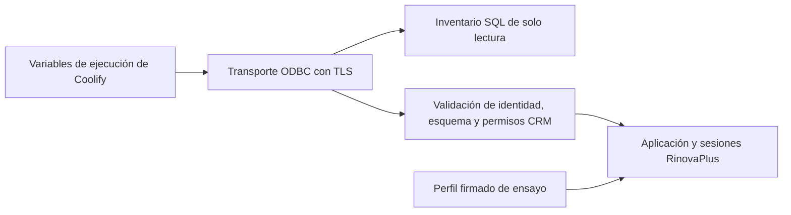

# RinovaPlus en Coolify

## Conexión PostgreSQL

La rama `deploy/coolify-rinovaplus` admite un despliegue de RinovaPlus en PostgreSQL 16 o posterior. Usar el método Dockerfile, la ruta `/docker/Dockerfile.coolify`, el puerto 4178 y el volumen existente de adjuntos. El servidor debe alcanzar PostgreSQL por la red privada.

| Variable de ejecución | Función |
|---|---|
| `CRM_DATABASE_ENGINE` | `postgresql` para activar el motor después de conciliar la candidata. `sqlserver` selecciona explícitamente el motor anterior durante una reversión. |
| `CRM_POSTGRES_URL` | URL privada del recurso PostgreSQL, con base `rinovaplus` y sin credenciales. |
| `CRM_POSTGRES_USER` | `rinovaplus_app`, rol PostgreSQL con los permisos CRM de P11. |
| `CRM_POSTGRES_PASSWORD` | Contraseña del rol PostgreSQL. Mantenerla como literal, solo para ejecución. |
| `CRM_POSTGRES_SNAPSHOT_SHA256` | Huella de la instantánea conciliada en la base de destino. |
| `CRM_SECURITY_KEY` | Clave de cifrado vigente de RinovaPlus. Conservar el valor anterior. |
| `CRM_PUBLIC_BASE_URL` | Origen HTTPS de RinovaPlus. |

Conservar el volumen de adjuntos y verificar que las escrituras CRM estén pausadas durante la sincronización final. Usar el [procedimiento de migración](postgresql-migration.md) para leer únicamente las tablas CRM de SQL Server y verificar la carga. Mantener la copia PostgreSQL anterior con otro nombre. Al desplegar, verificar `/health/ready` con `scope=postgres_deployment`. Una reversión después de nuevas escrituras en PostgreSQL exige conciliarlas antes de reabrir SQL Server.

## Conexión SQL Server

En Coolify, seleccionar el repositorio privado, la rama `deploy/coolify-rinovaplus` y el método **Dockerfile**. Usar `/` como contexto, `/docker/Dockerfile.coolify` como ruta y `4178` como puerto del servicio. El proxy de Coolify termina HTTPS. Configurar `https://app.rinovaplus.com` como dominio del servicio y conservar un solo origen para interfaz, API y webhooks. Montar un volumen persistente en `/var/lib/crm-ai` para adjuntos de Inbox y campañas, con acceso de escritura para el UID `10001`.

Configurar los valores únicamente en **Environment Variables** de ejecución de Coolify. Mantener desactivada la opción de pasarlos durante el build.

| Variable | Valor o función |
|---|---|
| `CRM_SQL_URL` | `sqlserver://50.62.180.142:1433`. Admite también el nombre DNS del servidor SQL. |
| `CRM_SQL_DATABASE` | Nombre exacto de la base, por ejemplo `DBSIIE_Copia`. Admite de 1 a 128 letras, números, guiones, guiones bajos o espacios interiores. |
| `CRM_SQL_USER` | Login SQL dedicado al CRM, con usuario en la base y permisos de la aplicación. |
| `CRM_SQL_PASSWORD` | Contraseña del login SQL, tal como la entrega el custodio. |
| `CRM_SECURITY_KEY` | Clave persistente de la aplicación. Usar 32 bytes codificados en Base64, guardados como secreto. Para una instalación nueva se puede generar con `openssl rand -base64 32`. Si se trasladan secretos CRM cifrados, revisar primero la custodia y compatibilidad de la clave existente. |
| `CRM_PUBLIC_BASE_URL` | `https://app.rinovaplus.com`. Define el origen de sesión y las URLs de Canales, OAuth, webhooks y adjuntos. |

El backend lee la configuración al arrancar. `CRM_SQL_DATABASE` tiene prioridad sobre el nombre que aparezca en `CRM_SQL_URL`. Cuando la variable está ausente, las URLs anteriores con `/dbsiie` o un nombre de ensayo admitido conservan su comportamiento. Con la conexión SQL configurada, ODBC Driver 18 usa `Encrypt=Yes;TrustServerCertificate=Yes`. La sesión va cifrada y el controlador acepta el certificado sin autenticar el servidor por TLS. El modo permite conectar por IP con un certificado autofirmado y prescinde de `CRM_SQL_CERTIFICATE_HOSTNAME` y de una CA privada en el contenedor. Con las variables SQL ausentes, se usa el perfil firmado de ensayos con su propia validación del certificado. Una configuración parcial detiene el arranque.

El arranque comprueba SQL Server 2019 y compatibilidad 150, identidad de la base, catálogo CRM, diarios, usuario propietario y permisos efectivos. La identidad de la base, los permisos y el historial se vuelven a comprobar en las transacciones. El arranque requiere una institución inicializada.

### Primera comprobación desde Coolify

Desde el host de Coolify, ejecutar la imagen con su punto de entrada sustituido por `python` y los argumentos `-m app.institutional.deployment`. Usar las cuatro variables SQL de ejecución y una cuenta de diagnóstico con `CONNECT` y `VIEW DEFINITION`. Este comando consulta el catálogo en solo lectura y finaliza sin arrancar el CRM. Un resultado correcto devuelve `{"sql": "verified", "scope": "catalog_read_only"}`. Usar una copia restaurada con la cuenta CRM antes de habilitar el servicio institucional.

Si aparece `sql_tls_negotiation_failed`, el DBA puede revisar las versiones y la configuración TLS que admite la instancia. Si aparece `sql_login_rejected`, revisar el acceso del login a la base. Los diagnósticos omiten usuario y contraseña.

Si aparece `sql_tables_missing`, el mensaje lista las tablas esperadas ausentes. El [generador SQL para el DBA](../../backend/tools/coolify_sql_grants.py) emite inventario de solo lectura o una propuesta separada de permisos con reversión por defecto. Ejecutar desde `/app/backend` en la imagen o desde `backend` con las dependencias instaladas.

```bash
python -m tools.coolify_sql_grants --database dbsiie --inventory > inventario-rinovaplus.sql
python -m tools.coolify_sql_grants --database dbsiie --login rinovaplus_runtime > permisos-rinovaplus.sql
```

El inventario identifica objetos `MISSING` por nombre y dominio. El DBA debe comparar el catálogo de destino con los contratos de [migraciones](../../backend/migrations) y preparar un script de esquema para revisar en una restauración antes de aplicar cambios. El arranque no ejecuta DDL ni concede permisos.



Referencias de configuración de [Coolify Dockerfile](https://coolify.io/docs/applications/builds/dockerfile), [variables de Coolify](https://coolify.io/docs/applications/configuration/environment-variables) y [opciones TLS de ODBC](https://learn.microsoft.com/en-us/sql/connect/odbc/linux-mac/connection-string-keywords-and-data-source-names-dsns?view=sql-server-ver17).

## Referencia histórica del preview privado

El paquete ejecuta el CRM integrado en **un contenedor Linux privado**, con React compilado, Nginx y un proceso Uvicorn. SQL Server permanece externo. No es una entrega productiva ni habilita un dominio público: autenticación/RBAC y aceptación de fase 1 siguen pendientes.

## Probar en este equipo

Desde la raíz del repositorio, con Docker disponible:

```powershell
docker compose -p crm-cbn-preview build
docker compose -p crm-cbn-preview up -d --wait
```

Abrir `http://127.0.0.1:4173`. La publicación está fijada a loopback; no sustituirla por `4173:4173`. El backend escucha únicamente `127.0.0.1:8002` dentro del contenedor. Nginx valida el Host recibido y conserva Origin y la cabecera local de IA. No se agregan credenciales al JavaScript.

`/health/live` devuelve 200 si el proceso responde. `/health/ready` conserva 503 porque las integraciones de negocio no están aceptadas; este segundo endpoint no se usa como healthcheck Docker. La configuración inicial es `local_demo`, sin SQL ni salida a proveedores.

## Preparación en Coolify / Oracle

1. **Integración publicada y verificada el 2026-10-15:** `codex/integracion-coolify`, commit [b92660a999b79f59c0d56e472463f02b80a33443](https://github.com/Jhon-Steven-dev/CRM_CBN/commit/b92660a999b79f59c0d56e472463f02b80a33443). El [registro Git](../github-workflow.md) conserva la comprobación remota. El trabajo continúa exclusivamente desde esa rama; la publicación no autoriza desplegar en Coolify/Oracle.
2. Seleccionar Docker Compose y el archivo `compose.yaml`. Mantener la red propia y el puerto loopback; **no asignar dominio, etiquetas de proxy público ni conectar esta preview a la red compartida del proxy**. Verificar esta condición en la configuración efectiva antes de cualquier arranque remoto.
3. Cuando se autorice el arranque remoto privado, abrir un túnel: `ssh -L 127.0.0.1:4173:127.0.0.1:4173 usuario@servidor`. Navegar a la misma URL local. El acceso SSH debe estar autorizado y restringido.
4. El dominio compartido queda pendiente de fase 1, autenticación/RBAC, gestión de sesiones, seguridad operativa y aceptación conectada. Este paquete no sustituye esas puertas.

Se comprobó AMD64 localmente; los manifiestos base incluyen ARM64, pero no se acredita ejecución ARM64 ni Oracle. La instalación ODBC usa el repositorio oficial Microsoft para Debian 12.

## Configuración y persistencia

| Configuración | Comportamiento |
|---|---|
| `CRM_AI_OUTBOUND_ENABLED` | `false` por defecto. Cambiar solo para pruebas sintéticas autorizadas. |
| Claves de proveedores | Variables de runtime de Coolify o del proceso, nunca build arguments, archivos fuente, logs o variables `VITE_`. Los nombres existentes aparecen en Ajustes → APIs y `.env.example`. |
| Edición de claves en Linux | Deshabilitada; las claves se administran en el entorno. Reiniciar tras cambiarlas. Windows conserva DPAPI. |
| `CRM_AI_STATE_DIR` | Ruta absoluta; Compose fija `/var/lib/crm-ai` y monta el volumen `ai-state`. Conserva ajustes y reservas/cuotas de voz. |
| Piper | Reconoce el runtime Linux `piper/.venv/bin/python` y las voces bajo el directorio de estado. La imagen no instala el motor ni descarga modelos; permanece no disponible mientras falten. |
| Clientes y borradores | Continúan siendo estado temporal del navegador; el volumen IA no los convierte en datos persistidos de negocio. |

Una sola réplica y un solo worker son obligatorios: las cuotas y el bloqueo de concurrencia no coordinan varios procesos. El audio temporal y los catálogos de proveedor están en memoria; un reinicio los invalida. **No usar `docker compose down -v`** para actualizar: borraría ajustes y cuotas.

## SQL Server existente

No se crea un contenedor de base de datos ni se copia SIIE. Las credenciales en Coolify serán necesarias, pero también una ruta privada Oracle → servidor SQL, TCP habilitado, puerto explícito y certificado válido para el nombre usado. No abrir SQL a Internet ni desactivar TLS para resolver conectividad.

El transporte preparado usa `CRM_SQL_HOST` (DNS o IPv4), `CRM_SQL_PORT` (1433 por defecto), `CRM_SQL_USER` y `CRM_SQL_PASSWORD`. La base sigue fijada a `DBSIIE`. Sin host TCP, se conserva el destino local histórico `localhost\SQLEXPRESS`. `Encrypt=Yes;TrustServerCertificate=No` no admite anulación. No se ejecutan migraciones, creación de tablas ni configuración de SQL Server.

Las variables no habilitan lecturas por sí solas: hace falta `CRM_APP_MODE=local_readonly_catalog`, un `CRM_CATALOG_TOKEN` privado de al menos 32 caracteres alfanuméricos y autorización específica del servidor/datos. Los cuatro catálogos conservan sus verificaciones de mínimo privilegio. La clave temporal se introduce en la interfaz; no se compila dentro del frontend.

## Detener y volver atrás

`docker compose -p crm-cbn-preview down` detiene solamente esa preview y conserva el volumen. Para revertir una imagen, reconstruir una revisión previamente comprobada manteniendo el volumen. No reutilizar ni borrar los archivos DPAPI del equipo Windows. La [integración de fuentes](../reports/branch-integration.md) conserva su evidencia previa; el [informe Docker](../reports/docker-private-preview.md) separa las nuevas pruebas.

Fuentes oficiales consultadas: [Coolify y Docker Compose](https://coolify.io/docs/applications/builds/docker-compose), [Docker: publicación de puertos](https://docs.docker.com/engine/network/port-publishing/), [Docker: varios procesos](https://docs.docker.com/engine/containers/multi-service_container/), [Microsoft ODBC en Linux](https://learn.microsoft.com/en-us/sql/connect/odbc/linux-mac/installing-the-microsoft-odbc-driver-for-sql-server).
