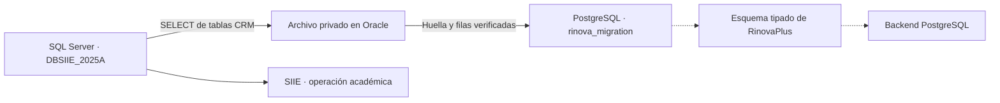

# Migración de RinovaPlus a PostgreSQL

Al 14 de noviembre de 2026, el backend en Coolify ejecuta la revisión `8a84f9876e5f` con SQL Server 2019 y la base `DBSIIE_2025A`. El trabajo de migración parte de esa revisión en la rama local `migration/rinovaplus-postgresql`. Las tablas académicas permanecen en SIIE.

## Copia inicial conciliada

| Comprobación | Resultado |
|---|---|
| Esquema CRM capturado | 155 de 155 tablas del mapeo versionado, con columnas, claves, índices, restricciones y relaciones |
| Lectura de filas CRM | 119 de 155 tablas legibles con la cuenta activa, una cobertura del 76,77 %. Se copiaron 48 filas. |
| Tablas CRM con lectura restringida | 36 tablas. Sus estimaciones del catálogo dieron cero filas. Pendiente confirmar el conteo de cada tabla con acceso de lectura completo. |
| Consistencia de la copia | Una transacción `SERIALIZABLE` con prioridad de interbloqueo baja y espera de bloqueo de un segundo. El origen tenía `SNAPSHOT` deshabilitado. |
| Destino PostgreSQL | PostgreSQL 16, base `rinovaplus`, recurso privado `RinovaPlus PostgreSQL` en Coolify. Volumen persistente y sin puertos publicados. |
| Carga inicial | `rinova_migration.source_snapshot` registra el manifiesto y `rinova_migration.source_row` contiene las 48 filas. La conciliación por tabla obtuvo cero diferencias respecto al manifiesto. |

Archivo privado en Oracle en `/var/lib/rinovaplus-migration/2026-11-14/crm-export.zip`, tamaño de 97.210 bytes y permisos `0600`. SHA-256 `90ad45bc17455a2c878139bbec65c82e7dc9796770a37461172d2322eb9ab64d`. El archivo permanece en el servidor y contiene filas del CRM. El directorio y los registros del cargador tienen acceso restringido.

La extracción ejecutó consultas de catálogo y `SELECT` únicamente en tablas CRM del mapeo. Los datos académicos quedaron fuera. PostgreSQL contiene una copia intermedia para construir el esquema de aplicación. El backend activo sigue apuntando al origen SQL Server.



## Repetición de la carga inicial

El [cargador](../../backend/tools/stage_postgres_crm.py) verifica la huella completa, los archivos esperados, el número de valores por fila, los conteos y las huellas por tabla. Emite una transacción que exige PostgreSQL 16 o posterior y protege el esquema intermedio con permisos explícitos. Para repetir la carga, usar una base de ensayo limpia `rinovaplus_rehearsal`. La transacción se detiene si el esquema intermedio ya existe.

```bash
set -o pipefail
python3 backend/tools/stage_postgres_crm.py "$PRIVATE_ARCHIVE" --sha256 "$EXPECTED_SHA256" \
  | psql -Xq -v ON_ERROR_STOP=1 -v VERBOSITY=terse
```

El SQL que circula por la tubería incluye datos del CRM. Usar la conexión PostgreSQL privada del operador y conservar los logs de error en el mismo ámbito. Las pruebas unitarias cubren el filtrado de tablas restringidas, el número de columnas y la huella de las filas.

## Avance de la migración

| Hito | Estado |
|---|---|
| 1. Confirmar origen activo e inventariar el contrato CRM | Completo |
| 2. Preparar PostgreSQL privado con almacenamiento persistente | Completo |
| 3. Cargar y conciliar la copia inicial disponible | Completo |
| 4. Verificar las 36 tablas y validar la copia completa | Parcial, 119 de 155 tablas verificadas por lectura |
| 5. Construir el esquema tipado y cargar el dominio | Pendiente |
| 6. Adaptar transacciones, repositorios y workers al nuevo motor | Pendiente |
| 7. Validar paridad, rendimiento y recuperación | Pendiente |
| 8. Pasar las últimas escrituras y activar PostgreSQL para el CRM | Pendiente |

Para el hito 4, usar un export del DBA limitado al CRM o un login temporal de lectura que cubra las 36 tablas en `DBSIIE_2025A`. El hito 5 conservará las claves e IDs y revisará fechas de alta precisión, concurrencia con `rowversion`, colaciones, índices filtrados y referencias hacia SIIE. El corte requiere validar usuarios, permisos, adjuntos, secretos cifrados y colas, y comparar el 503 y la latencia con la misma carga de prueba.
