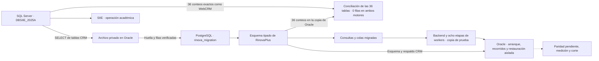

# Migración de RinovaPlus a PostgreSQL

Al 14 de noviembre de 2026, el backend en Coolify ejecuta la revisión `8a84f9876e5f` con SQL Server 2019 y la base `DBSIIE_2025A`. El trabajo de migración parte de esa revisión en la rama local `migration/rinovaplus-postgresql`. Las tablas académicas permanecen en SIIE.

## Copia inicial conciliada

| Comprobación | Resultado |
|---|---|
| Esquema CRM capturado | 155 de 155 tablas del mapeo versionado, con columnas, claves, índices, restricciones y relaciones |
| Lectura comprobada de filas CRM | 155 de 155 tablas del mapeo (100 %). La extracción inicial verificó 119 tablas y copió 48 filas. La comprobación posterior de las otras 36 encontró cero filas adicionales. |
| Tablas comprobadas con el rol temporal | 36 de 36. `WebCRM` obtuvo conteos exactos en `DBSIIE_2025A` y PostgreSQL obtuvo los mismos conteos en la copia de Oracle. |
| Consistencia de la copia | Una transacción `SERIALIZABLE` con prioridad de interbloqueo baja y espera de bloqueo de un segundo. El origen tenía `SNAPSHOT` deshabilitado. |
| Destino PostgreSQL | PostgreSQL 16, base `rinovaplus`, recurso privado `RinovaPlus PostgreSQL` en Coolify. Volumen persistente y sin puertos publicados. |
| Carga inicial | `rinova_migration.source_snapshot` registra el manifiesto y `rinova_migration.source_row` contiene las 48 filas. La conciliación por tabla obtuvo cero diferencias respecto al manifiesto. |

Archivo privado en Oracle en `/var/lib/rinovaplus-migration/2026-11-14/crm-export.zip`, tamaño de 97.210 bytes y permisos `0600`. SHA-256 `90ad45bc17455a2c878139bbec65c82e7dc9796770a37461172d2322eb9ab64d`. El archivo permanece en el servidor y contiene filas del CRM. El directorio y los registros del cargador tienen acceso restringido.

La extracción ejecutó consultas de catálogo y `SELECT` únicamente en tablas CRM del mapeo. Los datos académicos quedaron fuera. PostgreSQL conserva la copia intermedia en `rinova_migration` y el esquema tipado en `rinovaplus_crm`. El backend activo sigue apuntando al origen SQL Server.



## Repetición de la carga inicial

El [cargador](../../backend/tools/stage_postgres_crm.py) verifica la huella completa, los archivos esperados, el número de valores por fila, los conteos y las huellas por tabla. Emite una transacción que exige PostgreSQL 16 o posterior y protege el esquema intermedio con permisos explícitos. Para repetir la carga, usar una base de ensayo limpia `rinovaplus_rehearsal`. La transacción se detiene si el esquema intermedio ya existe.

```bash
set -o pipefail
python3 backend/tools/stage_postgres_crm.py "$PRIVATE_ARCHIVE" --sha256 "$EXPECTED_SHA256" \
  | psql -Xq -v ON_ERROR_STOP=1 -v VERBOSITY=terse
```

El SQL que circula por la tubería incluye datos del CRM. Usar la conexión PostgreSQL privada del operador y conservar los logs de error en el mismo ámbito. Las pruebas unitarias cubren el filtrado de tablas restringidas, el número de columnas y la huella de las filas.

## Esquema tipado y primera adaptación SQL

Aplicado en el destino privado `rinovaplus` a partir del ZIP con huella comprobada. El [generador del esquema](../../backend/tools/postgres_crm_schema.py) creó 155 tablas con 1.564 columnas, 313 índices incluyendo claves primarias, 334 comprobaciones de origen y 298 claves foráneas internas del CRM. Cargó las 48 filas disponibles, con cero diferencias de conteo por tabla. El catálogo de origen carece de claves foráneas de esas tablas hacia SIIE. Los campos de referencia académica conservan los IDs existentes.

Los UUID, decimales y binarios conservan sus tipos. Las fechas de SQL Server con siete decimales quedan a la precisión de microsegundos de PostgreSQL y el ZIP conserva los valores de origen. El equivalente de `rowversion` conserva los tokens importados y usa una secuencia para las actualizaciones. Para los textos se representan las reglas de comparación con ICU según el perfil de origen. La paridad de ordenación y búsquedas completas se comprobará en el backend.

La [migración de consultas y colas](../../backend/migrations/postgresql/001_copy_queries_and_queues.sql) incluye paginación de contactos y mensajes, conteos de ocho colas, selección de recepción, eventos, medios y envíos por `FOR UPDATE SKIP LOCKED`, reserva de envío y paso a incierto tras vencer una concesión. El perfil PostgreSQL conecta estas rutinas a los workers de Canales de la copia.

El [ensayo SQL](../../backend/migrations/postgresql/verify_copy_rollback.sql) validó los conteos y ejecutó las consultas con registros sintéticos. Comprobó la reserva inválida, la toma repetida, el cambio de `rowversion`, el vencimiento sin devolver el envío a pendientes y la transición conjunta de operación y reserva. Las filas sintéticas se revirtieron. En un contenedor desechable sin red, dos sesiones ejecutaron la función instalada de toma de envíos. La segunda tomó la fila siguiente mientras la primera mantenía el bloqueo. Se ejecutaron nueve pruebas unitarias del generador, el cargador y la lista de accesos.

## Acceso de lectura para las 36 tablas

Para usar el login SQL existente de RinovaPlus, el DBA abre [RinovaPlus-36-SELECT-usuario-existente.sql](sql/RinovaPlus-36-SELECT-usuario-existente.sql) en SSMS y selecciona `DBSIIE_2025A`. Configura `@LoginSql` con el nombre del login actual y ejecuta el archivo completo con `@Accion = 'OTORGAR'`. El script resuelve el usuario de la base por SID, verifica lectura efectiva y agrega únicamente los 36 `SELECT` mediante el rol temporal `rinovaplus_pg_select36_tmp`. Después de la extracción, ejecuta el mismo archivo con el mismo login y `@Accion = 'RETIRAR'`. Al retirar el rol, permanecen los permisos previos del usuario.

En SQL Server 2019 aislado se verificaron el otorgamiento y retiro repetidos, la conservación de permisos directos previos y el rechazo de lectura académica y escritura en las tablas del rol. Una denegación previa por columna hizo revertir el otorgamiento.

El 14 de noviembre de 2026 a las 22:11:44 (Bogotá) el backend de Coolify abrió una conexión nueva de lectura a SQL Server 2019. Confirmó la base `DBSIIE_2025A` y `WebCRM` como login y usuario efectivo. Ejecutó `COUNT_BIG(*)` en las 36 tablas autorizadas dentro de una transacción `SERIALIZABLE`, con espera de bloqueo de un segundo, y terminó con rollback. Resultado de origen: **36 tablas, 0 con filas, 0 filas**.

En PostgreSQL 16.16, base `rinovaplus`, otra transacción de solo lectura dio **36 tablas, 0 con filas, 0 filas** para los mismos objetos. Verificó además 155 tablas tipadas, 48 filas en `rinova_migration.source_row` y un manifiesto con la huella del archivo inicial. El hito cierra la cobertura de la copia inicial. El cotejo de las 36 tablas es posterior a la extracción de las otras 119. El corte requiere una comprobación fresca del origen. El DBA ya puede ejecutar `RETIRAR` para cerrar el acceso temporal.

Para usar un login aparte:

1. El DBA crea en SQL Server un login nuevo `rinovaplus_pg_reader` con contraseña custodiada y sin roles de servidor. En SSMS abre [readonly-crm-pending-36.sql](sql/readonly-crm-pending-36.sql) como archivo, elige `DBSIIE_2025A` en el selector de base y presiona **F5** para ejecutar el archivo completo. El script verifica la base seleccionada, crea o reutiliza el usuario dedicado, concede `SELECT` en las 36 tablas CRM y revierte ante permisos efectivos inesperados. Al completar muestra `tablas_crm_con_select = 36`.
2. En un recurso temporal de diagnóstico con la misma ruta de red a SQL Server, configurar las variables de ejecución `CRM_SQL_URL` con el mismo servidor, `CRM_SQL_DATABASE=DBSIIE_2025A`, `CRM_SQL_USER=rinovaplus_pg_reader` y `CRM_SQL_PASSWORD` como secreto. Conservar las variables del backend activo. Avisar cuando el recurso tenga acceso para consultar conteos exactos y exportar las filas que existan.
3. Después de verificar los datos, el DBA puede retirar el acceso temporal. Un export privado del DBA limitado a las mismas tablas también sirve.

## Backend y workers en la copia PostgreSQL

El perfil se activa con `CRM_POSTGRES_URL`, `CRM_POSTGRES_SNAPSHOT_SHA256` y `CRM_SECURITY_KEY`. La URL puede llevar solo el host, el puerto y la base cuando se proporcionan `CRM_POSTGRES_USER` y `CRM_POSTGRES_PASSWORD` como variables separadas. Requiere PostgreSQL 16 o posterior, la base `rinovaplus_rehearsal`, un rol de aplicación sin privilegios administrativos ni `CREATE`, el catálogo de 155 tablas CRM y la huella de la instantánea registrada. El modo PostgreSQL excluye una configuración simultánea de `CRM_SQL_URL` y mantiene los transportes externos deshabilitados.

El [ensayo de backend](../../backend/tools/verify_postgres_backend.py) arranca la API FastAPI y los workers contra PostgreSQL 16 con datos sintéticos. Verifica autenticación, permisos, CSRF, alta de contacto por webhook, consulta de CRM e Inbox, firma y deduplicación, proyección, respuesta idempotente y descarga, inspección y almacenamiento de una imagen entrante. El transporte de prueba confirma la secuencia `accepted` → `delivered` y un caso `uncertain` sin reenvío. El endpoint de operaciones comprueba el sondeo de las cinco etapas de Canales.

### Verificación en Oracle

El 14 de noviembre de 2026 se restauró el esquema SQL de la copia privada PostgreSQL 16.16 en un contenedor temporal del servidor Oracle (ARM64). El ensayo utilizó la base `rinovaplus_rehearsal`, el esquema restaurado sin registros y la huella del manifiesto de la copia. El backend de migración partió de `f032580` y se ejecutó sobre una imagen derivada de `8a84f9876e5f`. El arnés acepta `PG_FIXTURE_SOURCE_SHA256` al usar un esquema vacío restaurado y comprueba el arranque real de Coolify con Uvicorn, Nginx, disponibilidad, inicio y cierre de sesión y persistencia del contacto creado durante el recorrido.

El recorrido de backend y workers completó en 23 segundos de pared. Además se restauraron los dos esquemas CRM y sus datos por tubería a otra base dentro del contenedor temporal. El [ensayo SQL de recuperación](../../backend/migrations/postgresql/verify_copy_rollback.sql) verificó 155 tablas, 298 claves foráneas y 48 filas, con cero diferencias de conteo respecto al manifiesto. Probó el rechazo de una reserva incorrecta, la concesión duplicada, el vencimiento de un trabajo reservado y su transición a incierto sin volver a la cola. Revirtió todos los registros de prueba. El recibo de la copia y los IDs, horas de arranque y contadores de reinicio de los contenedores activos permanecieron iguales. Los contenedores, la red interna y la imagen temporal se retiraron. En paralelo pasaron 133 pruebas locales dirigidas.

### Ampliación de workers y acceso institucional

En PostgreSQL 16 aislado con autenticación SCRAM y el rol con los permisos P11 se verificaron las ocho etapas. La prueba añadió un recibo de envío en cuarentena que se concilia tras aparecer el identificador, la cancelación de una inscripción de campaña pausada y una solicitud de agente que pasa a incierta al vencer su concesión. Pasaron las lecturas de ajustes, usuarios y roles, sesiones, CRM, campañas, envíos masivos, conocimiento, memoria, publicidad, inteligencia y selección de agentes. La API devolvió el archivo recibido en el webhook y rechazó una escritura de campañas todavía fuera del alcance validado. Pasaron 139 regresiones dirigidas en local.

El conjunto ampliado también pasó en Oracle sobre otra restauración aislada. El recorrido tomó 33 segundos e incluyó las ocho etapas, los listados institucionales y el arranque de Coolify. La restauración volvió a conciliar 155 tablas, 298 claves foráneas y 48 filas con cero diferencias. El recibo de origen y la identidad de los contenedores activos coincidieron al finalizar. La prueba SCRAM se ejecutó en local.

Quedan por validar la operación completa de campañas y envíos masivos, las ejecuciones de agentes y las escrituras de los demás módulos, los adjuntos salientes, el rendimiento comparativo y el corte. Los hitos de integración y validación integral conservan su estado parcial.

### Cuenta de RinovaPlus y rol técnico

Un conteo de solo lectura en Oracle encontró una cuenta propietaria activa de RinovaPlus con hash PBKDF2 compatible. Las cuentas que conservan su hash usan la misma contraseña de la aplicación después del corte. Conservar la `CRM_SECURITY_KEY` vigente para los secretos cifrados del CRM y validar el inicio de sesión en la copia de corte. La auditoría solo registró conteos. El rol PostgreSQL `rinovaplus_app` todavía no existe en el recurso.

El rol técnico es distinto del login `WebCRM` de SQL Server y del correo con el que se inicia sesión en RinovaPlus. El DBA puede generar sus permisos con `python -m tools.postgres_runtime_role` desde `backend` y ejecutar la salida con `psql` conectado a `rinovaplus`. El script crea `rinovaplus_app` con `NOLOGIN` y aplica los privilegios CRM de P11. Desde la sesión de administración de `psql`, asignar una contraseña nueva sin incluirla en el SQL o el historial de comandos:

```text
SET password_encryption = 'scram-sha-256';
\password rinovaplus_app
ALTER ROLE rinovaplus_app LOGIN;
```

Para el corte, el host de `CRM_POSTGRES_URL=postgresql://<host-interno>:5432/rinovaplus` debe salir de la URL privada del recurso de Coolify. Usar `CRM_POSTGRES_USER=rinovaplus_app` y guardar la contraseña nueva en `CRM_POSTGRES_PASSWORD` como secreto. Estos valores se aplicarán cuando la base de despliegue y la paridad estén calificadas.

## Avance de la migración

| Hito | Estado |
|---|---|
| 1. Confirmar origen activo e inventariar el contrato CRM | Completo |
| 2. Preparar PostgreSQL privado con almacenamiento persistente | Completo |
| 3. Cargar y conciliar la copia inicial disponible | Completo |
| 4. Verificar las 36 tablas y validar la copia completa | Completo para la copia inicial. Cobertura de lectura 155 de 155. Las 36 pendientes devolvieron cero filas tanto en SQL Server como en PostgreSQL. |
| 5. Construir el esquema tipado y cargar el dominio | Completo para el alcance del respaldo disponible. Las filas de las 36 tablas se revisan en el hito 4. |
| 6. Adaptar transacciones, repositorios y workers al nuevo motor | Parcial. Ocho de ocho etapas probadas en Oracle (100 % de las etapas). Pasaron lecturas adicionales de módulos. Restan escrituras y recorridos de negocio completos. |
| 7. Validar paridad, rendimiento y recuperación | Parcial. Pasaron en Oracle el arranque real, el recorrido de Canales en la copia aislada y la restauración conciliada con las 48 filas. Restan paridad de módulos, adjuntos salientes y rendimiento comparativo. |
| 8. Pasar las últimas escrituras y activar PostgreSQL para el CRM | Pendiente |

**5 de 8 hitos completos (62,50 %).** Cobertura comprobada de lectura **155 de 155 tablas (100 %)**. El corte requiere validar usuarios, permisos, adjuntos, secretos cifrados y colas, y comparar el 503 y la latencia con la misma carga de prueba.
