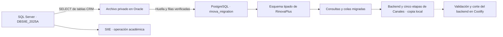

# Migración de RinovaPlus a PostgreSQL

Al 14 de noviembre de 2026, el backend en Coolify ejecuta la revisión `8a84f9876e5f` con SQL Server 2019 y la base `DBSIIE_2025A`. El trabajo de migración parte de esa revisión en la rama local `migration/rinovaplus-postgresql`. Las tablas académicas permanecen en SIIE.

## Copia inicial conciliada

| Comprobación | Resultado |
|---|---|
| Esquema CRM capturado | 155 de 155 tablas del mapeo versionado, con columnas, claves, índices, restricciones y relaciones |
| Lectura de filas CRM | 119 de 155 tablas legibles con la cuenta activa, una cobertura del 76,77 %. Se copiaron 48 filas. |
| Tablas CRM con lectura restringida | 36 tablas. Sus estimaciones del catálogo dieron cero filas. Pendiente confirmar el conteo de cada tabla con acceso de lectura completo. |
| Consistencia de la copia | Una transacción `SERIALIZABLE` con prioridad de interbloqueo baja y espera de bloqueo de un segundo. El origen tenía `SNAPSHOT` deshabilitado. |
| Destino PostgreSQL | PostgreSQL 16, base `rinovaplus`, recurso privado `RinovaPlus PostgreSQL` en Coolify. Volumen persistente y sin puertos publicados. |
| Carga inicial | `rinova_migration.source_snapshot` registra el manifiesto y `rinova_migration.source_row` contiene las 48 filas. La conciliación por tabla obtuvo cero diferencias respecto al manifiesto. |

Archivo privado en Oracle en `/var/lib/rinovaplus-migration/2026-11-14/crm-export.zip`, tamaño de 97.210 bytes y permisos `0600`. SHA-256 `90ad45bc17455a2c878139bbec65c82e7dc9796770a37461172d2322eb9ab64d`. El archivo permanece en el servidor y contiene filas del CRM. El directorio y los registros del cargador tienen acceso restringido.

La extracción ejecutó consultas de catálogo y `SELECT` únicamente en tablas CRM del mapeo. Los datos académicos quedaron fuera. PostgreSQL conserva la copia intermedia en `rinova_migration` y el esquema tipado en `rinovaplus_crm`. El backend activo sigue apuntando al origen SQL Server.



## Repetición de la carga inicial

El [cargador](../../backend/tools/stage_postgres_crm.py) verifica la huella completa, los archivos esperados, el número de valores por fila, los conteos y las huellas por tabla. Emite una transacción que exige PostgreSQL 16 o posterior y protege el esquema intermedio con permisos explícitos. Para repetir la carga, usar una base de ensayo limpia `rinovaplus_rehearsal`. La transacción se detiene si el esquema intermedio ya existe.

```bash
set -o pipefail
python3 backend/tools/stage_postgres_crm.py "$PRIVATE_ARCHIVE" --sha256 "$EXPECTED_SHA256" \
  | psql -Xq -v ON_ERROR_STOP=1 -v VERBOSITY=terse
```

El SQL que circula por la tubería incluye datos del CRM. Usar la conexión PostgreSQL privada del operador y conservar los logs de error en el mismo ámbito. Las pruebas unitarias cubren el filtrado de tablas restringidas, el número de columnas y la huella de las filas.

## Esquema tipado y primera adaptación SQL

Aplicado en el destino privado `rinovaplus` a partir del ZIP con huella comprobada. El [generador del esquema](../../backend/tools/postgres_crm_schema.py) creó 155 tablas con 1.564 columnas, 313 índices incluyendo claves primarias, 334 comprobaciones de origen y 298 claves foráneas internas del CRM. Cargó las 48 filas disponibles, con cero diferencias de conteo por tabla. El catálogo de origen carece de claves foráneas de esas tablas hacia SIIE. Los campos de referencia académica conservan los IDs existentes.

Los UUID, decimales y binarios conservan sus tipos. Las fechas de SQL Server con siete decimales quedan a la precisión de microsegundos de PostgreSQL y el ZIP conserva los valores de origen. El equivalente de `rowversion` conserva los tokens importados y usa una secuencia para las actualizaciones. Para los textos se representan las reglas de comparación con ICU según el perfil de origen. La paridad de ordenación y búsquedas completas se comprobará en el backend.

La [migración de consultas y colas](../../backend/migrations/postgresql/001_copy_queries_and_queues.sql) incluye paginación de contactos y mensajes, conteos de ocho colas, selección de recepción, eventos, medios y envíos por `FOR UPDATE SKIP LOCKED`, reserva de envío y paso a incierto tras vencer una concesión. El perfil PostgreSQL conecta estas rutinas a los workers de Canales de la copia.

El [ensayo SQL](../../backend/migrations/postgresql/verify_copy_rollback.sql) validó los conteos y ejecutó las consultas con registros sintéticos. Comprobó la reserva inválida, la toma repetida, el cambio de `rowversion`, el vencimiento sin devolver el envío a pendientes y la transición conjunta de operación y reserva. Las filas sintéticas se revirtieron. En un contenedor desechable sin red, dos sesiones ejecutaron la función instalada de toma de envíos. La segunda tomó la fila siguiente mientras la primera mantenía el bloqueo. Se ejecutaron nueve pruebas unitarias del generador, el cargador y la lista de accesos.

## Acceso de lectura para las 36 tablas

1. El DBA crea en SQL Server un login nuevo `rinovaplus_pg_reader` con contraseña custodiada y sin roles de servidor. En SSMS abre [readonly-crm-pending-36.sql](sql/readonly-crm-pending-36.sql) como archivo, elige `DBSIIE_2025A` en el selector de base y presiona **F5** para ejecutar el archivo completo. El script verifica la base seleccionada, crea o reutiliza el usuario dedicado, concede `SELECT` en las 36 tablas CRM y revierte ante permisos efectivos inesperados. Al completar muestra `tablas_crm_con_select = 36`.
2. En un recurso temporal de diagnóstico con la misma ruta de red a SQL Server, configurar las variables de ejecución `CRM_SQL_URL` con el mismo servidor, `CRM_SQL_DATABASE=DBSIIE_2025A`, `CRM_SQL_USER=rinovaplus_pg_reader` y `CRM_SQL_PASSWORD` como secreto. Conservar las variables del backend activo. Avisar cuando el recurso tenga acceso para consultar conteos exactos y exportar las filas que existan.
3. Después de verificar los datos, el DBA puede retirar el acceso temporal. Un export privado del DBA limitado a las mismas tablas también sirve.

## Backend y workers en la copia PostgreSQL

El perfil se activa con `CRM_POSTGRES_URL`, `CRM_POSTGRES_SNAPSHOT_SHA256` y `CRM_SECURITY_KEY`. Requiere PostgreSQL 16 o posterior, la base `rinovaplus_rehearsal`, un rol de aplicación sin privilegios administrativos ni `CREATE`, el catálogo de 155 tablas CRM y la huella de la instantánea registrada. El modo PostgreSQL excluye una configuración simultánea de `CRM_SQL_URL` y mantiene los transportes externos deshabilitados.

El [ensayo de backend](../../backend/tools/verify_postgres_backend.py) arranca la API FastAPI y los workers contra PostgreSQL 16 con el mismo modelo versionado y datos sintéticos. Verifica autenticación, permisos, CSRF, alta de contacto por webhook, consulta de CRM e Inbox, firma y deduplicación, proyección, respuesta idempotente y descarga, inspección y almacenamiento de una imagen entrante. El transporte de prueba confirma la secuencia `accepted` → `delivered` y un caso `uncertain` sin reenvío. El endpoint de operaciones comprueba el sondeo de las cinco etapas de Canales. Quedan por validar el acceso a adjuntos en la interfaz, los envíos con adjuntos, las tres etapas de otros productores, los demás módulos, el rendimiento, la restauración y la ejecución con la copia de Oracle.

## Avance de la migración

| Hito | Estado |
|---|---|
| 1. Confirmar origen activo e inventariar el contrato CRM | Completo |
| 2. Preparar PostgreSQL privado con almacenamiento persistente | Completo |
| 3. Cargar y conciliar la copia inicial disponible | Completo |
| 4. Verificar las 36 tablas y validar la copia completa | Parcial, 119 de 155 tablas verificadas por lectura |
| 5. Construir el esquema tipado y cargar el dominio | Completo para el alcance del respaldo disponible. Las filas de las 36 tablas se revisan en el hito 4. |
| 6. Adaptar transacciones, repositorios y workers al nuevo motor | Parcial. Autenticación, CRM básico, Inbox y cinco de ocho etapas de workers integradas en la copia local (62,50 % de las etapas). Restan campañas, masivos y solicitudes de agentes, además de los demás repositorios. |
| 7. Validar paridad, rendimiento y recuperación | Parcial. Ensayo SQL y recorrido de mensajes y adjuntos entrantes superados con datos sintéticos. Restan paridad de módulos, adjuntos salientes, rendimiento, restauración y comprobación en Oracle. |
| 8. Pasar las últimas escrituras y activar PostgreSQL para el CRM | Pendiente |

**4 de 8 hitos completos (50,00 %).** Cobertura comprobada de lectura **119 de 155 tablas (76,77 %)**. El corte requiere validar usuarios, permisos, adjuntos, secretos cifrados y colas, y comparar el 503 y la latencia con la misma carga de prueba.
