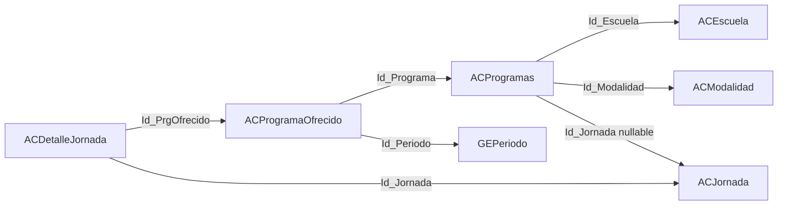

# Inventario de DBSIIE para contratos de lectura

**Estado:** inventario de metadatos observado; interpretación funcional y contratos de API propuestos, pendientes de revisión. **Fecha:** 2026-10-14, America/Bogota. El inventario permite delimitar un primer catálogo académico sin consultar personas ni modificar la base. No acredita APIs implementadas, permisos mínimos o datos de prueba anonimizados.

## Evidencia y alcance

La captura local conservada corresponde a `2026-10-14T16:20:04.8577744Z`. Esta entrega analiza esos archivos restaurados de forma offline; no abre una nueva conexión SQL. La evidencia de cifrado y certificado tiene su propia comprobación anterior en [informe TLS](local-sql-tls.md).

| Artefacto local ignorado por Git | Finalidad / SHA256 verificado |
|---|---|
| `.local/sql-inventory/schema-snapshot.json` | Captura de 21 conjuntos de catálogo y preflight. `0F195CDCDC3E94188C44447349984333219312288C0C8016E69E48A47DEE4A47` |
| `.local/sql-inventory/query-manifest.json` | Manifiesto de consultas. `6AE079AFB12913743B988253FFB680CE614E76C199005DC11BD7B95511126743` |
| `.local/sql-inventory/schema-handoff.json` | Resumen de cobertura y selección de 22 tablas candidatas con columnas, claves y relaciones. No sustituye la captura. |

Las consultas del inventario fueron `SELECT` de catálogos del sistema. No se leyeron filas, muestras o conteos de registros de negocio, cuerpos SQL, valores literales de defaults/checks ni propiedades extendidas. No se ejecutaron procedimientos. Los archivos brutos siguen locales e ignorados; este informe contiene únicamente estructura seleccionada, agregados y límites.

Los 21 conjuntos son: database, coverage, schemas, objects, tables, columns, indexes, index_columns, foreign_keys, foreign_key_columns, key_constraints, check_constraints, procedures, parameters, functions, dependencies, user_types, modules, triggers, synonyms y row_security. El preflight se registra aparte; no es un conjunto de catálogo adicional.

## Cobertura observada

| Medida | Resultado |
|---|---:|
| Objetos de usuario visibles | 3.028 |
| Tablas / vistas | 722 / 11 |
| Procedimientos / funciones | 861 / 130 |
| Columnas | 5.281 |
| Claves foráneas / pares de columnas FK | 518 / 518 |
| Restricciones PK / UNIQUE / CHECK | 610 / 12 / 24 |
| Tablas sin PK declarada | 112 |
| Triggers de objetos / de base | 62 / 1 (63 en total) |
| Tablas temporales / objetos con rowversion | 0 / 0 |
| Columnas LOB (`max_length=-1`, text/ntext/image) | 471 |
| Dependencias no resueltas / entre bases | 75 / 2 |
| Permiso de metadata `VIEW DEFINITION` / `SELECT` de base de la sesión | 1 / 1 |
| Errores SQL recogidos | 0 |

Estas cantidades describen lo visible para la sesión de captura, no una auditoría de todos los servidores. Los objetos de usuario incluyen restricciones y otros tipos; 3.028 no equivale a la suma de tablas, vistas, procedimientos y funciones. Las consultas fueron secuenciales, sin snapshot transaccional del esquema: un DDL concurrente podría afectar consistencia entre conjuntos.

La propiedad de base `read_only` era falsa. La ausencia de modificaciones depende del alcance `SELECT` del colector, no de que DBSIIE esté protegida globalmente contra escrituras. Los permisos de la sesión tampoco son el contrato de un futuro principal SQL de mínimo privilegio.

## Catálogo académico: fuentes concretas

Todos los objetos de esta sección pertenecen a `dbo`. Tipos y nulabilidad se obtuvieron de metadata; las denominaciones funcionales siguen siendo propuestas.

| Fuente / PK | Columnas seleccionadas y tipo SQL | Uso propuesto |
|---|---|---|
| `GEPeriodo` / `PK_GEPeriodo(Id_Periodo)` | `Id_Periodo int`; `Periodo varchar(20)`; `FechaInicio date`; `FechaFinal date`; `EstadoPeriodo bit`; todas NOT NULL | Períodos. El bit no prueba por sí solo qué significa «vigente». |
| `ACEscuela` / `PK_ACEscuela(Id_Escuela)` | `Id_Escuela int`, `NomEsla varchar(100)`, NOT NULL | Escuelas; excluir correo, URL y responsable del DTO inicial. |
| `ACModalidad` / `PK_ACModalidad(Id_Modalidad)` | `Id_Modalidad int`, `Modalidad varchar(20)`, NOT NULL; `DescripcionMod varchar(80)` NULL | Modalidades, mediante identidad y etiqueta propias. |
| `ACProgramas` / `PK_ACProgramas(Id_Programa)` | `Id_Programa int`, `CodigoPrograma varchar(10)`, `Id_Escuela int`, `Id_Modalidad int` NOT NULL; `NombrePrograma varchar(200)`, `fecha date`, `Semestres int`, `Id_Jornada int` NULL | Programa académico, independiente de su oferta por período. |
| `ACProgramaOfrecido` / `PK_ACProgramaOfrecido(Id_PrgOfrecido)` | `Id_PrgOfrecido int`, `Id_Programa int`, `Id_Periodo int` NOT NULL; `Id_Plan int` NULL | Oferta de un programa en un período. |
| `ACJornada` / `PK_ACJornada(Id_Jornada)` | `Id_Jornada int`, `DetalleJornada varchar(15)`, NOT NULL | Catálogo de jornadas; no horario de clases. |
| `ACDetalleJornada` / `PK_ACDetalleJornada(Id_DetalleJornada)` | `Id_DetalleJornada int`, `Id_Jornada int`, `Id_PrgOfrecido int`, NOT NULL | Relación oferta–jornada; conservar su identidad específica. |

`ACProgramaOfrecido` declara la clave única `IX_ACProgramaOfrecido_1(Id_Periodo, Id_Programa)`. `ACDetalleJornada` declara además `ControlDJ(Id_DetalleJornada, Id_Jornada, Id_PrgOfrecido)`: al incluir la PK, **no acredita** unicidad del par oferta–jornada. La futura API debe tolerar varias relaciones con el mismo par sin inventar una regla de deduplicación.

Las flechas representan FK declaradas, no secuencia de inscripción. Las siete FK de este gráfico están habilitadas y confiables en la captura (`is_disabled=false`, `is_not_trusted=false`). Sus nombres son `FK_ACProgramas_ACEscuela`, `FK_ACProgramas_ACModalidad`, `FK_ACProgramas_ACJornada`, `FK_ACProgramaOfrecido_ACProgramas`, `FK_ACProgramaOfrecido_GEPeriodo`, `FK_ACJornadaOfrecida_ACProgramaOfrecido` y `FK_ACJornadaOfrecida_ACJornada`; los dos últimos conservan el nombre histórico aunque el origen actual es `ACDetalleJornada`.

No asumir que `ACProgramas.Id_Jornada` es la jornada predeterminada o la única elegible. El modelo contiene también relaciones por oferta; su precedencia requiere confirmación del propietario/DBA. Tampoco derivar oferta disponible mediante año actual, fechas, nombre de procedimiento o `EstadoPeriodo` sin contrato de negocio.

## Aspirante, estudiante y CRM son contratos separados

| Objeto observado | Evidencia mínima | Límite de interpretación |
|---|---|---|
| `ACAspirante` | PK `Id_Aspirante int`; documento `Id_DocAspirante varchar(16)`; `TipoId tinyint` | Registro de aspirante candidato; no equivalencia automática con ficha CRM o estudiante. |
| `ACAspirantePorOferta` | PK `Id_AspiranteOfer int`; documento `nvarchar(20)`; `TipoId int`; `Id_Periodo int`; no FK declaradas en la selección | Nombre no prueba relación directa con `ACProgramaOfrecido`; no unir por documento sin contrato. |
| `GEEstudiante` | PK `Id_Estudiante int`; FK `Id_PrgOfrecido → ACProgramaOfrecido`; UNIQUE `DobleMat(Id_DocEstudiante, Id_PrgOfrecido)` | No fusionar identidad con aspirante ni convertir preinscripción en matrícula. |

Nombres, documentos, teléfonos, correos y otros campos personales quedaron identificados solo como estructura. No se consultaron sus valores. Tablas financieras, matrícula, seguimiento y observaciones figuran entre las candidatas del handoff, pero no reciben endpoints iniciales ni autorización de escritura.

Clientes, hilos, comentarios, tareas, reglas CRM y Ajustes actuales son estado temporal de [App](../../frontend/src/App.tsx). El inventario no demuestra almacenamiento compatible para esas capacidades. Crear tablas `CRM_` o reutilizar entidades SIIE para ellas requiere contrato y aprobación independientes.

## Procedimientos existentes: indicios, no contratos aprobados

| Procedimiento observado | Parámetros de metadata | Pendiente |
|---|---|---|
| `APIProgramasConJornada` | `@Id_Escuela int` | Cuerpo, efectos, shape, filtros y permiso de ejecución. |
| `APICatalogosPreinscripcionPLUS` | `@JSON nvarchar(max)`, `@Tipo nvarchar(2)` | Esquema JSON, códigos de tipo, efectos y resultado. |
| `GEProgramaOfrecidoSelectActivo` | Sin parámetros declarados | Significado de activo, efectos y resultado. |

Ninguno se ejecutó. Sus nombres, parámetros o dependencias estáticas no demuestran que sean exclusivamente de lectura. Revisar cuerpos y pruebas requiere una unidad autorizada distinta; no se propone invocarlos en el primer corte.

`max_length` representa bytes: `nvarchar(2)` ocupa cuatro bytes de capacidad declarada; `ACAspirantePorOferta.Id_DocAspirante` es `nvarchar(20)`, no `nvarchar(40)`. `-1` representa MAX, no tamaño negativo. No publicar cuerpos/defaults/checks para «completar» este inventario.

## Riesgos que condicionan la integración

- Las 112 tablas sin PK requieren identidad y paginación específicas antes de exponerse. No generar una API de todas las tablas.
- Sin `rowversion` observado ni temporalidad, no hay contrato general probado de concurrencia/auditoría. Definirlo antes de escrituras futuras.
- Las dependencias no resueltas y entre bases impiden asumir que procedimientos/vistas son autónomos de DBSIIE.
- LOB y metadata no prueban calidad, volumen, índices útiles o tiempos de lectura. Se evaluarán con consultas acotadas y autorización propia.
- Datos sintéticos/anonimizados, aislamiento del entorno, roles SQL mínimos y seguridad de API continúan pendientes en P-001/P-005/P-006/P-017/P-026.
- TLS comprobado por memoria compartida no prueba Python/ODBC, TCP, red ni cuenta de servicio. No desactivar validación del certificado para cubrir esa brecha.

## Verificación de esta entrega y siguiente paso

Se releyeron los archivos de captura de forma estructurada, se compararon ambos SHA256 y se contrastaron columnas, tipos, claves, nulabilidad y FK del catálogo. Se verificaron existencia de referencias locales y estructura Markdown de este informe y de la [propuesta de APIs](../integration/python-api-proposal.md). No se ejecutaron consultas nuevas, builds, pruebas de API ni procedimientos.

Revisar primero esa propuesta: delimita GET de catálogo, DTOs mínimos, permisos y aceptación futura. El propietario/DBA debe confirmar lectura permitida y significado de oferta/jornada/estado antes de implementar o conectar el backend. Este inventario avanza P-001; no cierra fase 1 ni autoriza modificaciones de DBSIIE.
