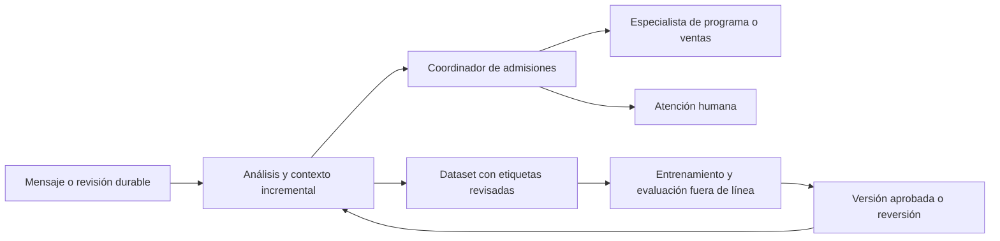

## Inbox: ediciones, remitentes y PRE-ICFES publicados — 2026-11-25

705d594 Success/Running: backend 2mwb4vzwzqw9mjjgkxso5o2u 4m20 y frontend mb6xwpdc5fq62rjkazfkedz0 27s. Voz revisión 38 guardada y recargada: máximo 120 segundos editable; comprobador del ensayo de Verane estima 83s y permite audio, sin nueva síntesis/envío. Cuota 5 por hilo conservada. Una consulta financiera PRE atendida por petición expresa: una salida Entregada, control restaurado IA, sin replay. Especialista PRE existente actualizado a versión 2, 37 skills disponibles, memoria/grafo/CRM habilitados, pautas de pagos/menores y ficha vigente; modelos/4000 tokens conservados, sin inferencia nueva acreditada.

Ediciones entrantes verifican original único de misma cuenta/identidad/hilo, conservan el original y crean corrección separada; bajas y guardas vigentes. Marcador histórico reconstruido sólo desde recibo cifrado autenticado, sin replay. Interfaz real muestra texto corregido, etiqueta y cita original; nueva edición/respuesta automática end-to-end aún pendiente. Lista identifica actor de salida real y muestra IA/Juan P, sin prefijo entrante, comprobados sin alertas. Primer rollout 7ae5c52 tuvo 42703 en consulta nueva de remitentes por TRY_CONVERT no traducido; corregido mediante comparación textual UUID en 705d594 y regresión añadida. No ocultar esta incidencia ni afirmar cero fallos universales.

330 backend focalizadas pasan, 16 reejecutadas tras corrección; frontend 52 pasan/2 fallos heredados reproducidos en 4df7272 (46 pasan/los mismos 2 fallan), 7 focalizadas solapadas pasan. Tipos/ESLint/Ruff/build pasan; aviso histórico de bundle. No suite completa verde. P24 sólo análisis, implementación 0%/aceptación 0/6; P22 técnico 3/5/comercial 0/5 y P23 aceptados 0/9 intactos. Sin DDL/seeds/servicios nuevos/SIIEwrites. Ver INBOX_EDITS_SENDERS_PREICFES_20261125.md y artifacts/live/inbox-edits-senders-preicfes-20261125.json.

## P24: listas lentas y diagnóstico de voz — 2026-11-25

Análisis únicamente sobre4df7272, sin cambios de código/configuración productiva ni consumo de modelos. Seis entradas nativas Coolify de02:19–02:20UTC26Nov identifican listing:912/ae7d8c1dcddb: sentencia4487–5067ms (mediana4775), transacción4907–5573ms (mediana5272), no latencia HTTP/p95/carga representativa. Consulta compleja de filas, riesgo por fila, ficha antes de historial, adjuntos consultados por hilo completo y autenticación que actualiza rate bucket bajo bloqueo institucional documentados. Propuestas: plan SQL/lecturas agrupadas, historial paralelo con controles conservados, adjuntos por página; después revisiones por recurso, contador atómico por usuario y pool acotado con aislamiento. P24 implementación0%, aceptación0/6; sin DDL ni optimizaciones. Voz44: activa/todos WhatsApp/modo nota de voz/Juampa, comprobador sin generación confirma5 reservas de5 y texto por máximo del hilo. No cambiar cuota ni atribuir caída de ElevenLabs. Señal de voz en turno mixto queda hipótesis pendiente, no reparación acreditada. Informe P24_INBOX_LIST_DIAGNOSIS_20261125.md y evidencia artifacts/live/p24-inbox-list-diagnosis-20261125.json. Aceptaciones previas conservadas.

## Motores activos publicados y piloto multimedia verificado — 2026-11-25

a45f63d backend sraangtg5zkko8l9pmeh8ifc Success/Running4m20; frontend a576ffe izysljtoh2yyzrjiy1o34yfi Success25s. Modelos7/IA37 guardados y recargados: audio OpenRouter Flash3.8, imágenes OpenRouter Sonnet4.6; apertura Flash3.8/comercial Sonnet4.6/respaldo Sonnet5.5, salida4000, espera60s, cuotas de cuenta y voces ElevenLabs conservadas. Diez públicos Publicados en Meta y tres privados Aceptados por proveedor; no acreditar entrega privada ni todo histórico atendido. Piloto real nota8s+imagen: transcripción nueva visible, generación OpenRouter/Sonnet4.6 confirmada, tres partes Leídas, cita sólo primera; operación previa obsoleta por nueva imagen sin replay. ASR configurado no equivale a traza individual: UI aún no muestra proveedor/modelo efectivo de transcripción por turno. No nueva voz saliente probada. 456 backend/26 frontend focalizadas, tipos/lint modificado/Ruff E9,F/build pasan; cinco fallos heredados reproducidos, no suite completa verde. P24 análisis registrado, implementación0%/aceptación0 de6; JS1202,89kB/348,25gzip y transacciones ~1,1s observadas, sin SLA/optimización implementada. P22 técnico3/5/comercial0/5 y P23 aceptados0/9 intactos. Sin DDL/seeds/servicios/SIIEwrites. Ver ACTIVE_ENGINE_ROUTING_20261125.md, P24_LOAD_PERFORMANCE_ANALYSIS_20261125.md y artifacts/live/active-engine-routing-20261125.json.

## Motores activos y comentarios preparados — 2026-11-25

Corrección del veto social comment_ai_pricing_review_required observado nativamente antes de invocar al modelo: tarifa del motor central y mismo cupo aprobado por cuenta, sin exigir revisión del Gemini antiguo. Comentarios automáticos y sugerencias usan motor/respaldos configurados; felicitaciones admiten agradecimiento público breve sin programa ni DM comercial. Recuperación sólo de bloqueos conocidos con cero intentos, <24h, sin SendJob alguno y con controles vigentes; no replay incierto ni Humano. ASR separado por proveedor/modelo seleccionado, catálogo de audio OpenRouter preparado, sin cambiar aún la selección productiva Gemini3.8 ni acreditar transcripción nueva. Adaptadores de texto configurables y guardas de modalidades; identificadores históricos conservados para recibos, no seleccionan motor. 454 backend / 25 frontend focalizadas, tipos, lint modificado, Ruff E9/F y build pasan; bundle histórico. Publicación y recibos de comentarios pendientes en este corte. Después, análisis de demora autorizado SIN implementar optimización. P22 3/5 técnico 0/5 comercial y P23 0/9 conservados. Sin DDL/seeds/servicios/SIIEwrites. Ver docs/adaptation/ACTIVE_ENGINE_ROUTING_20261125.md.

## Agentes: motor por etapa publicado y probado — 2026-11-25

9178c8b backend jtef0rendpxohoyacc404cgw Success4m23; frontend inicial aflhhneruftyxzlhwth3mvky Success45s. IA34guardada, Modelos5proyectaIA35, recargados: aperturaOpenRouterGemini3.8Flash enNuevo/Calificación; comercialSonnet4.6; respaldoSonnet5.5;4000tokenssalida; presupuestoacumuladoilimitado. ASRselecciónexplícitaGemini3.8Flash recargada, sin nueva transcripción probada.28perfilesconservados, especialista muestra herencia/tokens efectivos; antiguas versionesLite no se usan como ruta de conversación automática mientras motorcentral activo. EnsayoheredadoSonnetreal:objeción/nombre/objetivo/abonomenor/calendario,16873entrada263salida8,892s;Flashpruebaexplícita:11529/211/4,869s,completos,sinCRM/envíos. EstimaciónconjuntaUSD0,064002, nofacturación ni comparación homogénea/aceptaciónP22.60sesperaprevia conservada.334backendfocalizadas+19archivoetapas(solapa18),21frontend/tipos/lintmodificado/buildpasan;lintglobal8errores4avisosajenos/bundlehistórico. Ajustevisualtarifasheredadasenpublicación. Noallhistoric/SLA/ceroerrores/P22aceptado ni nueva prueba automática real de etapa. SinDDL/seeds/servicios/SIIEwrites/replayincierto. Ver AGENT_LANGUAGE_STAGES_20261125.md y artifacts/live/agent-language-stages-20261125.json. Aceptacionesde fasesconservadas.
## Agentes: motor por etapa preparado — 2026-11-25

Retirar dependencia de perfil/clave Gemini para generación OpenRouter; herencia institucional general/especialistas/simulador sin modelo explícito. Apertura opcional por claves CRM activas, necesidad del turno completo prevalece para financiación/objeciones/cierre/seguimiento; comercial y respaldos aprobados, sin regresar al perfil Lite antiguo. Máximo común512–8000, propuesta4000, distinto de cupo acumulado ilimitado y de fragmentación. ASR usa selección de audio separada; voces intactas. Versiones históricas de28perfiles conservadas y UI muestra efectivo.334backend/21frontend focalizadas, tipos/lint modificado/build pasan; lint global8errores/4avisos en archivos ajenos, bundle histórico. Publicación/configuración/inferencia real aún pendientes en este corte. No nuevas aceptaciones/P22=3/5técnico0/5comercial/P23=0/9. SinDDL/seeds/servicios/SIIEwrites ni replayincierto. Ver docs/adaptation/AGENT_LANGUAGE_STAGES_20261125.md.
## SIIE: primera recepción real confirmada — 2026-11-25

ff0ab17 saludable: backend hnkeubaidirkzhon0pxerilq Success4m19s; frontend mlhtlridk6w4znhka1p5azbk Success25s. Se observó firma válida y rechazo503 general_storage_unavailable con SQLSTATE0A000 dentro de transacción a00:09:45UTC26Nov. Consulta de normalización de teléfono corregida con colación determinista sólo en la expresión, sinDDL ni cambios de firma/vínculo. Huella/ubicación estática de SQL fallido añadidas sin parámetros ni excepciones.333backend focalizadas y RuffE9,F pasan; selección solapada, sin motor PostgreSQL aislado ni suite completa verde acreditados.

Primer evento real distinto del sintético original: PRE-ICFES domingoG3, HTTP200/upstream200 a00:17:01UTC26Nov (19:17:01Bogotá25Nov),0,441s. Recibo persistido y recargado en Admisiones, review_required, Inscrito en SIIE/Sin promociones. Detalle comprobado nativamente; datos nominales no copiados al informe/evidencia pública. No confirmar identidad sólo por nombre/teléfono: vínculo no aceptado, contacto no sobrescrito, ningún mensaje nuevo. Evento sintético de16922 todavía ausente; no afirmar que ese GUID se recibió ni deduplicación real. No se rellenó otro formulario por el agente. Volante/PDF y criterios completos P23 siguen pendientes,0/9 aceptados; demás fases intactas. Sin nuevas escriturasSIIE, servicios, seeds ni cambios de modelos. Informe docs/adaptation/SIIE_WEBHOOK_PILOT_20261125.md, contrato único actualizado y artifacts/live/siie-webhook-sql-projection-20261125.json. Otros pendientes de citas/imagenIG y horario incierto conservados en el informe de Inbox.

## Inbox y webhook SIIE: continuidad publicada — 2026-11-25

0654df5 y 936fcd3 publicados. Último backend oi4wjrayqborlb68fmgto8eh Success4m22s; frontend 8rdxkulxgjkdxeywjnz1mfdb Success25s. Reconstrucción de turnos tras cambio de contexto, entrada de imágenes inspeccionadas y aclaración de unsupported, búsqueda por identidad real y concesión de salida180s. Ampliación: lecturas PostgreSQL REPEATABLE READ READ ONLY sin retener bloqueo de escritura; mutaciones siguen exclusivas/autorizadas, sin DDL. Respuesta manual elige identidad más reciente con nulos al final. Receptor SIIE distingue 503 de almacenamiento/configuración con motivo seguro después de verificar firma, sin datos privados.

Tres orientaciones nativas nuevas Entregadas y tres controles IA restaurados. Un intento anterior de pago cancelado sin intentos; horarios conserva un envío incierto send_lease_expired con un intento, no repetido. Recuperación de imagen quedó storage_busy; respuesta entregada fue manual, no prueba multimodal generativa. Reconstrucción automática real pendiente. Errores55P03 conservados durante rollout; no SLA/carga máxima/cero fallos universales acreditados.329backend focalizadas pasan, solapadas con selecciones previas; Ruff E9,F y parseo PostgreSQL pasan. No afirmar suite completa verde.

SIIE recepción habilitada/secreto reconocido, cero eventos verificados; emisor informa mismo evento de prueba con4intentos/HTTP503, cuerpo exacto aún no acreditado. Solicitado reintento del mismo evento con timestamp/firma nuevos, sin otra inscripción. Contrato único actualizado con códigos503 y reloj del planificador. Volante/PDF y prueba conjunta pendientes; P23=0/9 y otras aceptaciones intactas. Sin nuevas escriturasSIIE, seeds, servicios ni cambios de modelos. Detalle: docs/adaptation/INBOX_CONTEXT_MEDIA_RECOVERY_20261125.md; evidencia agregada artifacts/live/inbox-context-media-recovery-20261125.json. Sin nuevo correo/apagado.

P23 · 25Nov: PR[#2](https://github.com/juampa1329-debug/rinovaplus/pull/2) integrado813fbaf, backend Success/Running4m18 y frontendSuccess25s. Nuevo rechazo real identificado: **firma correcta, reloj SIIE adelantado3h9s** (`clock_skew`, -10809s); 403 confirmado en proxy. CorregirUTC en emisor/header y occurred_at original, reintentar evento de16922 sin otra inscripción. No aceptación acreditada; sesión vencida impidió nueva lectura privada de recibos tras rollout, último corte0. [Diagnóstico y pasos para SIIE](adaptation/SIIE_WEBHOOK_PILOT_20261125.md), [contrato único actualizado](adaptation/SIIE_WEBHOOK_CONTRACT_V1.md). P23=0/9 y otras aceptaciones conservadas.

P23 · Ensayo autorizado25Nov: formulario público PRE-ICFES confirmó registro sintético16922/G1, sin documentos personales. Rinova sigue con0eventosverificados; firma/recepción activa comprobadas. Falta entrega del emisor y su respuestaHTTP; no se acredita integración completa ni matrícula/pago. Log de intentos sin datos personales preparado y60pruebas seleccionadas pasan. [Ensayo y pendientes](adaptation/SIIE_WEBHOOK_PILOT_20261125.md).P23=0/9, otras aceptaciones conservadas.

25Nov · Informe, diseño y firma: arreglo5033a238a8 publicado y comprobado con100filas/filtros/gráficos sin alertas. PR[#1](https://github.com/juampa1329-debug/rinovaplus/pull/1) del diseño revisado integrado en60dceb6, frontendSuccess44s; backend con secretoSuccess6m02 incluida cola.220backend/62frontend focalizadas (selecciones solapadas),tipos/ESLint/Ruff/build pasan; CI0checks y fallos heredados documentados.9procesosAlDía17:14:11Bogotá; otra consulta Inbox y esperas55P03 siguen observadas, sin afirmar reparación universal. Receptor SIIE firmado **habilitado y recargado**, etapaCalificación/envíos finalesOFF; **0eventos verificados**, primer envío real y volante/PDF pendientes;P23=0/9. [Incidencia y límites](adaptation/BROADCAST_REPORT_TIMEOUT_20261125.md), [revisión de diseño](adaptation/BRANDING_REVIEW_20261125.md), [contrato único SIIE](adaptation/SIIE_WEBHOOK_CONTRACT_V1.md). Aceptaciones de otras fases conservadas.

Informe de campañas25Nov: timeout57014 de la consulta paginada identificado; agregación por cuenta preparada con220backend/38frontend focalizadas aprobadas. PR, publicación y medición productiva pendientes; dos fallos heredados frontend documentados. Diseño del colaborador en revisión y firma webhook entregada en privado, guardado/activación pendientes. [Detalle](adaptation/BROADCAST_REPORT_TIMEOUT_20261125.md). Fases y aceptaciones conservadas.

P23 · Preparación RinovaPlus — 25Nov: `f202a36` backend Success4m18/frontend Success44s; etapa **Calificación** guardada y recargada, firma compartida pendiente, recepción/envíos finales OFF. Panel de preparación y recibos paginados publicados; detalle privado usa instantánea vigente y exige su revisión antes de confirmar vínculo, conservando el evento original. Ensayo HTTP firmado aislado preinscrito→repetición→inscrito: una ficha, dos recibos, Humano y exclusión promocional conservados. 186backend/23frontend focalizadas/tipos/ESLint/Ruff/build pasan; nueve procesos Al día15:07:26Bogotá. Sin eventos sintéticos productivos, SIIEwrites, mensajes, órdenes/PDF ni nuevas claves. [Informe y límites](adaptation/P23_RINOVA_WEBHOOK_PREPARATION_20261125.md). Firma/emisor, retención, piloto conjunto/remoto y contrato de pagos siguen pendientes; P23=0/9, otras aceptaciones/P22 intactas.

P23 · Catálogos R7 — 25Nov: `8f9143c` publicado, backend Success4m22/frontend Success26s. Clave única existente; selectores nativos y país→departamento→municipio comprobados, búsqueda y páginas100+25, dos requisitos PRE-ICFES recargados. Resueltas las seis clases de catálogo antes pendientes; 182backend/18frontend focalizadas y tipos/ESLint/Ruff/build pasan. Nueve procesos Al día12:45:36Bogotá. Selecciones temporales descartadas, cero escrituras SIIE. Etiquetas repetidas/caracteres de algunos catálogos se conservan para revisión del productor. Firma/emisor, retención, piloto remoto y contrato de volante/PDF siguen pendientes; recepción/envíos finales desactivados, 0/9 aceptados. [Informe y límites](adaptation/P23_SIIE_R7_CATALOGS_20261125.md).

Inbox25Nov: `55e4941` publicado, backend Success4m32/frontend Success51s; nueve procesos Al día12:08:55Bogotá. Corregido descarte model_changed causado por la propia actualización del interés CRM que retira una orientación de masterclass: se actualizan juntos los bindings en la misma transacción, sólo con agente/modelo/clave/configuración idénticos. Regresión reproducida antes y180backend/15frontend focalizadas, tipos/ESLint/Ruff/build pasan; bundlehistórico. Dos orientaciones nuevas1Leída/1Entregada, IArestaurada, sin replay. Segundo descarte de contexto en una respuesta parcial se conserva sin atribuirle la misma causa; consulta de precio atendida. [Informe y límites](adaptation/INBOX_OWN_PROJECTION_BINDING_20261125.md). Sin nueva aceptación de fases ni escrituras SIIE.

P23 · 25Nov: preparación publicada hasta `158be10`, backend Finished/Running4m21 y frontend Success45s. Receptor SIIE firmado, recibos cifrados/dedupe, filtros CRM y exclusión de inscritos de promociones; cuatro contratos Registration2 con clave única, once secciones y documentos. Lecturas reales: tres ofertas PRE-ICFES, seis tipos de documento y dos requisitos sin alerta tras corregir `archivoExistente=null`; SIIE0/Excel772. Nueve procesos Al día11:36:46Bogotá. La cédula ya se exige al preinscribirse; `idPreinscripcion` conserva continuidad y los cambios de documento se revisan. Firma/emisor, seis catálogos, retención, piloto remoto y contrato de volante/PDF pendientes; recepción/envíos finales siguen desactivados, cero escrituras SIIE. [Informe y pruebas](adaptation/P23_SIIE_IMPLEMENTATION_20261125.md), [criterios](adaptation/P23_SIIE_REGISTRATION.md), [contrato del webhook](adaptation/SIIE_WEBHOOK_CONTRACT_V1.md). 0/9 aceptados; otras fases conservadas.

Cierre operativo25Nov: `2b80de2` backend/frontendSuccess; causa de contención corregida en cobertura de turnos, tres aperturas sin alertas, cuatro orientaciones Entregadas y PRE-ICFES actualizado. [Informe](adaptation/INBOX_QUEUE_STORAGE_WAIT_20261125.md) y [evidencia](../artifacts/live/inbox-queue-storage-wait-20261125.json). Siguiente encargo autorizado: P23Registration2 y webhook SIIE→CRM; aún sin nueva aceptación.

25Nov: causa de contención identificada en cobertura de turnos (consulta3,6–3,8s). Agregación por identidad preparada y171pruebas pasan; publicación/medición pendientes. Frontend466bc15 publicado con espera visible y recuperación GET acotada. [Detalle](adaptation/INBOX_QUEUE_STORAGE_WAIT_20261125.md). P23/webhook SIIE sigue como siguiente encargo, sin nueva aceptación.

Corte25Nov: cola de espera interna publicada `f19cd38`; cuatro orientaciones Entregadas en tres hilos, nueve procesos Al día. PRE-ICFES revisión7: descuento hasta16Dic2026 e inicio13Feb2027 comprobados en simulación aislada. Mejora visual y recuperación GET acotada preparadas; [detalle y límites](adaptation/INBOX_QUEUE_STORAGE_WAIT_20261125.md). Sin nuevas aceptaciones de fases.

Corrección en preparación 25Nov: espera interna anterior al envío, continuidad de partes y fechas confirmadas. Dos orientaciones prioritarias Entregadas; PRE-ICFES actualizado hasta16Dic2026 e inicio13Feb2027. Publicación/diagnóstico de contención pendientes. [Detalle](adaptation/INBOX_QUEUE_STORAGE_WAIT_20261125.md). Fases y aceptaciones conservadas.

## Estado vigente del roadmap — 2026-11-24

### Correcciones de atención del 25 de noviembre de 2026

Atención prioritaria de audio, continuidad de Cocina y tres comentarios PRE-ICFES realizada con recibos nativos. Límite HTTP por usuario ampliado de 120 a 600 (revisión 5 recargada), separado del presupuesto de IA. Recuperación limitada de salida truncada, plazos de OpenRouter, reacción con referencia real y transcripciones publicados en bd830ba. Backend Success04m21s e interfaz Success00m46s. Reacción real y tres transcripciones comprobadas, seis hilos públicos atendidos y aclaración de horarios por texto Leído/audio Entregado; un privado adicional rechazado por Meta no se repitió. Horario exacto de Turismo pendiente de la institución; ver [informe de incidencia](adaptation/INBOX_RESPONSE_RECOVERY_20261125.md). Las aceptaciones y pendientes de fases se conservan.

El roadmap original **P0–P11 está aceptado al 100%**, con **56/56 criterios y 279/279 hitos**, dentro del alcance PostgreSQL aceptado y sus límites operativos documentados. P12 de puesta online también está aceptada. Los cortes inferiores son historia; sus porcentajes anteriores no describen la versión actual.

| Fase | De qué trata | Aceptación y pendientes |
|---|---|---|
| P0–P11 | Base del CRM, canales Meta, IA, conocimiento, broadcasting, seguimientos, publicidad, inteligencia y operación | 100% del alcance original aceptado. No incluye automáticamente las ampliaciones posteriores. |
| P12 | Puesta online en PostgreSQL/Coolify y Meta | 100% del alcance aceptado. |
| P13 | Académico y agentes comerciales por programa, skills, memoria y ficha CRM | 4/4, 100% inicial. Inglés A1+A2 en un semestre: precios, financiación, requisitos y fechas confirmados el24Nov en ambas jornadas. PRE-ICFES: grupos e inicio13Feb2027 confirmados. Auditoría27fichas/51planes y faltantes de horarios/calendarios en [informe](adaptation/PROGRAM_HOURS_AND_COST_SCOPE_20261124.md). SLA sin plazo configurado; calidad comparativa y modelos por etapa siguen P22. |
| P14 | Entrenamiento y mejora comercial basada en datos | Plan pendiente; implementación no iniciada, 0%. |
| P15 | Correos, recuperación, invitaciones, alertas y plantillas | 7/7, 100% inicial. Mejoras de monitorización operativa siguen separadas. |
| P16 | API SIIE para programas, aspirantes, estudiantes y finanzas | Parcial; 0/5 aceptadas (0% de aceptación). Hay lecturas reales y catálogo local de 25 programas. Falta completar/verificar finanzas y sincronización de origen. |
| P17 | Integración de TikTok | Diferida; 0/5, 0%. Requiere cuenta y pruebas propias. |
| P18 | Seguridad integral: sesiones, tokens, IP/rate limit, 2FA, CAPTCHA, inyecciones e infraestructura | Planificada; 0/8, 0% de aceptación. Los controles existentes no equivalen a auditoría integral. |
| P19 | ElevenLabs y notas de voz por agente/escuela, límites y consumo | 5/5, 100% técnico inicial. Faders/ducking/muestras aceptados; ambiente sonoro pendiente de grabaciones del propietario y nueva escucha. |
| P20 | Llamadas de WhatsApp y agentes de voz, entrada/salida, transferencia y supervisión | Planificada; 0/8, 0%. Requisitos de cuenta/ruteo y coste pendientes. |
| P21 | Catálogo y respaldo compatible de modelos | 4/4, 100% inicial. Timeout optativo activo con OpenRouter real comprobado en ensayo privado/público. ASR/TTS y monitor proactivo no forman parte de ese cierre. |
| P22 | Comparativa de modelos y elección por agente/etapa del CRM | 3/5 hitos técnicos trabajados, 60%; 0/5 aceptaciones comerciales. Matrices21Nov conservadas. Ronda22Nov con17skills completas:35/35respuestas y copias al44 entregadas; USD1,52840825estimados. [Informe detallado](adaptation/P22_FULL_SKILLS_20261122.md). Consulta de proveedores publicada y comprobada: consumo OpenRouter y unidades/plan ElevenLabs; saldo global pendiente de la clave administrativa del titular. Adaptación del manual comercial publicada:35respuestas/35copias entregadas y chatIA restaurado, USD1,5569715estimados nuevos; [informe](adaptation/P22_MANUAL_CBN_20261122.md). Faltan elección del titular, enlace con etapas y piloto/reversión. |
| OPS-01–06 | Copia externa, custodia de clave, RPO/RTO, retención, alertas y conciliación DB/archivos | 0/6 mejoras cerradas; límites expresamente conservados. |

No hay un porcentaje global nuevo que mezcle estas ampliaciones: no tienen pesos homologados con los 56 criterios originales. Las cantidades de pruebas no sustituyen una aceptación. Detalle y evidencia: [fases adicionales](adaptation/PENDING_PHASES.md), [estado vivo](adaptation/RINOVAPLUS_LIVE_STATUS.md) y `tasks/*-progress.json`.

La revisión del 21-11 añade contactos públicos separados para llamadas/WhatsApp, diagnóstico de recepción/IA/envíos y tratamiento de menciones de historias. Su validación de publicación se registra aparte, sin convertirla en cierre automático de P16/P18/P22.

## Corte de producción RinovaPlus — 2026-11-17

El [estado vigente de producción y pendientes por fase](adaptation/RINOVAPLUS_LIVE_STATUS.md) registra canales, Inbox, Gemini, Académico y despliegues. El [registro de seguimiento](../tasks/rinovaplus-live-progress.json) separa implementación y aceptación. Total técnico: **93,88%, 262/279 hitos, 45/56 criterios aceptados**; quedan 17 hitos. P7 avanza a **85,14%** por el catálogo Meta aprobado real, sin acreditar aún envío masivo ni recibos. La definición y los pesos originales se conservan; el replay completo sigue limitado por artefactos históricos ausentes. Respuestas personalizadas y silencio Humano confirmados en Messenger/Instagram; comentario publicado observado. P13 mantiene cuatro aceptaciones pendientes: **SIIE pasa a P15, diferida**, y no bloquea fichas revisadas manualmente.

## Checkpoint histórico P11-ES local — 2026-10-28

**Roadmap general:93,62%. P11 original:72,50% (2/4criterios); sprint local de operación:100% dentro de su alcance.** Son261/279hitos y45/56criterios aceptados. El general incluye trabajo parcial mediante los56criterios de peso1; no es promedio de fases ni ratio de tests/hitos. Cada respuesta final debe incluir porcentaje general y avance de todas las fases. P12 es la fase adicional solicitada por el usuario para servidor/URLs/puesta online:ejecución0%,sin añadir peso ni duplicar los18hitos originales pendientes. No declarar el roadmap ni P11 institucional al100%.

Aplicación única acumulada:**http://127.0.0.1:4178/#/settings/operations**. Imagen`crm-cbn-workspace:p11es-r3`,digest`sha256:61d11e928e0c64d6fc52535892e418809afa94086a2721eca0e772eb9e17531d`,base`CBN_P11ES_TRIAL_20261028_e0a14ef5`,perfil privado`.local/p11-es/final-runtime`,volumen`crm-cbn-p11-media`. Receta:`docker compose -p crm-cbn-current-p11 -f compose.operations.yaml up -d --pull never`. Credenciales humanas conservadas en`.local/p11-es/ACCESS.txt`;no publicarlas. `.local/current-preview/access.json` ya apunta a P11. P10 original queda detenido como`crm-cbn-preview-p10-preserved`,con base/perfil/imagen/volumen intactos. SIIE Windows,C5/C9 y todas las copias anteriores se conservan.

P11 no añade tablas de dominio ni DDL de arranque:SQL2019,motor15/compat150,TLS/CA/nombre validados,185tablas/330FK/155bindings y30académicas protegidas incluidas en185. Principal y cookie propios. Runtime sin lectura/escritura académica,DDL,administración ni respaldo/restauración. En cada transacción nueva se comprueban identidad/modelo/contexto/diarios/ACL completos;P11 recorre una vez la cadena P5–P10 conservando P3/P4. Sin caché entre peticiones. Mismo perfil sobre imágenes R2/R3 reproduce273→121consultas (160→46dehistoria);los tiempos no son SLA. No editar releases/checkers/grafos anteriores ni`es_schema_catalog_v2.py`.

Ajustes→Operación es sólo lectura con`users.manage`:SQL fresco,ocho consumidores con comprobación por etapa/frescura180s,totales completos de colas y recibo HMAC ligado a base/institución/principal/perfil/release. Liveness no es readiness;Docker usa readiness SQL+workers. El recibo se emite después de recuperar SQL y archivos,no sustituye el ensayo ni rehash continuo del`.bak`. Más de24h se muestra vencido;es alerta local,no RPO institucional. No hay API de backup/restore/migración,borrados ni automatización nueva. La retención conserva todas las copias por instrucción humana.

Ajustes reutiliza recurso ligado a ruta+CSRF+secuencia+ciclo de vida;respuestas tardías no cambian otra sección. Los errores de recarga se muestran conservando borradores,incluso en Shell. Credencial cargando/error no se muestra ausente. Comentarios sigue la capacidad Inbox;Canales se puede administrar mientras su procesamiento está pausado. Navegación usa tokens claros/oscuros Glass,sin rediseño. Proxy propio P11:90s para APIs con varias transacciones acotadas;SQLquery20s/applock15s intactos.

Pasan440backend/354frontend,tipos/lint. Autoridad:150rol/acción,188método/ruta y510CSRF (102escrituras×5roles),55lecturas porrol y extras5. Workers22 en segmentos18+4 tras nuevo login real por confirmación vencida;guard8 incluye corrupción rollback-only de seis diarios sin cambiar185tablas. Son recibos distintos,no sumarlos como tests únicos. UI28rutas/112celdas en segmentos84R2+28R3,siete estados de error/carga/borrador,teclado y smoke final R3. Admisiones muestra integración pendiente:no aceptación académica ni auditoría formal de accesibilidad.

Recuperación de fixture y principal final:backupCOPY_ONLY/CHECKSUM/VERIFYONLY,comparación inicial185tablas,CHECKDB,secretosAccess/C10/Ads autenticados y cuatro archivos privados validados. Tras revocar sesiones/OAuth/autoridad copiada y pausar productores/modelos,171tablas estables conservan huellas. El panel valida el recibo de su propia recuperación. Reinicio real:15checks,misma sesión,182tablas estables y cuatro archivos descargados/verificados porhash. Seis lecturas de mensajes con concurrencia2:4.660–6.909ms;observación local,no carga institucional. Reversión8checks sobre una recuperación P10 NUEVA con imagen congelada;P10 original conserva185tablas. P11 vuelve a4178 con182tablas estables;Session/Audit/RateBucket se excluyen expresamente por ser volátiles.

Se conservan11contactos/11conversaciones/26mensajes,3agentes,5packs,256muestras y4artefactos sintéticos. Modelos restaurados pausados hasta revisión. Cero consentimientos comerciales concedidos,intentos masivos,inscripciones,cuentasAdsconectadas o efectos externos nuevos. Aprendizaje sigue siendo variante logística JSON,con datos numéricos revisados y finalidad explícita;no equivalencia con HistGradientBoosting ni eficacia institucional. Abandono sin evidencia vigente se muestra sin evaluación,no inventar resultados demo. HORARIOSSIIE es un fragmento:no afirmar mapeo completo DBSIIE.

Fallos conservados en`artifacts/p11-es/failures.json`:preparaciones rechazadas,backup concurrente rechazado,primer503deauditoría no reproducido,arnés UI corregido y reversión repetida con volátiles explícitos. Timeout real de mensajes motivó ajustes P11;no se ocultaron intentos ni se debilitaron guardas. Las copias fallidas se conservan:no escoger base por fecha/nombre parecido.

Continuidad:`tasks/p11-es-progress.json`,`tasks/p12-online-backlog.json`,`docs/adaptation/sql/SQL_P11_ES_REVIEW.md`,`P11_OPERATOR_RUNBOOK.md`,`P11_ES_CHECKPOINT.md`,`artifacts/p11-es/criteria-matrix.json`,`docs/adaptation/sql/p11_es_validation.json` y`graphify-out/p11-es/`. Checkoffline:`python -X utf8 -B backend/tools/check_p11_es_checkpoint.py --self-test --replay-parent`;grafo:`python -X utf8 -B backend/tools/p11_es_graphs.py check`. Replay exacto1.769preimágenes P10→P9→P8→P7→P6→P5→P4→preview→P3→P2→P1,sinSQLIO. Siete ZIPinmutables se enlazan sólo trasSHA,no código mutable. Revisiones semánticas son estáticas;tokensUNMEASURED yparserSQLopcional ausente.

No reejecutar preparadores/seeds/calificadores en bases pobladas. El preparador P11 usa P10 como base de fixtures;trabajo futuro debe partir del P11 vigente. El contenedor`crm-cbn-p11-reversal-preserved`,perfil`.local/p11-es/reversal-p10-runtime` yvolumen`crm-cbn-p11-rollback-media` son otra recuperación P10 para ensayo,no el P10 original. Revertir exige detener primero la ocupante de4178,preservar base/perfil/media/recibos y comprobar readiness al regresar. PendienteP12:Linux+DNS/HTTPS,SQL/mapeos completos,appsMeta/TikTok,custodios/retención/RPO-RTO yaceptación institucional. No pedir contraseñas porchat ni fabricar verificación externa.

| Fase | Avance técnico con parcial | Criterios aceptados |
|---|---:|---:|
| P0 | 100,00% | 5/5 |
| P1 | 100,00% | 5/5 |
| P2 | 100,00% | 5/5 |
| P3 | 100,00% | 5/5 |
| P4 | 82,29% | 2/5 |
| P5 | 100,00% | 4/4 |
| P6 | 100,00% | 5/5 |
| P7 | 82,29% | 2/5 |
| P8 | 95,00% | 3/4 |
| P9 | 93,75% | 3/4 |
| P10 | 95,00% | 4/5 |
| P11 | 72,50% | 2/4 |

P12:0,00% de ejecución online auxiliar, fuera del denominador general.

## Historia anterior a P11; prevalece el estado superior

## Estado vigente P10-ES parcial — 2026-10-28

**Roadmap general: 90,23%. P10: 95,00%; cuatro de cinco criterios aceptados localmente y 23 de 24 hitos realizados.** El hito P10.close.m4 exige cerrar P8/P9, que conservan dependencias externas pendientes. No declarar P10 al 100%. Cada cierre debe incluir el porcentaje general y el avance por fase, contando trabajo parcial. El general suma equivalentes realizados en 56 criterios de peso uno y divide por 56; no es un promedio simple de fases ni el ratio de 279 hitos.

La aplicación acumulada sigue en **http://127.0.0.1:4178/#/intelligence**. Imagen `crm-cbn-workspace:p10es-r2`, digest `sha256:d053356e8ea6b5aa23d09ae9422a9e6d1464955748dfc0ca9ce9bcee567e08c1`, base `CBN_P10ES_TRIAL_20261028_014cc86f`, perfil privado `.local/p10-es/final-v2-runtime`, volumen `crm-cbn-p10-media`. Receta: `docker compose -p crm-cbn-current-p10 -f compose.learning.yaml up -d --pull never`. Se mantienen las credenciales humanas; están guardadas privadamente en `.local/p10-es/ACCESS.txt`. P9 R9 queda detenido como `crm-cbn-preview-p9-preserved`, con imagen/base/perfil/volumen intactos. No redirigir SIIE, C5/C9 ni copias anteriores.

Inteligencia integra packs/versiones, autorización por finalidad, muestras revisadas y correcciones append-only, datasets temporales, modelos JSON, evaluación frente a baseline y por segmento, inferencia sombra, deriva, promoción humana y reversión. Son cuatro tareas: prospectos, abandono, seguimiento y anomalías. Las observaciones son numéricas y humanas: se verifica el origen CRM, sujeto y fecha, pero no se reconstruyen automáticamente features históricas desde mensajes. El consentimiento comercial no autoriza entrenamiento. Revocaciones, correcciones o cambios de identidad invalidan usos posteriores afectados sin borrar evidencia.

Se usa regresión logística binaria determinista, identificada como variante institucional; no se afirma equivalencia con el HistGradientBoosting de Scentra. No se carga pickle/joblib ni se añade una red neuronal. Reglas CRM, memoria/ADN, LLM y modelo entrenado permanecen distinguidos. La separación temporal y de sujetos y la normalización sólo de entrenamiento evitan fugas estructurales. Promoción exige evaluación, autoridad reciente y cuatro sujetos distintos en sombra de la revisión actual, con autorizaciones y bindings vigentes. La reversión a un artefacto aprobado sigue disponible al detener nuevos entrenamientos.

SQL Server 2019, motor 15/compatibilidad 150 y TLS validados: **185 tablas, 330 FK y 155 mapeos CRM**, más las 30 tablas académicas protegidas incluidas en el total. Nueve tablas nuevas de dominio y su diario; release congelada `831c4a3f667aa67a94d2b2ae9465be0bbc000388b8b8d40cbd21ec6b4747c67c`. Runtime sin DDL ni acceso académico, con perfil propio, CAS, idempotencia y validación íntegra de modelo/historial/permisos. Un drift real en otra copia es rechazado después de un check válido; no hay caché entre peticiones. No editar releases/checkers/grafos anteriores ni el lector congelado `es_schema_catalog_v2.py`.

Verificación: **419 pruebas backend y 351 frontend**, tipos y lint; P10 aporta 24 puras y nueve UI. Recibos separados: API16, extras15, gates8, almacenamiento12, recuperación8 y fronteras6. El navegador completa 25 checks funcionales y cinco de apariencia/móvil/teclado en segmentos declarados; reinicio real12 conserva la sesión y huellas de 182 tablas. La imagen coincide con 222 archivos de aplicación. No sumar esos recibos heterogéneos como pruebas únicas. Recuperación poblada conserva 171 tablas estables y cuatro blobs privados, autentica secretos existentes y pausa modelos/productores; su snapshot de fixture precede al seed del preview y no acredita efectos posteriores.

El preview conserva 11 contactos, 11 conversaciones, 26 mensajes y las funciones/datos P2–P9. Añade cuatro packs ficticios, 256 muestras y cuatro modelos con 48 muestras de entrenamiento/16 de validación por tarea. Las mejoras medidas son sintéticas, no eficacia institucional real. El navegador añade un quinto pack ficticio vacío, con entrenamiento detenido y autorización ficticia revocada. Cero consentimientos comerciales, intentos, inscripciones, gasto o envíos externos nuevos. Packs/autorizaciones y listados paginan; el catálogo inicial limita contextos CRM y campañas recientes a 200. No afirmar mapeo completo DBSIIE.

Se preservaron fallos de preparación: constraint duplicado corregido antes de congelar; prueba inválida del último propietario sustituida por un usuario de consulta separado; generador demo inicial con grupo incorrecto rechazado y conservado como prototipo `CBN_P10ES_TRIAL_20261028_cea278a8`. No reparar sus muestras inmutables con UPDATE ni apuntar el preview a él. El destino válido es `final-v2`. La revisión semántica es estática; los recibos SQL/API/UI están separados. Tokens no medidos; el parser SQL opcional no está instalado.

Roadmap fijo: **252/279 hitos realizados y 43/56 criterios aceptados**. P4/P7 permanecen en 82,29%, P8 en 95% y P9 en 93,75%; no hay dominio/apps reales de proveedor para cerrar sus dependencias.

| Fase | Avance técnico incluido parcial | Criterios aceptados |
|---|---:|---:|
| P0 | 100,00% | 5/5 |
| P1 | 100,00% | 5/5 |
| P2 | 100,00% | 5/5 |
| P3 | 100,00% | 5/5 |
| P4 | 82,29% | 2/5 |
| P5 | 100,00% | 4/4 |
| P6 | 100,00% | 5/5 |
| P7 | 82,29% | 2/5 |
| P8 | 95,00% | 3/4 |
| P9 | 93,75% | 3/4 |
| P10 | 95,00% | 4/5 |
| P11 | 25,00% | 0/4 |

Continuidad: `tasks/p10-es-progress.json`, `docs/adaptation/sql/SQL_P10_ES_REVIEW.md`, `artifacts/p10-es/acceptance-review.json`, `docs/adaptation/sql/p10_es_validation.json` y `graphify-out/p10-es/`. Check offline: `python -X utf8 -B backend/tools/check_p10_es_checkpoint.py --self-test --replay-parent`; grafo: `python -X utf8 -B backend/tools/p10_es_graphs.py check`. El replay conserva 1660 preimágenes exactas y la cadena P9→P8→P7→P6→P5→P4→preview→P3→P2→P1 sin SQL IO ni modificar checkers anteriores. No reejecutar preparadores, seeds o calificadores sobre copias pobladas.

Revertir: pausar predicción/entrenamiento y seleccionar un artefacto aprobado previo conservando muestras/evaluación. La recuperación crea base/perfil/media nuevos y exige revisión de selecciones pausadas. Para volver a P9, conservar P10/base/volumen, detener P10 e iniciar sólo P9 retenido en 4178. Próximo: aceptación externa cuando existan apps/dominio o P11 bajo una nueva solicitud. Una modificación futura del estimador requiere nueva versión de algoritmo y evaluación; no reinterpretar artefactos existentes.

## Historia anterior a P10; prevalece el estado superior

## Estado vigente P9-ES parcial — 2026-10-27

**Roadmap general:82,46% técnico ponderado, incluido trabajo parcial. P9:93,75%,3/4criterios aceptados;17/18hitos. Pendiente P9.close.m4 por cierre de P4. No declarar100%.** Preferencia humana permanente: cada respuesta final de trabajo debe incluir porcentaje general del roadmap y porcentajes por fase. General=suma de equivalentes realizados en56criterios de peso1 /56; no promedio simple de fases ni ratio de279hitos. Se conservan pesos/textos/denominadores fijos y aceptación separada.

Aplicación única acumulada: **http://127.0.0.1:4178/#/ads**, imagen `crm-cbn-workspace:p9es-r9`, base propia `CBN_P9ES_TRIAL_20261027_94ba4b55`, perfil privado `.local/p9-es/final-runtime`, volumen `crm-cbn-p9-media`, receta `docker compose -p crm-cbn-current-p9 -f compose.ads.yaml up -d --pull never`. Mismas credenciales humanas en `.local/p9-es/ACCESS.txt`, privadas. P8R7 queda detenido como `crm-cbn-preview-p8-preserved`; imagen/base/perfil/volumen/evidencia/grafo intactos. P7/P6/P5/P4/C5/C9 y SIIE no se redirigen.

Publicidad adapta la fuente Scentra real: cuentasMeta/TikTok, campañas y presupuestos/CTR/CPC/leads registrados con período, formularios/leads, comentarios de anuncios,6indicadores y vínculos CRM/Inbox/programa/etapa. La fuente no tiene MarketingAPI HTTP/publicación/gasto: no se inventa sincronización, gasto ni last_sync_at. OAuth continúa en Canales. AdsCreative/ContentStudio/Advisor/WooCommerce/planes/cobros quedan fuera de este dominio. Estados declarados separados de verificación externa; UI conserva estiloCBN y detalles por cuenta.

Recibos C10 firmados vigentes usan cursor propio Ads sin modificar Status/Attempts/Lease C10. Mapeo explícito de anunciante o formulario/campaña único por canal; ambiguos/incompletos/contexto pausado/no verificado/ruta cambiada quedan en cuarentena, con reintentoCAS revisado e historial. NormalizaciónMeta leadgen/directa yTikTok anidada acotada, aliases con ID externo explícito; firma/client_key y fechas desbordadas probadas. Sin segundo reply worker ni productor B011 automático. Formularios crean contexto CRM humano y nota; no fabrican DM, ventana24h, LastIncomingAt ni consentimiento.

Identidad aislada por institución/cuenta/canal; coordenadas útiles sólo dentro de la misma cuenta. Teléfonos inválidos no colapsan personas. Identity/Note/_crm persisten ContactId histórico, lecturas resuelven canonical; conversiones antes/después de merge yundo preservan vínculo. P4/P9 reutilizan autor/contacto/conversación en ambos órdenes, incluso lead previo al primer comentario. Eventos/secretos AES-GCM versionados append-only; acceso sensible exige permisoCanales yautenticación reciente; revocar retira puntero sin borrar versiones.

SQL2019 motor15/compat150/TLS validado:175tablas/304FK/145mapeosCRM+30académicas protegidas. Siete tablasAds+diario propios. Releasev1P9ES-000/001 congelada; extensión aditivav2P9ES-002 añade ignored yCHECKconversión fuerte sin reescribir historial. Runner conapplock/secuencia/drift/fallos/reconciliación; perfilv2 autentica modelo/diario/base/principal/permisos ysecretos. Sin DDL de arranque, acceso académico ni ALTER del diario desde runtime. Mapeos educativos siguen catálogoCRM declarado, no afirmar DBSIIE completo.

395pruebas backend/342frontend, tipos/lint pasan; P9puras34/UI10. API16/Meta14/extras12/TikTok4/storage12/recuperación8 son recibos separados, no suma de pruebas únicas. SQL fallos/concurrencia/drift en4copias propias; conversión/merge/undo/permisos/CSRF/módulo probados. El navegador detectó GETtardío tras navegar: hookAds por vista+CSRF/secuencia/cleanup, guard de editor descartado y generación paraProcesar/Reintentar;3regresiones diferidas. Prueba históricaSettings espera la misma lectura única asíncrona. Contención nativa3checks: bloqueo exclusivo6s; sóloP9 espera15s porapplock, manteniendo SERIALIZABLE/TLS/validaciones/SQLtimeout5s; perfiles anteriores5s. Logging sóloetapa/clase/tag. Recibos visuales yreinicio real se conservan aparte.

Recuperación poblada mantiene162tablas estables, autentica todas versiones Access/C10/Ads, revoca sesiones/OAuth/aprobaciones ypausa cuentas; cuatro blobsprivadosP8 copiados/verificados en nueva raíz. Ese snapshot precede últimas API16/extras12, no afirmar recuperar efectos posteriores al backup. RespaldoSQL no incluye archivos. Reinicio real conserva172tablas estables, sesión, ejemplosAds yblobP8. FuenteP8 y30académicas de su respaldo fresco conservan huellas; WindowsSIIE no se reconsulta ni modifica.

Preview conserva8contextos originales/26mensajes, notas/tareas/comentarios,3agentes yconocimiento/memoria/ADN/ajustes/canales/borradores anteriores. Añade2cuentasAds pausadas/2campañas enborrador/2leads/1comentario etiquetados Ejemplo ficticio y3contextosCRM humanos. Cero consentimientos/inscripciones/intentos/aprobaciones/gasto/envíos externos nuevos. No hay dominio/apps reales: P4/P7siguen82,29%; P8sigue95% y P9cierre dependeP4.

Roadmap fijo: **231/279hitos realizados,48pendientes;39/56criterios aceptados**. Las pruebas locales no sustituyen la aceptación externa ni alteran definiciones para alcanzar100%.

| Fase | Avance técnico incluido parcial | Criterios aceptados |
|---|---:|---:|
| P0 | 100,00% | 5/5 |
| P1 | 100,00% | 5/5 |
| P2 | 100,00% | 5/5 |
| P3 | 100,00% | 5/5 |
| P4 | 82,29% | 2/5 |
| P5 | 100,00% | 4/4 |
| P6 | 100,00% | 5/5 |
| P7 | 82,29% | 2/5 |
| P8 | 95,00% | 3/4 |
| P9 | 93,75% | 3/4 |
| P10 | 8,00% | 0/5 |
| P11 | 25,00% | 0/4 |

Continuidad: `tasks/p9-es-progress.json`, `docs/adaptation/sql/SQL_P9_ES_REVIEW.md`, `artifacts/p9-es/acceptance-review.json`, `docs/adaptation/sql/p9_es_validation.json`, `graphify-out/p9-es/`. Verificadoroffline: `python -X utf8 -B backend/tools/check_p9_es_checkpoint.py --self-test --replay-parent`; grafo: `python -X utf8 -B backend/tools/p9_es_graphs.py check`. Replay P8→P7→P6→P5→P4→preview→P3→P2→P1 desde1562preimágenes exactas, checkers/graphs/releases anteriores intactos. Uso tokens no medido. No reejecutar preparadores/seeds/calificadores sobre copias pobladas.

Reversión: pausar disponibilidad local de la cuenta, conservar IDs externos/captaciones/procesos/eventos, no tocar anuncios reales para revertirUI. Recuperación siempre nueva base/perfil/media y revisión antes de activar. Para volver aP8, conservar primeroP9/base/volumen, detenerP9 y arrancar sóloP8retenido en4178; nunca fusionar efectos inciertos. Próximo: aceptación externaP4 cuando existan apps/dominio; P10requiere nueva autorización.

## Historia anterior a P9; prevalece el estado superior

## Estado vigente P8-ES parcial — 2026-10-27

**P8:95,00% técnico;3/4criterios aceptados (P8.1/P8.2/P8.3). Pendiente P8.close.m5 por cierre real de P7/P4. No declarar100%.** Preview único acumulado: **http://127.0.0.1:4178/#/campaigns**, imagen `crm-cbn-workspace:p8es-r7`, base propia `CBN_P8ES_TRIAL_20261027_1908de72`, perfil privado `.local/p8-es/final-runtime`, receta `docker compose -p crm-cbn-current-p8 -f compose.campaigns.yaml up -d --pull never`, volumen `crm-cbn-p8-media`. Mismas credenciales humanas, guardadas privadamente en `.local/p8-es/ACCESS.txt`. P7 queda detenido como `crm-cbn-preview-p7-preserved` con imagen/base/perfil/volumen intactos. P6/P5/P4/C5/C9 y SIIE no se redirigen.

Campañas, flujos, activadores, segmentos y plantillas CRM funcionan sobre SQL Server2019 con CAS, CSRF, roles, versiones inmutables, copia/restauración revisada y preflight vinculado a sesión/documento. Flujos persistidos de espera/condición/envío, horarios IANA/DST y activadores futuros por mensaje/etapa/programa/inactividad. Identidad canónica, respuesta, consentimiento/no-contactar, rol y control humano se revisan antes de efectos. Pausa/reanudación conserva plazos y partes aceptadas; efectos inciertos nunca se reenvían automáticamente. Una sola cola C10 y dispatcher P7; no arrancar el worker legado de campañas ni B011 automático.

Plantillas CRM admiten bloques texto/enlace/imagen/audio/video/documento, uploads inspeccionados, grabación por gesto, preview/descarga autenticados y demoras persistidas por parte. Caption social es texto independiente; WhatsApp conserva caption de video y nombre editable del documento. Instagram Login usa URL firmada por perfil/institución/cola/media de600s con comprobación de estado, contexto e integridad. Requiere PublicBaseUrl HTTPS institucional. Biblioteca privada y cuota total compartida;5MB/archivo, audio300s, video120s/1920×1080, TikTokimagen3MB+IMAGE_SEND; otros medios TikTok rechazados. La simulación resume pasos, no el cronograma exacto de cada parte. A/B determinista y métricas observadas; respuesta atribuida sólo por contexto explícito, sin conversiones/ganadores inventados.

SQL motor15/compat150/TLS verificado:167tablas totales/284FK/137mapeos CRM+30tablas académicas. Release P8 congelada, seis tablas+diario propios; metadatos media usan Event JSON, sin nueva DDL.361pruebas backend/332frontend, tipos ylint pasan;API16/runtime13/extras6/storage12/recovery9/boundaries3/wait-resync3/media9/caption4/Instagramdelivery6. Espera real2min+reinicio4; navegador20+adjunto3+smoke/reinicio9. Son recibos de alcances distintos, no una suma de pruebas únicas. Runtime13 continúa9 comprobaciones registradas y extras6 continúa5 tras ajustes del calificador. Media9 usó codecR5; correcciones posteriores tienen pruebas actuales361/332 y caption4/delivery6.

Restauración poblada v2 preserva155tablas estables, incertidumbre y11blobs privados en raíz nueva (snapshot anterior a caption/delivery adicionales). El backupSQL solo no contiene archivos. Reinicio real conserva164tablas estables, la sesión y el adjunto demo. Fuente P7 y30tablas académicas de su copia conservan huellas; no se reconsulta Windows SIIE ni se afirma mapa completo DBSIIE. El catálogo usa JOINs de sys.sql_modules/constraints/triggers; no restaurar OBJECT_DEFINITION escalar del código histórico para validación SQL viva.

Preview conserva8contactos/8conversaciones/26mensajes, notas/tareas/comentarios,3agentes y conocimiento/memoria/ADN previos. Añade5registros P8 de ejemplo en borrador y adjuntos ficticios privados; sin inscripciones, consentimiento comercial, intentos o efectos de proveedor. Cuenta pendiente/cadencia deshabilitada. No existen todavía dominio/apps/catálogo/recibos Meta reales; P4 yP7 permanecen82,29% y su aceptación externa no se fabrica.

Roadmap fijo: **215/279hitos realizados,64pendientes;36/56criterios aceptados**. P8 tiene21/22hitos realizados. Su95% sale de3criterios completos+4/5del cierre; se conserva el peso de P8.close.m5. No modificar denominadores ni sustituir aceptación real por fixtures.

| Fase | Avance técnico, incluido parcial | Criterios aceptados |
|---|---:|---:|
| P0 | 100,00% | 5/5 |
| P1 | 100,00% | 5/5 |
| P2 | 100,00% | 5/5 |
| P3 | 100,00% | 5/5 |
| P4 | 82,29% | 2/5 |
| P5 | 100,00% | 4/4 |
| P6 | 100,00% | 5/5 |
| P7 | 82,29% | 2/5 |
| P8 | 95,00% | 3/4 |
| P9 | 6,25% | 0/4 |
| P10 | 8,00% | 0/5 |
| P11 | 25,00% | 0/4 |

Continuidad: `tasks/p8-es-progress.json`, `docs/adaptation/sql/SQL_P8_ES_REVIEW.md`, `artifacts/p8-es/acceptance-review.json`, `docs/adaptation/sql/p8_es_validation.json`, `graphify-out/p8-es/`. Verificador offline: `python -X utf8 -B backend/tools/check_p8_es_checkpoint.py --self-test --replay-parent`; grafo: `python -X utf8 -B backend/tools/p8_es_graphs.py check`. Replay P7→P6→P5→P4→preview→P3→P2→P1 desde1464preimágenes exactas; anteriores grafos/releases/checkers intactos. Uso de tokens no medido. No reejecutar preparadores/seeds/calificadores en copias pobladas.

Revertir: pausar flujo, conservar intentos/aceptación/incertidumbre y restaurar versión como borrador con nueva revisión. Recuperación crea base/perfil/raíz media nuevos y retira sesiones/aprobaciones copiadas. Para volver a P7, conservar primero P8/base/volumen y detener P8 antes de arrancar P7 retenido en4178. Próximo trabajo: aceptación externa P4/P7 cuando existan apps/dominio, o siguiente fase bajo nueva autorización.

## Historia anterior a P8; prevalece el estado superior

## Estado vigente P7-ES parcial — 2026-10-27

**P7:82,29% técnico ponderado;2/5criterios aceptados (P7.2/P7.3). No está cerrada al100%.** Aplicación integrada: **http://127.0.0.1:4178/#/broadcasts**. Imagen `crm-cbn-workspace:p7es-r3`, base propia `CBN_P7ES_TRIAL_20261027_c305e024`, perfil privado `.local/p7-es/final-runtime`, receta `docker compose -p crm-cbn-current-p7 -f compose.broadcast.yaml up -d --pull never`, volumen `crm-cbn-p7-media`. Mismas credenciales humanas conservadas privadamente en `.local/p7-es/ACCESS.txt`. P6 está detenido como `crm-cbn-preview-p6-preserved`, con su base/perfil/imagen/volumen intactos; P5/P4/C5/C9 y SIIE no se redirigen.

Mensajería masiva está integrada con cuentas WhatsApp C10, catálogo/versiones de plantillas, creación a revisión sin aprobación local, cabeceras/pie/botones, variables explícitas, audiencia/consentimiento/no-contactar/deduplicación canónica, zona horaria+UTC, preparación sin IO, pausa/reanudación revisada y cadencia en la frontera real del POST. Una sola cola C10 conserva intentos, aceptación y efectos inciertos. Reintento selectivo sólo para fallo definitivo sin ID proveedor; un merge tras aceptación no permite duplicar a la persona. Catálogo/credencial/contexto/autoridad se vuelven a validar justo antes de enviar. Recibos adelantados se concilian; respuesta atribuida sólo por context.id+cuenta+remitente. Informe/CSV filtrados y paginados en SQL, con cuerpo/fechas observadas y protección de fórmulas. El worker/API legado de campañas y productor automático B011 siguen cerrados.

SQL2019 motor15/compat150/TLS:160tablas (130CRM y30académicas protegidas),266FK/130mapeos,6tablas P7+diario nuevos,3entradas de release congeladas, sin DDL de arranque.322pruebas backend/323frontend, tipos ylint pasan;15checksAPI,22ejecución,6extras,12storage,7recuperación,5catálogo;18navegador+7smoke/reinicio. Son alcances separados, sin sumar como pruebas únicas. Runtime22 continúa14checks ya registrados y extras6 continúa5 tras corregir expectativas del calificador; no son dos ejecuciones completas nuevas. Cero proveedores reales. Catálogo/recibos Meta reales y P4 siguen pendientes; no fabricar aprobación ni reinterpretar hitos para llegar100%.

La calificación de reinicio detectó OBJECT_DEFINITION escalar atascado en validación. Se sustituyó por JOINs equivalentes de módulos/constraints/triggers, probados contra15objetos incluyendo NULL cifrado en FAULT propio. Conserva exactamente el digest del perfil, TLS y todas las validaciones. Se reinició sólo el SQL Docker de copias para retirar el rollback no interrumpible; SIIE Windows no participa. Reinicio real posterior conserva157tablas estables y sesión. Restauración poblada conserva150tablas estables y dos trabajos inciertos; trabajadores nuevos no reencolan ni hacen POST. Fuente P6 coincide con su respaldo fresco y30académicas vacías siguen iguales. No se afirma mapeo completo de DBSIIE ni recuperación de archivos poblados (ready0).

Se conservan8contactos/8conversaciones/26mensajes/8notas/8tareas/3comentarios,3agentes y6registros de conocimiento. P7 añade cuenta ficticia pendiente, campaña y2plantillas de ejemplo en borrador; sin consentimiento, destinatarios, intentos o aprobaciones de proveedor falsos. Cuenta/cadencia/envío permanecen deshabilitados. Guardar agente válido sigue disponible, editar pausado conserva pausa, diagnóstico opcional; fuentes/etapas/acciones sensibles conservan sus controles propios. Memoria/ADN privados y colectivos mantienen el contrato P6.

Roadmap fijo: **201/279hitos realizados,78pendientes;33/56criterios aceptados**. P7.1.m5/m7 requieren catálogo Meta aprobado real; P7.4.m4/m5 requieren recibos externos; P7.close.m5 depende del recorrido completo/P4. No hay dominio/apps reales. El progreso técnico incluye trabajo parcial, sin otorgar crédito canónico a un criterio incompleto.

| Fase | Avance técnico, incluido parcial | Criterios aceptados |
|---|---:|---:|
| P0 | 100,00% | 5/5 |
| P1 | 100,00% | 5/5 |
| P2 | 100,00% | 5/5 |
| P3 | 100,00% | 5/5 |
| P4 | 82,29% | 2/5 |
| P5 | 100,00% | 4/4 |
| P6 | 100,00% | 5/5 |
| P7 | 82,29% | 2/5 |
| P8 | 30,83% | 0/4 |
| P9 | 6,25% | 0/4 |
| P10 | 8,00% | 0/5 |
| P11 | 25,00% | 0/4 |

Continuidad: `tasks/p7-es-progress.json`, `docs/adaptation/sql/SQL_P7_ES_REVIEW.md`, `artifacts/p7-es/acceptance-review.json`, `docs/adaptation/sql/p7_es_validation.json`, `graphify-out/p7-es/`. Verificador offline: `python -X utf8 -B backend/tools/check_p7_es_checkpoint.py --self-test --replay-parent`; grafo: `python -X utf8 -B backend/tools/p7_es_graphs.py check`. No volver a ejecutar preparadores/seeds/calificadores sobre copias pobladas. Replay P6→P5→P4→preview→P3→P2→P1 desde1382preimágenes exactas; verificadores/grafos anteriores intactos, uso de tokens no medido.

Revertir campaña: pausar y conservar intentos/recibos/incertidumbre antes de revisión. Revertir fase: conservar primero P7/base/volumen, detener P7 y arrancar P6 retenido; nunca ambos en4178 ni fusionar efectos inciertos. Próximo trabajo: validación real P4/P7 cuando existan apps/dominio, o P8 bajo nueva autorización.

## Historia anterior a P7; prevalece el estado superior

## Estado vigente P6-ES local — 2026-10-27

**P6:100,00% local,5/5 criterios.** Aplicación integrada: **http://127.0.0.1:4178/#/knowledge**. Imagen `crm-cbn-workspace:p6es-r2`; base propia `CBN_P6ES_TRIAL_20261027_a6fc321d`; perfil privado `.local/p6-es/final-runtime`; mismas credenciales humanas en `.local/p6-es/ACCESS.txt`. Receta vigente: `docker compose -p crm-cbn-current-p6 -f compose.knowledge.yaml up -d --pull never`.

Conocimiento PDF/TXT, citas léxicas con página/versión, fuentes revisadas por ámbito/vigencia/visibilidad, memoria colectiva, ADN institucional y memoria privada del Inbox están integrados. Corrección crea borrador; publicación requiere revisión explícita; archivo retira el contenido; recuperar una versión publicada añade versión e historial. Sólo se reconstruyen índices derivados. Datos «Sólo equipo editor» nunca entran al prompt; hechos privados exigen mensaje entrante/cita literal y quedan ligados a conversación/contexto/revisión. Generic simulator no lee esos hechos. Cambios de memoria/ADN/fuentes o de switches de módulos invalidan contexto y replay confirmado sin segunda inferencia. Confianza editorial0 se conserva al cargar y editar.

Pasan288pruebas backend,316frontend, tipos/lint;45checksAPI,14ejecución,13negativas extra,12storage,5recuperación,5replay/switch/carga;15checks de navegador y5smoke/reinicio. Alcances separados. Tres preguntas educativas sintéticas recuperan fuente esperada en posición1; no mide precisión institucional. Cero proveedores reales. PDF/TXT sin URL remota/OCR/CSV/vectores nuevos. Referencias validadas por ID no equivalen a entailment. Productor automático B011 sigue cerrado.

SQL2019 motor15/compat150 con TLS validado:153tablas,249FK,123mapeos. Release P6 `cf32dcab88a1e0467c5ae58fa2863e16df13ce906d246a3df43ceb8eb311f5ff`,3entradas congeladas. Diario, registro tipado y versiones append-only; sin DDL de arranque. Recuperación conserva148tablas estables; reinicio150. Preservación final compara105tablas heredadas y30académicas vacías contra respaldo fresco de P5. No se consultó de nuevo SIIE Windows ni se modifica su estructura/datos. El catálogo sigue declarado CRM, sin afirmar mapeo completo de DBSIIE. Volumen P6 propio con0blobsready; no afirmar recuperación de archivos poblados.

P5 queda detenido en `crm-cbn-preview-p5-preserved`, con imagen/base/perfil/volumen intactos. P4,C5,C9 y demás checkpoints preservados. Para revertir fase: detener P6, conservar primero su base/historial/volumen y arrancar el contenedor P5 retenido; nunca simultáneamente en4178 ni fusionando efectos inciertos. Se conservan8contactos/8conversaciones/26mensajes/8notas/8tareas/3comentarios y3agentes educativos. P6 añade fuentes, criterio colectivo y ADN ficticios; navegador añade guías de ejemplo. La pausa del agente de programa se conserva, sin activar al descendiente para la demostración. Guardar perfil válido sigue disponible, editar pausado conserva pausa, diagnóstico opcional; fuentes/etapas/acciones sensibles mantienen controles propios.

Roadmap fijo: **189/279hitos realizados,90pendientes;31/56criterios aceptados**. Pesos/textos conservados. **P4 sigue82,29%** por aceptación externa pendiente; próxima fase **P7 Mensajería masiva**.

| Fase | Avance técnico, incluido parcial | Criterios aceptados |
|---|---:|---:|
| P0 | 100,00% | 5/5 |
| P1 | 100,00% | 5/5 |
| P2 | 100,00% | 5/5 |
| P3 | 100,00% | 5/5 |
| P4 | 82,29% | 2/5 |
| P5 | 100,00% | 4/4 |
| P6 | 100,00% | 5/5 |
| P7 | 38,57% | 0/5 |
| P8 | 30,83% | 0/4 |
| P9 | 6,25% | 0/4 |
| P10 | 8,00% | 0/5 |
| P11 | 25,00% | 0/4 |

Continuidad: `tasks/p6-es-progress.json`, `docs/adaptation/sql/SQL_P6_ES_REVIEW.md`, `artifacts/p6-es/acceptance-review.json`, `docs/adaptation/sql/p6_es_validation.json`, `graphify-out/p6-es/`. Verificación **offline**: `python -X utf8 -B backend/tools/check_p6_es_checkpoint.py --self-test --replay-parent`; grafo: `python -X utf8 -B backend/tools/p6_es_graphs.py check`. No volver a ejecutar preparadores, seeds ni calificadores SQL sobre copias pobladas. Replay P5→P4→preview→P3→P2→P1 desde1304preimágenes exactas; ningún verificador padre modificado. Tres referencias históricas conservan bytes/SHA en `docs/adaptation/history/p6-predecessors/`. Grafos anteriores congelados; uso de tokens no medido.

## Historia anterior a P6; prevalece el estado superior

## Estado vigente P5-ES local — 2026-10-27

P5 cerrada al **100,00% local,4/4 criterios canónicos**. Un solo CRM CBN integrado: **http://127.0.0.1:4178/#/agents**. Imagen `crm-cbn-workspace:p5es-r5`, base propia `CBN_P5ES_TRIAL_20261027_13990dac`, perfil privado `.local/p5-es/final-runtime`, acceso `.local/p5-es/ACCESS.txt` con las mismas credenciales humanas. Receta vigente: `docker compose -p crm-cbn-current-p5 -f compose.agents.yaml up -d --pull never`. P4 conserva imagen/base/perfil/volumen y contenedor detenido `crm-cbn-preview-p4-preserved`; P3 y los demás checkpoints siguen conservados. No iniciar sus recetas simultáneamente en4178.

Constructor, jerarquía orientador→programa→etapa, personalidad/instrucciones/variables/reglas/objetivos/herramientas/canales, modelos/fallback/cuotas por perfil, diagnóstico opcional, archivo/restauración/versiones y asignación desde el Inbox real están integrados. Guardar válido deja disponible; editar pausado conserva pausa. Etapas, fuentes y acciones sensibles mantienen sus controles separados. Simulación fija agente/versión; actor/nonce/hash/lease evita doble inferencia. Handoff, pausa y epoch invalidan resultados y envíos antiguos. No se activa IA automática por guardar ni se monta el productor B011; una sola outbox C10. Restaurar configuración crea versión nueva en pausa y conserva memoria, historial y asignaciones.

Se conservaron8contactos/8conversaciones/26mensajes/8notas/8tareas y3comentarios, y se añadieron3perfiles educativos y1etapa de ejemplo persistidos. El modelo de ejemplo bloquea IO; la prueba de navegador dejó el agente de programa pausado para revisión. El catálogo nuevo es declarado CRM, con ejemplos marcados sintéticos; no representa oferta académica SIIE validada. Vincular solicitud/período sigue cerrado hasta revisar el mapeo real. Publicación/administración/reindexación de conocimiento pertenece a P6; P5 sí aplica ámbito, responsable, vigencia y revisión al recuperar fuentes.

Pasan242pruebas backend,311frontend, tipos y lint(exit0,1warning histórico de cleanupEpoch),19checks de navegador y smoke tras reinicio;8constructor/API,22ejecución,18ciclo/fuentes/handoff,28C10/dispatch,8archivo/tarea/techos,3replay de contexto,10storage y5recuperación. Los conteos son alcances separados. Cero llamadas a proveedores reales: las inferencias y transportes de calificación son controlados. No hay dominio/apps reales; **P4 permanece82,29%**, sin aceptar recepción/OAuth/envío externo por esta fase.

Release P5 `9046a8c33a3bbbb9d874ba0fc5451e3db5815c9afcc9b6552aabb6b0d2a2793a`:3entradas congeladas,150tablas,242FK,120mapeos. Se conservan14entradas P2 y releases P3/P4. Se comprobaron106tablas de negocio heredadas y30académicas vacías entre fuente/respaldo/P5; no hubo nueva consulta a SIIE Windows. Recuperación conserva145tablas estables, autentica vault y retira sesiones copiadas; reinicio conserva147tablas estables y sesión. La fuente y destino finales tienen0blobsready: volumen propio y copia vacía verificados, sin afirmar ensayo P5 de archivos poblados. Fuente P4 intacta frente a respaldo fresco.

El ledger conserva pesos y textos: **170/279 hitos done,109pending;26/56criterios aceptados**. Los porcentajes incluyen trabajo parcial, no horas ni producción externa.

| Fase | Avance técnico con trabajo parcial | Criterios aceptados |
|---|---:|---:|
| P0 | 100,00% | 5/5 |
| P1 | 100,00% | 5/5 |
| P2 | 100,00% | 5/5 |
| P3 | 100,00% | 5/5 |
| P4 | 82,29% | 2/5 |
| P5 | 100,00% | 4/4 |
| P6 | 33,90% | 0/5 |
| P7 | 38,57% | 0/5 |
| P8 | 30,83% | 0/4 |
| P9 | 6,25% | 0/4 |
| P10 | 8,00% | 0/5 |
| P11 | 25,00% | 0/4 |

Evidencia: `docs/adaptation/sql/SQL_P5_ES_REVIEW.md`, `artifacts/p5-es/acceptance-review.json`, `docs/adaptation/sql/p5_es_validation.json`, `tasks/p5-es-progress.json` y `graphify-out/p5-es/`. Retomar con `python -X utf8 -B backend/tools/check_p5_es_checkpoint.py --self-test --replay-parent` y `python -X utf8 -B backend/tools/p5_es_graphs.py check`, offline; nunca con preparadores/seeds/calificadores SQL automáticos. Replay transitorio P4→preview→P3→P2→P1 desde1225preimágenes exactas, sin modificar verificadores. Cinco referencias históricas a dos fuentes cambiadas conservan sus bytes/SHA en `docs/adaptation/history/p5-predecessors/`; la evidencia P5 actual está separada. El replay usa un directorio privado persistente del helper para evitar llenar su tmpfs.

Para revertir un perfil: restaurar versión en pausa y revisar permisos descendientes antes de reanudar. Para volver a P4: pausar entrada/salida, conservar base/solicitudes/colas/volumen P5, detener P5 e iniciar el contenedor P4 conservado. No reparentar datos posteriores ni reenviar efectos inciertos. Siguiente: P6; las validaciones externas P4 necesitan dominio/apps/cuentas reales y conservan sus pendientes.

## Historia preservada anterior a P5

## Estado vigente P4-ES local — 2026-10-27

Un solo CRM CBN integrado: **http://127.0.0.1:4178/#/comments**. Imagen `crm-cbn-workspace:p4es-r3`, base propia `CBN_P4ES_TRIAL_20261026_a8ef717a`, perfil privado `.local/p4-es/final-runtime`, acceso `.local/p4-es/ACCESS.txt` con las mismas credenciales humanas. Receta vigente: `docker compose -p crm-cbn-current-p4 -f compose.channels.yaml up -d --pull never`. La copia P3 demo conserva base/perfil/imagen y contenedor detenido `crm-cbn-preview-p3-demo-preserved`; no levantar simultáneamente las recetas históricas en4178.

Canales por cuenta, callbacks/verify token generados por la aplicación, vault C10, OAuth provisional/selección/verificación, comentarios/filtros/estados/conversión/IA humana y una outbox C10 están integrados con SQL2019. Se conservan los8contactos/8conversaciones/26mensajes/8notas/8tareas demo y se agregan3comentarios ficticios con1cuenta pausada sin egress. Los ejemplos bloquean efectos externos. No hay dominio ni apps de proveedor: **P4 no está al100%**. TikTok Login Kit sólo identidad; Business OAuth/renovación y aceptación real por canal siguen pendientes. Cookie Secure/origen humano/proxy HTTPS se deben calificar bajo el dominio real antes de usar OAuth externo.

P4=**82,29%** técnico,2/5 criterios locales aceptados; P4.3.m6/m7, P4.4.m4/m5 y P4.close.m5 pendientes. Totales158hitos done/121pending sobre279,22criterios/56. Se conservaron textos y pesos fijos; los porcentajes no son horas ni aceptación institucional. P0–P3 permanecen100%. El avance parcial de las demás fases no se borró.

| Fase | Avance técnico con trabajo parcial | Criterios aceptados |
|---|---:|---:|
| P0 | 100,00% | 5/5 |
| P1 | 100,00% | 5/5 |
| P2 | 100,00% | 5/5 |
| P3 | 100,00% | 5/5 |
| P4 | 82,29% | 2/5 |
| P5 | 45,00% | 0/4 |
| P6 | 33,90% | 0/5 |
| P7 | 38,57% | 0/5 |
| P8 | 30,83% | 0/4 |
| P9 | 6,25% | 0/4 |
| P10 | 8,00% | 0/5 |
| P11 | 25,00% | 0/4 |

Evidencia: `docs/adaptation/sql/SQL_P4_ES_REVIEW.md`, `artifacts/p4-es/acceptance-review.json`, `tasks/p4-es-progress.json`, `docs/adaptation/sql/p4_es_validation.json` y `graphify-out/p4-es/`. Pruebas170backend,299/306frontend (7fallos previos de agentes reproducidos en preimágenes),4nuevasUI,15checks navegador,13eventos/medios/pausa,23comentarios/IA/medios,9recuperación,26API,3límites Unicode,7storage y2drift; los conteos son alcances separados, no capacidades únicas. Las notas largas respetan2000unidadesUTF16 y conservan íntegro el comentario original. Reinicio conserva142tablas de negocio y la sesión sigue válida al reemplazar la imagen.

Preservación:107tablas de negocio de la fuente comparadas con backup fresco;30tablas académicas vacías coinciden en respaldo/fuente/P4. No se afirma nuevo fingerprint de filas de HORARIOSSIIE Windows ni de todas las copias: no se escribieron ni redirigieron. Release P4 `fd247602e95f7756deb77c7a71dfd53bf4b18f56eb555c499c1cc69a8d438e5b`,147tablas/236FK/117mapeos. Las14entradas P2 y3P3, los grafos y verificadores anteriores se conservan. Replay offline PREVIEW→P3→P2→P1 desde1128preimágenes públicas sin debilitar checks; Linux evita rutas Windows anidadas largas.

Retomar sólo con `python -X utf8 -B backend/tools/check_p4_es_checkpoint.py --self-test --replay-parent` y `python -X utf8 -B backend/tools/p4_es_graphs.py check`. El replay usa únicamente archivos en el helper Docker, sin SQL. No ejecutar preparadores/calificadores/seed por consultar memoria ni en el arranque. No editar releases, ampliar tickets antiguos, vaciar colas ni reenviar POST inciertos. Para revertir: pausar entrada/salida, conservar base/cola/eventos/volumen P4, detener P4 e iniciar el contenedor P3 conservado; nunca reparentar datos/secretos P4 sobre P3. Los siguientes pasos externos requieren dominio/apps/permisos reales; la infraestructura local por sí sola no los acepta.

## Historia preservada anterior a P4

# Roadmap vigente — CRM con datos reales e inteligencia continua

## Preview actual único con datos demo — 2026-10-26

Se desarrolla un solo CRM CBN. La dirección de trabajo es **http://127.0.0.1:4178/#/inbox** y ahora muestra datos ficticios persistidos en SQL Server 2019: 8 contactos, 8 conversaciones, 26 mensajes, 8 notas y 8 tareas. Usa exactamente la imagen P3 R6 ya aceptada; integra usuarios/permisos/ajustes de P2, Inbox/CRM/mini CRM/riesgo de P3 y la configuración de Canales disponible. Las fases parciales todavía incluyen contratos/código/pruebas que no equivalen a una función operativa completa.

La copia demo es `CBN_P3ES_TRIAL_20261026_f6b6fa1f`, con perfil y principal propios. La copia limpia P3 `CBN_P3ES_TRIAL_20261026_606a9bec`, su perfil y su contenedor quedan conservados; sólo su contenedor se detuvo para liberar el puerto. No ejecutar simultáneamente compose.workspace.yaml y compose.preview.yaml en 4178. La receta vigente es `docker compose -p crm-cbn-current -f compose.preview.yaml up -d --pull never`. Acceso privado en `.local/current-preview/ACCESS.txt`; correo y contraseña se conservan. La sesión anterior requiere nuevo login en la copia demo.

Los otros puertos son checkpoints históricos conservados, no productos que se desarrollen por separado. En las próximas fases se promoverá la aplicación integrada al mismo 4178, preservando los datos demo mediante copia/migración revisada; no reiniciar los seeds ni dar al usuario otro puerto por cada fase. SIIE y las copias anteriores permanecen fuera del seed; no hay envíos reales. El ejemplo de riesgo es sintético y vence con la frescura normal de 24 horas; una evaluación obsoleta vuelve a «Sin evaluación».

La demostración facilita revisar lo ya integrado y no añade crédito artificial al roadmap: 147/279 hitos y 20/56 criterios; porcentajes sin cambios.

| Fase | Progreso técnico | Criterios aceptados |
|---|---:|---:|
| P0 | 100,00% | 5/5 |
| P1 | 100,00% | 5/5 |
| P2 | 100,00% | 5/5 |
| P3 | 100,00% | 5/5 |
| P4 | 38,29% | 0/5 |
| P5 | 45,00% | 0/4 |
| P6 | 33,90% | 0/5 |
| P7 | 38,57% | 0/5 |
| P8 | 30,83% | 0/4 |
| P9 | 6,25% | 0/4 |
| P10 | 8,00% | 0/5 |
| P11 | 25,00% | 0/4 |

Detalle vigente: `docs/adaptation/PREVIEW_STATUS.md`, `tasks/current-preview.json` y `graphify-out/current-preview/`. Retomar con `python -B backend/tools/check_current_preview.py --self-test --replay-parent`, offline. Verifica las transiciones de memoria y reproduce P3/P2/P1 congelados; no cambiar sus hashes para aceptar documentos actuales.

## Histórico anterior al preview demo

## Estado vigente P3-ES — 2026-10-26

P3 está cerrada al 100,00% en el alcance canónico local de Inbox, mini CRM, CRM y superficie de riesgo sobre SQL Server 2019. La ficha editable es única, las consultas filtran en SQL antes de paginar y conservan borradores, asignación humana, lectura observada, CAS y reintentos. Notas, tareas, actividad y unificación reversible mantienen el origen institucional. Riesgo por reglas, interés manual y SLA son independientes; evidencia inválida muestra «Sin evaluación». P10 conserva la inferencia entrenada y P5 la asignación/ejecución de agentes IA. Las tareas locales tienen título, fecha, prioridad, responsable y tres estados; no se afirma paridad literal de cada campo Scentra.

Preview general limpio: `http://127. 0. 0. 1:4178/`, base `CBN_P3ES_TRIAL_20261026_606a9bec`, perfil propio revisión 2 y una cuenta propietaria sin fixtures. Acceso humano sólo en `.local/p3-es/ACCESS.txt` con ACL del usuario y SYSTEM. 4177 sigue P2 y4173/4176 sus copias anteriores. Se verificaron intactas6 bases Windows y77 copias SQL2019 anteriores; sin DDL/DML académico, redirección de perfiles ni proveedores.

Release P3 `7d4c3f55654d8d683246c2cd2547d29da5274825170f304b2c6b069e914d379b`:6 tablas nuevas,144 totales,229 FK y114 mapeos; 3 entradas congeladas. No editarlo ni repetir preparadores sobre destinos poblados. Pasaron127 pruebas backend,81 frontend,25 checks SQL/API base,16 únicos de riesgo/17 instancias y24 checks finales de consultas/anclas/umbral74–75. Navegador:12 checks de ficha, reintento tras respuesta perdida, tres paneles, móvil y teclado; 8 checks de perfil limpio y sesión conservada tras reemplazar la aplicación. Tres fallos de migración, concurrencia, restore nativo poblado con2 cuentas/secretos, cuatro denegaciones SQL y persistencia de15 tablas pasaron. Las suites base y las ampliaciones finales conservan sus fuentes y alcances en la revisión.

Hay147 hitos completados/132pendientes sobre279 y20 criterios aceptados/56. Los porcentajes incluyen trabajo parcial con pesos fijos; no son horas, funciones utilizables ni aceptación de producción institucional.

| Fase | Avance técnico con trabajo parcial | Criterios aceptados |
|---|---:|---:|
| P0 | 100,00% | 5/5 |
| P1 | 100,00% | 5/5 |
| P2 | 100,00% | 5/5 |
| P3 | 100,00% | 5/5 |
| P4 | 38,29% | 0/5 |
| P5 | 45,00% | 0/4 |
| P6 | 33,90% | 0/5 |
| P7 | 38,57% | 0/5 |
| P8 | 30,83% | 0/4 |
| P9 | 6,25% | 0/4 |
| P10 | 8,00% | 0/5 |
| P11 | 25,00% | 0/4 |

Evidencia actual: `docs/adaptation/sql/SQL_P3_ES_REVIEW.md`, `docs/adaptation/sql/p3_es_validation.json`, `artifacts/p3-es/acceptance-review.json`, `tasks/p3-es-progress.json` y `graphify-out/p3-es/`. Verificador offline: `python -B backend/tools/check_p3_es_checkpoint.py --self-test`; reproduce los checkers P2/P1 congelados en carpetas nuevas con993 preimágenes y dependencias públicas verificadas por sus hashes originales. No ajustar los hashes de P1/P2 al código P3.

Siguiente: P4, comentarios, canales y webhooks, con la paridad de campos/acciones de Scentra y SQL Server. Conservar SIIE, C5/C9/C13, releases/imágenes/perfiles P1/P2/P3 y sus grafos. El arranque no ejecuta DDL; la devolución al consumidor anterior conserva su propia base y puerto y nunca borra/reparenta datos P3. No ejecutar calificadores para consultar memoria; empezar por checks offline. Proveedores/recepción pública/transporte, campañas, Ads, agentes/memoria operativos y puesta en servicio mantienen sus fases.

## Histórico anterior a P3-ES

## Estado vigente P2-ES — 2026-10-26

P2 está cerrada al 100,00% en administración institucional local sobre SQL Server 2019. Se integraron esquema español, perfil propio, usuarios/permisos/sesiones/MFA, ajustes tipados y UI Glass independiente. El preview limpio está en `http://127.0.0.1:4177/`, sobre `CBN_P2ES_TRIAL_20261026_13f95607`; tiene una cuenta propietaria y cero fixtures. Acceso sólo en `.local/p2-es/ACCESS.txt`, protegido por ACL del usuario y SYSTEM. Sin DDL/DML académico, cambios a SIIE ni redirección de copias anteriores.

Hay 138 tablas, 108 mapeos y 221 relaciones físicas. Release P2 comprometido SHA `1a7ba0dc7435e1e5dd61b431cca7f2164d698d4b4b6df9dd53cd66e8b40b10b4`: 14 entradas congeladas, dos unidades y repetición NOOP. No editar sus entradas/diario ni repetir preparadores sobre destinos poblados. Reinicio, restauración poblada de nueve cuentas, MFA/anti-replay y consumidor anterior compatible pasaron. Se conservaron 6 bases Windows y 56 copias SQL Server 2019 previas. 91 pruebas backend, 72 frontend y verificaciones SQL/navegador aprobadas. Las fuentes P1 originales se reproducen desde preimágenes; su checker no se relaja para el código P2.

Los porcentajes cuentan trabajo parcial con pesos fijos: 129 hitos done/150 pending sobre 279, y 15 criterios aceptados/56. P4.3.m5 suma configuración de Canales; P4 pasa a 38,29% sin aceptar proveedores. OAuth, números/tokens externos, webhooks públicos, campañas/envíos, Ads, agentes/memoria operativos, churn y puesta en servicio institucional mantienen sus fases pendientes. No confundir P2 local con producción institucional.

| Fase | Avance técnico con trabajo parcial | Criterios aceptados |
|---|---:|---:|
| P0 | 100,00% | 5/5 |
| P1 | 100,00% | 5/5 |
| P2 | 100,00% | 5/5 |
| P3 | 34,67% | 0/5 |
| P4 | 38,29% | 0/5 |
| P5 | 45,00% | 0/4 |
| P6 | 33,90% | 0/5 |
| P7 | 38,57% | 0/5 |
| P8 | 30,83% | 0/4 |
| P9 | 6,25% | 0/4 |
| P10 | 8,00% | 0/5 |
| P11 | 25,00% | 0/4 |

Ver `docs/adaptation/sql/SQL_P2_ES_REVIEW.md`, `docs/adaptation/sql/p2_es_validation.json`, `artifacts/p2-es/acceptance-review.json`, `docs/adaptation/phase-work-progress.json`, `graphify-out/p2-es/` y `tasks/p2-es-progress.json`. Check actual sin SQL: `python -B backend/tools/check_p2_es_checkpoint.py --self-test`; reproduce P1 en copia aislada. No ejecutar el checker P1 congelado contra archivos actuales y después cambiar sus hashes para hacerlo pasar.

Siguiente fase: P3, Inbox/mini CRM/CRM, filtros antes de paginar y churn/riesgos unificados, sobre una copia propia. Comenzar por comprobaciones offline; los scripts de calificación no son comandos de arranque ni preparadores idempotentes del producto.

## Histórico anterior a este cierre

**Estado vigente · 2026-10-26:** P1 técnica SQL2019 completada al 100%; P2 en implementación (48,67% de trabajo documentado). El roadmap ahora cuenta avances parciales con hitos de peso fijo y mantiene aceptación separada. Ver [progreso por fase](ADAPTATION_STATUS.md), [detalle por criterio](adaptation/WORK_PROGRESS.md) e [informe P1](adaptation/sql/SQL_P1_ES_REVIEW.md). No se han redirigido las aplicaciones anteriores ni adoptado todavía sus nuevos nombres españoles. Los estados siguientes conservan su fecha histórica.

**2026-10-24:** para la copia educativa de Scentra, la planificación canónica es [SCENTRA_ADAPTATION_ROADMAP.md](SCENTRA_ADAPTATION_ROADMAP.md). Este documento conserva R0–R9 y sus aceptaciones históricas; sus estados no se trasladan automáticamente a la nueva matriz de paridad.

**Actualización: 2026-10-16, America/Bogota.** R1.1 Inbox está implementado y aceptado con datos reales, incluido navegador; R2 local añade asignación dual, tareas y SLA configurable, aceptados también en navegador. R3A incorpora preparación técnica recuperable, con runtime/reinicio y navegador aceptados. R4 local incorpora consumidor/contexto/correcciones, con activación y aceptación de inferencia real pendientes; autenticación compartida continúa pendiente. La dirección de producto confirmada sitúa la IA en el centro: analizar todas las conversaciones, mantener contexto, comprender intención/comportamiento, coordinar agentes de admisiones y ventas especializados por programa/curso y aprender de resultados revisados. **El runtime no realiza inferencia: R4 está desactivado sin proveedor/modelo/política configurados.**

Este documento distingue la implementación local R1.1 de las capacidades futuras. R1.1 no ejecuta DDL, entrenamiento, proveedores ni envíos. La autorización de analizar continuamente no resuelve por sí sola la de responder o enviar automáticamente. Esa decisión sigue abierta por capacidad/canal, sin sustituir la dirección confirmada por un modo exclusivamente manual.

## Punto de partida comprobado

| Capacidad | Estado real y evidencia |
|---|---|
| Clientes e Inbox | Contactos, conversaciones locales, mensajes, estado y prioridad persisten en SQL. R2 añade referencias humanas/IA independientes, tareas y SLA opcional con idempotencia/conflictos. Borradores en la pestaña. Sin recepción/envío externo ni autenticación empresarial. [Aceptación](reports/crm-local-runtime.md). |
| Admisiones | Período activo SIIE y selección explícita, listado paginado, ficha, candidatos históricos de estudiantes sin fusión automática, historial SIIE y seguimiento CRM propio. Sin crear alumnos/matrículas. [Aceptación](reports/admissions-local.md). |
| Filtros reales | Clientes: búsqueda automática, etapa/etiqueta/ciudad/tipo/programa. Admisiones: nombre/documento, programa y jornada del programa por período antes de paginar. SQL, HTTP y navegador aceptados. [Evidencia](reports/real-data-filters.md). |
| IA existente | Ajustes, proveedores y asistente con historial acotado, voz/media/búsqueda según capacidad. Base reutilizable, no análisis de Inbox, agentes por programa ni aprendizaje desplegado. No se presume proveedor activo. [Asistente](reports/assistant-chat-local.md). |
| Runtime | Preview privado local 4173. SIIE es la fuente transaccional; CRM conserva sus registros y derivados. No acredita operación compartida ni producción. |

Estado después de R1.1: Inbox consulta lista y mensajes paginados en SQL, expone fechas originales y permite editar la ficha compartida dentro del panel derecho. [Aceptación por capa](reports/inbox-r1-1.md). MiniCRM muestra contexto R4 y cobertura, actualmente sin análisis generado; R2 local incorpora tareas, referencias estables y SLA configurado explícitamente; faltan activación/prueba real de contexto incremental, banco ejecutable de agentes y puntaje evaluado. El snapshot de Clientes/Resumen mantiene 500 contactos/2000 mensajes, pero Inbox ya no depende de él para leer o mutar. Sigue una conversación por contacto y origen Local. Referencias: [Inbox](../frontend/src/modules/inbox/pages/Inbox.tsx), [repositorio Inbox](../backend/app/modules/inbox/application/service.py), [MiniCrm](../frontend/src/features/MiniCrm.tsx) y [contrato SQL](../backend/migrations/001_local_crm.sql).

## Secuencia y estado

Los IDs R0–R9 identifican esta ruta; no renumeran informes históricos. «Planificado» no significa implementado ni autoriza automáticamente infraestructura/publicación. No se fijan porcentajes, fechas, SLA o presupuestos sin evidencia y acuerdo.

| ID | Resultado | Estado | Dependencias principales |
|---|---|---|---|
| R0 | Base real y contratos operativos | Base comprobada; ampliaciones pendientes | Cortes SQL existentes y contrato por capacidad |
| R1 | Inbox de tres paneles y consultas paginadas | R1.1 completado y aceptado | R0; filtros adicionales al existir su dato |
| R2 | Identidad, tareas y SLA reales | Corte local aceptado en SQL/HTTP/navegador; auth pendiente | R0–R1 |
| R3 | Eventos durables y primer canal real | R3A completado y aceptado; R3B pendiente | R3A: contratos R0 y mensajes R1; R3B: contrato del canal |
| R4 | Análisis continuo y contexto incremental | Local implementado/desactivado; inferencia real pendiente | R3A y acceso IA autorizado |
| R5 | Banco de agentes y coordinación | Dirección confirmada; implementación pendiente | R0/R2/R4 y conocimiento validado |
| R6 | Aprendizaje neuronal evaluado | Dirección confirmada; diseño/modelo por validar | Datos revisados R3–R5 y resultados verificables |
| R7 | Recomendaciones de campañas y horarios | Planificado | R4–R6, medición y permisos de contacto |
| R8 | Admisión académica y escrituras core humanas | Planificado; deja de ser el siguiente corte | Contrato SIIE y aprobación específica |
| R9 | Operación continua y acceso compartido | Planificado; controles transversales | Evidencia de capacidades activadas |

R3A puede procesar conversaciones locales sin esperar tareas/SLA completos de R2, identidad empresarial ni canal externo R3B. R4 depende de esos eventos, no de completar R2 o todos los canales. R2 sigue siendo necesario para asignación humana identificada y acceso compartido. Protección de datos y control de costes se incorporan con cada capacidad; R9 consolida operación, no difiere controles necesarios para activarla.

Diagrama de la meta, no del runtime actual. La atención humana conserva el análisis; tomar control bloquea respuestas/envíos IA. Cualquier salida al canal atraviesa su política de autorización y revalida propietario/revisión.

## R0 — Base de datos y contratos operativos

### Adaptación del CRM de referencia — C1–C5

**Prioridad C5 confirmada:** primero C5.1 de señales comerciales entrantes, riesgo de abandono cualitativo, planes con evidencia y autonomía únicamente para una tarea interna; SQL/runtime/HTTP y navegador escritorio/móvil aceptados; generación real pendiente, sin activar Gemini ni envíos. El índice cuenta tres señales y no es una probabilidad calibrada. Sigue C5.2 de estrategias similares revisadas con resultados medidos. Canales/agentes, campañas y aprendizaje neuronal conservan las puertas R3B/R5/R7/R6; no se considera C5 completo ni se presupone canal elegido. [Contrato y aceptación por capa](reports/conversation-strategy-c5-1.md).

El propietario autorizó adaptar las funciones aplicables del código `backend/app/crm` a SQL Server y al frontend vigente. Se conserva como referencia; no se monta su router SaaS/PostgreSQL. **C1** incorpora configuración SQL de etapas/etiquetas/campos y mejora el mini CRM compartido; migración 006 aplicada y navegador escritorio/móvil aceptado. **C2** incorpora ficha declarada y candidatos de lectura de CRM/aspirantes/estudiantes, sin copiar/vincular ni fusionar identidades:007 aplicada y SQL/frontend/runtime privado/navegador escritorio-móvil aceptados. **C3** incorpora actividad deduplicada y métricas del contacto completo sin DDL ni escritores nuevos: SQL/frontend/runtime privado/navegador escritorio-móvil aceptados. **C4** implementa unificación lógica reversible, sin borrar/reparentar contactos o conversaciones; migración 008 local, servicio restaurado, frontend/runtime y navegador de preflight aceptados; ninguna pareja real confirmada ni unificada. La reversión real permanece validada en restauración, no sobre los contactos vivos. Sigue **C5** canales, agentes y predicción con activaciones independientes. [Contrato, rollback y estado por fase](reports/contact-merge-c4.md#fases-ordenadas). Esta secuencia complementa R0–R9 y conserva las aceptaciones previas.

**Entrada:** persistencia local y recuperación aceptadas, catálogos reales. **Entrega pendiente:** mapa de campos/fuentes por contacto, conversación, mensaje, programa/oferta, responsable y derivado; contratos de fechas, paginación, revisión y evidencia. SIIE conserva autoridad sobre personas, programas, ofertas y resultados académicos; los derivados CRM no la reemplazan.

**Aceptación:** cada campo nuevo tiene fuente, clave, nulabilidad, significado y frescura. Período aspirado, período de oferta y jornada del programa conservan su diferencia. Vacío/error no generan fixtures. Cambios de esquema requieren migración explícita, preservación y reversión comprobadas en copia autorizada; este documento no aplica DDL. **Dependencia/estado:** base comprobada; ampliaciones vinculadas a cada R posterior.

## R1 — Inbox operativo de tres paneles

**Entrada:** R0 y conversaciones locales reales. **Entrega:** lista izquierda con búsqueda AJAX al escribir, conversación central y ficha derecha; scroll independiente por panel en escritorio y navegación accesible por panel en móvil. Separar lista paginada y mensajes por hilo del snapshot global, preservando Clientes, selección y borradores. Ficha compartida, sin duplicar identidad/datos. Campos humanos existentes editables desde el panel derecho y Clientes con validación/borrador común; nombre estructurado, documento y pagos requieren fuente y contrato propios antes de ampliarlos.

**Aceptación:** filtros acumulativos en servidor antes de paginar, cancelación/descarte de respuestas antiguas, carga/error/vacío y limpieza comprobados. Canal/estado usan datos persistidos; responsable local se rotula como etiqueta hasta R2. La meta incluye agente, asignación humana, SLA, temperatura y riesgo de abandono; se habilitan al existir dato y semántica R2/R4/R5/R6. Prioridad humana no equivale a puntaje IA; ausencia de evaluación no equivale a cero.

**Primer corte viable R1.1:** tres paneles/scroll, AJAX paginado, filtros canal/estado/control/asignación disponibles, fechas reales y ficha compartida; regresión de mensajes, cambios operativos, borradores/conflictos y navegador. Sin demos ni activación de IA/canales para simular avance. **Dependencia/estado:** R1.1 completado: SQL/HTTP, pruebas y navegador verificados; no queda pendiente visual para este corte. [Evidencia y límites](reports/inbox-r1-1.md).

## R2 — Identidades, tareas y tiempo de atención

**Entrada:** R1 y equipo de Admisiones confirmado por el propietario. **Entrega local R2:** membresía explícita desde empleados activos `GEEmpleado`, registro de agentes inicialmente vacío, asignaciones humano/IA independientes del control, tareas SQL por conversación con prioridad/vencimiento/estado y política SLA opcional. Configuración mediante listas buscables; no se inventan integrantes ni agentes.

**Aceptación:** esquema aislado, idempotencia/revisión, preservación, asignación dual, inactivos, tareas y filtros comprobados por capas. SLA disponible: próxima respuesta registrada local, tiempo 24/7 sin pausas, inicio desde entrante pendiente real, fechas UTC/Bogota y umbral elegido expresamente; sin política aparece no configurado. Tarea vencida y SLA son distintos. **Dependencias/estado:** corte local implementado y aceptado en SQL/HTTP/pruebas/navegador. [Informe y configuración](reports/inbox-r2-local.md). Autenticación/RBAC siguen pendientes antes del acceso compartido; este registro de agentes no completa R5 ni activa proveedores.

## R3 — Eventos durables, procesamiento y canales

**Entrada R3A:** contratos R0 y fuente de mensajes R1; no requiere completar tareas/SLA R2 ni identidad empresarial. **Entrega R3A:** registro durable de referencias de mensajes/revisiones y estado por evento recuperable en el stack aprobado; reintentos acotados, idempotencia/observabilidad. SQL registra trabajo pendiente; Redis no es fuente de verdad. **Entrada R3B:** capacidad/contrato comprobados del canal elegido, con controles de identidad aplicables antes de compartir. **Entrega R3B:** primer canal real con identidad/origen externo, fechas, recepción y estados de entrega. Ampliar conversación por contacto requiere migración que preserve hilos existentes.

**Aceptación:** reentrega, reinicio, orden tardío y caída entre persistir/encolar/procesar no pierden ni duplican efectos. Recepción/análisis separados de outbox/envío; incertidumbre externa se reconcilia antes de reenviar. Conector y permiso de enviar se verifican por separado. **Dependencias/estado:** R3A completado con migración/SQL, pruebas enfocadas, runtime/reinicio y navegador aceptados. [Evidencia](reports/conversation-events-r3a.md). Captura eventual por referencias ausentes desde diarios durables; no reconstruye contenido histórico. LastEventId/PreparedAt no son cursores suficientes: R4 definirá su propio estado transaccional por consumidor. Canal inicial/activación R3B pendientes. R4 puede comenzar con R3A sin esperar R3B.

## R4 — Análisis continuo de todas las conversaciones

**Entrada:** eventos locales R3A, datos mínimos permitidos y proveedor/modelo habilitados para el alcance aprobado; sin esperar canal R3B, SLA/tareas completos ni identidad empresarial R2. **Entrega:** cada mensaje nuevo o revisión pertinente actualiza intención, comportamiento observable, objeciones, compromisos, siguiente acción y resumen. Incluye conversaciones atendidas por humanos: tomar control bloquea respuestas/envíos IA, **no detiene el análisis**. Se conserva la revisión procesada y el trabajo pendiente.

Evaluación, puntaje, contexto y recomendaciones de IA son derivados de lectura: no se editan como campos humanos. Las correcciones humanas se registran como evidencia o feedback y originan una nueva evaluación; no se sobrescribe silenciosamente el resultado.

Contexto persistido con conversación, mensajes fuente, fecha y versión de modelo/prompt/reglas. Distinguir hechos comprobados, declaraciones del contacto e inferencias; correcciones invalidan derivados afectados. Incorporar histórico con carga inicial acotada/reanudable y cobertura visible, no reenviar todo el diálogo en cada llamada. Procesar eventos, consolidar ráfagas y reintentar fallos; no polling costoso. Analizar una charla no entrena los pesos del modelo.

**Aceptación:** cobertura contabilizada de todas las conversaciones del CRM, incluida atención humana; ninguna exclusión silenciosa. Fallos y contexto obsoleto visibles/recuperables. Resumen/señales remiten a evidencia y admiten «sin evidencia»; revisión nueva invalida resultados antiguos. Control humano impide respuestas pendientes aunque concluya el análisis. Temperatura/riesgo tienen definición evaluada; probabilidad solo tras calibración R6. **Dependencias/estado:** consumidor SQL, worker y UI locales implementados, navegador del modo desactivado aceptado; activación y aceptación de inferencia real pendientes de destino/modelo/credencial, alcance y presupuesto explícitos. [Evidencia R4](reports/conversation-analysis-r4.md). Incluye corrección humana separada y procedencia real preservada. Envío automático todavía sin decidir.

## R5 — Banco de agentes y coordinación especializada

**Entrada:** R4, catálogo SQL vigente y conocimiento institucional verificado. **Entrega explícita:** agente general de admisiones, perfiles académicos especialistas para cada programa/curso del alcance institucional y agentes de admisiones/ventas con responsabilidades delimitadas. El general identifica necesidad/programa y coordina derivación; el especialista usa conocimiento autorizado; ventas acompaña sin decidir aceptación académica, pagos o matrícula.

Inventario del banco: ID estable, programas/cursos cubiertos, versión activa, responsable, conocimiento/fuentes vigentes, herramientas de lectura permitidas, configuración de modelo y estado —borrador, probado, activo o retirado—. Contrastar cobertura completa con SQL; mostrar altas/cambios/bajas y faltantes para revisión. La fuente exacta de cursos se debe verificar: no inventar cursos ni equipararlos automáticamente con programas. **Perfil especialista, conocimiento y modelo base son distintos:** el número de programas no exige ese número de modelos o entrenamientos separados.

**Aceptación:** inventario completo, pruebas por especialidad/casos desconocidos, probar antes de activar y rollback versionado. Transferir conserva resumen, evidencia, intención, programa/oferta/período, compromisos, tareas y propietario. Límites de enrutamiento evitan bucles; revisión/propiedad vigente impiden respuestas simultáneas. Ambigüedad vuelve al general o humano sin adivinar. Control humano prevalece. **Dependencias/estado:** dirección confirmada; banco pendiente, contrato de conocimiento/responsabilidad/activación por validar.

## R6 — Aprendizaje neuronal con evaluación

**Entrada:** conversaciones autorizadas, resultados observables, etiquetas revisadas y datos suficientes para el objetivo elegido. **Entrega:** dataset versionado/trazable, definición de intención/comportamiento/resultado, baseline medible y comparación con modelos neuronales o ajuste fino cuando mejore resultados. No se promete entrenar desde cero ni asumir que cada conversación/respuesta generada enseña una verdad.

Flujo propuesto: datos/etiquetado → entrenamiento fuera de línea → evaluación → ejecución en sombra → promoción controlada o reversión. Separar entrenamiento/validación/prueba por contacto y tiempo; excluir información futura y derivados que revelen la etiqueta. Mantener evaluación retenida, resultados por programa/canal/segmento pertinente, calibración, edad del modelo y vigilancia de cambios de distribución. Versionar datos, transformaciones, modelo, umbrales y aprobación.

**Aceptación:** indicadores/umbrales acordados antes de promover; comparación reproducible con baseline, errores revisados, ausencia comprobada de fuga y reversión ensayada. Si faltan datos/mejora, conservar baseline/abstención sin declarar aprendizaje desplegado. Pagos/matrículas son hechos institucionales solo bajo su contrato: ninguna predicción declara que ocurrieron ni los ejecuta. **Dependencias/estado:** dirección confirmada; objetivo, etiquetas, volumen, método, infraestructura y umbrales por validar.

## R7 — Recomendaciones de campañas y horarios

**Entrada:** R4/R5 y modelos/medidas aceptados R6 cuando se utilicen. **Entrega:** sugerencias de campaña, audiencia permitida, siguiente acción y horario con fundamento, período de evidencia y resultado esperado definido. Una recomendación descriptiva no se presenta como efecto causal demostrado.

**Aceptación:** registrar sugerencia, revisión humana, intervención y resultado; comparar con baseline o control apropiado sin contaminar evaluación. Respetar preferencias, ventanas/exclusiones; medir utilidad y efectos no deseados. Con datos insuficientes, explicar limitación. **Dependencias/estado:** planificado; objetivos/indicadores y permiso de campañas por decidir. Recomendar no activa una campaña/contacto automático.

## R8 — Flujo académico y escrituras institucionales

**Entrada:** reglas y contratos SIIE probados con aprobación específica. **Entrega:** alta/actualización de aspirante, validación de existentes, revisión académica humana y transiciones permitidas. Reutilizar consulta de estudiantes/vínculos durables; no fusionar personas por coincidencia documental ni duplicar core.

**Aceptación:** campos obligatorios, oferta/período, identidad, transacciones, idempotencia, concurrencia/reversión comprobados fuera de producción. Matrículas/pagos solo por contratos autorizados y decisiones humanas aplicables. IA orienta, no decide/ejecuta por puntaje. **Dependencias/estado:** planificado; ya no es el siguiente corte. El análisis continuo no depende de habilitar escrituras académicas.

## R9 — Operación continua y acceso compartido

**Entrada:** aceptación de capacidades activadas y autorización del ambiente. **Entrega:** autenticación/RBAC antes de compartir usuarios/datos, propiedad/auditoría efectiva y supervisión de cola, latencia, fallos, costes y antigüedad del análisis. Restauración, recuperación, rotación y pausa/reanudación comprobadas; responsables/escalamiento para operación 24/7.

**Aceptación:** objetivos de servicio, presupuesto, concurrencia/retención acordados y medidos; recuperación/reconciliación de envíos inciertos ensayadas; observabilidad sin mensajes personales. Verificar separadamente SQL, proveedor, canal, navegador, carga y restauración. Loopback/build no acreditan 24/7. **Dependencias/estado:** planificado; sin SLA, presupuesto, proveedor o despliegue fijados aquí.

## Decisiones abiertas y límites de datos

| Decisión | Afecta | Por resolver |
|---|---|---|
| Identidad/responsabilidad | R2/R5/R9 | Fuente de usuarios, permisos, responsables de agentes y alcance de asignación. |
| SLA/métricas | R2/R6/R7/R9 | Calendario/umbrales; etiquetas/resultados, calidad, utilidad, coste y servicio. |
| IA/conocimiento | R4–R6 | Proveedor/modelo, datos autorizados para inferencia, fuentes por especialidad y método evaluable de aprendizaje. No se presupone activación actual. |
| Respuestas/envíos | R3–R7 | Capacidades automáticas permitidas, canal/destinatario, ventanas y control humano. Análisis continuo confirmado; envío automático no decidido. |
| Dataset/conservación | R4/R6/R9 | Finalidad/alcance, acceso, consentimiento aplicable, minimización/seudonimización, retención y correcciones/bajas en derivados y datasets. |

Conservar solo lo necesario para el caso aprobado; sin credenciales/conversaciones personales en logs, informes o fixtures. Intención/comportamiento se limita a señales pertinentes a atención/admisión/ventas, no inferencias sensibles ajenas al propósito. Diseñar trazabilidad/retiro desde el primer dataset; una conversación cruda no es conocimiento institucional aprobado.

Continúa el [monolito modular aprobado](architecture.md). Tablas, workers, modelos neuronales, índice de conocimiento y herramientas son propuestas por validar; cambios de stack requieren ADR aceptado. Este roadmap no reescribe ADR ni otorga autorización productiva.

## Compatibilidad con el historial

El [roadmap anterior se conserva literalmente](roadmap-historical.md), con títulos, enlaces, fases 0–7 y puertas de sus cortes. Sus rótulos «vigente»/«siguiente» corresponden a ese momento; R0–R9 establece la prioridad actual. Informes, ADR e IDs P no se renumeran ni pierden evidencia.

| Referencia histórica | Correspondencia actual, sin equivalencia de aceptación |
|---|---|
| Fases 0/2/3 locales y V0–V7 visuales | Base R0/R1; prototipos no cierran tareas, canales o IA reales. |
| Fase 1 segura/datos | Contratos R0/R2 y controles antes de compartir R9. La copia local autorizada conserva su alcance. |
| Fases 4/5 | Consulta/seguimiento real en R0; alta e integración académica pendientes R8. |
| Fase 6 y 7A–7C | Operación R9, media según alcance R3, seguimiento R2/R7 y conocimiento R4/R5. |
| MiniCRM/P-029 y canales/P-030 | Análisis R4, agentes R5, aprendizaje R6 y canales R3; aceptación nueva independiente. |
| 7D–7F, retención/corporativo/creadores | Condicionados al alcance histórico; no entran por analogía con campañas de admisiones. |

## Cierre de cada unidad

Registrar resultado, evidencia por capa, límites, conservación/reversión y siguiente unidad en [avance](progress.md)/[pendientes](pending.md), con la [plantilla](templates/report-and-decision.md). Documentación pasiva exige lectura estructural/enlaces/consistencia; no se atribuyen pruebas nuevas al roadmap. Implementaciones requieren pruebas proporcionales y aceptación real. Cerrar una unidad no autoriza publicar, desplegar, escribir core ni enviar mensajes.

## Referencias técnicas consultadas

- [Anthropic: Building effective agents](https://www.anthropic.com/engineering/building-effective-agents). Fundamenta separar categorías/responsabilidades mediante enrutamiento y especialización. Patrón conceptual para R5, no selección de proveedor/framework ni arquitectura implementada; el artículo advierte de cambios posteriores en herramientas.
- [Google: Monitoring pipelines](https://developers.google.com/machine-learning/crash-course/production-ml-systems/monitoring). Orienta vigilancia de discrepancias entre entrenamiento y servicio, fugas de datos y envejecimiento del modelo. Apoya R6/R9; no aporta umbrales específicos de este CRM.
- [Google: ML pipelines](https://developers.google.com/machine-learning/managing-ml-projects/pipelines). Sustenta separar datos, entrenamiento, evaluación y servicio. Fases, contratos y secuencia concreta de sombra/promoción/reversión son propuestas de diseño propias para CRM CBN.
